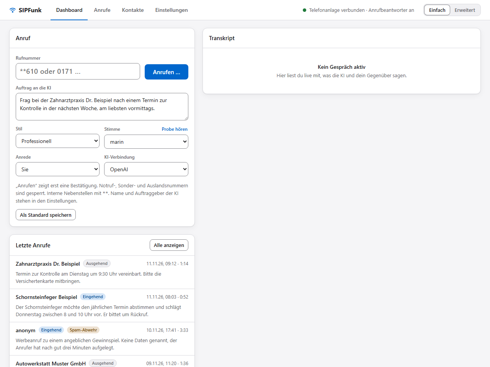
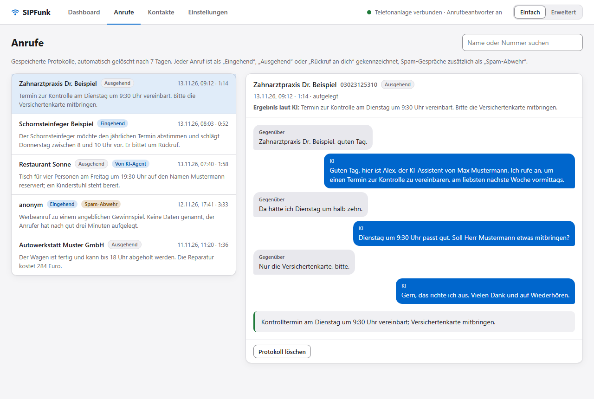

# SIPFunk

[English](README.md) · **Deutsch**

SIPFunk ist ein lokaler KI-Telefonassistent. Das Programm meldet sich wie ein IP-Telefon an einer FRITZ!Box an und verbindet das Telefonaudio mit einem Live-Sprachmodell von OpenAI oder Google. Die KI kann ausgehend anrufen und einen Auftrag erledigen, eingehende Anrufe als Anrufbeantworter annehmen und dich danach benachrichtigen. Alles läuft auf dem eigenen Rechner: ein Benutzer, eine Nebenstelle, ein Gespräch gleichzeitig.



*Die Web-UI mit erfundenen Beispieldaten. Mehr Bilder im [Benutzerhandbuch](doc/user-guide.de.md).*

> **Nutzung auf eigene Verantwortung.** Die Software wird ohne Gewährleistung bereitgestellt. Wer SIPFunk betreibt, ist für jeden Anruf verantwortlich, den die KI führt oder annimmt.
>
> **Rechtliches vorher lesen.** Gespräche werden an den gewählten KI-Anbieter (OpenAI oder Google) übertragen und als Text protokolliert; die KI muss sich als KI zu erkennen geben; die optionale Spam-Abwehr kann auf diesen Hinweis verzichten, wenn du dort die KI-Kennung ausschaltest; das ist rechtlich nicht abschließend geklärt. Einordnung für Deutschland und die EU in [doc/legal.de.md](doc/legal.de.md). Das ist keine Rechtsberatung.
>
> **Zwei KI-Anbieter.** OpenAI Realtime ist der erprobte Standard. Google Gemini (Live API) steht als zweiter Anbieter zur Wahl; es ist erst in wenigen echten Telefonaten erprobt (erste Gespräche am 11.11.2026). Prüfe die Protokolle der ersten Gespräche damit genau.

## Was es kann

- **Ausgehende Anrufe mit Auftrag.** Du schreibst in normaler Sprache, was die KI erledigen soll („Frag in der Praxis nach einem Termin nächste Woche vormittags“). Ein Textmodell erstellt daraus einen Gesprächsplan, die KI arbeitet ihn ab und meldet ein Ergebnis.
- **Anrufbeantworter.** Die KI nimmt nach einer einstellbaren Klingelzahl ab, stellt sich als KI-Assistent vor und nimmt Anliegen und Rückrufwunsch auf. Je eigener Rufnummer lässt sich ein Profil anlegen (Meldung, Person oder Firma, Stil, Stimme, Auftrag, Benachrichtigungen).
- **Benachrichtigung nach dem Anruf.** Hinweis im Tray, E-Mail mit Zusammenfassung (SMTP oder OAuth für Gmail und Microsoft 365, Vorlagen anpassbar) und bei wichtigen Anrufen ein Rückruf an dich mit Bericht und Durchstellen zum Anrufer.
- **Pop-up beim Klingeln** mit einer Einschätzung der Nummer (Kontakt, eigene Spam-Liste, frühere Spam-Gespräche, auffällige Rufnummerngasse, optional Abfrage bei tellows) und Knöpfen zum sofortigen Annehmen oder Klingelnlassen.
- **Spam-Abwehr.** Werbe- und Betrugsanrufer wimmelt die KI ab oder hält sie hin, standardmäßig offen als KI. Wer die KI-Kennung ausschaltet, lässt sie als Privatperson mit eigenem Namen auftreten; das geht nur nach ausdrücklicher Bestätigung des Risikos in der Web-UI. Stimme, Tempo und Anweisungen der Rolle sind einstellbar.
- **Beschwerde-Entwurf** für die Bundesnetzagentur aus dem Protokoll eines Spam-Anrufs.
- **Kontakte und Protokolle.** Kontakte mit Notizen als Hintergrundwissen, mit ihren Telefonnummern importierbar aus Google, Microsoft (Outlook, Microsoft 365) oder einer vCard-/CSV-Datei (z. B. Apple iCloud); für Google und Microsoft registrierst du einmal eine eigene App (Handbuch, Abschnitt 11.1); je Gespräch Transkript, Zusammenfassung, Ergebnis und Kostenschätzung. Es wird kein Audio gespeichert, Protokolle werden nach einer einstellbaren Frist gelöscht.
- **Simulator.** `npm run sim` spielt Gespräche im Textmodus durch, ohne jemanden anzurufen (nur mit OpenAI).
- **MCP-Schnittstelle für KI-Agenten.** Ein Agent wie Codex, Claude Code oder Claude Desktop kann für dich telefonieren: Er startet den Anruf mit einem Auftrag, liest mit, was gesagt wird, gibt der KI am Telefon Vorgaben und holt das Ergebnis ab. Standardmäßig aus; in der Web-UI legst du fest, wen ein Agent anrufen darf, ob und wann du einen Anruf vor dem Wählen bestätigst (immer, nur bei Nummern ohne Kontakt, nie), und die Limits.

## Voraussetzungen

- **FRITZ!Box** mit der Funktion „LAN/WLAN (IP-Telefon)“. Entwickelt und getestet wurde an einer FRITZ!Box; andere SIP-Anlagen mit Registrierung über UDP und G.711 können funktionieren, sind aber ungetestet (die Profile je eigener Rufnummer brauchen den Header `P-Called-Party-ID`).
- **Node.js ab 20.12.**
- **Windows 10 oder 11** für die Tray-App. Server und Web-UI sind reines Node.js; auf anderen Systemen ungetestet.
- **API-Schlüssel für einen der beiden KI-Anbieter**: OpenAI (mit Zugriff auf die Realtime-Modelle) oder Google Gemini (aus Google AI Studio).
- Der Rechner muss laufen, solange der Anrufbeantworter Anrufe annehmen soll.

## Schnellstart

1. In der FRITZ!Box ein IP-Telefon anlegen (Telefonie → Telefoniegeräte → Gerät einrichten → Telefon → LAN/WLAN (IP-Telefon)) und Benutzername und Kennwort vergeben. Details im [Handbuch, Kapitel 3](doc/user-guide.de.md#3-fritzbox-einrichten).
2. Abhängigkeiten installieren:

   ```bash
   npm install
   ```

3. Starten – für den ersten Start ist keine Konfigurationsdatei nötig:

   ```bash
   npm start
   ```

4. <http://127.0.0.1:3865> öffnen. Solange das Nötigste fehlt, öffnet sich der **Einrichtungsassistent**: Er fragt nach den Zugangsdaten des IP-Telefons und dem Schlüssel des KI-Anbieters (OpenAI oder Google Gemini), prüft beide und legt sie in der `.env` ab. Am Ende bietet er einen Testanruf im Echo-Modus an eine interne Nebenstelle an (z. B. `**610`, meist das erste Schnurlostelefon); das kostet nichts und beweist, dass SIP und Audio funktionieren. Wer mag, kopiert stattdessen `.env.example.de` nach `.env` und füllt sie von Hand aus.

Die Windows-Firewall fragt beim ersten Start nach den UDP-Ports für SIP und RTP: für „Private Netzwerke“ zulassen.

### Windows-App (Installer, Tray, Autostart)

Ohne Node.js: `SIPFunk-<Version>-win-x64.exe` unter [Releases](https://github.com/alorbach/ai-sip-funk/releases) herunterladen und ausführen. Die Datei ist nicht signiert, Windows SmartScreen warnt deshalb („Weitere Informationen“ → „Trotzdem ausführen“). Der Installer installiert in der Vorgabe für den angemeldeten Benutzer, ohne Administratorrechte, und legt einen Eintrag im Startmenü an. SIPFunk läuft danach im Infobereich, ohne Fenster und ohne Konsole; Doppelklick auf das Symbol öffnet die Web-UI, beim ersten Start mit dem Einrichtungsassistenten.

Nach der Installation startet SIPFunk nach der Windows-Anmeldung von selbst. Aus- und einschalten: Tray-Menü, „Beim Anmelden starten“. Konfiguration und Daten liegen unter `%APPDATA%\SIPFunk`; sie bleiben bei Updates (den neueren Installer über die alte Fassung laufen lassen) und auch bei der Deinstallation erhalten. Die portable ZIP-Datei (`SIPFunk-<Version>-win-x64.zip`) läuft ohne Installation und richtet den Autostart nicht von selbst ein.

Aus dem Repository startet dieselbe Tray-App mit:

```bash
npm run tray
```

`npm run dist:win` baut Installer und portable ZIP-Datei selbst (Ergebnis in `release/`).

## Konfiguration

- **`.env`**: Zugangsdaten (SIP, Schlüssel der KI-Verbindungen), Ports und Startwerte. Alle Variablen stehen kommentiert in [.env.example.de](.env.example.de) (englisch: [.env.example](.env.example)). Der Einrichtungsassistent schreibt die SIP-Zugangsdaten und den Schlüssel des KI-Anbieters dorthin und übernimmt sie sofort; Änderungen von Hand brauchen einen Neustart.
- **Web-UI, Seite „Einstellungen“**: alles Übrige (KI-Assistent, KI-Verbindungen, Anrufbeantworter, Benachrichtigungen, E-Mail-Versand, Spam-Abwehr, Technik); die Abschnittsliste links arbeitet wie Reiter und zeigt jeweils einen Abschnitt. Unter „KI-Verbindungen“ verwaltest du benannte Zugänge zu den KI-Anbietern, jeweils mit Anbieter (OpenAI oder Google Gemini), eigenem Schlüssel, Sprach- und Textmodell und Standardstimme. „OpenAI“ und „Google Gemini“ gibt es von Anfang an; du kannst weitere anlegen (zum Beispiel ein zweites Konto oder ein günstigeres Modell) und dort oder auf dem Dashboard zwischen ihnen umschalten. Die Karte ist eine Liste zum Aufklappen: Ein Klick auf eine Verbindung zeigt ihre Einstellungen. Die aktive Verbindung übernimmt das Gespräch, den Gesprächsplan, die Zusammenfassung, die Einschätzung, den Beschwerde-Entwurf und die Hörproben; Änderungen an Verbindungen gelten sofort. Alles Übrige speicherst du mit „Speichern“ in `settings.json`; diese Werte überschreiben die Startwerte aus der `.env` und gelten ab dem nächsten Anruf. Der Schalter „Einfach / Erweitert“ im Kopf bestimmt, wie viel davon zu sehen ist; „Einfach“ ist der Standard. Die Oberfläche gibt es auf Deutsch und Englisch („Sprache“ auf der Seite „Einstellungen“; standardmäßig nach der Sprache des Browsers). Die KI selbst spricht am Telefon Deutsch.

`.env`, `settings.json`, `contacts.json`, `transcripts/`, `mail-token.json` und Logdateien enthalten Zugangsdaten oder personenbezogene Daten. Sie stehen in der `.gitignore`, ebenso der Monatszähler `usage.json`, und gehören in kein Repository, kein Ticket und keinen Screenshot.

## Bedienung in Kürze



Die Web-UI hat vier Seiten:

- **Dashboard**: Anruf starten (Rufnummer oder Kontakt, Auftrag, Stil, Stimme, Anrede, KI-Verbindung), Transkript des laufenden Gesprächs, Protokoll des Servers. „Anrufen …“ zeigt immer erst eine Bestätigung.
- **Anrufe**: gespeicherte Gespräche mit Transkript, Zusammenfassung, Ergebnis und Kosten.
- **Kontakte**: Namen, Nummern, Vorgaben und Notizen; „Kontakte importieren“ übernimmt sie aus einem Adressbuch.
- **Einstellungen**: siehe oben.

Solange ein Gespräch läuft, zeigt die Kopfzeile Phase, Gegenüber und Dauer sowie „Mithören“ und „Auflegen“.

Ohne Telefon lässt sich das Gesprächsverhalten mit dem Simulator prüfen (er läuft nur mit OpenAI):

```bash
npm run sim
```

KI-Agenten erreichen SIPFunk über den eingebauten MCP-Server, direkt über HTTP unter `http://127.0.0.1:3865/mcp` oder als stdio-Prozess (`npm run mcp`; aus der installierten App mit der Konfiguration, die die Web-UI anzeigt). Die Schnittstelle ist aus, bis du sie unter „Einstellungen › MCP-Schnittstelle“ einschaltest; auf derselben Karte trägt sich SIPFunk auf Klick selbst bei Claude Code, Claude Desktop, Codex, Cursor, Gemini CLI und GitHub Copilot CLI ein (mit Sicherungskopie, andere Einträge bleiben) und zeigt für alle anderen die fertige Konfiguration zum Kopieren. Der Port (Standard 3865) ist unter „Einstellungen › Technik“ einstellbar; ist er belegt, weicht SIPFunk auf den nächsten freien aus und speichert ihn. Einrichtung, alle Tools und ein durchgespieltes Beispiel („Tisch reservieren“): [Handbuch, Kapitel 13](doc/user-guide.de.md#13-mcp-schnittstelle). Ein Beispiel-Skill für Agenten liegt unter [`examples/skills/sipfunk-anruf`](examples/skills/sipfunk-anruf/SKILL.md).

## Kosten

Beide Anbieter rechnen nach Token ab; ein Abo bei ChatGPT deckt die OpenAI-API nicht ab. Die Web-UI zeigt je Gespräch den Verbrauch und eine Schätzung in US-Dollar (Preistabelle in `src/ai/pricing.ts`, muss bei Preisänderungen angepasst werden) und unter „Einstellungen › KI-Verbindungen“ Gespräche, Minuten und geschätzte Kosten des laufenden Monats je Anbieter. Zusammenfassung, Einschätzung und Gesprächsplan fallen kaum ins Gewicht. Setze bei deinem Anbieter ein Budget-Limit. Dazu kommen die Telefonkosten deines Anschlusses.

Bei Gemini rechnet die Schätzung immer mit den Preisen der bezahlten Stufe. Google bietet für die Gemini API ein kostenloses Kontingent an, schränkt es in seinen Bedingungen aber für Nutzer im EWR, in der Schweiz und im Vereinigten Königreich ein; lies [doc/legal.de.md](doc/legal.de.md) (Abschnitt 3.5), bevor du dich darauf verlässt.

Hinweis des Autors: SIPFunk ist ein guter Verwendungszweck für vorhandenes OpenAI-API-Guthaben, zum Beispiel solches, das man im Zusammenhang mit Codex erhalten hat. Ob und in welcher Höhe es solches Guthaben gibt, hängt von OpenAI und vom eigenen Konto ab.

## Grenzen

- Google Gemini ist erst in wenigen echten Telefonaten erprobt (erste Gespräche am 11.11.2026); OpenAI bleibt der erprobte Standard. Prüfe die Protokolle der ersten Gespräche mit Gemini genau.
- Mit Gemini dauert ein Gespräch höchstens neun Minuten, die Sprechgeschwindigkeit lässt sich nicht einstellen, ein spät fertiger Gesprächsplan und der Wechsel in die Spam-Abwehr erreichen die KI nur als nachgereichte Anweisung (schwächer als bei OpenAI), das Zu-Ende-Sprechen nach einem bloßen „Mhm“ klappt seltener, und der Simulator steht nicht zur Verfügung. Einzelheiten im [Handbuch, Abschnitt 6.2](doc/user-guide.de.md#62-ki-verbindungen).
- Ein Gespräch gleichzeitig; während eines Gesprächs ist die Nebenstelle besetzt.
- Deutsch: Web-UI, Anweisungen an die KI und Rufnummernregeln sind auf Deutschland ausgelegt. Notruf, Sonder-, Mehrwert- und Auslandsnummern sind gesperrt.
- Keine Tastentöne (DTMF), also keine Sprachmenüs; keine Übernahme des Gesprächs per Mikrofon.
- SIP über UDP ohne Verschlüsselung, gedacht für das eigene LAN.
- Die Web-UI ist nur an `127.0.0.1` gebunden und hat keine Anmeldung. Nicht ins Netz freigeben.
- Sprachmodelle machen Fehler: Die KI kann sich verhören, etwas Falsches zusagen oder einen Anruf falsch einschätzen. Protokolle prüfen.

## Bestimmungsgemäße Nutzung und Haftung

SIPFunk ist ein privates, nichtkommerzielles Projekt einer Einzelperson: kein Produkt, kein Support, keine Verbindung zu einem Arbeitgeber. Es ist für den Eigenbetrieb an einem eigenen Anschluss gedacht. Wer es betreibt, ist für jeden Anruf verantwortlich, den die KI führt oder annimmt. Im Normalbetrieb stellt sich die KI als KI vor; Audio und Text gehen zur Verarbeitung an den gewählten KI-Anbieter (OpenAI oder Google); gespeichert werden nur Textprotokolle (Standard 7 Tage), kein Audio. Die Spam-Abwehr ist standardmäßig aus und gibt sich ebenfalls als KI zu erkennen; ohne KI-Kennung ist sie nur nach ausdrücklicher Bestätigung nutzbar. Die Software wird ohne Gewährleistung bereitgestellt, die Nutzung geschieht auf eigene Verantwortung; zwingende gesetzliche Pflichten und Haftungsregeln bleiben davon unberührt. Einzelheiten: [Richtlinien](doc/guidelines.de.md) und [Rechtliches](doc/legal.de.md).

FRITZ!Box ist eine Marke der AVM GmbH, OpenAI eine Marke von OpenAI, Google und Gemini sind Marken der Google LLC. Alle genannten Marken gehören ihren jeweiligen Inhabern. SIPFunk ist ein unabhängiges Projekt und steht in keiner Verbindung zu diesen Unternehmen; es wird von ihnen weder unterstützt noch empfohlen.

## Dokumentation

- [Benutzerhandbuch](doc/user-guide.de.md): Einrichtung, alle Funktionen und Einstellungen, Fehlersuche.
- [Richtlinien für den Einsatz](doc/guidelines.de.md): wofür SIPFunk gedacht ist und wofür nicht.
- [Rechtliche Aspekte](doc/legal.de.md): KI-Verordnung, Datenschutz, Telefonwerbung, Risiken der Spam-Abwehr.
- [Architektur](doc/architecture.de.md): Aufbau, Gesprächsablauf, Entwurfsentscheidungen.
- [Manuelle Testliste](doc/test-checklist.de.md): was sich nur am echten Anschluss prüfen lässt.
- [Mitarbeit](CONTRIBUTING.de.md), [Sicherheit](SECURITY.de.md) und [Änderungen](CHANGELOG.de.md).

Alle Dokumente gibt es auch auf Englisch, siehe [README.md](README.md). Die Software selbst (Web-UI, Anweisungen an die KI) ist deutsch.

## Entwicklung

```bash
npm run typecheck
```

```bash
npm test
```

Die Tests laufen offline gegen eine simulierte Telefonanlage auf localhost; sie rufen niemanden an und brauchen keinen API-Schlüssel.

## Lizenz

Copyright (C) 2026 alorbach

SIPFunk ist freie Software: Du darfst sie unter den Bedingungen der GNU Affero General Public License, Version 3 oder (nach deiner Wahl) jeder späteren Version, weitergeben und verändern. Wer eine veränderte Fassung weitergibt oder anderen als Dienst über ein Netz anbietet, muss auch deren Quelltext unter derselben Lizenz offenlegen.

Die Software wird in der Hoffnung bereitgestellt, dass sie nützlich ist, aber **ohne jede Gewährleistung**, auch ohne die stillschweigende Gewährleistung der Marktgängigkeit oder der Eignung für einen bestimmten Zweck. Maßgeblich ist der englische Lizenztext in [LICENSE](LICENSE).
