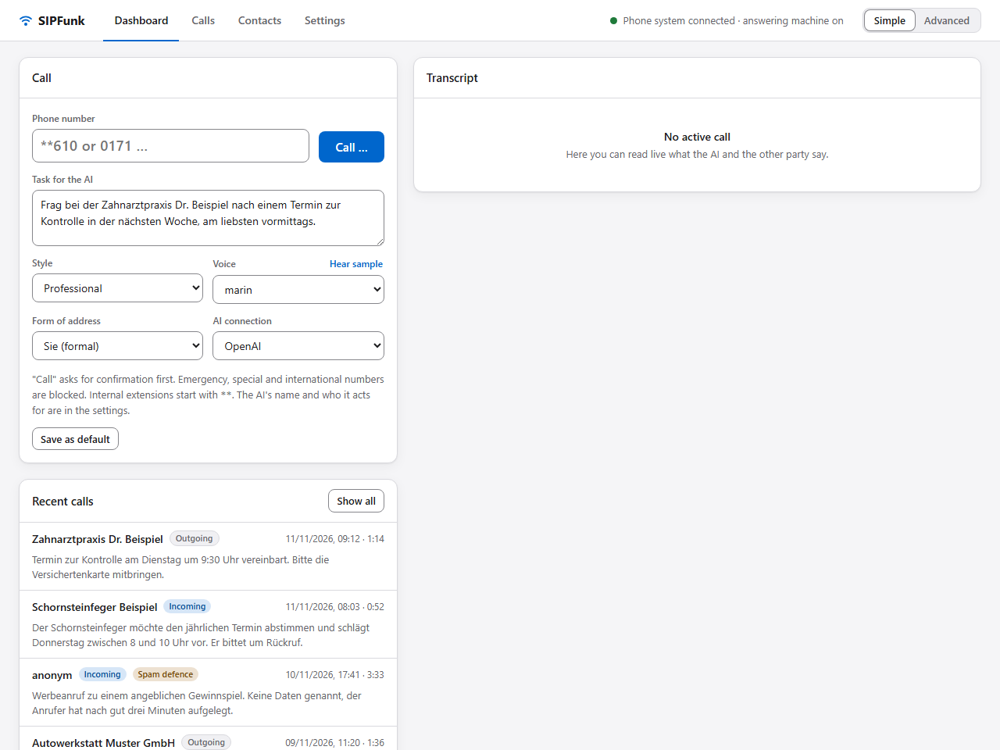
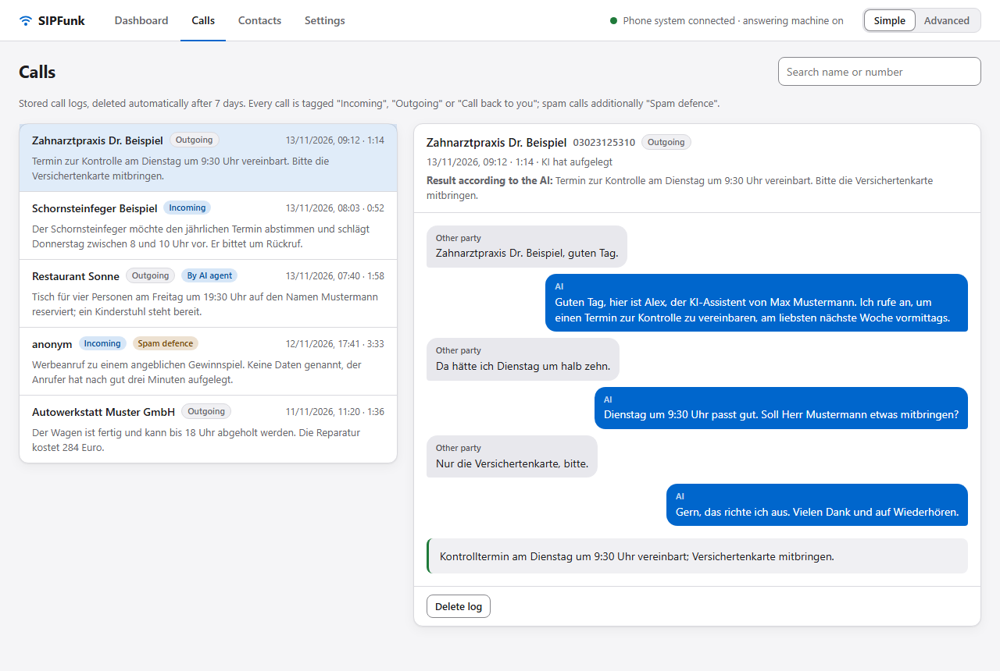

# SIPFunk

**English** · [Deutsch](README.de.md)

SIPFunk is a local AI phone assistant. It registers with a FRITZ!Box like an IP phone and connects the call audio to a live speech model from OpenAI or Google. The AI can place outgoing calls and carry out a task, answer incoming calls as an answering machine, and notify you afterwards. Everything runs on your own computer: one user, one extension, one call at a time.

> **The software speaks German.** The web UI, the instructions given to the AI and the dialling rules are German and built for Germany. This documentation is available in English and German; quoted UI labels are the German ones you will see on screen.
>


*The web UI with made-up example data. More images in the [user guide](doc/user-guide.md).*

> **Use at your own risk.** The software comes with no warranty. Whoever runs SIPFunk is responsible for every call the AI places or answers.
>
> **Read the legal notes first.** Calls are sent to the selected AI provider (OpenAI or Google) and logged as text; the AI has to identify itself as an AI; the optional spam defence can omit that notice if you switch AI disclosure off there; that is legally unsettled. See [doc/legal.md](doc/legal.md) for an overview covering Germany and the EU. This is not legal advice.
>
> **Two AI providers.** OpenAI Realtime is the tested default. Google Gemini (Live API) is available as a second provider; so far it has been tried on only a few real phone calls (first calls on 11 November 2026). Check the logs of your first calls with it carefully.

## What it does

- **Outgoing calls with a task.** You describe in plain language what the AI should do ("Ask the dentist's office for an appointment next week, mornings"). A text model turns this into a call plan, the AI works through it and reports a result.
- **Answering machine.** The AI picks up after a configurable number of rings, introduces itself as an AI assistant and takes down the caller's request and whether they want a call back. You can set up a profile per own phone number (greeting, person or company, style, voice, task, notifications).
- **Notification after the call.** Tray notification, e-mail with a summary (SMTP, or OAuth for Gmail and Microsoft 365, with editable templates) and, for important calls, a call back to you with a report and the option to be put through to the caller.
- **Pop-up while ringing** with an assessment of the number (contact, your own spam list, earlier spam calls, conspicuous number range, optional lookup at tellows) and buttons to answer immediately or let it ring.
- **Spam defence.** The AI brushes off advertising and scam callers or keeps them busy, openly as an AI by default. If you switch AI disclosure off, it acts as a private person with a name of its own; that is only possible after you have explicitly confirmed the risk in the web UI. Voice, pace and instructions of the role are configurable.
- **Complaint draft** for the German Federal Network Agency (Bundesnetzagentur) from the log of a spam call.
- **Contacts and call logs.** Contacts with notes as background knowledge; per call a transcript, summary, result and cost estimate. No audio is stored, logs are deleted after a configurable period.
- **Simulator.** `npm run sim` plays through conversations in text mode without calling anyone (OpenAI only).
- **MCP interface for AI agents.** An agent such as Codex, Claude Code or Claude Desktop can make a call for you: it starts the call with a task, reads along what is said, gives the AI on the phone directions, and fetches the result. Off by default; in the web UI you set whom an agent may call, whether and when you confirm a call before it is dialled (always, only for numbers without a contact, never), and the limits.

## Requirements

- **FRITZ!Box** with the "LAN/WLAN (IP-Telefon)" feature. SIPFunk was developed and tested against a FRITZ!Box; other SIP systems with registration over UDP and G.711 may work but are untested (the per-number profiles need the `P-Called-Party-ID` header).
- **Node.js 20.12 or later.**
- **Windows 10 or 11** for the tray app. Server and web UI are plain Node.js; untested on other systems.
- **API key for one of the two AI providers**: OpenAI (with access to the Realtime models) or Google Gemini (from Google AI Studio).
- The computer has to be running for as long as the answering machine should take calls.

## Quick start

1. Create an IP phone in the FRITZ!Box (Telefonie → Telefoniegeräte → Gerät einrichten → Telefon → LAN/WLAN (IP-Telefon)) and assign a user name and password. Details in the [user guide, chapter 3](doc/user-guide.md#3-setting-up-the-fritzbox).
2. Install dependencies:

   ```bash
   npm install
   ```

3. Start – no configuration file is needed for the first start:

   ```bash
   npm start
   ```

4. Open <http://127.0.0.1:8080>. As long as the essentials are missing, the **setup assistant** opens: it asks for the credentials of the IP phone and the key of the AI provider (OpenAI or Google Gemini), checks both and stores them in `.env`. At the end it offers a test call in echo mode to an internal extension (e.g. `**610`, usually the first cordless phone); this costs nothing and proves that SIP and audio work. If you prefer, copy `.env.example` to `.env` and fill it in by hand instead (German comments: `.env.example.de`).

On first start the Windows firewall asks about the UDP ports for SIP and RTP: allow them for private networks.

### Windows app (installer, tray, autostart)

Without Node.js: download `SIPFunk-<version>-win-x64.exe` from [Releases](https://github.com/alorbach/ai-sip-funk/releases) and run it. The file is not code-signed, so Windows SmartScreen warns ("More info" → "Run anyway"). By default the installer installs for the current user, without administrator rights, and adds a Start menu entry. SIPFunk then runs in the notification area, without a window or console; double-clicking the icon opens the web UI, on first start with the setup assistant.

After installation SIPFunk starts by itself after you sign in to Windows. Switch this off or on in the tray menu ("Beim Anmelden starten", start at login). Configuration and data live under `%APPDATA%\SIPFunk`; they survive updates (run the newer installer over the old one) and are kept when you uninstall. The portable ZIP (`SIPFunk-<version>-win-x64.zip`) runs without installation and does not set up autostart by itself.

From the repository the same tray app starts with:

```bash
npm run tray
```

`npm run dist:win` builds the installer and the portable ZIP yourself (output in `release/`).

## Configuration

- **`.env`**: credentials (SIP, keys of the AI connections), ports and initial values. All variables are listed with comments in [.env.example](.env.example). The setup assistant writes the SIP credentials and the key of the AI provider there and applies them immediately; changes made by hand require a restart.
- **Web UI, page "Einstellungen" (settings)**: everything else (AI assistant, AI connections, answering machine, notifications, e-mail, spam defence, technical values); the section list on the left works like tabs and shows one section at a time. Under "KI-Verbindungen" (AI connections) you manage named accesses to the AI providers, each with its provider (OpenAI or Google Gemini), its own key, its voice and text model and its default voice. "OpenAI" and "Google Gemini" exist from the start, and you can add more (for example a second account or a cheaper model) and switch between them there or on the dashboard. The card is an expandable list: a click on a connection shows its settings. The active connection handles the call, the call plan, the summary, the assessment, the complaint draft and the voice samples; changes to connections apply immediately. Everything else is saved to `settings.json` with "Speichern"; these values override the initial values from `.env` and apply from the next call. The switch "Einfach / Erweitert" (simple / advanced) in the header decides how much of it is shown; "Einfach" is the default. The interface is available in German and English ("Sprache" on the settings page; by default it follows the browser language). The AI itself speaks German on the phone.

`.env`, `settings.json`, `contacts.json`, `transcripts/`, `mail-token.json` and log files contain credentials or personal data. They are listed in `.gitignore`, as is the monthly usage counter `usage.json`, and do not belong in any repository, ticket or screenshot.

## Usage in brief



The web UI has four pages:

- **Dashboard**: start a call (number or contact, task, style, voice, form of address, AI connection), transcript of the running call, server log. "Anrufen …" (call) always shows a confirmation first.
- **Anrufe** (calls): stored calls with transcript, summary, result and cost.
- **Kontakte** (contacts): names, numbers, defaults and notes.
- **Einstellungen** (settings): see above.

While a call is running, the header shows its phase, the other party and the duration, plus "Mithören" (listen in) and "Auflegen" (hang up).

The simulator lets you check conversation behaviour without a phone (it works with OpenAI only):

```bash
npm run sim
```

AI agents reach SIPFunk through its MCP server, directly over HTTP on `http://127.0.0.1:8080/mcp` or as a stdio process (`npm run mcp`, or the installed `SIPFunk.exe`). The interface is off until you switch it on under "Einstellungen › MCP-Schnittstelle"; the same card shows the ready-made configuration for Codex, Claude Code and Claude Desktop. Setup, all tools and a worked example ("book a table"): [user guide, chapter 13](doc/user-guide.md#13-mcp-interface). An example skill for agents is in [`examples/skills/sipfunk-call`](examples/skills/sipfunk-call/SKILL.md).

## Cost

Both providers bill by token; a ChatGPT subscription does not cover the OpenAI API. The web UI shows usage and an estimate in US dollars per call (price table in `src/ai/pricing.ts`, which has to be updated when prices change), and under "Einstellungen › KI-Verbindungen" the calls, minutes and estimated cost of the current month per provider. Summary, assessment and call plan are negligible. Set a budget limit at your provider. Your line's call charges come on top.

For Gemini the estimate always uses the prices of the paid tier. Google offers a free quota for the Gemini API, but its terms restrict the free tier for users in the EEA, Switzerland and the UK; read [doc/legal.md](doc/legal.md) (section 3.5) before relying on it.

A note from the author: SIPFunk is a good use for existing OpenAI API credit, for example credit you received in connection with Codex. Whether you get such credit, and how much, depends on OpenAI and on your account.

## Limitations

- Google Gemini has so far been tried on only a few real phone calls (first calls on 11 November 2026); OpenAI remains the tested default. Check the logs of your first calls with Gemini carefully.
- With Gemini a call lasts nine minutes at most, the speaking rate cannot be set, a late call plan and the switch into spam defence reach the AI only as follow-up instructions (weaker than with OpenAI), finishing a sentence after a mere "mhm" works less often, and the simulator is not available. Details in the [user guide, section 6.2](doc/user-guide.md#62-ai-connections).
- One call at a time; during a call the extension is busy.
- German: web UI, AI instructions and dialling rules are built for Germany. Emergency, special, premium-rate and international numbers are blocked.
- No touch tones (DTMF), hence no phone menus; no taking over the call by microphone.
- SIP over UDP without encryption, intended for your own LAN.
- The web UI is bound to `127.0.0.1` only and has no login. Do not expose it to a network.
- Speech models make mistakes: the AI can mishear, promise something wrong or misjudge a call. Check the logs.

## Intended use and liability

SIPFunk is a private, non-commercial project by an individual: not a product, no support, no connection to an employer. It is meant to be run by you on your own phone line. Whoever runs it is responsible for every call the AI places or answers. In normal operation the AI introduces itself as an AI; audio and text are sent to the selected AI provider (OpenAI or Google) for processing; only text logs are stored (7 days by default), no audio. The spam defence is off by default and identifies itself as an AI as well; without AI disclosure it can only be used after explicit confirmation. The software comes with no warranty and is used at your own risk; mandatory statutory duties and liability rules remain unaffected. Details: [guidelines](doc/guidelines.md) and [legal aspects](doc/legal.md).

FRITZ!Box is a trademark of AVM GmbH, OpenAI is a trademark of OpenAI, Google and Gemini are trademarks of Google LLC. All trademarks mentioned belong to their respective owners. SIPFunk is an independent project and is not affiliated with, endorsed by or sponsored by these companies.

## Documentation

| | English | Deutsch |
| --- | --- | --- |
| Setup, all features and settings, troubleshooting | [User guide](doc/user-guide.md) | [Benutzerhandbuch](doc/user-guide.de.md) |
| What SIPFunk is meant for and what not | [Usage guidelines](doc/guidelines.md) | [Richtlinien](doc/guidelines.de.md) |
| AI Act, data protection, telephone advertising, risks of the spam defence | [Legal aspects](doc/legal.md) | [Rechtliches](doc/legal.de.md) |
| Structure, call flow, design decisions | [Architecture](doc/architecture.md) | [Architektur](doc/architecture.de.md) |
| What can only be checked on a real line | [Manual test checklist](doc/test-checklist.md) | [Testliste](doc/test-checklist.de.md) |
| Contributing | [CONTRIBUTING.md](CONTRIBUTING.md) | [CONTRIBUTING.de.md](CONTRIBUTING.de.md) |
| Security | [SECURITY.md](SECURITY.md) | [SECURITY.de.md](SECURITY.de.md) |
| Changes per version | [CHANGELOG.md](CHANGELOG.md) | [CHANGELOG.de.md](CHANGELOG.de.md) |

## Development

```bash
npm run typecheck
```

```bash
npm test
```

The tests run offline against a simulated phone system on localhost; they call no one and need no API key.

## License

Copyright (C) 2026 alorbach

SIPFunk is free software: you can redistribute it and/or modify it under the terms of the GNU Affero General Public License as published by the Free Software Foundation, either version 3 of the License, or (at your option) any later version. Anyone who distributes a modified version, or offers one to others as a service over a network, has to make its source code available under the same license.

SIPFunk is distributed in the hope that it will be useful, but **without any warranty**; without even the implied warranty of merchantability or fitness for a particular purpose. See the GNU Affero General Public License in [LICENSE](LICENSE) for more details.
