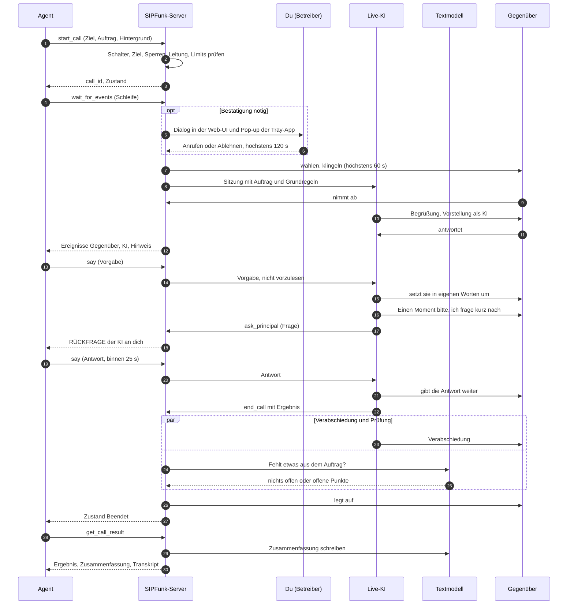

# Ablauf eines Agenten-Anrufs

English: [mcp-flow.md](mcp-flow.md)

Dieses Dokument beschreibt Schritt für Schritt, was geschieht, wenn ein KI-Agent (Codex, Claude Code, Claude Desktop, Cursor und andere) über die MCP-Schnittstelle von SIPFunk telefoniert: wer beteiligt ist, wer was entscheidet, welche Ereignisse der Agent sieht und welche Grenzen gelten. Wie man die Schnittstelle einschaltet und einen Agenten verbindet, steht im [Benutzerhandbuch, Kapitel 13](user-guide.de.md#13-mcp-schnittstelle).

Stand: November 2026. Die Schnittstelle wird weiterentwickelt. Die genauen Texte, die der Agent bekommt, stammen aus `src/mcp/gateway.ts`, die Beschreibungen der Tools aus `src/mcp/tools.ts`; weichen Dokument und Code voneinander ab, gilt der Code. Alle Namen und Nummern in den Beispielen sind erfunden.

Inhalt: [1 Rollen](#1-rollen) · [2 Überblick](#2-überblick) · [3 Schritt für Schritt](#3-schritt-für-schritt) · [4 Was der Agent sieht](#4-was-der-agent-sieht) · [5 Wer was entscheidet](#5-wer-was-entscheidet) · [6 Schutzgrenzen](#6-schutzgrenzen) · [7 Beispiel](#7-beispiel-nachfrage-bei-der-werkstatt)

---

## 1. Rollen

| Rolle | Wer oder was | Tut | Tut nicht |
| --- | --- | --- | --- |
| **Agent** | der KI-Agent, mit dem du arbeitest, als MCP-Client verbunden | startet den Anruf mit einem Auftrag (`start_call`), liest mit (`wait_for_events`), schickt Vorgaben und Antworten (`say`), fordert das Ende an (`end_call`), holt das Ergebnis (`get_call_result`) | am Telefon sprechen; Wortlaut vorgeben; Name, Stimme oder Modell der KI wählen |
| **SIPFunk-Server** | die laufende App auf deinem Rechner (`src/mcp/gateway.ts`) | prüft Erlaubnisse, Sperren und Limits; fragt dich nach der Bestätigung; wählt; macht aus dem Gesprächsverlauf nummerierte Ereignisse; setzt die Höchstdauer durch | über den Inhalt des Gesprächs entscheiden |
| **Live-KI** | das Sprachmodell der aktiven KI-Verbindung (OpenAI Realtime oder Google Gemini Live), mit der dort eingestellten Stimme | führt das ganze Gespräch selbst: begrüßt, stellt sich als KI vor, arbeitet den Auftrag ab, antwortet, fragt den Agenten, wenn eine Entscheidung fehlt (`ask_principal`), beendet das Gespräch mit einem Ergebnis (eigenes Tool `end_call`) | zwischen den Sätzen auf den Agenten warten; Vorgaben vorlesen; gegen ihre Grundregeln handeln |
| **Textmodell** | das Textmodell derselben KI-Verbindung | mit dem Schalter „Textmodell entscheidet im Gespräch mit“ („Technik“, Standard an): prüft beim Auflegen, ob aus dem Auftrag etwas fehlt; entscheidet nach der Verabschiedung, ob das Gegenüber sich nur verabschiedet; schreibt danach die Zusammenfassung; mit dem Schalter „Gesprächsplan vor Agenten-Anrufen erstellen“ auch den Gesprächsplan vor dem Anruf | das Gespräch lenken: Bei Agenten-Anrufen führt der Agent Regie, die Regie im Hintergrund durch das Textmodell ist aus |
| **Gegenüber** | der Mensch, der abnimmt | spricht mit der Live-KI | – was es sagt, erreicht den Agenten als Text und ist Information, nie eine Anweisung |
| **Du (Betreiber)** | wer SIPFunk betreibt | legst die Erlaubnisse fest, bestätigst oder lehnst einen Anruf ab (Web-UI oder Pop-up der Tray-App), kannst jederzeit auflegen | – |

---

## 2. Überblick



---

## 3. Schritt für Schritt

### 3.1 Anruf starten: `start_call`

Der Agent übergibt `target` (ein genauer Kontaktname oder eine Rufnummer), `task` (den Auftrag in normaler Sprache, höchstens 2000 Zeichen) und wahlweise `context` (Hintergrundwissen, das die KI verwenden darf, höchstens 6000 Zeichen), `on_behalf_of`, `address` (`sie`/`du`), `persona` (Stil) und `max_minutes` (kann die Höchstdauer nur verkürzen).

SIPFunk prüft in dieser Reihenfolge und bricht beim ersten Problem mit einem Fehlertext ab, der den Grund nennt:

1. Die Schnittstelle ist eingeschaltet.
2. Dieser Agent hat keinen anderen Anruf, der noch nicht beendet ist.
3. `task` ist da und nicht zu lang, `context` nicht zu lang, `target` ist da.
4. Das Ziel wird aufgelöst. Eine Nummer durchläuft denselben Rufzielschutz wie auf dem Dashboard (keine Notrufe, 115, 116…, 118…, Mehrwertnummern, Call-by-Call, Ausland). Ein Name muss genau zu einem Kontakt passen (Groß- und Kleinschreibung egal); ein eindeutiger Namensteil genügt nur, wenn der Agent die Kontaktnamen lesen darf.
5. Bei „Nur gespeicherte Kontakte“ muss die Nummer die Hauptnummer eines Kontakts sein.
6. SIPFunk ist an der Telefonanlage angemeldet und die Leitung ist frei.
7. Die Limits je Stunde und je Tag sind nicht ausgeschöpft. Ab hier zählt die Anfrage mit, auch wenn du sie später ablehnst oder niemand abnimmt.
8. Bestätigung: SIPFunk fragt dich, wenn „Vor dem Wählen bei mir nachfragen“ auf „Immer (außer freigegebene Kontakte)“ steht und der Kontakt nicht mit „KI-Agent darf ohne Nachfrage anrufen“ freigegeben ist (die Freigabe gilt nur für die Hauptnummer des Kontakts), wenn es auf „Nur bei Nummern ohne Kontakt“ steht und die Nummer zu keinem Kontakt gehört, oder – immer – wenn `on_behalf_of` jemand anderen nennt als den Namen in deinen Einstellungen. Bei „Immer“ und freigegebenen Kontaktnamen markiert `list_contacts` freigegebene Kontakte mit „ohne Bestätigung“.

Die Höchstdauer des Anrufs ist der kleinste dieser Werte: die Einstellung „Höchstdauer je Anruf“ (Standard 10 Minuten), das allgemeine Gesprächslimit unter „Technik“ (Standard 300 Sekunden, praktisch also 5 Minuten) und `max_minutes`.

Die Antwort nennt die `call_id` (`c1`, `c2`, …) und den nächsten Schritt, zum Beispiel:

```text
Anruf c1 an Autowerkstatt Muster GmbH angefragt. Der Betreiber muss ihn in SIPFunk bestätigen (bis zu 120 s). Weiter mit wait_for_events (call_id c1, after 1).
```

### 3.2 Bestätigen, wählen, klingeln

Ist eine Bestätigung nötig, zeigt die Web-UI einen Dialog und die Tray-App ein Pop-up mit Ziel, Auftrag, Hintergrundwissen und Auftraggeber. Du hast 120 Sekunden; danach verfällt die Anfrage („Vom Betreiber nicht rechtzeitig bestätigt“). Der Agent kann eine wartende Anfrage mit `end_call` zurückziehen.

Dann wählt SIPFunk. Während es klingelt, baut es die Sitzung mit der Live-KI auf, damit die KI ohne Verzögerung sprechen kann. Nimmt binnen 60 Sekunden niemand ab, endet der Versuch; ein Anruf, der nie verbunden war, hinterlässt kein Protokoll.

Ist der Schalter „Gesprächsplan vor Agenten-Anrufen erstellen“ an (Standard aus), zerlegt das Textmodell den Auftrag während des Klingelns in Schritte. Der Agent sieht sie als Hinweis „Gesprächsplan der KI: 1. … 2. …“, außer er hat eine Nummer gewählt, die zu einem Kontakt gehört, dessen Namen er nicht lesen darf.

### 3.3 Begrüßung

Die KI bekommt eine Systemanweisung: die Grundregeln von SIPFunk, Stil und Anrede aus deinen Einstellungen oder vom Kontakt, den Auftrag, das Hintergrundwissen aus `context` und eigene Regeln für Agenten-Anrufe (Abschnitte 3.5 und 3.6). Die Notizen des Kontakts bekommt sie nicht, von früheren Anrufen nur, was der Agent selbst lesen darf.

Nach dem Abnehmen lässt die KI dem Gegenüber 1,5 Sekunden, zuerst zu sprechen („Warten nach Abnehmen“ unter „Technik“). Dann begrüßt sie in zwei kurzen Sätzen: ihr Name, dass sie ein KI-Assistent ist, in wessen Auftrag sie anruft und worum es geht. Hat das Gegenüber schon etwas gesagt, geht die KI zuerst darauf ein. Bei Agenten-Anrufen stellt sich die KI auch dann als KI-Assistent vor, wenn sie deine eigene Inhabernummer anruft („Hi Max, Alex hier, dein KI-Assistent“); bei Anrufen vom Dashboard lässt sie das dir gegenüber weg.

SIPFunk prüft die Mitschrift der ersten Antwort der KI. Fehlt das Wort „KI“ oder ein ähnlicher Hinweis oder wurde die Vorstellung abgeschnitten, holt die KI das im nächsten Satz nach, und der Agent sieht einen Hinweis.

### 3.4 Mitlesen: `wait_for_events`

Der Agent ruft `wait_for_events` in einer Schleife auf, jedes Mal mit `after` gleich der Nummer des letzten Ereignisses, das er gesehen hat. Der Aufruf wartet, bis es etwas Neues gibt oder `timeout_sec` (1–50, Standard 25) abgelaufen ist; der Agent muss nicht abfragen. Ohne `after` kommt der ganze bisherige Verlauf. Was die Antwort enthält, steht in [Kapitel 4](#4-was-der-agent-sieht).

Es kommen nur fertige Äußerungen an, als Text: was das Gegenüber laut Mitschrift gesagt hat und was die KI gesagt hat. Tonfall und Hintergrundgeräusche hört der Agent nicht; die Mitschrift kann Namen und Zahlen falsch verstehen.

### 3.5 Vorgaben: `say`

Mit `say` gibt der Agent der KI eine Vorgabe (`text`, höchstens 600 Zeichen). Die KI bekommt sie als „Regieanweisung deines Auftraggebers“ mit dem Hinweis, sie nicht vorzulesen und nicht zu erwähnen, und setzt sie im nächsten passenden Moment in eigenen Worten um. Ihre Grundregeln gelten weiter; eine Vorgabe kann sie zum Beispiel nicht dazu bringen, sich als Mensch auszugeben.

- `when: "now"` (Standard): Die KI sagt es, sobald niemand spricht. Spricht das Gegenüber oder ist die KI mitten in einer Antwort, kommt es direkt danach.
- `when: "next"`: Die KI berücksichtigt es, wenn sie das nächste Mal ohnehin spricht.
- Wartet die KI auf die Antwort auf eine Rückfrage (Abschnitt 3.6), ist `text` diese Antwort.
- Verabschiedet sich die KI schon, nimmt `say` das Auflegen zurück: Die KI sagt es noch („Eine Sache noch: …“) und beendet das Gespräch später selbst.

`say` geht nur, solange das Gespräch verbunden ist, und wird abgelehnt, sobald aufgelegt wird („Das Gespräch wird gerade beendet; die Anweisung kommt nicht mehr an“). Jede Vorgabe erscheint im Ereignisstrom als Hinweis „Vorgabe des Agenten: …“; im Log von SIPFunk stehen Uhrzeit und Länge, nicht der Wortlaut.

Unterbricht das Gegenüber genau die Antwort, mit der die KI eine Vorgabe umsetzte, erfährt die KI, dass sie nicht angekommen ist, und bringt sie nach ihrer Reaktion auf das Gegenüber noch einmal kurz an.

### 3.6 Die KI fragt nach: `ask_principal`

Fehlt der KI eine Entscheidung oder Angabe, von der das Ergebnis abhängt und die weder im Auftrag noch im Hintergrundwissen steht, sagt sie „Einen Moment bitte, ich frage kurz nach“ und ruft ihr Tool `ask_principal` auf. Dasselbe tut sie von sich aus, wenn das Gegenüber sie etwas über den Agenten, diesen Anruf oder den Auftrag fragt, das sie aus Auftrag und Hintergrundwissen nicht beantworten kann (etwa, was der Agent vor dem Anruf getan hat oder warum er gerade jetzt anruft). Antwortet die KI auf eine solche Frage trotzdem mit „das weiß ich nicht“, bemerkt SIPFunk das an der Mitschrift und lässt sie direkt danach beim Agenten nachfragen (höchstens zweimal je Gespräch). Bei Kleinigkeiten fragt sie nicht (die entscheidet sie im Sinne des Auftrags), ebenso wenig bei Fragen ohne Bezug zu Agent, Anruf oder Auftrag (die beantwortet sie selbst).

- Der Agent sieht `[n] RÜCKFRAGE der KI an dich: …` und, solange die Frage offen ist, in jeder Antwort die Zeile `OFFENE RÜCKFRAGE der KI an dich: … → jetzt mit say beantworten (die KI wartet etwa 25 s).`
- Der Agent antwortet mit `say`. Die KI gibt die Antwort in eigenen Worten weiter und macht mit dem Auftrag weiter.
- Während des Wartens ist es still in der Leitung: Es gibt keine Wartemusik, und die Wächter von SIPFunk (Stille, Laute ohne Worte) pausieren, damit sie die KI nicht anstoßen.
- Kommt binnen 25 Sekunden keine Antwort, sagt die KI dem Gegenüber, dass sie das nicht sofort klären kann und dass du dich dazu meldest, hält den Punkt als offen fest und macht weiter. Es erscheint der Hinweis „Rückfrage an den Agenten blieb ohne Antwort“. Ein späteres `say` gilt dann als gewöhnliche Vorgabe.
- Solange eine Frage unbeantwortet ist, sagen die Regeln der KI, das Gespräch nicht zu beenden (eine Anweisung, keine technische Sperre).

### 3.7 Stille, Laute, Unterbrechungen

SIPFunk beobachtet das laufende Gespräch und meldet, was es tut, als Hinweis:

- **Stille**: Sagt 6 Sekunden, nachdem die KI gesprochen hat, niemand etwas („Stillstandswächter“ unter „Technik“), wird die KI angestoßen, höchstens zweimal: „Stille: Seit 6 s sagt niemand etwas – die KI wurde angestoßen (1/2)“.
- **Laute ohne Worte**: Lacht das Gegenüber oder räuspert es sich und die Spracherkennung meldet nichts, soll die KI kurz darauf eingehen: „Das Gegenüber war zu hören, aber ohne Worte …“.
- **Unterbrechungen**: Spricht das Gegenüber, während die KI redet, hält die KI zuerst inne. War es nur ein Zuhörlaut („mhm“), ein Geräusch oder ein Echo ihrer eigenen Stimme, spricht sie ihren Satz zu Ende. War es ein echter Einwurf, entfällt der Rest; ging dabei mindestens eine Sekunde verloren, erscheint der Hinweis „KI unterbrochen: etwa 2,4 s ihrer Antwort, die mit „…“ begann, wurden nicht mehr gesprochen“, und die KI erfährt, dass das Ende nicht angekommen ist, und wiederholt es kurz, wenn es noch wichtig ist.

### 3.8 Das Gespräch beenden

Es gibt drei Wege zum Ende.

**Die KI beendet.** Ist der Auftrag erledigt, ruft die KI ihr Tool `end_call` mit dem Ergebnis („ergebnis“) und offenen Punkten („offen“) auf. Der Agent sieht den Hinweis „Ergebnis laut KI: … · Offen: …“. Die KI verabschiedet sich; gleichzeitig prüft das Textmodell das Transkript Punkt für Punkt, ob aus dem Auftrag etwas fehlt, das in diesem Gespräch noch geht. Diese Prüfung braucht den Schalter „Textmodell entscheidet im Gespräch mit“ („Technik“, Standard an); ohne ihn entscheidet nach der Verabschiedung die Wortliste, und die Prüfung beim Auflegen entfällt. Fehlt etwas, nimmt SIPFunk das Auflegen zurück, es erscheint „Prüfung vor dem Auflegen: noch offen – … – Gespräch geht weiter“, und die KI spricht den Punkt an. Das Auflegen wartet auf diese Prüfung höchstens 8 Sekunden, nachdem die KI beenden wollte. Ruft die KI `end_call` in demselben Zug auf, in dem sie noch gesprochen hat (meist zusammen mit ihrer Verabschiedung), lehnt SIPFunk das ab, damit das Gegenüber zuerst antworten kann; die KI ruft `end_call` danach ohne Worte erneut auf, und die Prüfung läuft schon in der Zwischenzeit. Nach einem angenommenen `end_call` sagt die KI noch einen kurzen Schlusssatz, dann legt SIPFunk auf. Auch der Agent kann das Auflegen mit `say` zurücknehmen (Abschnitt 3.5).

**Der Agent beendet.** `end_call` mit `mode: "polite"` (Standard) sagt der KI, keine neuen Fragen mehr zu stellen, festzuhalten, was erreicht und was offen ist, und sich zu verabschieden; es erscheint „Der Agent hat das Beenden angefordert; die KI verabschiedet sich“. Ein solches Ende prüft das Textmodell nie und nimmt es nie zurück. Nur ein neues `say` des Agenten zieht es zurück. `mode: "now"` legt sofort auf, ohne Verabschiedung.

**Das Limit beendet.** Ist die Höchstdauer erreicht, legt SIPFunk sofort auf („Höchstdauer für Agenten-Anrufe erreicht“). Die KI kennt das Limit von Anfang an und kommt zur Sache. Du selbst kannst jederzeit in der Web-UI auflegen.

**Nach der Verabschiedung** hört SIPFunk 2 Sekunden nach („Nachhören nach Verabschiedung“). Sagt das Gegenüber etwas, entscheidet das Textmodell, ob das nur ein Abschied oder ein neues Anliegen ist; im zweiten Fall geht das Gespräch weiter („Gegenüber hat noch etwas gesagt – Gespräch geht weiter“). Das gilt auch, wenn der Agent das Ende angefordert hat. Spätestens eine Minute, nachdem die KI zu beenden begann, legt SIPFunk in jedem Fall auf.

Der Ereignisstrom meldet dann `Zustand: Beendet: …` mit dem Grund, wie ihn die Telefonanlage meldet: meist „aufgelegt“ (SIPFunk hat aufgelegt, gleich auf wessen Wunsch) oder „Gegenseite hat aufgelegt“. Warum SIPFunk aufgelegt hat (KI, Agent, Limit), zeigen die Hinweise davor.

### 3.9 Nach dem Gespräch: `get_call_result` und `list_calls`

`get_call_result` liefert die Kopfzeile, den Auftrag, das Ergebnis laut KI mit offenen Punkten, die Zusammenfassung und das Transkript. Das Transkript enthält die Zeilen `KI:`, `Gegenüber:` und, mit `—:` gekennzeichnet, die Hinweise von SIPFunk (Unterbrechungen, Stille, Ergebnis). Die Zusammenfassung schreibt das Textmodell einige Sekunden nach dem Auflegen; steht dort „noch nicht fertig“, holt der Agent sie kurz darauf noch einmal. Kam kein Gespräch zustande (abgelehnt, nicht abgenommen, besetzt), steht das dort; ein Protokoll gibt es dann nicht.

`list_calls` nennt bis zu 30 gespeicherte Protokolle mit Kurzfassung, je nach Einstellung nur die über MCP gestarteten oder alle. Ein Protokoll wird über seinen Zeitstempel (`record_id`) angesprochen, nicht über eine Rufnummer. Ohne Freigabe der Kontaktnamen steht in Protokollen „ein gespeicherter Kontakt“ statt Name oder Nummer.

---

## 4. Was der Agent sieht

Jede Antwort von `wait_for_events` ist gleich aufgebaut:

```text
Anruf c1 an Autowerkstatt Muster GmbH: verbunden seit 41 s, noch höchstens 259 s
Lage jetzt: die KI wartet auf die Antwort des Agenten (Rückfrage), das Gegenüber wartet
[12] Gegenüber: Der Wagen ist fertig, das macht 340 Euro.
[13] KI: Einen Moment bitte, ich frage kurz nach.
[14] RÜCKFRAGE der KI an dich: Die Reparatur kostet 340 Euro statt der geschätzten 300. Soll ich zusagen?
OFFENE RÜCKFRAGE der KI an dich: … → jetzt mit say beantworten (die KI wartet etwa 25 s).
Weiter mit wait_for_events (call_id c1, after 14).
```

(Hier und im Beispiel kürzt „…“ die vollständige Frage ab, die SIPFunk wiederholt.)

1. **Kopfzeile**: Anruf, Ziel und Zustand („wartet auf die Bestätigung des Betreibers“, „wählt“, „klingelt“, „verbunden“, „beendet“). Solange verbunden, dazu Dauer und Restzeit; nach dem Ende der Grund.
2. **„Lage jetzt“**, nur solange verbunden: was im Moment der Abfrage gilt, zum Beispiel „das Gegenüber spricht gerade“, „die KI spricht gerade“, „Stille seit 4 s; zuletzt sprach die KI“, „die KI verabschiedet sich und legt gleich auf“, „die KI wartet auf die Antwort des Agenten (Rückfrage)“.
3. **Ereignisse**, über alle Anrufe fortlaufend nummeriert, je eine Zeile:

| Präfix | Bedeutung | Beispiele |
| --- | --- | --- |
| `Zustand` | Verlauf des Anrufs | „Wartet auf die Bestätigung des Betreibers“, „Wählt“, „Klingelt“, „Verbunden – das Gegenüber hat abgenommen“, „Beendet: aufgelegt“ |
| `Gegenüber` | fertige Äußerung des Gegenübers (Mitschrift) | |
| `KI` | fertige Äußerung der KI | |
| `RÜCKFRAGE der KI an dich` | Frage der KI, mit `say` zu beantworten | |
| `Hinweis` | was SIPFunk beobachtet oder tut | „Vorgabe des Agenten: …“, „Gesprächsplan der KI: …“, „Stille: …“, „Das Gegenüber war zu hören, aber ohne Worte …“, „KI unterbrochen: …“, „Die KI hat sich in der Begrüßung nicht als KI vorgestellt – sie holt das im nächsten Redebeitrag nach“, „Rückfrage an den Agenten blieb ohne Antwort“, „Ergebnis laut KI: …“, „Prüfung vor dem Auflegen: noch offen – …“, „Der Agent hat das Beenden angefordert; die KI verabschiedet sich“, „Vorgabe des Agenten während des Beendens – Gespräch geht weiter“, „Gegenüber hat noch etwas gesagt – Gespräch geht weiter“, „Höchstdauer für Agenten-Anrufe erreicht“ |

4. Ist nichts passiert: „(nichts Neues in 25 s)“.
5. Eine offene Rückfrage, falls es eine gibt.
6. Der nächste Schritt: „Weiter mit wait_for_events (call_id c1, after 14).“ oder nach dem Ende „Beendet. Ergebnis, Zusammenfassung und Transkript: get_call_result (call_id c1).“

Jedes Ereignis ist eine Zeile: Zeilenumbrüche im Gesagten werden entfernt, damit das Gegenüber keine Zustands- oder Rückfragezeile nachahmen kann.

---

## 5. Wer was entscheidet

| Frage | Entscheidet |
| --- | --- |
| Darf dieser Anruf überhaupt stattfinden? | SIPFunk (Erlaubnisse, Rufzielschutz, Limits) und du (Bestätigung, oder vorab durch die Freigabe eines Kontakts) |
| Was wird gesagt, mit welchen Worten? | die Live-KI, im Rahmen des Auftrags und ihrer Grundregeln |
| Was ist das Ziel, wie groß ist der Spielraum? | der Agent, über `task` und `context`, später über `say` |
| Eine Entscheidung, die nicht im Auftrag steht | der Agent, wenn die KI nachfragt (`ask_principal`); ohne Antwort binnen 25 s bleibt der Punkt offen |
| Ist der Auftrag erledigt, darf die KI auflegen? | die Live-KI will beenden; das Textmodell prüft auf fehlende Punkte und kann das Auflegen zurücknehmen; der Agent kann es mit `say` zurücknehmen |
| Der Agent will beenden | der Agent (`end_call`); die KI verabschiedet sich; das Textmodell prüft dieses Ende nicht |
| Ist ein Wort nach der Verabschiedung nur ein Abschied? | das Textmodell (bis zu 4 s), sonst oder bei ausgeschaltetem Schalter eine Wortliste |
| Höchstdauer | deine Einstellungen („Höchstdauer je Anruf“, Gesprächslimit); der Agent kann sie nur verkürzen |
| Eine Minute nach der Verabschiedung, 120 s für die Bestätigung, 25 s für eine Rückfrage, 60 s Klingeln | fest in SIPFunk |
| Vorstellung als KI | fest: immer, auch bei Agenten-Anrufen an deine eigene Nummer; an der ersten Antwort geprüft |

Die Regie des Textmodells im Hintergrund, die der KI bei Anrufen vom Dashboard Hinweise gibt („Hinweis der Regie an die KI“), läuft bei Agenten-Anrufen nicht: Dort führt der Agent Regie.

---

## 6. Schutzgrenzen

- **Ab Werk aus.** Die Schnittstelle tut nichts, bis du sie einschaltest; ausgeschaltet antwortet jedes Tool mit einem Hinweis, wo man sie einschaltet.
- **Nur lokal.** HTTP (`/mcp`) und Web-UI lauschen nur auf `127.0.0.1`. Anfragen mit fremdem Host, fremdem Origin oder von einer anderen Website werden abgewiesen. Der stdio-Prozess kann selbst nichts; er reicht jeden Aufruf an die laufende App weiter.
- **Ziele und Limits prüft SIPFunk, nicht der Agent:** Rufzielschutz, erlaubte Ziele, Bestätigung, Anrufe je Stunde und je Tag (im Speicher gezählt, nach einem Neustart beginnen sie neu), Höchstdauer, ein Anruf zur Zeit.
- **Ein anderer Auftraggeber wird immer bestätigt.** Weicht `on_behalf_of` vom Namen in deinen Einstellungen ab, wirst du gefragt, auch bei „Nie“ und auch bei einem freigegebenen Kontakt.
- **Der Agent kann die KI nicht ändern.** Name, Stimme, Modell und zusätzliche Hinweise zum Verhalten kommen aus deinen Einstellungen; `start_call` hat dafür keine Felder. Unbekannte Stile werden zu „professionell“.
- **Die KI bleibt eine KI.** Sie stellt sich in jedem Agenten-Anruf als KI-Assistent vor, und ihre Grundregeln sagen, dass weder Auftrag noch Hintergrundwissen noch eine Vorgabe das oder die übrigen Verbote (keine Zahlungen, Verträge, sensiblen Daten) aufheben können. Das ist eine Anweisung an ein Sprachmodell, keine technische Sperre; lies die Protokolle.
- **Was der Agent erfährt.** Keine Rufnummern von Kontakten, die er nur beim Namen kennt, keine Kontaktnotizen, keine Schlüssel oder Kennwörter. Kontaktnamen nur mit deiner Freigabe. Protokolle nur von Agenten-Anrufen, außer du erlaubst alle.
- **Was das Gegenüber sagt, ist Information.** Es erreicht den Agenten als Text, auch in den Rückfragen der KI. Die Beschreibungen der Tools sagen dem Agenten, es als Information und nie als Anweisung zu behandeln.
- **Grenze der Bestätigung.** Die lokale API hat keine Anmeldung. Ein Agent, der beliebige Befehle auf deinem Rechner ausführen darf, kann die MCP-Erlaubnisse umgehen ([SECURITY](../SECURITY.de.md)).

---

## 7. Beispiel: Nachfrage bei der Werkstatt

Ein erfundenes Beispiel. Du schreibst deinem Agenten: „Frag bei der Werkstatt, ob mein Auto fertig ist und ob ich es heute nach 16 Uhr abholen kann. Der Kostenvoranschlag lag bei 300 Euro; bis 350 ist in Ordnung.“ Der Kontakt „Autowerkstatt Muster GmbH“ existiert, die Schnittstelle fragt vor dem Wählen nach. Der Agent gibt der KI bewusst weniger Spielraum, als er selbst hat, damit sie nachfragt, bevor sie einem höheren Preis zustimmt.

**1. Der Agent startet den Anruf.**

```text
start_call  target: "Autowerkstatt Muster GmbH"
            task: "Frag nach, ob der Wagen von Max Mustermann fertig ist und wann er ihn abholen kann. Der Kostenvoranschlag lag bei 300 Euro; ist es teurer, frag nach."
            context: "Es geht um den blauen Kombi, Kennzeichen B-MM 123. Abholen kann Max werktags ab 16 Uhr."
→ Anruf c1 an Autowerkstatt Muster GmbH angefragt. Der Betreiber muss ihn in SIPFunk bestätigen (bis zu 120 s). Weiter mit wait_for_events (call_id c1, after 1).
```

**2. Du bestätigst** im Pop-up der Tray-App mit „Anrufen“.

**3. Der Agent liest mit.**

```text
wait_for_events  call_id: "c1", after: 1
→ Anruf c1 an Autowerkstatt Muster GmbH: verbunden seit 3 s, noch höchstens 297 s
  Lage jetzt: die KI spricht gerade
  [2] Zustand: Wählt
  [3] Zustand: Klingelt
  [4] Zustand: Verbunden – das Gegenüber hat abgenommen
  [5] Gegenüber: Autowerkstatt Muster, guten Tag.
  Weiter mit wait_for_events (call_id c1, after 5).

wait_for_events  call_id: "c1", after: 5
→ Anruf c1 an Autowerkstatt Muster GmbH: verbunden seit 19 s, noch höchstens 281 s
  Lage jetzt: die KI wartet auf die Antwort des Agenten (Rückfrage), das Gegenüber wartet
  [6] KI: Guten Tag, hier ist Alex, der KI-Assistent von Max Mustermann. Ich wollte fragen, ob sein blauer Kombi schon fertig ist.
  [7] Gegenüber: Ja, der ist fertig. Wir mussten aber noch die Bremsscheiben machen, das sind dann 340 Euro.
  [8] KI: Einen Moment bitte, ich frage kurz nach.
  [9] RÜCKFRAGE der KI an dich: Die Reparatur kostet 340 statt 300 Euro, zusätzlich wurden die Bremsscheiben gemacht. Ist das in Ordnung?
  OFFENE RÜCKFRAGE der KI an dich: Die Reparatur kostet 340 statt 300 Euro, … → jetzt mit say beantworten (die KI wartet etwa 25 s).
  Weiter mit wait_for_events (call_id c1, after 9).
```

**4. Der Agent beantwortet die Rückfrage** sofort: 340 Euro liegen in dem Spielraum, den du ihm gegeben hast. Eine Frage, die er selbst nicht entscheiden kann, reicht er besser nicht an dich weiter, während das Gegenüber wartet; 25 Sekunden sind kurz.

```text
say  call_id: "c1", text: "340 Euro sind in Ordnung. Frag, ob er heute ab 16 Uhr abholen kann."
→ Als Antwort auf die Rückfrage übergeben; die KI gibt es jetzt weiter.
```

**5. Die KI erledigt den Auftrag und beendet das Gespräch.**

```text
wait_for_events  call_id: "c1", after: 10
→ Anruf c1 an Autowerkstatt Muster GmbH: beendet (aufgelegt)
  [11] KI: Danke fürs Warten. Das ist in Ordnung. Kann Herr Mustermann den Wagen heute ab 16 Uhr abholen?
  [12] Gegenüber: Ja, bis 18 Uhr sind wir da.
  [13] KI: Prima, dann kommt er heute zwischen 16 und 18 Uhr. Vielen Dank und auf Wiederhören.
  [14] Gegenüber: Wiederhören.
  [15] Hinweis: Ergebnis laut KI: Wagen ist fertig, Kosten 340 Euro (Bremsscheiben zusätzlich) bestätigt, Abholung heute 16–18 Uhr.
  [16] KI: Dann bis heute Nachmittag. Auf Wiederhören!
  [17] Zustand: Beendet: aufgelegt
  Beendet. Ergebnis, Zusammenfassung und Transkript: get_call_result (call_id c1).
```

Diese Antwort fasst mehrere Aufrufe von `wait_for_events` zusammen; „beendet“ steht erst im letzten. Ereignis 10 war der Hinweis „Vorgabe des Agenten: …“ zur eigenen Antwort des Agenten. Die KI hatte sich verabschiedet und im selben Zug `end_call` aufgerufen; SIPFunk lehnte das ab, damit zuerst die Werkstatt antwortet. Danach rief die KI `end_call` ohne Worte auf, meldete ihr Ergebnis und verabschiedete sich noch einmal kurz. Das Textmodell fand nichts Offenes aus dem Auftrag.

**6. Der Agent holt das Ergebnis** mit `get_call_result` (`call_id: "c1"`) und berichtet dir: Das Auto ist fertig, 340 Euro, Abholung heute zwischen 16 und 18 Uhr.
