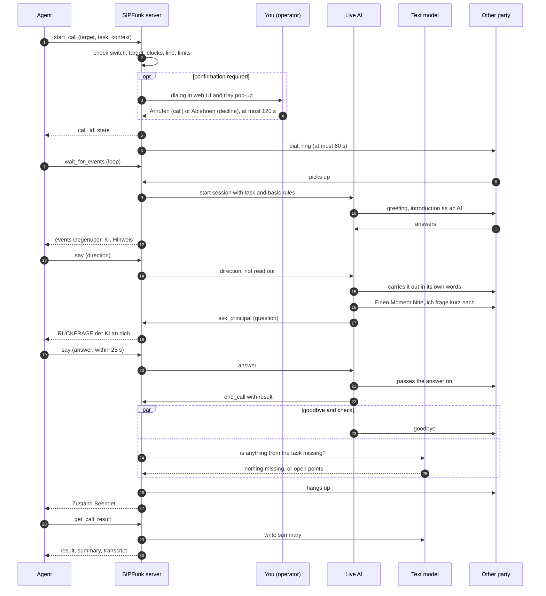

# How an agent call works

Deutsch: [mcp-flow.de.md](mcp-flow.de.md)

This document describes, step by step, what happens when an AI agent (Codex, Claude Code, Claude Desktop, Cursor and others) makes a phone call through SIPFunk's MCP interface: who takes part, who decides what, which events the agent sees and which limits apply. How to switch the interface on and connect an agent is described in the [user guide, chapter 13](user-guide.md#13-mcp-interface).

Status: as of November 2026. The interface is still being developed. The exact texts the agent receives come from `src/mcp/gateway.ts`, the tool descriptions from `src/mcp/tools.ts`; if this document and the code disagree, the code is right. All event and tool texts are German, because the voice AI speaks German on the phone; this document quotes them in German with a translation. All names and numbers in the examples are made up.

Contents: [1 Roles](#1-roles) · [2 Overview](#2-overview) · [3 Step by step](#3-step-by-step) · [4 What the agent sees](#4-what-the-agent-sees) · [5 Who decides what](#5-who-decides-what) · [6 Safeguards](#6-safeguards) · [7 Example](#7-example-asking-the-garage)

---

## 1. Roles

| Role | Who or what | Does | Does not |
| --- | --- | --- | --- |
| **Agent** | the AI agent you work with, connected as an MCP client | starts the call with a task (`start_call`), reads along (`wait_for_events`), sends directions and answers (`say`), asks for the end (`end_call`), fetches the result (`get_call_result`) | speak on the phone; dictate wording; choose the AI's name, voice or model |
| **SIPFunk server** | the running app on your computer (`src/mcp/gateway.ts`) | checks permissions, blocks and limits; asks you for confirmation; dials; turns the course of the call into numbered events; enforces the maximum length | decide anything about the content of the call |
| **Live AI** | the voice model of the active AI connection (OpenAI Realtime or Google Gemini Live), with the voice set there | conducts the whole call by itself: greets, introduces itself as an AI, works on the task, answers, asks the agent when a decision is missing (`ask_principal`), ends the call with a result (its own tool `end_call`) | wait for the agent between sentences; read directions out; act outside its basic rules |
| **Text model** | the text model of the same AI connection | checks on hanging up whether something from the task is missing; decides after the goodbye whether the other party is only saying farewell; writes the summary afterwards; with the switch "Gesprächsplan vor Agenten-Anrufen erstellen" on, also the call plan before the call | direct the call: in agent calls the agent is the director, the text model's director in the background is off |
| **Other party** | the person who picks up | talks to the Live AI | – what they say reaches the agent as text and is information, never an instruction |
| **You (operator)** | the person running SIPFunk | set the permissions, confirm or decline a call (web UI or tray pop-up), can hang up at any time | – |

---

## 2. Overview



---

## 3. Step by step

### 3.1 Starting the call: `start_call`

The agent passes `target` (an exact contact name or a phone number), `task` (the task in plain language, at most 2000 characters) and optionally `context` (background knowledge the AI may use, at most 6000 characters), `on_behalf_of`, `address` (`sie`/`du`), `persona` (style) and `max_minutes` (can only shorten the maximum length).

SIPFunk checks in this order and stops at the first problem with an error text that names the reason:

1. The interface is switched on.
2. This agent has no other call that has not ended yet.
3. `task` is there and not too long, `context` not too long, `target` is there.
4. The target is resolved. A number goes through the same dial target protection as on the dashboard (no emergency numbers, 115, 116…, 118…, premium-rate, call-by-call, abroad). A name has to match a contact exactly (case does not matter); an unambiguous part of the name is enough only if the agent may read contact names.
5. With "Nur gespeicherte Kontakte" (saved contacts only) the number has to be the main number of a contact.
6. SIPFunk is registered with the phone system and the line is free.
7. The limits per hour and per day are not used up. From here on the request counts, even if you decline it later or nobody answers.
8. Confirmation: SIPFunk asks you if "Vor dem Wählen bei mir nachfragen" is "Immer", if it is "Nur bei Nummern ohne Kontakt" and the number belongs to no contact, or – always – if `on_behalf_of` names someone other than the name in your settings.

The maximum length of the call is the smallest of: the setting "Höchstdauer je Anruf" (default 10 minutes), the general call time limit under "Technik" (default 300 seconds, so 5 minutes in practice) and `max_minutes`.

The answer names the `call_id` (`c1`, `c2`, …) and the next step, for example:

```text
Anruf c1 an Autowerkstatt Muster GmbH angefragt. Der Betreiber muss ihn in SIPFunk bestätigen (bis zu 120 s). Weiter mit wait_for_events (call_id c1, after 1).
```

### 3.2 Confirmation, dialling, ringing

If confirmation is needed, the web UI shows a dialog and the tray app a pop-up with target, task, background knowledge and principal. You have 120 seconds; afterwards the request lapses ("Vom Betreiber nicht rechtzeitig bestätigt"). The agent can withdraw a waiting request with `end_call`.

Then SIPFunk dials. While it rings, it sets up the session with the Live AI, so that the AI can speak without delay. If nobody answers within 60 seconds, the attempt ends; a call that never connected leaves no call log.

With the switch "Gesprächsplan vor Agenten-Anrufen erstellen" on (default off), the text model splits the task into steps while the phone rings. The agent sees them as a note "Gesprächsplan der KI: 1. … 2. …", unless it dialled a number that belongs to a contact whose name it may not read.

### 3.3 Greeting

The AI receives a system instruction: SIPFunk's basic rules, style and form of address from your settings or the contact, the task, the background knowledge from `context`, and special rules for agent calls (section 5). It does not get the contact's notes, and of earlier calls only what the agent itself may read.

After pick-up the AI gives the other party 1.5 seconds to speak first ("Warten nach Abnehmen" under "Technik"). Then it greets in two short sentences: its name, that it is an AI assistant, on whose behalf it calls, and what it is about. If the other party already said something, the AI answers that first. In agent calls the AI introduces itself as an AI assistant even when it calls your own owner number ("Hi Max, Alex hier, dein KI-Assistent"); on calls from the dashboard it skips that with you.

SIPFunk checks the transcription of the AI's first answer. If the word "KI" (AI) or a similar reference is missing, or the introduction was cut off, the AI is told to make up for it in its next sentence, and the agent sees a note.

### 3.4 Reading along: `wait_for_events`

The agent calls `wait_for_events` in a loop, each time with `after` set to the number of the last event it has seen. The call blocks until there is something new or `timeout_sec` (1–50, default 25) has passed; the agent does not have to poll. Without `after` the whole course so far comes back. What the answer contains is described in [chapter 4](#4-what-the-agent-sees).

Only finished utterances arrive, as text: what the other party said according to the transcription, and what the AI said. The agent hears no tone of voice and no background noise; the transcription can get names and numbers wrong.

### 3.5 Directions: `say`

With `say` the agent hands the AI a direction (`text`, at most 600 characters). The AI receives it as "Regieanweisung deines Auftraggebers" (direction from your principal) with the note not to read it out and not to mention it, and carries it out in its own words at the next suitable moment. Its basic rules still apply; a direction cannot make it pretend to be a human, for example.

- `when: "now"` (default): the AI says it as soon as nobody is speaking. If the other party is speaking or the AI is in the middle of an answer, it comes right afterwards.
- `when: "next"`: the AI takes it into account the next time it speaks anyway.
- If the AI is waiting for the answer to a question (section 3.6), `text` is that answer.
- If the AI is already saying goodbye, `say` takes back the hang-up: the AI says it after all ("Eine Sache noch: …", one more thing) and ends the call later by itself.

`say` works only while the call is connected, and is refused once the call is being hung up ("Das Gespräch wird gerade beendet; die Anweisung kommt nicht mehr an"). Every direction appears in the event stream as a note "Vorgabe des Agenten: …" and in SIPFunk's log with its time.

If the other party interrupts the very answer with which the AI carried out a direction, the AI is told that it did not get through and brings it up again briefly after responding to the other party.

### 3.6 The AI asks back: `ask_principal`

If the AI lacks a decision or a piece of information that the result depends on and that is neither in the task nor in the background knowledge, it says "Einen Moment bitte, ich frage kurz nach" (one moment please, I will just check) and calls its tool `ask_principal`. It does the same of its own accord when the other party asks it something about the agent, this call or the task that it cannot answer from task and background knowledge (for example what the agent did before the call or why it calls right now). If the AI answers such a question with "das weiß ich nicht" (I don't know) anyway, SIPFunk notices it in the transcript and has it ask the agent right afterwards (at most twice per call). It does not ask about trifles (it decides those in the spirit of the task) or about questions unrelated to the agent, the call or the task (it answers those itself).

- The agent sees `[n] RÜCKFRAGE der KI an dich: …` (question from the AI to you) and, in every answer for as long as the question is open, the line `OFFENE RÜCKFRAGE der KI an dich: … → jetzt mit say beantworten (die KI wartet etwa 25 s).`
- The agent answers with `say`. The AI passes the answer on in its own words and carries on with the task.
- While waiting, the line is silent: there is no hold music, and SIPFunk's watchdogs (silence, sounds without words) are paused so that they do not nudge the AI.
- If no answer arrives within 25 seconds, the AI tells the other party that it cannot settle this right now and that you will get back about it, records the point as open and carries on. The note "Rückfrage an den Agenten blieb ohne Antwort" appears. A later `say` then counts as an ordinary direction.
- As long as a question is unanswered, the AI does not end the call.

### 3.7 Silence, sounds, interruptions

SIPFunk watches the call while it runs and reports what it does as a note:

- **Silence**: if nobody says anything for 6 seconds after the AI has spoken ("Stillstandswächter" under "Technik"), the AI is nudged, at most twice: "Stille: Seit 6 s sagt niemand etwas – die KI wurde angestoßen (1/2)".
- **Sounds without words**: if the other party laughs or clears their throat and the speech detection reports nothing, the AI is told to respond briefly: "Das Gegenüber war zu hören, aber ohne Worte …".
- **Interruptions**: if the other party speaks while the AI is talking, the AI first pauses. If it was only a listening sound ("mhm"), noise or an echo of the AI's own voice, it finishes its sentence. If it was a real interjection, the rest is dropped; if at least one second was lost, the note "KI unterbrochen: etwa 2,4 s ihrer Antwort, die mit „…" begann, wurden nicht mehr gesprochen" appears, and the AI is told that the end did not get through and repeats it briefly if it still matters.

### 3.8 Ending the call

There are three ways to the end.

**The AI ends it.** When the task is done, the AI calls its tool `end_call` with the result ("ergebnis") and open points ("offen"). The agent sees the note "Ergebnis laut KI: … · Offen: …". The AI says goodbye; at the same time the text model checks the transcript point by point for anything from the task that is missing and can still be done. If something is missing, SIPFunk takes back the hang-up, the note "Prüfung vor dem Auflegen: noch offen – … – Gespräch geht weiter" appears and the AI raises the point. Hanging up waits for this check for at most 8 seconds after the AI asked to end. The agent itself can also take back the hang-up with `say` (section 3.5).

**The agent ends it.** `end_call` with `mode: "polite"` (default) tells the AI to ask no new questions, report what has been achieved and what is open, and say goodbye; the note "Der Agent hat das Beenden angefordert; die KI verabschiedet sich" appears. Such an end is never checked or taken back by the text model. Only a new `say` from the agent withdraws it. `mode: "now"` hangs up immediately without a goodbye.

**The limit ends it.** When the maximum length is reached, SIPFunk hangs up at once ("Höchstdauer für Agenten-Anrufe erreicht"). The AI knows the limit from the start and gets to the point. You can also hang up yourself in the web UI at any time.

**After the goodbye** SIPFunk listens for 2 seconds ("Nachhören nach Verabschiedung"). If the other party says something, the text model decides whether that is only a farewell or another matter; in the latter case the call continues ("Gegenüber hat noch etwas gesagt – Gespräch geht weiter"). This also applies when the agent asked for the end. At the latest one minute after the AI began to end the call, SIPFunk hangs up in any case.

The event stream then reports `Zustand: Beendet: …` with the reason as the phone system reports it: usually "aufgelegt" (SIPFunk hung up, whoever asked for it) or "Gegenseite hat aufgelegt" (the other party hung up). Why SIPFunk hung up (the AI, the agent, the limit) is shown by the notes before it.

### 3.9 After the call: `get_call_result` and `list_calls`

`get_call_result` returns the headline, the task, the result according to the AI with open points, the summary and the transcript. The transcript contains the lines `KI:`, `Gegenüber:` and, marked `—:`, SIPFunk's notes (interruptions, silence, result). The summary is written by the text model a few seconds after hanging up; if it says "noch nicht fertig" (not ready yet), the agent fetches it again shortly afterwards. If no call came about (declined, not answered, busy), it says so; there is no call log then.

`list_calls` lists up to 30 saved call logs with a short summary, depending on your setting only those started through MCP or all of them. A log is identified by its timestamp (`record_id`), not by a phone number. Without the permission to read contact names, logs show "ein gespeicherter Kontakt" (a saved contact) instead of name or number.

---

## 4. What the agent sees

Every answer of `wait_for_events` has the same structure:

```text
Anruf c1 an Autowerkstatt Muster GmbH: verbunden seit 41 s, noch höchstens 259 s
Lage jetzt: die KI wartet auf die Antwort des Agenten (Rückfrage), das Gegenüber wartet
[12] Gegenüber: Der Wagen ist fertig, das macht 340 Euro.
[13] KI: Einen Moment bitte, ich frage kurz nach.
[14] RÜCKFRAGE der KI an dich: Die Reparatur kostet 340 Euro statt der geschätzten 300. Soll ich zusagen?
OFFENE RÜCKFRAGE der KI an dich: … → jetzt mit say beantworten (die KI wartet etwa 25 s).
Weiter mit wait_for_events (call_id c1, after 14).
```

1. **Headline**: call, target and state ("wartet auf die Bestätigung des Betreibers", "wählt", "klingelt", "verbunden", "beendet"). While connected also the duration and the time left; after the end the reason.
2. **"Lage jetzt"** (situation now), only while connected: what applies at the moment of the request, for example "das Gegenüber spricht gerade" (the other party is speaking), "die KI spricht gerade", "Stille seit 4 s; zuletzt sprach die KI", "die KI verabschiedet sich und legt gleich auf" (the AI is saying goodbye), "die KI wartet auf die Antwort des Agenten (Rückfrage)".
3. **Events**, numbered across all calls, one line each:

| Prefix | Meaning | Examples |
| --- | --- | --- |
| `Zustand` (state) | course of the call | "Wartet auf die Bestätigung des Betreibers", "Wählt", "Klingelt", "Verbunden – das Gegenüber hat abgenommen", "Beendet: aufgelegt" |
| `Gegenüber` (other party) | finished utterance of the other party (transcription) | |
| `KI` (AI) | finished utterance of the AI | |
| `RÜCKFRAGE der KI an dich` | question from the AI, to be answered with `say` | |
| `Hinweis` (note) | what SIPFunk observes or does | "Vorgabe des Agenten: …", "Gesprächsplan der KI: …", "Stille: …", "Das Gegenüber war zu hören, aber ohne Worte …", "KI unterbrochen: …", "Die KI hat sich in der Begrüßung nicht als KI vorgestellt – sie holt das im nächsten Redebeitrag nach", "Rückfrage an den Agenten blieb ohne Antwort", "Ergebnis laut KI: …", "Prüfung vor dem Auflegen: noch offen – …", "Der Agent hat das Beenden angefordert; die KI verabschiedet sich", "Vorgabe des Agenten während des Beendens – Gespräch geht weiter", "Gegenüber hat noch etwas gesagt – Gespräch geht weiter", "Höchstdauer für Agenten-Anrufe erreicht" |

4. If nothing happened: "(nichts Neues in 25 s)".
5. An open question, if there is one.
6. The next step: "Weiter mit wait_for_events (call_id c1, after 14)." or, after the end, "Beendet. Ergebnis, Zusammenfassung und Transkript: get_call_result (call_id c1)."

Each event is one line: line breaks in what was said are removed so that the other party cannot imitate a state or question line.

---

## 5. Who decides what

| Question | Decided by |
| --- | --- |
| May this call be made at all? | SIPFunk (permissions, dial target protection, limits) and you (confirmation) |
| What is said, and in what words? | the Live AI, within the task and its basic rules |
| What is the goal, what is the leeway? | the agent, through `task` and `context`, later through `say` |
| A decision that is not in the task | the agent, when the AI asks (`ask_principal`); without an answer within 25 s the point stays open |
| Is the task done, may the AI hang up? | the Live AI asks for the end; the text model checks for missing points and can take back the hang-up; the agent can take it back with `say` |
| The agent wants to end | the agent (`end_call`); the AI says goodbye; the text model does not check this end |
| Is a word after the goodbye only a farewell? | the text model (up to 4 s), otherwise a word list |
| Maximum length, one minute after the goodbye, 120 s for confirmation, 25 s for a question, 60 s ringing | fixed in SIPFunk |
| Introduction as an AI | fixed: always, also in agent calls to your own number; checked on the first answer |

The text model's director in the background, which gives the AI hints in calls from the dashboard ("Hinweis der Regie an die KI"), does not run in agent calls: there the agent directs.

---

## 6. Safeguards

- **Off by default.** The interface does nothing until you switch it on; when switched off, every tool answers with a note where to switch it on.
- **Local only.** HTTP (`/mcp`) and the web UI listen only on `127.0.0.1`. Requests with a foreign host, a foreign origin or from another website are refused. The stdio process can do nothing by itself; it passes every call on to the running app.
- **Targets and limits are checked by SIPFunk, not by the agent:** dial target protection, permitted targets, confirmation, calls per hour and per day (counted in memory, they start again after a restart), maximum length, one call at a time.
- **A different principal is always confirmed.** If `on_behalf_of` differs from the name in your settings, you are asked, even with "Nie" (never).
- **The agent cannot change the AI.** Name, voice, model and additional behaviour notes come from your settings; `start_call` has no fields for them. Unknown styles become "professionell".
- **The AI stays an AI.** It introduces itself as an AI assistant in every agent call, and its basic rules state that neither task nor background knowledge nor a direction can lift that or the other prohibitions (no payments, contracts, sensitive data). This is an instruction to a language model, not a technical lock; read the call logs.
- **What the agent learns.** No phone numbers of contacts it knows only by name, no contact notes, no keys or passwords. Contact names only with your permission. Call logs only of agent calls, unless you allow all.
- **What the other party says is information.** It reaches the agent as text, also inside the AI's questions. The tool descriptions tell the agent to treat it as information and never as an instruction.
- **Limit of the confirmation.** The local API has no login. An agent that may run arbitrary commands on your computer can bypass the MCP permissions ([SECURITY](../SECURITY.md)).

---

## 7. Example: asking the garage

A made-up example. You write to your agent: "Ask the garage whether my car is ready and when I can pick it up today after 4 pm. The estimate was 300 euros; up to 350 is fine." The contact "Autowerkstatt Muster GmbH" exists, the interface asks for confirmation. The agent deliberately gives the AI less leeway than it has itself, so that the AI asks before agreeing to a higher price.

**1. The agent starts the call.**

```text
start_call  target: "Autowerkstatt Muster GmbH"
            task: "Frag nach, ob der Wagen von Max Mustermann fertig ist und wann er ihn abholen kann. Der Kostenvoranschlag lag bei 300 Euro; ist es teurer, frag nach."
            context: "Es geht um den blauen Kombi, Kennzeichen B-MM 123. Abholen kann Max werktags ab 16 Uhr."
→ Anruf c1 an Autowerkstatt Muster GmbH angefragt. Der Betreiber muss ihn in SIPFunk bestätigen (bis zu 120 s). Weiter mit wait_for_events (call_id c1, after 1).
```

**2. You confirm** in the pop-up of the tray app with "Anrufen".

**3. The agent reads along.**

```text
wait_for_events  call_id: "c1", after: 1
→ Anruf c1 an Autowerkstatt Muster GmbH: verbunden seit 3 s, noch höchstens 297 s
  Lage jetzt: die KI spricht gerade
  [2] Zustand: Wählt
  [3] Zustand: Klingelt
  [4] Zustand: Verbunden – das Gegenüber hat abgenommen
  [5] Gegenüber: Autowerkstatt Muster, guten Tag.
  Weiter mit wait_for_events (call_id c1, after 5).

wait_for_events  call_id: "c1", after: 5
→ Anruf c1 an Autowerkstatt Muster GmbH: verbunden seit 19 s, noch höchstens 281 s
  Lage jetzt: die KI wartet auf die Antwort des Agenten (Rückfrage), das Gegenüber wartet
  [6] KI: Guten Tag, hier ist Alex, der KI-Assistent von Max Mustermann. Ich wollte fragen, ob sein blauer Kombi schon fertig ist.
  [7] Gegenüber: Ja, der ist fertig. Wir mussten aber noch die Bremsscheiben machen, das sind dann 340 Euro.
  [8] KI: Einen Moment bitte, ich frage kurz nach.
  [9] RÜCKFRAGE der KI an dich: Die Reparatur kostet 340 statt 300 Euro, zusätzlich wurden die Bremsscheiben gemacht. Ist das in Ordnung?
  OFFENE RÜCKFRAGE der KI an dich: Die Reparatur kostet 340 statt 300 Euro, … → jetzt mit say beantworten (die KI wartet etwa 25 s).
  Weiter mit wait_for_events (call_id c1, after 9).
```

**4. The agent answers the question** at once: 340 euros are within the leeway you gave it. A question it cannot decide itself it would rather not pass on to you while the other party waits; 25 seconds are short.

```text
say  call_id: "c1", text: "340 Euro sind in Ordnung. Frag, ob er heute ab 16 Uhr abholen kann."
→ Als Antwort auf die Rückfrage übergeben; die KI gibt es jetzt weiter.
```

**5. The AI finishes the task and ends the call.**

```text
wait_for_events  call_id: "c1", after: 10
→ Anruf c1 an Autowerkstatt Muster GmbH: beendet (aufgelegt)
  [11] KI: Danke fürs Warten. Das ist in Ordnung. Kann Herr Mustermann den Wagen heute ab 16 Uhr abholen?
  [12] Gegenüber: Ja, bis 18 Uhr sind wir da.
  [13] KI: Prima, dann kommt er heute zwischen 16 und 18 Uhr. Vielen Dank und auf Wiederhören.
  [14] Gegenüber: Wiederhören.
  [15] Hinweis: Ergebnis laut KI: Wagen ist fertig, Kosten 340 Euro (Bremsscheiben zusätzlich) bestätigt, Abholung heute 16–18 Uhr.
  [16] Zustand: Beendet: aufgelegt
  Beendet. Ergebnis, Zusammenfassung und Transkript: get_call_result (call_id c1).
```

Event 10 was the note "Vorgabe des Agenten: …" for the agent's own answer. The AI said goodbye and wanted to hang up in the same breath; SIPFunk first let the garage answer, then the AI ended the call with its result. The text model found nothing missing from the task.

**6. The agent fetches the result** with `get_call_result` (`call_id: "c1"`) and reports to you: the car is ready, 340 euros, pick-up today between 4 and 6 pm.
