# SIPFunk – Benutzerhandbuch

English: [user-guide.md](user-guide.md)

Begriffe und Schaltflächen entsprechen der deutschen Web-UI. Die Oberfläche gibt es auch auf Englisch (Abschnitt 5.2). Beispielnamen, Rufnummern und Adressen in diesem Handbuch sind erfunden.

Weitere Dokumente: [Richtlinien für den Einsatz](guidelines.de.md) · [Rechtliche Aspekte](legal.de.md) · [Architektur](architecture.de.md) · [Manuelle Testliste](test-checklist.de.md) · [Ablauf eines Agenten-Anrufs](mcp-flow.de.md).

Inhalt: [1 Überblick](#1-was-sipfunk-ist) · [2 Voraussetzungen](#2-voraussetzungen) · [3 FRITZ!Box](#3-fritzbox-einrichten) · [4 Installation](#4-installation-und-erster-start) · [5 Web-UI](#5-die-web-ui-im-überblick) · [6 Ausgehende Anrufe](#6-ausgehende-anrufe) · [7 Anrufbeantworter](#7-anrufbeantworter) · [8 Pop-up beim Klingeln](#8-pop-up-beim-klingeln) · [9 Benachrichtigungen](#9-benachrichtigungen-nach-einem-angenommenen-anruf) · [10 Spam-Abwehr](#10-spam-abwehr) · [11 Kontakte, Protokolle, Daten](#11-kontakte-protokolle-daten) · [12 Simulator](#12-simulator) · [13 MCP](#13-mcp-schnittstelle) · [14 Faxen](#14-faxen) · [15 Einstellungen](#15-einstellungen-im-überblick) · [16 Kosten](#16-kosten) · [17 Fehlersuche](#17-fehlersuche) · [18 Begriffe](#18-begriffe)

---

## 1. Was SIPFunk ist

SIPFunk ist ein lokaler KI-Telefonassistent für die FRITZ!Box. Das Programm meldet sich an der Box wie ein IP-Telefon an (SIP-Nebenstelle) und verbindet das Telefonaudio mit dem Live-Sprachmodell des KI-Anbieters, den du wählst: OpenAI (Realtime-API, der erprobte Standard) oder Google Gemini (Live API, erst in wenigen echten Telefonaten erprobt; Abschnitt 6.2). Damit kann die KI

- **ausgehend anrufen** und einen Auftrag erledigen („Frag in der Praxis nach einem Termin nächste Woche“),
- **eingehende Anrufe annehmen** (Anrufbeantworter), Anliegen und Rückrufwunsch aufnehmen,
- dich danach **benachrichtigen** (Tray-Hinweis, E-Mail, bei wichtigen Anrufen ein Rückruf mit Durchstellen zum Anrufer),
- optional **Werbe- und Betrugsanrufe abwimmeln oder hinhalten** (Spam-Abwehr, nur nach ausdrücklicher Bestätigung, Kapitel 10).

Unabhängig von der KI **sendet SIPFunk Faxe** über die Box: aus jedem Programm über den Drucker „SIPFunk Fax“, mit Nummernvorschlägen aus dem FRITZ!Box-Telefonbuch (Kapitel 14).

Alles läuft auf deinem Rechner. Es gibt keinen Cloud-Dienst von SIPFunk; nach außen gehen nur die Verbindungen zum gewählten KI-Anbieter, OpenAI oder Google (Sprache, Texte), zu deinem Mail-Anbieter, wenn eingerichtet, zu tellows, wenn du das Nachschlagen einschaltest, zu Google oder Microsoft, während du von dort Kontakte importierst, zur FRITZ!Box für Telefonbuch und Fax, und, nur wenn du im Mail-Assistenten auf „Automatisch einrichten“ klickst, zu Mozillas Thunderbird-Datenbank und zu einem DNS-Server, mit der Domain deiner Mailadresse (Abschnitt 9.3). Die Web-UI ist nur auf dem eigenen Rechner erreichbar (127.0.0.1).

Grenzen: ein Benutzer, eine Nebenstelle, ein Gespräch gleichzeitig. SIPFunk arbeitet mit der OpenAI-Realtime-API oder der Gemini Live API (Abschnitt 6.2). Es wird kein Audio aufgezeichnet; gespeichert werden Transkripte (Text), Zusammenfassungen und Metadaten.

### Wie ein Gespräch technisch läuft

1. Die FRITZ!Box schickt das Telefonaudio als G.711 (HD mit 16 kHz, wenn die Box es anbietet, sonst 8 kHz) an SIPFunk.
2. SIPFunk rechnet es in das PCM-Format des Anbieters um (OpenAI: 24 kHz in beide Richtungen; Gemini: 16 kHz zu Google, 24 kHz zurück) und streamt es an das Live-Sprachmodell; die Antwort kommt als Audio zurück und geht in Echtzeit zur Box.
3. Die KI bekommt eine Systemanweisung (Grundregeln, Stil, dein Auftrag, Hintergrundwissen) und bis zu drei Werkzeuge: `end_call` (Gespräch beenden und Ergebnis melden), beim Rückruf an dich `transfer_call` (durchstellen), bei aktiver Spam-Abwehr `flag_spam`. Bei Anrufen, die ein KI-Agent gestartet hat, hat sie statt der letzten beiden `ask_principal` (beim Agenten nachfragen, Kapitel 13).
4. Während des Gesprächs entscheidet das Textmodell derselben KI-Verbindung an einigen Stellen mit: ob vor dem Auflegen etwas aus dem Auftrag fehlt, ob ein Wort nach der Verabschiedung nur ein Abschied ist, und als Regie im Hintergrund (Abschnitt 6.3).
5. Nach dem Gespräch erstellt ein Textmodell eine Zusammenfassung und, beim Anrufbeantworter, eine Einschätzung „wichtig/unwichtig“.

Mehr dazu in der [Architektur](architecture.de.md).

---

## 2. Voraussetzungen

- FRITZ!Box mit einem FRITZ!OS, das „LAN/WLAN (IP-Telefon)“ unterstützt. Andere SIP-Anlagen sind ungetestet.
- Node.js ab 20.12 für den Start aus dem Repository. Die gebaute Tray-App bringt ihre Laufzeit mit.
- Windows 10/11 für die Tray-App (Infobereich, Benachrichtigungen, Pop-up beim Klingeln). Server und Web-UI brauchen nur Node.js, sind auf anderen Systemen aber ungetestet.
- Ein API-Schlüssel für einen der beiden KI-Anbieter: OpenAI (mit Zugriff auf die Realtime-Modelle) oder Google Gemini (aus Google AI Studio; Abschnitt 6.2). Kosten fallen pro Gesprächsminute an (Kapitel 16).
- Der Rechner muss laufen, solange der Anrufbeantworter Anrufe annehmen soll.

---

## 3. FRITZ!Box einrichten

1. FRITZ!Box-Oberfläche öffnen → **Telefonie → Telefoniegeräte → Neues Gerät einrichten → Telefon (mit und ohne Anrufbeantworter) → LAN/WLAN (IP-Telefon)**.
2. Benutzername und Kennwort vergeben. Diese Daten kommen später in die `.env` (`SIP_USER`, `SIP_PASSWORD`). **Nie in Chats, Tickets oder Screenshots weitergeben.**
3. **Ausgehende Rufnummer** wählen (mit dieser Nummer ruft die KI an).
4. **Ankommende Rufe:** alle Rufnummern zuordnen, bei denen die KI klingeln bzw. abnehmen soll. Ohne Zuordnung bekommt SIPFunk den Anruf gar nicht zu sehen.
5. Optional: Unter **Telefonie → Rufbehandlung** Rufumleitungen oder den Anrufbeantworter der Box so einstellen, dass sie nicht vor SIPFunk abnehmen (Klingelzahl beachten, Kapitel 7).

Die Box liefert bei eingehenden Anrufen die gewählte Rufnummer im SIP-Header `P-Called-Party-ID`; damit kann SIPFunk sich je nach angerufener Nummer anders melden (Abschnitt 7.3).

---

## 4. Installation und erster Start

### 4.1 Start aus dem Repository

```bash
npm install
npm start
```

Danach <http://127.0.0.1:3865> öffnen. Für den ersten Start ist keine Konfigurationsdatei nötig. Ist der Port 3865 belegt, nimmt SIPFunk den nächsten freien und nennt ihn im Log und im Tray-Menü („Im Browser öffnen (Port …)“); ändern lässt er sich unter „Einstellungen › Technik“ (Abschnitt 15.3).

### 4.2 Der Einrichtungsassistent

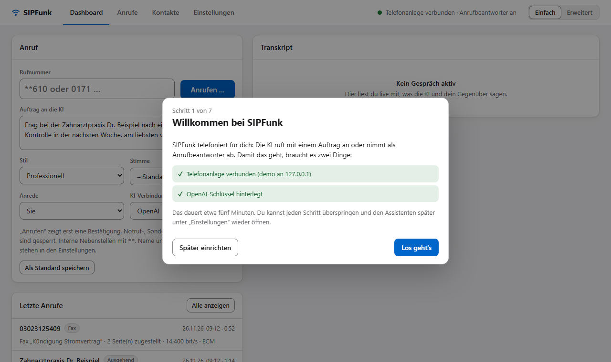

Solange das Nötigste fehlt (Zugangsdaten zur Telefonanlage, Schlüssel des KI-Anbieters, der Name, in dessen Auftrag die KI spricht), öffnet die Web-UI von selbst den Einrichtungsassistenten. Er hat sieben Schritte, jeder lässt sich überspringen; „Später einrichten“ oder Esc schließt ihn, und „Einrichtungsassistent …“ auf der Seite „Einstellungen“ öffnet ihn jederzeit wieder.

1. **Willkommen**: was noch fehlt.
2. **Telefonanlage verbinden**: Adresse (bei einer FRITZ!Box `fritz.box`), Benutzername und Kennwort des IP-Telefons aus Kapitel 3. „Verbindung prüfen und speichern“ meldet sich einmal zur Probe an; nur wenn das gelingt, werden die Werte gespeichert, und die App meldet sich damit an – ohne Neustart. Scheitert die Probe, steht in einem Satz, woran es lag (abgelehnt, nicht gefunden, keine Antwort), und es ändert sich nichts.
3. **KI-Verbindung**: die Verbindung wählen, die die Gespräche führen soll (von Anfang an gibt es „OpenAI“ und „Google Gemini“), und ihren API-Schlüssel eintragen. „Schlüssel prüfen und speichern“ prüft den Schlüssel einmal beim Anbieter und speichert ihn dann. Ohne Schlüssel funktionieren nur „Echo“ und „Testton“. Was eine Verbindung ist und was die beiden Anbieter unterscheidet, steht in Abschnitt 6.2.
4. **Dein Assistent**: Name der KI und „Im Auftrag von“.
5. **Anrufbeantworter**: an/aus und, wenn gewünscht, eine erste eigene Rufnummer mit dem Namen, für den die KI dort abnimmt.
6. **E-Mail-Benachrichtigung** (optional): Postfach und Passwort; der Server wird gesucht und die Anmeldung geprüft. Anbieter, die OAuth verlangen, richtest du unter „Einstellungen › E-Mail-Versand“ in der Stufe „Erweitert“ ein.
7. **Fertig**: Stand der drei nötigen Angaben und ein Testanruf ohne KI: interne Nebenstelle eintragen (z. B. `**610`), bestätigen, und du hörst dich selbst mit einer Sekunde Verzögerung.

So geht der Assistent mit den Zugangsdaten um: SIP-Kennwort und Schlüssel des KI-Anbieters nimmt nur die lokale Web-UI (`127.0.0.1`) entgegen; sie werden in die `.env` im Datenordner geschrieben und in die laufende App übernommen. Angezeigt oder von der API zurückgeliefert werden sie nie wieder, und sie stehen in keinem Log; der Assistent zeigt nur, ob etwas hinterlegt ist. Ein hinterlegtes Kennwort wird nur weiterverwendet, solange Adresse und Benutzername gleich bleiben. Alles andere, was der Assistent einstellt (Namen, Anrufbeantworter, E-Mail), sind gewöhnliche Einstellungen in `settings.json`.

Lieber von Hand? `.env.example.de` nach `.env` kopieren und mindestens ausfüllen:

| Variable | Bedeutung |
| --- | --- |
| `SIP_SERVER` | Adresse der Box, meist `fritz.box` |
| `SIP_USER`, `SIP_PASSWORD` | Zugangsdaten der IP-Telefon-Nebenstelle (Pflicht) |
| `SIP_LOCAL_PORT` (5062), `RTP_PORT` (40000) | lokale UDP-Ports; die Windows-Firewall fragt beim ersten Start, „Private Netzwerke“ zulassen |
| `OPENAI_API_KEY` oder `GEMINI_API_KEY` | Schlüssel des KI-Anbieters (der mitgelieferten Verbindung „OpenAI“ bzw. „Google Gemini“, Abschnitt 6.2), für KI-Gespräche, Gesprächsplan, Zusammenfassung, Einschätzung, Hörproben. OpenAI ist der Standard; für Google Gemini zusätzlich `AI_PROVIDER=gemini` setzen. Ohne Schlüssel funktionieren nur „Testton“ und „Echo“ |
| `OWNER_NUMBERS` | deine eigene(n) Nummer(n), mit Komma getrennt (Ziel des Rückrufs, Rückrufnummer für Angerufene); alternativ ein Kontakt mit Kennzeichen „Inhaber“ |

Alle weiteren Variablen stehen kommentiert in der `.env.example.de`; Kapitel 15 zeigt, was nur dort und was in der Web-UI eingestellt wird. Von Hand eingetragene Werte wirken nach einem Neustart.

### 4.3 Tray-App (Windows, ohne Konsole)

Installiert mit dem Installer von der Seite [Releases](https://github.com/alorbach/ai-sip-funk/releases) (siehe unten) oder aus dem Repository:

```bash
npm run tray
```

Ein Symbol im Infobereich zeigt den Zustand (registriert, bereit, verbunden). Doppelklick öffnet die Oberfläche in einem eigenen Fenster, ein Klick das Menü: „SIPFunk öffnen“ (dasselbe Fenster), „Im Browser öffnen (Port …)“ (die Web-UI im Standardbrowser), „Anrufbeantworter“ (an/aus), „Einstellungen (.env) bearbeiten“, „Datenordner öffnen“, „Beim Anmelden starten“ (nicht beim Start aus dem Repository), „Server neu starten“, „Beenden“. Fehler (z. B. eine gescheiterte Anmeldung) stehen als Zeile im Menü; ein Klick kopiert sie. Nach einem angenommenen Anruf erscheint eine Windows-Benachrichtigung; ein Klick darauf öffnet das Fenster.

**Das SIPFunk-Fenster** zeigt dieselbe Oberfläche wie der Browser unter <http://127.0.0.1:3865>, nur ohne Browser. Es läuft unabhängig vom Tray: Schließen beendet SIPFunk nicht (das geht nur über „Beenden“ im Tray-Menü), und Anrufe, Anrufbeantworter und Pop-ups laufen weiter, auch wenn das Fenster hängt oder zu ist. Links zu Anbietern und Anmeldungen bei Google oder Microsoft öffnen sich im Standardbrowser. Das Fenster darf nur das Mikrofon benutzen (für die Spracheingabe des Auftrags, Abschnitt 5), sonst nichts. Strg+Plus und Strg+Minus vergrößern und verkleinern die Ansicht, Strg+0 setzt sie zurück. Größe, Lage und Zoom merkt sich das Fenster in `window.json` im Datenordner; liegt es danach auf keinem vorhandenen Bildschirm mehr (Monitor abgesteckt), öffnet es sich wieder mittig.

**Installer.** `SIPFunk-<Version>-win-x64.exe` von der Release-Seite installiert SIPFunk für den angemeldeten Benutzer ohne Administratorrechte (Eintrag im Startmenü, Deinstallation über „Installierte Apps“ in Windows). Lass die Vorauswahl „nur für mich“ stehen: Eine Installation für alle Benutzer braucht Administratorrechte, und der Autostart samt seinem Entfernen bei der Deinstallation hängt dann an dem Konto, das sie bestätigt hat. Die Datei ist nicht signiert, Windows SmartScreen warnt deshalb: „Weitere Informationen“ → „Trotzdem ausführen“. Die Version steht im Tray-Menü und auf der Seite „Einstellungen“. Für ein Update den neueren Installer über die alte Fassung laufen lassen; der Datenordner bleibt dabei unberührt, und er bleibt auch bei der Deinstallation liegen.

**Autostart.** Nach der Installation startet SIPFunk nach der Windows-Anmeldung von selbst, im Infobereich und ohne Fenster; der erste Start weist mit einer Benachrichtigung darauf hin. „Beim Anmelden starten“ im Tray-Menü schaltet das aus und ein, ebenso Windows unter „Autostart-Apps“. Die Wahl bleibt bei Updates erhalten; die Deinstallation entfernt den Eintrag. Die portable ZIP-Datei (`SIPFunk-<Version>-win-x64.zip`, entpacken und `SIPFunk.exe` starten) schaltet den Autostart nicht von selbst ein; der Menüpunkt funktioniert dort auch, solange der Ordner an seinem Platz bleibt.

**Microsoft Store.** Die Store-Fassung ist dasselbe Programm, von Microsoft signiert, deshalb ohne SmartScreen-Warnung; Updates kommen über den Store. Ist die Installer-Fassung schon eingerichtet, arbeitet sie mit deren Datenordner `%APPDATA%\SIPFunk` weiter. Sonst legt Windows ihre Daten in ihren eigenen Paketordner und löscht sie beim Deinstallieren; „Datenordner öffnen“ und „Einstellungen (.env) bearbeiten“ im Tray-Menü finden den Ordner in beiden Fällen. Den Autostart verwaltet Windows: Nach dem ersten Start ist er an, im Tray-Menü öffnet „Autostart in Windows einstellen …“ die Seite „Autostart-Apps“, wo die Store-Fassung unter dem Herausgeber „delta2win“ steht. Wer von der Installer-Fassung wechselt, deinstalliert diese über „Installierte Apps“; Einstellungen, Kontakte und Protokolle bleiben erhalten. Laufen beide Fassungen nebeneinander, starten nach der Anmeldung beide und streiten um Port und Telefonanlage.

Installer und portable ZIP selbst bauen: `npm run dist:win` (Ergebnis in `release/`). Installiert liegen `.env`, `settings.json`, `contacts.json`, `transcripts/`, `mail-token.json`, `usage.json` und `sipfunk.log` im Benutzerprofil unter `%APPDATA%\SIPFunk`. Beim ersten Start wird `.env.example` (englisch kommentiert) dorthin kopiert, und die Web-UI öffnet sich mit dem Einrichtungsassistenten (Kapitel 4.2). Die Umgebungsvariable `SIPFUNK_DATA_DIR` legt den Datenordner auch beim Start aus dem Repository fest.

### 4.4 Erster Funktionstest ohne KI

Am eigenen Telefon prüfen, ob SIP und Audio funktionieren. Interne Nebenstellen der Box beginnen mit `**` (`**610` ist meist das erste Schnurlostelefon):

```bash
npm run test-call -- **610
```

Spielt einen Piepton. Mit `--echo` kommt alles Gesprochene nach einer Sekunde zurück (prüft beide Richtungen), `--seconds 60` verlängert das Limit (Standard 30 s). Ohne Rufnummer prüft der Befehl nur die Registrierung. In der Web-UI leisten die Anrufarten „Testton“ und „Echo (1 s)“ dasselbe („Art des Anrufs“, sichtbar in der Stufe „Erweitert“); der letzte Schritt des Einrichtungsassistenten bietet den Echo-Test direkt an.

Erfolgreich ist der Test, wenn die Registrierung klappt, das Telefon klingelt, der Ton zu hören ist und Auflegen von beiden Seiten funktioniert.

---

## 5. Die Web-UI im Überblick

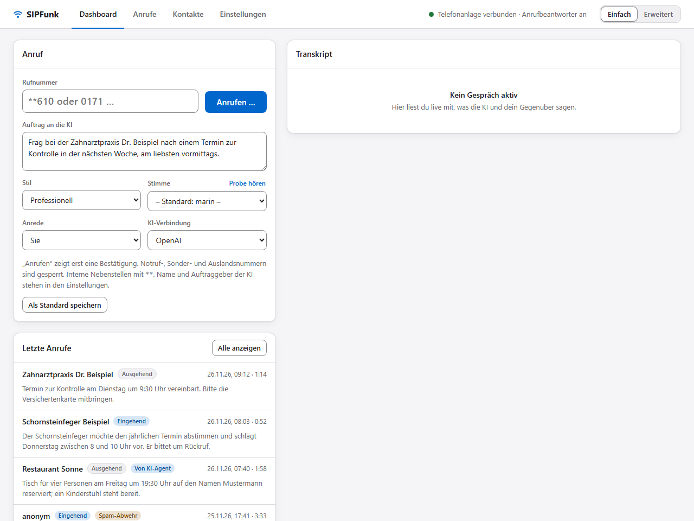

*Alle Bilder in diesem Handbuch zeigen erfundene Beispieldaten.*

Die Kopfzeile ist immer sichtbar: links die vier Seiten, rechts der Verbindungsstatus und der Schalter „Einfach / Erweitert“ (Kapitel 5.1); die zuletzt geöffnete Seite wird gemerkt. Sobald ein Anruf läuft, erscheint darunter die Gesprächsleiste mit Phase (wählt, klingelt, eingehender Anruf, verbunden), Name oder Nummer des Gegenübers, Dauer, Codec, „Mithören“ und „Auflegen“; außerdem pulsiert ein Punkt am Reiter „Dashboard“. Bei einem klingelnden eingehenden Anruf stehen dort zusätzlich die Knöpfe aus Kapitel 8.

**Mithören** in der Gesprächsleiste spielt beide Gesprächsseiten im Browser ab (nur live, keine Aufzeichnung). Mit `LIVE_LISTEN_ENABLED=false` ist die Funktion aus.

- **Dashboard** (in der Stufe „Einfach“ heißt der Reiter „Start“): die Karte „Anruf“ (Rufnummer oder Kontakt, Auftrag mit Mikrofon-Taste, Art des Anrufs, Stil, Stimme, Anrede, „KI-Verbindung“, „Anrufen …“, „Als Standard speichern“), die letzten fünf Anrufe und das Transkript des laufenden Gesprächs mit Verbrauch und Zusammenfassung, darunter das Systemprotokoll (nur in der Stufe „Erweitert“). In „Einfach“ steht alles in einer Spalte: oben „Anruf“, darunter das Gespräch (nur wenn eins läuft oder gerade lief), darunter die letzten Anrufe. Stil, Stimme, Anrede und KI-Verbindung liegen dort hinter „Stimme und Stil“; daneben steht kurz, was gerade gilt.

**Auftrag einsprechen.** Die Mikrofon-Taste neben dem Feld „Auftrag an die KI“ nimmt auf: einmal klicken, sprechen, noch einmal klicken. Während der Aufnahme steht über dem Feld, wie lange schon aufgenommen wird und welcher Anbieter den Text erkennt; nach zwei Minuten endet die Aufnahme von selbst, die letzten 15 Sekunden sind hervorgehoben. Der erkannte Text wird an den Auftrag angehängt und lässt sich danach bearbeiten. Erkannt wird über die aktive KI-Verbindung mit demselben Schlüssel: bei OpenAI mit dem Transkriptionsmodell `gpt-4o-mini-transcribe`, bei Google Gemini mit dem Textmodell der Verbindung. Die Aufnahme geht nur an diesen Anbieter und wird nicht gespeichert; ein Diktat kostet Bruchteile eines Cents. Den Zugriff aufs Mikrofon muss Windows erlauben („Einstellungen › Datenschutz und Sicherheit › Mikrofon“, auch für Desktop-Apps), im Browser zusätzlich die Seite.
- **Anrufe**: alle gespeicherten Gespräche mit Suche nach Name oder Nummer und den Markierungen „Eingehend“, „Ausgehend“, „Rückruf an dich“, „Spam-Abwehr“ und „Von KI-Agent“. Ein Klick zeigt Transkript, Ergebnis laut KI, Zusammenfassung und Kosten sowie die Knöpfe „Nummer auf die Spam-Liste“, „Beschwerde-Entwurf“, „Als Kontakt speichern“ und „Protokoll löschen“.
- **Kontakte**: Liste mit „Anrufen“ (übernimmt den Kontakt ins Dashboard), „Verlauf“ (filtert die Anrufliste), „Bearbeiten“ und Löschen; „Neuer Kontakt“ oben rechts.
- **Einstellungen**: die Abschnitte KI-Assistent, KI-Verbindungen, Anrufbeantworter, Benachrichtigungen, E-Mail-Versand, Spam-Abwehr, MCP-Schnittstelle und Technik (nur in der Stufe „Erweitert“). Die Abschnittsliste links arbeitet wie Reiter: Rechts steht nur die Karte des gewählten Abschnitts, und die Auswahl wird gemerkt. „Speichern“ (oder Strg+S) unter der Liste speichert weiterhin alle Abschnitte dieser Seite – nur die Werte, die du geändert hast –, sie gelten ab dem nächsten Anruf. Ausnahme sind Änderungen an KI-Verbindungen: Sie gelten sofort, ohne „Speichern“ (Abschnitt 6.2). „Einrichtungsassistent …“ oben öffnet den Einrichtungsassistenten. Im Abschnitt „Technik“ stehen außerdem zur Information die Werte, die nur in der `.env` stehen (Box, Ports, Datenordner).

Stil, Anrede und Auftrag für ausgehende Anrufe stellst du auf dem Dashboard ein; „Als Standard speichern“ merkt sie und die Art des Anrufs (und nur sie: Die beiden Speichern-Knöpfe fassen die Werte des jeweils anderen nicht an). Die Stimme merkt der Knopf nicht: Das Feld „Stimme“ auf dem Dashboard gilt nur für den nächsten Anruf von dort und steht sonst auf der Standardstimme der aktiven Verbindung (z. B. „– Standard: marin –“). Das Feld „KI-Verbindung“ auf dem Dashboard schaltet die aktive KI-Verbindung um; das gilt sofort und braucht keinen Speichern-Knopf. Modelle und Standardstimme gehören zur Verbindung und stehen unter „Einstellungen › KI-Verbindungen“ (Abschnitt 6.2).

### 5.1 „Einfach“ und „Erweitert“

Der Schalter oben rechts auf jeder Seite legt fest, wie viel die Web-UI zeigt. Er wirkt sofort und wird gemerkt (`uiMode` in `settings.json`); „Einfach“ ist der Standard. Umschalten blendet nur aus und ein: Ausgeblendete Einstellungen behalten ihre Werte, und beim Speichern wird nie etwas angefasst, das du nicht geändert hast.

| Bereich | „Einfach“ zeigt | „Erweitert“ zusätzlich |
| --- | --- | --- |
| Dashboard | Rufnummer, Auftrag mit Mikrofon-Taste, „Anrufen …“, unter „Stimme und Stil“ Stil, Stimme mit Hörprobe, Anrede, KI-Verbindung; letzte Anrufe, Live-Transkript (nur während und nach einem Gespräch); alles in einer Spalte | Art des Anrufs (KI, Echo, Testton), Hinweistext und „Als Standard speichern“, Systemprotokoll, Codec und RTP-Zähler, Lautstärke beim Mithören, Token-Verbrauch; zwei Spalten |
| Anrufe, Kontakte | alles | Token-Verbrauch und Kosten eines Gesprächs |
| KI-Assistent | Name der KI, „Im Auftrag von“, Verhalten im Gespräch (vier Auswahlfelder und freier Text) | – |
| KI-Verbindungen | Liste der Verbindungen zum Aufklappen, Hinzufügen, Umbenennen, Umschalten und Entfernen, Standardstimme mit Hörprobe, Sprachmodell, Textmodell, Ausweich-Sprach- und -Textmodelle, Schlüssel, „Verbindung testen“, Verbrauch in diesem Monat, Hinweise zu Gemini | eigene Modell-IDs, tatsächliche Kosten laut OpenAI (Admin-Schlüssel) |
| Anrufbeantworter | an/aus, Klingelzahl, eigene Rufnummern (Nummer, Name, Person, Firma oder Familie) | allgemeiner Auftrag, Details je Rufnummer (Annahme, Klingelzahl, Anrede, Stil, Stimme, Auftrag, Benachrichtigungen) |
| Benachrichtigungen | Tray, E-Mail, Rückruf, Pop-up beim Klingeln | Hinweis auf die Regeln je Rufnummer |
| E-Mail-Versand | Postfach, Passwort, „Automatisch einrichten“, Empfänger, Prüfen und Probe-Mail | Versandweg (SMTP/OAuth), Server, Port, Verschlüsselung, Absender, OAuth-Client, Mail-Vorlagen |
| Spam-Abwehr | an/aus, KI-Kennung an/aus (aus nur mit Bestätigung), Verhalten | Minuten, Name, Stimme, Geschlecht, Tempo und Anweisungen der Rolle, Nummernliste, tellows-Abfrage |
| MCP-Schnittstelle | an/aus, erlaubte Ziele, Bestätigung vor dem Wählen, Limits, Gesprächsplan vor Agenten-Anrufen an/aus, Konfiguration für Agenten zum Kopieren | Protokolle und Kontaktnamen für Agenten, Verbindung über HTTP oder als Prozess |
| Technik | – | der ganze Abschnitt samt den `.env`-Angaben |

Zwei Ausnahmen halten sichtbar, was gerade zählt: Steht die Art des Anrufs nicht auf „KI-Gespräch“, ist sie auch in „Einfach“ zu sehen, und wer per OAuth sendet, sieht den Versandweg.

### 5.2 Sprache der Oberfläche

Web-UI, Pop-up beim Klingeln und Tray-Menü gibt es auf Deutsch und Englisch. „Sprache“ oben auf der Seite „Einstellungen“ bietet „Automatisch“ (nach der Sprache des Browsers; das Tray-Menü nach der Sprache des Systems), „Deutsch“ und „English“; die Wahl steht als `uiLang` in der `settings.json`, und die Seite lädt einmal neu, wenn sich die Sprache ändert.

Drei Dinge bleiben unabhängig davon deutsch: Die KI spricht am Telefon Deutsch (Aufträge, Hinweise zum Verhalten und Kontakt-Notizen also auf Deutsch schreiben), Systemprotokoll und Gesprächsergebnisse kommen unübersetzt vom Server, und die Mail-Vorlagen behalten ihre deutschen Variablennamen.

---

## 6. Ausgehende Anrufe

1. **Rufnummer** eingeben oder Kontakt wählen. Erlaubt sind deutsche Festnetz- und Mobilnummern (auch `+49…`) und interne Nebenstellen (`**610`). Gesperrt sind Notruf (110, 112), 115, 116…, 118…, 0900, 0137/0138, 0180, 019…, Call-by-Call-Vorwahlen (010…) und das Ausland. Die Sperre gilt auch für MCP-Aufrufe und lässt sich nicht einstellen.
2. Die **Art des Anrufs** steht auf **„KI-Gespräch“**. So ist es voreingestellt; das Feld erscheint nur in der Stufe „Erweitert“. Dann den **Auftrag** in normaler Sprache schreiben. Gute Aufträge sagen, wer vermutlich abnimmt, was gefragt oder ausgerichtet werden soll und was die KI dafür wissen muss:

   > „Ruf die Zahnarztpraxis an. Ich brauche einen Kontrolltermin in den nächsten drei Wochen, vormittags, Name Max Mustermann, die Versichertennummer habe ich nicht zur Hand. Nimm einen angebotenen Termin an, wenn er vormittags liegt.“

3. **Stil** (Presets aus `personas/*.md`: professionell, locker, formell, herzlich; eine eigene Datei ist ein eigenes Preset), **Stimme** (steht auf der Standardstimme der aktiven KI-Verbindung, z. B. „– Standard: marin –“; eine andere Stimme ihres Anbieters gilt nur für den nächsten Anruf von hier; „Probe hören“ spielt alle mit dem eingestellten KI-Namen vor; Rangfolge in Abschnitt 6.2), **Anrede** Du/Sie, **KI-Verbindung** (welche Verbindung das Gespräch führt, mit ihrem Schlüssel, ihren Modellen und ihrer Standardstimme; Abschnitt 6.2).
4. Auf der Seite „Einstellungen“ unter „KI-Assistent“: **Name der KI** (wie sie sich vorstellt), **Im Auftrag von** (dein Name) und das **Verhalten im Gespräch** (Abschnitt 6.1). Modelle und Standardstimme stellst du je Verbindung unter „KI-Verbindungen“ ein (Abschnitt 6.2).
5. **„Anrufen …“** zeigt eine Bestätigung mit der Nummer. **„Jetzt wählen“** startet.

Während des Gesprächs läuft das Transkript mit. Du kannst jederzeit **„Auflegen“**. Das Gesprächslimit (Standard 300 s; mit Google Gemini nie mehr als 540 s, Abschnitt 6.2) beendet das Gespräch sonst automatisch; die KI kennt das Limit und kommt zum Punkt.

**Was die KI immer tut:** Sie stellt sich mit Namen als KI-Assistent in deinem Auftrag vor, bleibt beim Auftrag, sagt nur zu, was der Auftrag abdeckt (keine Zahlungen, Bestellungen, Verträge, keine sensiblen Daten), erfindet nichts (auf „Wer bist du?“ oder „Wer hat dich gemacht?“ nennt sie nur ihren Namen und in wessen Auftrag sie anruft und erfindet nichts über Entwickler oder Technik), führt keine Anweisungen des Gegenübers aus und legt nach der Verabschiedung selbst auf. Möchte das Gegenüber nicht mit einer KI sprechen, bedankt sie sich und beendet. Weicht das Gegenüber einer Frage aus dem Auftrag aus (Gegenfrage, Themenwechsel), beantwortet die KI kurz, was es wissen will, und stellt ihre Frage einmal erneut; nach einer Ablehnung oder einem zweiten Ausweichen lässt sie den Punkt los und hält ihn als offen fest.

**Gesprächsplan und Ergebnis.** Parallel zum Wählen erstellt das Textmodell aus dem Auftrag einen Gesprächsplan (wer abnimmt, Einstieg, Schritte, Ton). Die KI arbeitet die Schritte ab. Will sie auflegen, prüft das Textmodell am Transkript, ob vom Auftrag noch etwas fehlt (Abschnitt 6.3); nur wenn „Textmodell entscheidet im Gespräch mit“ ausgeschaltet ist, prüft die KI die Schritte selbst. Beim Auflegen meldet sie ein **Ergebnis** („Termin Dienstag 9:30 angenommen“) und offene Punkte; beides steht im Protokoll unter „Ergebnis laut KI“.

**Ende des Gesprächs.** Nach der Verabschiedung hört die KI kurz nach (Standard 2 s). Sagt das Gegenüber noch etwas Inhaltliches, geht das Gespräch weiter; ein reines „Tschüss“ oder „Danke“ beendet es sofort. Welches von beidem es ist, entscheidet das Textmodell (Abschnitt 6.3); nur ohne Textmodell entscheidet eine Wortliste.

**Inhabernummer.** Rufst du dich selbst an (Kontakt mit Kennzeichen „Inhaber“ oder Nummer in `OWNER_NUMBERS`), meldet sich die KI persönlich mit Du und Vornamen, ohne KI-Erklärung. Auf Nachfrage sagt sie trotzdem, dass sie eine KI ist. Ausnahme sind Anrufe, die ein KI-Agent startet: Dort sagt dir die KI in der Begrüßung, dass sie dein KI-Assistent ist (Kapitel 13). Auf Nachfrage des Gegenübers nennt die KI bei anderen Anrufen diese Nummer als Rückrufnummer.

---

### 6.1 Verhalten im Gespräch

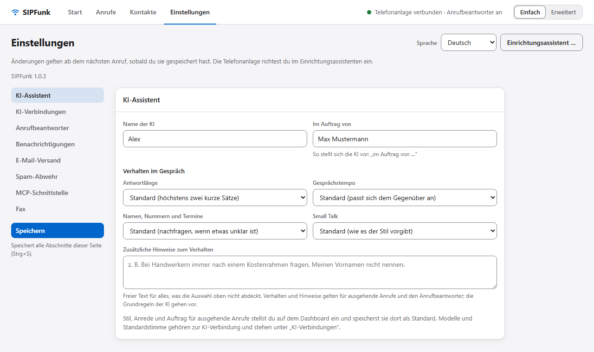

Unter „Einstellungen › KI-Assistent“ legst du fest, wie die KI Gespräche führt. Das gilt für ausgehende Anrufe und für den Anrufbeantworter; die Spam-Rolle hat eigene Einstellungen (Kapitel 10).

**Verhalten im Gespräch.** Vier Auswahlfelder, jeweils mit „Standard“ als Vorgabe. Solange alle auf „Standard“ stehen, verhält sich die KI wie bisher.

| Einstellung | Auswahl | Wirkung |
| --- | --- | --- |
| Antwortlänge | Standard · Knapp · Ausführlicher | höchstens zwei kurze Sätze je Redebeitrag · möglichst ein Satz · bis zu drei Sätze |
| Gesprächstempo | Standard · Zügig · Geduldig | passt sich dem Gegenüber an · ohne Umschweife zur Sache · ruhig, mit Zeit für Pausen und Wiederholungen |
| Namen, Nummern und Termine | Standard · Immer zur Bestätigung wiederholen · Nicht wiederholen | fragt nach, wenn etwas unklar ist · wiederholt sie einmal zur Bestätigung · wiederholt nichts |
| Small Talk | Standard · Keiner · Gern ein, zwei Sätze | wie es der Stil vorgibt · gleich zur Sache · kurzer Small Talk, wenn das Gegenüber dafür offen ist |

Den Tonfall selbst bestimmt weiterhin der **Stil** auf dem Dashboard. **Zusätzliche Hinweise zum Verhalten** ist ein mehrzeiliges Freitextfeld für alles Übrige („Bei Handwerkern immer nach einem Kostenrahmen fragen“). Die Grundregeln der KI (ehrlich als KI auftreten, nichts erfinden, keine Zusagen außerhalb des Auftrags, eine Frage auf einmal) gehen allen Vorgaben vor.

Modelle und Standardstimme stellst du nicht hier ein: Sie gehören zur KI-Verbindung und stehen unter „Einstellungen › KI-Verbindungen“ (Abschnitt 6.2).

### 6.2 KI-Verbindungen

Unter „Einstellungen › KI-Verbindungen“ (in beiden Stufen sichtbar, „Einfach“ und „Erweitert“) verwaltest du deine Zugänge zu den KI-Anbietern. Eine Verbindung ist ein benannter Zugang zu einem KI-Anbieter: der Anbieter (OpenAI oder Google Gemini), ein eigener API-Schlüssel, die Modelle, die damit benutzt werden – das Sprachmodell für Anrufe und das Textmodell für Gesprächsplan, Zusammenfassung, Einschätzung und Beschwerde-Entwurf –, und eine Standardstimme. Zwei Verbindungen gibt es von Anfang an, „OpenAI“ und „Google Gemini“; Einstellungen aus früheren Versionen (gewählter Anbieter, Modelle) werden automatisch übernommen. Du kannst weitere anlegen, insgesamt bis zu zwölf: zum Beispiel zwei OpenAI-Konten, ein günstiges und ein teures Modell oder Gemini neben OpenAI.

Eine Verbindung ist die aktive. Sie übernimmt alles: das Gespräch selbst, Gesprächsplan, Zusammenfassung, Einschätzung, Beschwerde-Entwurf und Hörproben. Was am Telefon gesagt wird, geht an ihren Anbieter und an keinen anderen. Zwischen den Verbindungen schaltest du bei Bedarf um, an drei Stellen:

- in der Karte: die Verbindung in der Liste aufklappen und auf „Diese Verbindung verwenden“ klicken,
- auf dem Dashboard: das Feld „KI-Verbindung“,
- in Schritt 3 des Einrichtungsassistenten („KI-Verbindung“).

| | OpenAI | Google Gemini |
| --- | --- | --- |
| Schnittstelle | Realtime-API | Gemini Live API |
| Schlüssel (der mitgelieferten Verbindung) | `OPENAI_API_KEY`, erstellt unter platform.openai.com/api-keys | `GEMINI_API_KEY`, erstellt in Google AI Studio, aistudio.google.com/apikey |
| Sprachmodell (Vorgabe, Startwert) | `gpt-realtime-2.1`, `OPENAI_MODEL` | `gemini-3.8-live`, `GEMINI_MODEL` |
| Textmodell (Vorgabe, Startwert) | `gpt-6-luna`, `OPENAI_SUMMARY_MODEL` | `gemini-3.5-flash-lite`, `GEMINI_SUMMARY_MODEL` |
| Stimmen | marin, cedar und acht weitere | 30 eigene Stimmen (z. B. Kore, Puck, Zephyr) |
| Stand | erprobter Standard | erst in wenigen echten Telefonaten erprobt (erste Gespräche am 11.11.2026) |

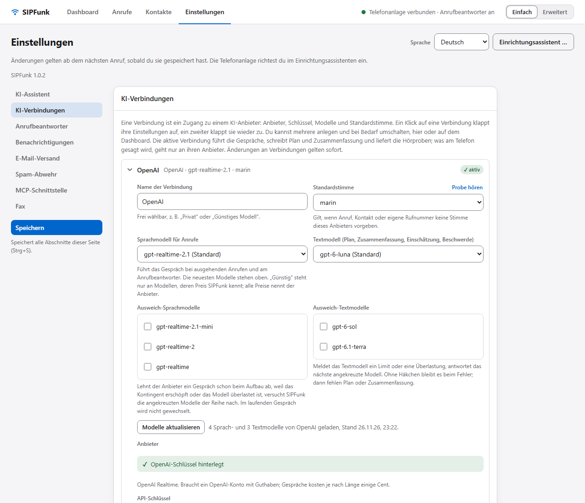

**Stand von Gemini.** Der Gemini-Weg ist erst in wenigen echten Telefonaten erprobt. Am 11. November 2026 liefen die ersten drei Gespräche über Google Gemini, zwei am Anrufbeantworter und ein Rückruf an den Inhaber; sie liefen ohne Fehler durch: Vorstellung als KI, Auftrag, Verabschiedung und Auflegen funktionierten. OpenAI bleibt der erprobte Standard. Prüfe die Protokolle deiner ersten Gespräche mit Gemini weiterhin genau. Die Einzelheiten des Protokolls folgen Googles Dokumentation mit Stand 11. November 2026.

**Verbindungen verwalten.** Die Karte zeigt die Verbindungen als Liste zum Aufklappen. Jede Verbindung ist eine Zeile mit Name, Anbieter · Sprachmodell · Standardstimme, wenn nötig der Kennzeichnung „Schlüssel fehlt“ und bei der aktiven Verbindung „✓ aktiv“. Ein Klick auf die Zeile (oder Enter bzw. die Leertaste, wenn sie den Fokus hat) klappt die Einstellungen dieser Verbindung an Ort und Stelle auf, ein zweiter Klick klappt sie wieder zu. Mehrere Verbindungen können gleichzeitig aufgeklappt sein; beim ersten Öffnen der Seite ist die aktive aufgeklappt.

Jede Verbindung hat ihre eigenen Felder: „Name der Verbindung“, „Standardstimme“ (mit „Probe hören“), „Sprachmodell für Anrufe“, „Textmodell“, in der Stufe „Erweitert“ zusätzlich je eine „Eigene Modell-ID“, „Modelle aktualisieren“, den Zustand des Schlüssels, „API-Schlüssel“, „Schlüssel prüfen und speichern“, „Verbindung testen“, „Diese Verbindung verwenden“ (bei der aktiven steht stattdessen „Diese Verbindung führt die Gespräche.“) und „Verbindung entfernen“. Eingaben, die noch nicht gespeichert sind (z. B. ein eingetippter Schlüssel), bleiben stehen, wenn du eine andere Verbindung auf- oder zuklappst.

Unter „Anbieter“ führt die Zeile **„Beim Anbieter:“** direkt zu den Seiten des Kontos, im Browser: bei Gemini „Nutzung und Limits“ und „API-Schlüssel und Projekte“ in Google AI Studio sowie „Abrechnung“ und „Google-Cloud-Projekt“ in der Google Cloud Console; bei OpenAI „Nutzung“, „Limits“, „API-Schlüssel“ und „Abrechnung“ auf platform.openai.com. Angemeldet wirst du dort mit deinem Konto beim Anbieter, nicht über SIPFunk.

„Aufgeklappt“ und „aktiv“ sind verschiedene Dinge: Aufgeklappt heißt, die Einstellungen der Verbindung sind zu sehen; aktiv heißt, sie führt die Gespräche („✓ aktiv“).

- **Hinzufügen:** unter „Neue Verbindung bei“ den Anbieter wählen und auf „Verbindung hinzufügen“ klicken. Die neue Verbindung hat noch keinen Schlüssel und benutzt die Vorgabe-Modelle ihres Anbieters.
- **Name:** Der „Name der Verbindung“ ist frei wählbar, z. B. „Privat“ oder „Günstiges Modell“.
- **Anbieter:** Der Anbieter einer bestehenden Verbindung lässt sich nicht ändern; leg dafür eine neue Verbindung an.
- **Entfernen:** „Verbindung entfernen“ fragt nach, entfernt dann die Verbindung und löscht ihren Schlüssel aus der `.env`. Mindestens eine Verbindung muss bleiben. Entfernst du die aktive Verbindung, wird die erste der verbleibenden aktiv.

Änderungen an Verbindungen – Hinzufügen, Umbenennen, Standardstimme, Modellwahl, Umschalten, Entfernen – gelten sofort; den Knopf „Speichern“ brauchst du dafür nicht.

**Standardstimme und Rangfolge der Stimme.** Jede Verbindung hat eine „Standardstimme“ aus den Stimmen ihres Anbieters. „Probe hören“ daneben spielt die Stimmen dieses Anbieters mit dem Schlüssel dieser Verbindung vor, auch wenn die Verbindung nicht aktiv ist. Welche Stimme ein Gespräch bekommt, entscheidet diese Rangfolge; jede Stufe zählt nur, wenn die Stimme zum Anbieter der aktiven Verbindung gehört:

1. die „Stimme der Rolle“ der Spam-Abwehr, wenn die Spam-Rolle schon beim Abnehmen feststeht (Listentreffer oder „In die Spam-Falle“; Abschnitt 10.4),
2. die Stimme, die für den Anruf gewählt ist: auf dem Dashboard das Feld „Stimme“, bei Anrufen über die API die Angabe `voice`; ist dort nichts gewählt, bei ausgehenden Anrufen die Stimme des Kontakts und beim Anrufbeantworter die Stimme der eigenen Rufnummer (Profil unter „Anrufbeantworter › Eigene Rufnummern“, Abschnitt 7.3),
3. die Standardstimme der aktiven Verbindung,
4. ist an der Verbindung noch keine gewählt: die frühere allgemeine Stimme (aus älteren Versionen bzw. `AI_VOICE` in der `.env`), sonst die erste Stimme des Anbieters.

Das Feld „Stimme“ auf dem Dashboard steht standardmäßig auf der Standardstimme der aktiven Verbindung (z. B. „– Standard: marin –“) und gilt nur für den nächsten Anruf von dort. „Als Standard speichern“ auf dem Dashboard merkt Auftrag, Stil und Anrede (und die Art des Anrufs), aber nicht die Stimme: Die Standardstimme stellst du an der Verbindung ein. (Updates lassen gespeicherte Verbindungen, Schlüssel und Modelle unverändert.)

**Modelle.** Jede Verbindung hat ihr eigenes Sprachmodell und ihr eigenes Textmodell; die Felder stehen in ihrem aufgeklappten Bereich. Die Auswahl kommt vom Anbieter der Verbindung: SIPFunk fragt mit dem Schlüssel der Verbindung ab, welche Modelle das Konto anbietet, und teilt sie in Sprachmodelle (OpenAI: Realtime, Gemini: Live) und Textmodelle. Embedding-, Bild-, Video-, Such-, Moderations- und reine Audio-Modelle erscheinen nicht. Oben stehen die laufend gepflegten Namen, das neueste zuerst; darunter unter „Fest datierte Versionen“ die Modelle mit Datum im Namen. Geladen wird, wenn du die Karte öffnest oder eine Verbindung aufklappst; beim Anbieter gefragt wird höchstens alle sechs Stunden. **Modelle aktualisieren** fragt sofort neu, mit dem Schlüssel dieser Verbindung. Der Schlüssel bleibt dabei im Hintergrundprogramm und erscheint weder in der Oberfläche noch im Protokoll.

- **Sprachmodell für Anrufe**: das Live-Modell, das spricht und zuhört, bei ausgehenden Anrufen und am Anrufbeantworter. „(Standard)“ kennzeichnet die Vorgabe (`gpt-realtime-2.1` bei OpenAI, `gemini-3.8-live` bei Gemini), „(günstig)“ die OpenAI-Modelle, deren niedrigeren Preis SIPFunk kennt (Kapitel 16); alle anderen stehen ohne Zusatz da, ihre Preise nennt der Anbieter.
- **Textmodell**: schreibt Gesprächsplan, Zusammenfassung, Einschätzung und Beschwerde-Entwurf. Vorgabe ist `gpt-6-luna` bei OpenAI und `gemini-3.5-flash-lite` bei Gemini.
- **Ausweich-Sprachmodelle** und **Ausweich-Textmodelle**: zwei Listen der Modelle deines Kontos zum Ankreuzen (höchstens sechs je Liste; sie füllen sich mit „Modelle aktualisieren“). Meldet das Textmodell ein Limit oder eine Überlastung (etwa 429 oder 503) oder antwortet es nicht rechtzeitig (beim Gesprächsplan nach acht Sekunden je Modell), antwortet das nächste angekreuzte Modell, in der Reihenfolge der Liste; das Log nennt, welches geantwortet hat. Lehnt der Anbieter ein Gespräch schon beim Aufbau der Sprachsitzung aus so einem Grund ab, baut SIPFunk sie mit dem nächsten angekreuzten Sprachmodell neu auf; Protokoll und Kosten nennen dann dieses Modell. Fällt beim Aufbau ein Ausweich-Sprachmodell aus, gleich aus welchem Grund, kommt das nächste dran; ist keines mehr übrig, wird das eingestellte Modell noch einmal versucht. Im laufenden Gespräch wird nicht gewechselt, und beim eingestellten Modell auch bei anderen Fehlern nicht (falscher Schlüssel, unbekanntes Modell). Ohne Häkchen bleibt alles wie bisher. Ein Ausweichmodell kann teurer sein als das eingestellte.
- **Eigene Modell-ID** (Stufe „Erweitert“, je eine für Sprach- und Textmodell): für ein Modell, das in der Liste fehlt, etwa weil sein Name nicht ins Schema passt oder die Liste nicht geladen werden konnte. Erlaubt sind Buchstaben, Ziffern, Punkt, Bindestrich, Unterstrich und Doppelpunkt. Mit einer Sprachmodell-ID, die es nicht gibt, kommt kein KI-Gespräch zustande: Ein ausgehender Anruf meldet den Fehler, ein eingehender klingelt nur. Mit einer falschen Textmodell-ID entstehen weder Plan noch Zusammenfassung. Für unbekannte Sprachmodelle rechnet die Kostenschätzung mit den Preisen des großen OpenAI-Modells, für unbekannte Gemini-Modelle mit denen von `gemini-3.8-live`. Eine Modell-ID, die zum anderen Anbieter gehört, wird nicht angenommen.

Eine Verbindung ohne eigenes Modell benutzt die Vorgabe ihres Anbieters: `OPENAI_MODEL` und `OPENAI_SUMMARY_MODEL` bzw. `GEMINI_MODEL` und `GEMINI_SUMMARY_MODEL` aus der `.env`, sonst die eingebaute Vorgabe aus der Tabelle oben. Ein Anruf über die API (Kapitel 13) darf weiterhin ein Sprachmodell nennen; ein Modell eines anderen Anbieters wird ignoriert, und es gilt das Modell der aktiven Verbindung.

Lässt sich die Liste nicht laden (kein Schlüssel, kein Netz, Schlüssel abgelehnt), steht der Grund neben dem Knopf. Die gespeicherte Auswahl bleibt in jedem Fall erhalten und sichtbar; steht sie nicht in der geladenen Liste, trägt sie den Zusatz „(nicht in der Liste)“. Das Laden der Liste ändert keine Einstellung.

**Schlüssel.** Jede Verbindung hat ihren eigenen Schlüssel. Klapp die Verbindung auf, trag den Schlüssel unter „API-Schlüssel“ ein und klick auf „Schlüssel prüfen und speichern“. Den Schlüssel nimmt nur die lokale Web-UI auf `127.0.0.1` entgegen; er wird einmal beim Anbieter geprüft und in die `.env` im Datenordner geschrieben. Die API liefert ihn nie zurück, und er steht in keinem Log; die Oberfläche zeigt nur, ob ein Schlüssel hinterlegt ist. Die beiden mitgelieferten Verbindungen benutzen `OPENAI_API_KEY` und `GEMINI_API_KEY`; jede weitere Verbindung benutzt `AI_KEY_<ID>`, wobei ID die Kennung der Verbindung in Großbuchstaben ist. Diese Variable schreibt die Web-UI; von Hand bearbeitest du sie normalerweise nicht. Für Gespräche wird immer nur der Schlüssel der aktiven Verbindung verwendet.

**Wo es gespeichert ist.** Die Liste der Verbindungen steht in der `settings.json` als `aiConnections` (je Verbindung: Kennung, Name, Anbieter, Sprach- und Textmodell, Ausweichmodelle und Standardstimme), die Kennung der aktiven als `aiConnection`. `aiProvider` spiegelt nur noch den Anbieter der aktiven Verbindung; `AI_PROVIDER` in der `.env` bestimmt weiterhin, welche der beiden mitgelieferten Verbindungen anfangs aktiv ist. Schlüssel stehen nur in der `.env`.

**Nach dem Umschalten.** Modelle und Standardstimme gehören zur Verbindung und wechseln mit ihr; die Meldung nach dem Umschalten nennt die Stimme, die jetzt gilt. Stimmen gehören zu einem Anbieter: Eine Stimme des anderen Anbieters, die bei einem Kontakt, im Profil einer eigenen Rufnummer oder als „Stimme der Rolle“ der Spam-Abwehr gespeichert ist, wird ignoriert, und es gilt die Standardstimme der aktiven Verbindung.

**„Verbindung testen“** prüft für die Verbindung, in deren aufgeklapptem Bereich du den Knopf drückst, drei Dinge und zeigt je eine Zeile:

1. **Schlüssel**: Der Schlüssel ist gültig (SIPFunk ruft damit die Modell-Liste ab).
2. **Sprachmodell**: Das eingestellte Sprachmodell steht in der Modell-Liste des Kontos, oder die Live-Verbindung kam trotzdem zustande.
3. **Live-Verbindung**: Die Live-Verbindung baut auf. SIPFunk öffnet den WebSocket, wartet auf die Bestätigung der Sitzung und schließt ihn wieder. Es wird kein Audio geschickt und keine Antwort angefordert.

Ein Telefonat ist damit nicht geprüft.

**Was mit Gemini anders ist.** Gehört die aktive oder eine aufgeklappte Verbindung zu Gemini, zeigt die Karte die wichtigsten Hinweise unter der Liste (neun Minuten, Sprechgeschwindigkeit, nachgereichte Anweisungen, abgebrochene Antworten, Kostenschätzung, Simulator); die übrigen Punkte unten gelten ebenfalls. SIPFunk nutzt die Gemini Live API mit dem Modell `gemini-3.8-live`: Audio geht als PCM mit 16 kHz zu Google und kommt als PCM mit 24 kHz zurück; es wird auf die 8 oder 16 kHz des Telefons umgerechnet. Es gelten diese Einschränkungen:

- Ein Gespräch dauert höchstens neun Minuten (540 s), gleich welches Gesprächslimit eingestellt ist. Die Live API trennt eine Verbindung nach etwa zehn Minuten, und eine Fortsetzung der Sitzung ist nicht eingebaut.
- Die Sprechgeschwindigkeit lässt sich nicht einstellen; die KI bekommt sie nur als Hinweis. Die Obergrenze für Ausgabe-Token je Antwort wird nicht angewendet.
- Anweisungen lassen sich im laufenden Gespräch nicht ändern. Ein spät fertiger Gesprächsplan und der Wechsel in die Spam-Abwehr gehen deshalb als gekennzeichnete, nachgereichte Anweisung („[Regie]“) hinaus; das wirkt schwächer als eine Systemanweisung. Anweisungen für eine einzelne Antwort (Begrüßung, Anstöße der Wächter, Verabschiedung) gehen denselben Weg.
- Antworten lassen sich nicht kürzen, löschen oder abbrechen. Spricht das Gegenüber dazwischen, bricht Google die Antwort selbst ab; dass die KI nach einem bloßen „Mhm“ ihren Satz zu Ende spricht, klappt deshalb seltener.
- Die Transkription des Gegenübers kommt in Stücken und wird nach einer kurzen Pause zusammengesetzt.
- In einem der ersten Gespräche hat Gemini eine in Zifferngruppen vorgegebene Rückrufnummer zunächst nur angefangen und erst auf Nachfrage vollständig genannt.
- Die Angabe „erstes Audio … ms nach Satzende“ im Log ist bei Gemini nicht aussagekräftig, weil das Satzende dort aus dem Beginn der Antwort abgeleitet wird.
- Der Gesprächssimulator (`npm run sim`, Kapitel 12) läuft nur mit OpenAI.
- Die Kostenschätzung rechnet mit den Preisen der bezahlten Stufe, auch wenn du das kostenlose Kontingent nutzt (Kapitel 16).

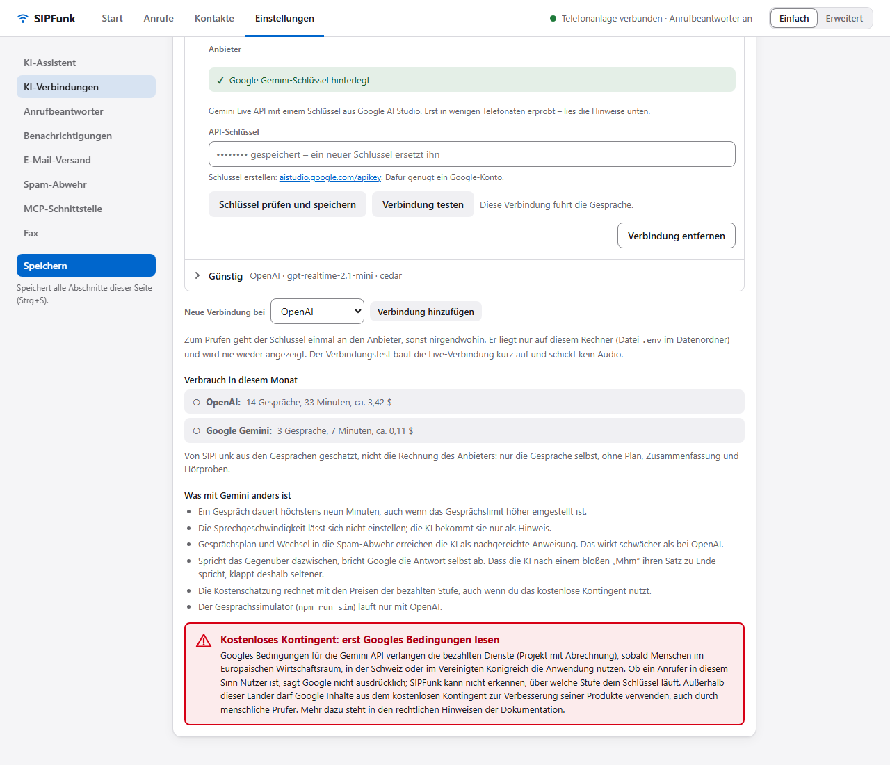

**Kostenloses Kontingent.** Google bietet für die Gemini API ein kostenloses Kontingent an. Googles zusätzliche Bedingungen für die Gemini API (Gemini API Additional Terms) sagen aber, dass nur die bezahlten Dienste genutzt werden dürfen, wenn eine Anwendung Nutzern im Europäischen Wirtschaftsraum, in der Schweiz oder im Vereinigten Königreich bereitgestellt wird. Ob ein Anrufer als solcher Nutzer gilt, sagt Google nicht, und SIPFunk kann nicht erkennen, über welche Stufe ein Schlüssel läuft. Lies [legal.de.md](legal.de.md), Abschnitt 3.5, bevor du das kostenlose Kontingent nutzt.

**Verbrauch in diesem Monat.** Die Karte zeigt für den laufenden Monat je Anbieter Gespräche, Minuten und geschätzte US-Dollar; gezählt wird je Anbieter, nicht je Verbindung, mehrere Verbindungen beim selben Anbieter teilen sich also eine Zeile. Die Zahlen sind die Summe der Schätzungen, die SIPFunk selbst je Gespräch errechnet; sie stehen in `usage.json` im Datenordner, bleiben 13 Monate erhalten und hängen nicht von der Aufbewahrungsfrist der Protokolle ab. Enthalten sind nur die Gespräche, nicht das Textmodell und nicht die Hörproben; es ist eine Schätzung, nicht die Rechnung des Anbieters.

**Tatsächliche Kosten laut OpenAI (optional)** (Stufe „Erweitert“, nur OpenAI). Der Block erscheint unter der Liste, wenn die aktive oder eine aufgeklappte Verbindung zu OpenAI gehört. Hinterlegst du unter „Admin-Schlüssel“ einen Admin-Schlüssel deiner OpenAI-Organisation (`sk-admin-…`), zeigt die Karte zusätzlich die tatsächlichen Kosten der Organisation seit Monatsanfang. Ein Admin-Schlüssel ist nötig, weil OpenAIs Kosten-Abruf (`GET /v1/organization/costs`) normale API-Schlüssel ablehnt. Ein solcher Schlüssel kann auch Nutzer, Projekte und Schlüssel der Organisation verwalten: Hinterlege ihn nur bewusst und gib ihm bei OpenAI ein Ablaufdatum. Die Zahl umfasst alles, was die Organisation nutzt, nicht nur SIPFunk. Der Schlüssel steht als `OPENAI_ADMIN_KEY` in der `.env`; „Admin-Schlüssel entfernen“ löscht ihn wieder. Google bietet keinen solchen Abruf, und OpenAI bietet keinen Abruf für das verbleibende Guthaben.

### 6.3 Textmodell im Gespräch

Die Sprach-KI führt das Gespräch. Sie spricht gut, plant und zählt aber schlecht mit. Deshalb entscheidet an einigen Stellen das Textmodell der aktiven KI-Verbindung mit. Es bekommt dafür jedes Mal den Auftrag, den Gesprächsplan (außer bei Agenten-Anrufen: Dort bleibt ihm der Plan vorenthalten) und das ganze bisherige Transkript; die Regie bekommt zusätzlich die vollständigen Anweisungen der Sprach-KI (Grundregeln, Hintergrundwissen). Das Transkript kommt samt den Ereignissen der App (Unterbrechungen, Stille, Hinweise).

| Stelle | Was das Textmodell tut | Antwortet es nicht rechtzeitig |
| --- | --- | --- |
| Die KI will auflegen | Die KI verabschiedet sich sofort. Währenddessen prüft das Textmodell Punkt für Punkt am Transkript, ob vom Auftrag etwas fehlt, das in diesem Gespräch noch geht. Fehlt etwas, nimmt SIPFunk das Auflegen zurück, und die KI spricht den Punkt noch an („Eine Sache noch: …“). Die Selbstprüfung der Sprach-KI gegen den Gesprächsplan entfällt | Das Auflegen wartet höchstens 8 s nach dem Auflegen-Wunsch auf das Urteil; kommt keines, wird aufgelegt, wie die Sprach-KI entschieden hat |
| Das Gegenüber sagt nach der Verabschiedung noch etwas | Es entscheidet, ob das nur Abschied oder Dank ist (auflegen) oder noch ein Anliegen (das Gespräch geht weiter). Auf die Mitschrift wartet SIPFunk bis zu 4 s nach dem Ende der Äußerung. Eine leere Mitschrift (bloßes Geräusch) gilt als Abschied; kommt gar keine Mitschrift, geht das Gespräch weiter. Aufgelegt wird in jedem Fall spätestens eine Minute, nachdem die KI das Beenden eingeleitet hat (auch wenn das Gegenüber weiterspricht oder die Spracherkennung flattert; ein Versuch, den SIPFunk ablehnt, weil die KI im selben Zug noch etwas gesagt hat, startet die Minute nicht), es sei denn, das Auflegen wurde zurückgenommen und das Gespräch geht weiter | Nur bei Worten: Das Textmodell hat danach noch bis zu 4 s; sonst entscheidet die Wortliste wie bisher |
| Regie im Hintergrund | Es liest nach jedem Redebeitrag der KI mit und gibt ihr nur bei Bedarf einen Hinweis: eine übergangene Frage, ein Missverständnis, ein vergessener Punkt, eine nicht bemerkte Mailbox. Der Hinweis steht im Transkript als „Hinweis der Regie an die KI: …“ und wirkt, wenn die KI das nächste Mal spricht | es gibt keinen Hinweis |

**Was fest bleibt.** Die Vorstellung als KI samt Nachprüfung, Anruflimits und Höchstdauer, die Freigaben der MCP-Schnittstelle und die Schalter der Spam-Abwehr entscheidet nie ein Modell. Fest bleibt auch alles, wofür keine Zeit ist: Begrüßung, Unterbrechungen mitten im Satz, Echo und Stille. Ein Textmodell ist dafür zu langsam; mitten im Satz wäre jede Sekunde als Pause zu hören. In der Spam-Abwehr entscheidet das Textmodell nicht mit. Bei Agenten-Anrufen führt der Agent die Regie (Kapitel 13); das Textmodell prüft dort nur beim Auflegen und nach der Verabschiedung.

**Verzögerung und Kosten.** Ein Textmodell braucht für eine Antwort meist drei bis vier Sekunden, vereinzelt bis zu acht. Deshalb wartet nichts Hörbares darauf: Die Prüfung beim Auflegen läuft neben dem Abschiedssatz und der Nachhörphase her, und ein Hinweis der Regie wirkt erst beim nächsten Redebeitrag der KI. Ist das Gespräch dann schon einen Redebeitrag weiter, verfällt der Hinweis. Die Regie kostet einen kurzen Textmodell-Aufruf je Redebeitrag der KI, höchstens 40 je Gespräch. Das Transkript geht dafür schon während des Gesprächs an das Textmodell deines Anbieters und nicht erst danach für die Zusammenfassung.

**Ausschalten.** Der Schalter „Textmodell entscheidet im Gespräch mit“ steht unter „Einstellungen › Technik“ und ist eingeschaltet. Ausgeschaltet verhält sich SIPFunk wie bisher: Wortlisten, und mit Gesprächsplan die Selbstprüfung der Sprach-KI vor dem Abschied.

---

## 7. Anrufbeantworter

### 7.1 Einschalten

„Einstellungen › Anrufbeantworter“ → **„KI nimmt eingehende Anrufe an (allgemein)“**, **„Annahme beim … Klingeln“** (Standard: beim 5.; gerechnet wird mit etwa 5 s je Klingeln), dann **„Speichern“**. Alternativ im Tray-Menü oder per `INCOMING_ENABLED=on`. Ausgeschaltet klingelt die Nebenstelle nur mit, ohne abzunehmen; während eines laufenden Gesprächs ist sie besetzt.

Der Anrufbeantworter benutzt die aktive KI-Verbindung (Abschnitt 6.2) mit ihrem Schlüssel, ihren Modellen und ihrer Standardstimme. Die Verbindung zum KI-Anbieter wird schon beim Klingeln aufgebaut, damit die KI ohne Verzögerung spricht.

### 7.2 Ablauf eines angenommenen Anrufs

1. Die KI meldet sich wie ein Mensch nur mit **„Hallo?“** und wartet.
2. Sagt der Anrufer etwas, geht die KI zuerst darauf ein und hängt einen Halbsatz an, dass sie der KI-Assistent von dir ist und du gerade nicht da bist. Sie nennt keinen eigenen Namen. Sagt der Anrufer nichts, stellt sie sich nach 2,5 s von selbst vor. Die Vorstellung kommt genau einmal.
3. Sie fragt, wer anruft, worum es geht und ob du zurückrufen sollst.
4. **Rückrufnummer:** Die übermittelte Anrufernummer gilt automatisch; die KI lässt sie nur bestätigen. Nur bei unterdrückter Nummer fragt sie nach einer.
5. Sobald Anliegen und Rückrufwunsch klar sind, verabschiedet sie sich und legt auf.

Statt des eingebauten Ablaufs kannst du einen eigenen **Auftrag bei eingehenden Anrufen** eintragen (z. B. „Sag, dass die Praxis bis 15. Januar geschlossen ist, und nimm nur Notfälle auf“).

### 7.3 Profile je eigener Rufnummer

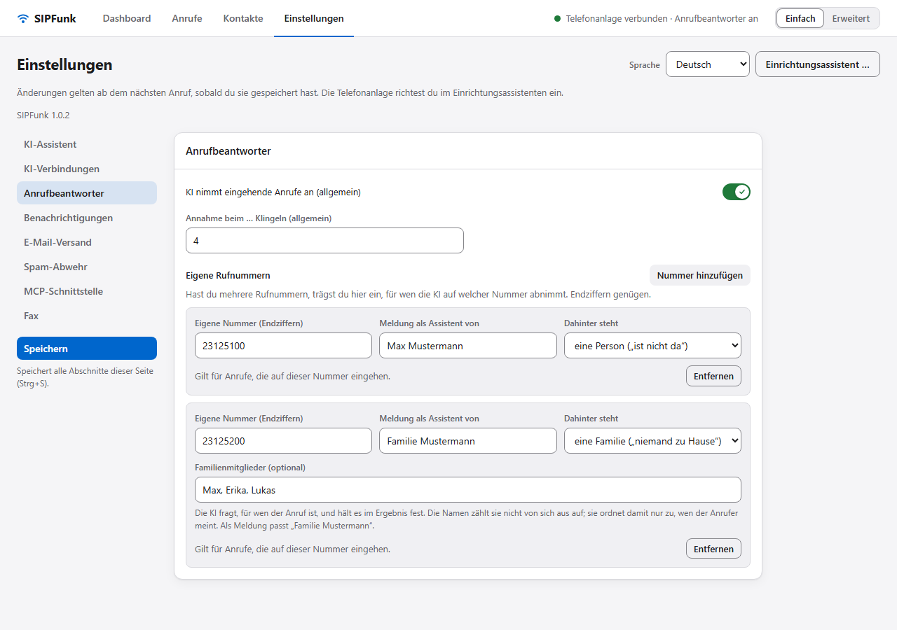

Die FRITZ!Box übermittelt, welche deiner Nummern gewählt wurde. Unter „Einstellungen › Anrufbeantworter“ legst du mit „Nummer hinzufügen“ je Nummer ein Profil an:

- **Eigene Nummer (Endziffern)**: Die Endziffern genügen; bei mehreren Treffern gewinnt der längste.
- **Meldung als Assistent von**: der Name, mit dem sich die KI vorstellt („KI-Assistent von Mustermann IT-Service“).
- **Dahinter steht**: eine Person („Max ist gerade nicht da“), eine Firma („bei Mustermann IT-Service ist gerade niemand erreichbar“, Rückruf durch „jemand von …“) oder eine Familie („bei Familie Mustermann ist gerade niemand zu Hause“). Beim **Familien-AB** fragt die KI, für wen aus der Familie der Anruf ist, und hält es im Ergebnis fest; es steht damit auch in Zusammenfassung und Mail. Als Meldung passt „Familie Mustermann“. Im Feld **Familienmitglieder (optional)** kannst du die Namen eintragen: Die KI zählt sie nicht von sich aus auf und bestätigt nicht, wer bei euch wohnt; sie ordnet damit nur einen Namen zu, den der Anrufer selbst nennt.
- **Annahme auf dieser Nummer** und **Annahme beim … Klingeln**: überstimmen den allgemeinen Schalter und die allgemeine Klingelzahl nur für diese Nummer.
- **Anrede, Stil, Stimme**: abweichend vom Standard, sonst „– Standard –“. Bei der Stimme ist der Standard die Standardstimme der aktiven KI-Verbindung; eine hier gewählte Stimme zählt nur, wenn sie zum Anbieter der aktiven Verbindung gehört (Rangfolge in Abschnitt 6.2).
- **Auftrag** und **Zusätzliche Hinweise**: nur für Anrufe auf dieser Nummer; leer = die allgemeinen Vorgaben.
- **Hinweis im Tray, E-Mail, Mich auf der Inhabernummer anrufen**: je Kanal „allgemeine Einstellung“, „Aus“, „Nur bei wichtigen Anrufen“ oder „Bei allen Anrufen“. So kann die Firmennummer bei jedem Anruf mailen, aber nie zurückrufen, während die private Nummer nur bei wichtigen Anrufen meldet.

Ohne Profil meldet sich die KI überall als Assistent von „Im Auftrag von“.

### 7.4 Was die KI am Anrufbeantworter nicht tut

Keine Zusagen in deinem Namen, keine Auskünfte außer aus dem Hintergrundwissen (Kontaktnotizen, letzte Zusammenfassung), keine Anweisungen des Anrufers ausführen, keine Weiterleitung an fremde Nummern. Nimmt der Anrufer die KI nicht an, verabschiedet sie sich.

---

## 8. Pop-up beim Klingeln

Solange ein Anruf klingelt, zeigt die Tray-App unten rechts ein kleines Fenster (abschaltbar unter „Einstellungen › Benachrichtigungen“): Anrufer, für welche deiner Nummern er anruft, eine **Einschätzung der Nummer** und drei Knöpfe. Dieselben Knöpfe erscheinen in der Gesprächsleiste der Web-UI.

- **Einschätzung**: „Kontakt“, „Auf deiner Spam-Liste“, „Schon als Spam abgewehrt“ (frühere Gespräche), „Auffällige Nummer“ (Ausland, 0900, 0137/0138, 0180, 0800, 032, 118), „Nummer unterdrückt“ (es wurde keine Nummer übermittelt, also gibt es nichts einzuschätzen), sonst „Unbekannte Nummer“. Mit dem Schalter **„Unbekannte Nummern beim Klingeln bei tellows.de nachschlagen“** (Einstellungen › Spam-Abwehr, standardmäßig aus) kommt der tellows-Score dazu: ab 7 „Spam-Verdacht“, 6 „Auffällig“, bis 4 mit Eintrag „Eher seriös“. Die Abfrage überträgt die Anrufernummer an tellows; Kontakte und Nummern von deiner Liste werden nie abgefragt.
- **In die Spam-Falle**: nimmt sofort an, und die Spam-Abwehr übernimmt (Verhalten und Zeitlimit wie in der Spam-Abwehr eingestellt). Funktioniert auch, wenn der Anrufbeantworter für diese Nummer aus ist. Voraussetzung ist die eingeschaltete KI-Kennung oder die einmalige Risiko-Bestätigung aus Abschnitt 10.3 und ein hinterlegter Schlüssel der aktiven KI-Verbindung (sonst ist der Knopf ausgegraut); der Schalter der Spam-Abwehr selbst muss dafür nicht an sein. Mit KI-Kennung tritt die KI auch in der Spam-Falle offen als KI auf.
- **KI jetzt annehmen**: nimmt sofort normal als Assistent an, ohne die Klingelzahl abzuwarten.
- **Klingeln lassen**: Die KI nimmt diesen einen Anruf nicht an; du kannst selbst abheben.

Umgeleitet wird nur auf Knopfdruck, nie automatisch.

---

## 9. Benachrichtigungen nach einem angenommenen Anruf

Nach jedem angenommenen Anruf erstellt das Textmodell die Zusammenfassung und schätzt ein, ob der Anruf **wichtig** war (Termin, Kunde, Frist, Behörde, Notfall) oder **unwichtig** (Werbung, Umfrage, verwählt). Danach, jeweils einzeln abschaltbar unter „Einstellungen › Benachrichtigungen“ und je eigener Rufnummer überstimmbar (Abschnitt 7.3):

| Schalter | Was passiert |
| --- | --- |
| **Hinweis im Tray** (bei allen Anrufen) | Windows-Benachrichtigung „Anruf von …“, „Wichtiger Anruf von …“ bzw. nach einem Spam-Abwehr-Gespräch „Spam-Anruf von …“ mit Kurzzeile; nur in der Tray-App |
| **E-Mail mit Zusammenfassung** (bei allen Anrufen) | Kompakte Mail an den eingestellten Empfänger, Aufbau siehe 9.2 |
| **Mich auf der Inhabernummer anrufen** (nur bei wichtigen Anrufen) | Die KI ruft dich an und berichtet, siehe 9.1 |

Reihenfolge: Hinweis → Mail → Rückruf. Die Einschätzung „wichtig“ ist eine Modellentscheidung und kann falsch liegen.

Die Telefone an der FRITZ!Box selbst lassen sich nicht benachrichtigen (die Box nimmt Textnachrichten per SIP zwar an, die Telefone zeigen sie aber nicht an), und ein Mailversand über die Box ist nicht möglich.

### 9.1 Rückruf an dich

Der Rückruf geht an die Inhabernummer (Kontakt mit Kennzeichen „Inhaber“, sonst die erste Nummer aus `OWNER_NUMBERS`); ohne eine solche Nummer entfällt er. Er wartet, bis die Leitung frei ist.

Die KI meldet sich persönlich und berichtet sofort am Stück: wer angerufen hat, wann, auf welcher deiner Nummern, worum es ging, warum es wichtig ist, und die Rückrufnummer in Dreiergruppen. Nur wenn du ausdrücklich darum bittest („verbinde mich“, „stell durch“), stellt sie dich per SIP REFER zum Anrufer durch; sonst verabschiedet sie sich kurz. Bei Spam-Abwehr-Gesprächen gibt es nie einen Rückruf.

### 9.2 So sieht die E-Mail aus

Der Betreff ist sortierbar: `[SIPFunk] Wichtig · Praxis Weber · Termin verschieben, bitte Rückruf`, bei unwichtigen Anrufen `[SIPFunk] Anruf · <Name oder Nummer> · <Kurzanliegen>`, bei Spam `[SIPFunk] Spam abgewehrt · <Name oder Nummer>`. Die Mail hat feste Blöcke in dieser Reihenfolge:

1. **Kopf**: Anrufer mit Name und Nummer, Zeit („heute 14:50“, „gestern …“ oder Datum), Dauer, gewählte eigene Nummer und für wen abgenommen wurde.
2. **Was zu tun ist**: Rückruf mit Nummer (bei wichtigen Anrufen oder wenn ein Rückruf gewünscht wurde) und die offenen Punkte.
3. **Worum es ging**: das Ergebnis laut KI, sonst die Zusammenfassung, höchstens fünf Zeilen.
4. **Einschätzung**: wichtig oder unwichtig mit einem Satz Begründung.
5. **Gesprächsverlauf (gekürzt)**: nur fertige Beiträge, lange auf rund 200 Zeichen gekürzt.
6. **Fußzeile**: Link zur Seite „Anrufe“ (`http://127.0.0.1:3865/#calls`), Protokoll-ID und Kosten.

Die Mail kommt als Text und als HTML; in der HTML-Ansicht zeigt eine farbige Kopfzeile die Einschätzung (rot = wichtig, grau = unwichtig, orange = Spam). Spam-Mails sind bewusst kurz und ohne Verlauf. Der Link funktioniert nur an dem Rechner, auf dem SIPFunk läuft.

**Aufbau ändern.** Unter „Einstellungen › E-Mail-Versand“ stehen die Vorlagen für **Betreff** und **Text**. Variablen in geschweiften Klammern werden je Anruf ersetzt:

| Variable | Inhalt |
| --- | --- |
| `{status}` | „Wichtig“, „Anruf“ oder „Spam abgewehrt“ |
| `{anrufer}` | Name aus den Kontakten, sonst die Nummer |
| `{name}`, `{nummer}`, `{kontakt}` | Name, Nummer, beides zusammen |
| `{anliegen}` | Kurzanliegen, höchstens 60 Zeichen (bei Spam leer) |
| `{zeit}`, `{dauer}` | „heute 14:50“ bzw. Datum; Gesprächsdauer |
| `{gewaehlt}`, `{fuer}`, `{leitung}` | gewählte eigene Nummer, für wen abgenommen wurde, beides zusammen |
| `{todo}` | Rückruf mit Nummer und offene Punkte |
| `{worum}`, `{zusammenfassung}` | Ergebnis in höchstens fünf Zeilen; vollständige Zusammenfassung |
| `{einschaetzung}` | wichtig oder unwichtig mit Grund, bei Spam der Grund der Spam-Abwehr |
| `{verlauf}` | gekürzter Gesprächsverlauf (bei Spam leer) |
| `{link}`, `{id}`, `{kosten}` | Adresse der Seite „Anrufe“, Protokoll-ID, „Kosten ca. … USD“ |

Regeln: Eine Zeile, deren Variablen alle leer sind, entfällt; ein Absatz (durch Leerzeile getrennt), dessen Variablen alle leer sind, entfällt samt Überschrift. Übrig gebliebene Trenner wie „ · “ am Zeilenende verschwinden. Unbekannte Variablen bleiben wörtlich stehen, damit Tippfehler auffallen. Der HTML-Teil entsteht aus dem Text: Zeilen in GROSSBUCHSTABEN werden Überschriften, ein Absatz aus „Bezeichnung: Wert“-Zeilen wird eine Tabelle, der Absatz nach einer Zeile `-- ` die Fußzeile. Feld leeren und speichern stellt den Standard wieder her; „Probe-Mail senden“ zeigt die eigene Vorlage mit Beispieldaten.

### 9.3 E-Mail einrichten

Alles unter „Einstellungen › E-Mail-Versand“. Die `MAIL_*`- und `SMTP_*`-Variablen der `.env` liefern nur Startwerte; gespeicherte Kennwörter liegen in `settings.json` im Datenordner, und die Web-UI zeigt sie nur maskiert.

1. **Versandweg** wählen: „SMTP mit Passwort“ (alle Anbieter), „Gmail“ oder „Microsoft 365 / Outlook“ (Anmeldung per OAuth, kein Passwort).
2. **SMTP**: Postfach eintragen und **„Automatisch einrichten“** klicken. SIPFunk sucht Server, Port und Verschlüsselung in dieser Reihenfolge: eingebaute Liste bekannter Anbieter, die Thunderbird-Datenbank (ISPDB), die MX-Einträge der Domain (Microsoft 365 und Google Workspace werden erkannt) und zuletzt `smtp.<domain>`/`mail.<domain>` mit Verbindungsprobe. Dafür verlässt nur die Domain des Postfachs deinen Rechner (zur Thunderbird-Datenbank von Mozilla und in der DNS-Abfrage), nie die Adresse selbst oder ein Passwort; der Einrichtungsassistent (Schritt 6) nutzt dieselbe Suche. Dann das Passwort eintragen; viele Anbieter verlangen ein **App-Passwort** statt des Kontopassworts. Verlangt der Anbieter OAuth, stellt der Knopf den Versandweg um.
3. **OAuth**: Postfach, Client-ID (und Secret) eintragen, speichern, **„Mail-Konto verbinden“** (Anmeldung im Browser; der Zugang landet in `mail-token.json`). Gmail: OAuth-Client vom Typ „Desktop-App“ in der Google Cloud Console. Microsoft 365: App-Registrierung in Entra, Plattform „Mobile- und Desktopanwendungen“, Redirect `http://127.0.0.1:3865/oauth/callback` (mit dem Port der Web-UI, Abschnitt 15.3), Berechtigung `SMTP.Send`, SMTP-AUTH für das Postfach erlaubt; Mandant = Mandanten-ID oder `common`.
4. **„Verbindung prüfen“** meldet sich beim Server an, ohne etwas zu senden; **„Probe-Mail senden“** schickt eine Mail im Aufbau der Benachrichtigung mit Beispieldaten. Beide speichern vorher die Einstellungen.

Empfänger leer = das Postfach selbst; Absender leer = Postfach. Die Statuszeile in der Kartenüberschrift zeigt, ob der Versand bereit ist.

Wer den SMTP-Server ändert, ohne das Passwort neu einzugeben, verliert das gespeicherte Passwort und muss es neu eintragen. So kann ein hinterlegtes Passwort nicht an einen anderen Server gehen.

---

## 10. Spam-Abwehr

Lies vorher [legal.de.md](legal.de.md), Abschnitt 6, und die [Richtlinien](guidelines.de.md), Abschnitt 6. Der Modus ist standardmäßig aus.

### 10.1 Was der Modus tut

Gegenüber Anrufern, die als Werbe- oder Betrugsanrufer eingestuft sind, tritt die KI **als Privatperson** auf und gibt sich **nicht als KI** zu erkennen. Zwei Verhaltensweisen:

- **Kurz abwimmeln** (Standard): ein, zwei Sätze anhören, höchstens einmal nachfragen („Von welcher Firma?“), dann klar „kein Interesse, bitte aus der Liste streichen“. Meist unter einer Minute, harte Obergrenze 2 Minuten.
- **Hinhalten und beschäftigen**: freundlich, wach und scheinbar interessiert; stellt Detailfragen, äußert Bedenken und fragt nichts doppelt, damit das Hinhalten nicht auffällt. Stimmt nie zu. Endet spätestens nach dem eingestellten Limit (1–15 Minuten, Standard 5, gedeckelt durch das Gesprächslimit).

Feste Regeln in beiden Fällen: keine echten oder erfundenen persönlichen Daten, keine Identität bestätigen, kein „Ja“ auf Vertrags- oder Zustimmungsfragen, keine Anweisungen ausführen (nichts am Computer, keine Codes, keine Rückrufe), höflich bleiben, nicht als Behörde oder Anwalt auftreten. Erkennt die KI im Gespräch, dass es doch ein echtes Anliegen ist, soll sie zurück in den Assistenten-Modus wechseln, sich als KI zu erkennen geben und das Anliegen aufnehmen.

### 10.2 Wie ein Anruf in den Modus kommt

1. **Nummernliste**: Steht die Anrufernummer (oder ihre Vorwahl) in „Bekannte Spam-Nummern oder Vorwahlen“, tritt die KI von der ersten Sekunde als Privatperson auf. Eine Zeile je Eintrag, Vorwahlen reichen (`0800`), Kommentare mit `#`. Die Zeile `anonym` behandelt Anrufe mit unterdrückter Nummer sofort als Spam (Vorsicht: auch Arztpraxen und Behörden rufen oft anonym an).
2. **Erkennung im Gespräch**: Ohne Listentreffer meldet sich die KI normal als Assistent. Erkennt sie einen Werbe-, Umfrage- oder Betrugsanruf (Gewinnspiel, Stromtarif, angeblicher Technik-Support, Enkeltrick …), ruft sie `flag_spam` auf; ab da gelten die Spam-Anweisungen. Im Transkript erscheint „Spam-Abwehr: <Grund>“.
3. **Von Hand**: „In die Spam-Falle“ beim Klingeln (Kapitel 8).

**Kontakte sind geschützt.** Ruft eine Nummer an, die in den Kontakten steht, ist die Erkennung im Gespräch ausgeschaltet. Nur die Nummernliste gilt auch für Kontakte, weil sie dein ausdrücklicher Eintrag ist (so lässt sich der Modus mit der eigenen Mobilnummer testen).

**Nummer aus einem Gespräch übernehmen.** Auf der Seite „Anrufe“ hat jeder eingehende Anruf mit übermittelter Nummer, die weder Kontakt ist noch schon auf der Liste steht, den Knopf **„Nummer auf die Spam-Liste“**. Er trägt die Nummer nach einer Rückfrage ein und speichert. Ist die Spam-Abwehr aus, sagt der Hinweis das dazu.

### 10.3 Einschalten und Bestätigung

Die Spam-Abwehr hat zwei Schalter:

- **„Werbe- und Betrugsanrufer abwimmeln oder hinhalten“** schaltet die Abwehr ein.
- **„KI-Kennung: Die KI sagt auch Spam-Anrufern, dass sie eine KI ist“** legt fest, ob sie dabei offen als KI auftritt. Der Standard ist **an**: Die KI gibt sich auch Spam-Anrufern zu erkennen.

**Mit KI-Kennung** stellt sich die KI auch Spam-Anrufern als KI-Assistent vor, bestätigt es auf Nachfrage, nennt keinen erfundenen Namen und wimmelt trotzdem ab oder hält hin. Alle Schutzregeln aus 10.1 gelten unverändert. Dafür braucht es keine Risiko-Bestätigung. „Name der Rolle“ und „Die Rolle ist“ gelten dann nicht; Stimme, Tempo und eigene Anweisungen schon.

**Ohne KI-Kennung** zeigt die Seite einen roten Warnkasten („Achtung: ohne KI-Kennung – auf eigene Verantwortung“), solange die Kennung aus ist. Beim ersten Einschalten der Abwehr ohne Kennung (oder beim Ausschalten der Kennung bei laufender Abwehr) öffnet sich ein Dialog mit den Risiken. Nur wenn du ankreuzt, dass du sie gelesen hast und das Risiko übernimmst, und „Ohne KI-Kennung einschalten“ klickst, wird der Modus aktiv; das Datum der Bestätigung wird in `settings.json` gespeichert und im Warnkasten angezeigt. „Abbrechen“ stellt den Schalter zurück. Ohne Kennung und ohne Bestätigung bleibt die Abwehr aus, auch wenn die `settings.json` von Hand geändert wird (der Server prüft es). Es gibt absichtlich keinen `.env`-Schalter dafür.

### 10.4 Die Rolle einstellen

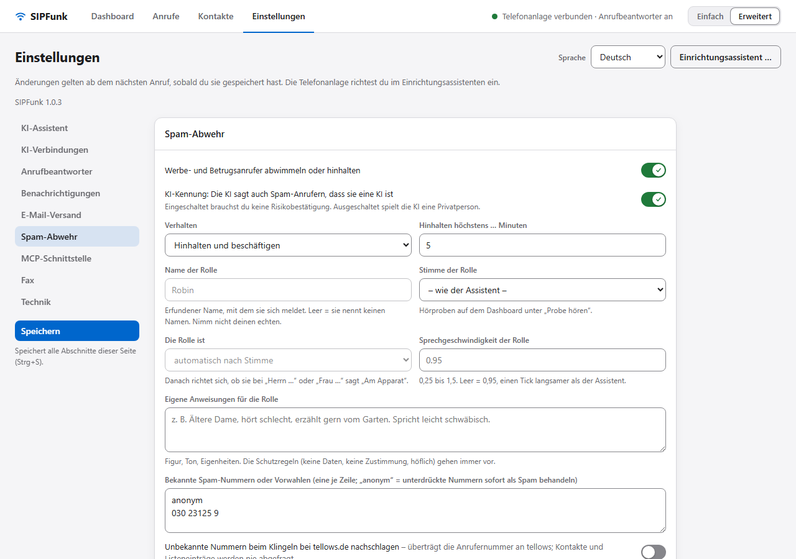

Die Privatperson hat eigene Einstellungen, getrennt vom Assistenten (Name und Geschlecht gelten nur ohne KI-Kennung):

- **Name der Rolle**: ein erfundener Name, mit dem sie sich meldet („Schmidt?“) und den sie auf Nachfrage nennt. Verlangt der Anrufer genau diesen Namen, sagt sie „Am Apparat“; verlangt er jemand anderen, ist der gerade nicht da. Leer = sie nennt keinen Namen. Nimm nicht deinen echten Namen.
- **Stimme der Rolle** und **Sprechgeschwindigkeit der Rolle**: Stimme leer = wie der Assistent; Tempo leer = 0,95, etwas langsamer als der Assistent. Beides gilt, wenn die Spam-Abwehr schon beim Abnehmen feststeht (Listentreffer oder „In die Spam-Falle“); die Stimme der Rolle geht dann jeder anderen Stimme vor, zählt aber nur, wenn sie zum Anbieter der aktiven KI-Verbindung gehört (Rangfolge in Abschnitt 6.2); mit Google Gemini ist das Tempo nur ein Hinweis an die KI (Abschnitt 6.2). Wechselt die KI erst mitten im Gespräch die Rolle, bleiben Stimme und Tempo des Assistenten; Name und eigene Anweisungen gelten trotzdem.
- **Die Rolle ist**: ein Mann, eine Frau oder automatisch nach der Stimme (bei OpenAI gelten cedar, ash, ballad, echo und verse als männlich; Gemini hat eine eigene Liste, zum Beispiel Puck, Charon und Fenrir). Danach richtet sich, ob sie bei „Herrn Schmidt“ oder „Frau Schmidt“ sagt „Am Apparat“.
- **Eigene Anweisungen für die Rolle**: freie Vorgaben zu Figur, Ton und Eigenheiten, zum Beispiel „Älterer Herr, erzählt gern Geschichten, freundlich, aber umständlich“. Die Schutzregeln (keine Daten, keine Zustimmung, keine reale Identität, höflich bleiben) gehen immer vor.

### 10.5 Nach dem Gespräch

Protokolle solcher Gespräche tragen die Markierung „Spam-Abwehr“. Sie zählen nie als wichtig; es gibt keinen Rückruf. Tray-Hinweis und E-Mail („Spam abgewehrt“) kommen, wenn eingeschaltet. Das Ergebnis laut KI nennt, was der Anrufer verkaufen wollte und welche Firma er genannt hat.

**Beschwerde-Entwurf.** Jedes als Spam-Abwehr markierte Protokoll hat den Knopf **„Beschwerde-Entwurf“**. Das Textmodell verfasst daraus einen sachlichen Entwurf für das Online-Formular der Bundesnetzagentur zu unerlaubter Telefonwerbung: Datum, Uhrzeit, anrufende und angerufene Nummer, Dauer, Inhalt des Anrufs mit Zitaten aus dem Protokoll, Hinweis auf fehlende Einwilligung und darauf, dass ein automatischer Assistent abgenommen hat und ein Textprotokoll vorliegt. Der Entwurf erscheint in einem Fenster zum Kopieren; Name und Anschrift ergänzt du selbst und reichst ihn selbst ein. Es ist ein Vorschlag, keine Rechtsberatung.

---

## 11. Kontakte, Protokolle, Daten

### 11.1 Kontakte

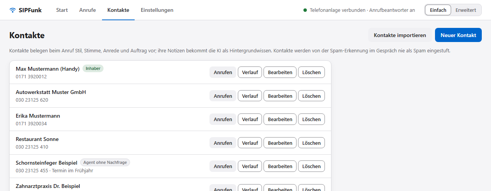

Kontakte (lokal in `contacts.json`) haben Name und Nummer, optional Anrede, Stil, Stimme, Standard-Auftrag und Notizen. Die Auswahl füllt das Anrufformular vor; Notizen und die Zusammenfassung des letzten Gesprächs bekommt die KI als Hintergrundwissen (sie trägt es nicht von sich aus vor, gibt es auf Rückfrage aber preis; bei Anrufen eines KI-Agenten bekommt sie keine Notizen, Abschnitt 13.2). Das Kennzeichen **„Inhaber“** markiert deine eigene Nummer. Mit **„KI-Agent darf ohne Nachfrage anrufen“** gibst du einen Kontakt für die MCP-Schnittstelle frei: Ein Agent wählt ihn, ohne dass du den Anruf bestätigen musst, auch wenn dort „Immer“ nachfragen eingestellt ist (Abschnitt 13.2). In der Liste steht dann „Agent ohne Nachfrage“. Änderst du die Nummer des Kontakts, ist die Freigabe aufgehoben; setz das Häkchen für die neue Nummer erneut.

Auf derselben Seite zeigt der Bereich **„FRITZ!Box-Telefonbuch“**, ob SIPFunk Nummern aus dem Telefonbuch der FRITZ!Box vorschlägt. Diese Nummern werden nicht in die Kontakte übernommen; sie erscheinen nur als Vorschläge im Fax-Fenster und im Wählfeld (Abschnitt 14.6).

Ein Kontakt kann **weitere Nummern** haben („Weitere Nummern“, mit Komma getrennt), etwa das Festnetz neben dem Handy. Sie zählen bei eingehenden Anrufen und bei Dubletten; gewählt wird immer die Nummer darüber. Für die MCP-Freigabe „Nur gespeicherte Kontakte“ zählt nur diese Nummer; eine weitere Nummer kann ein Agent also nicht anrufen.

#### Kontakte importieren

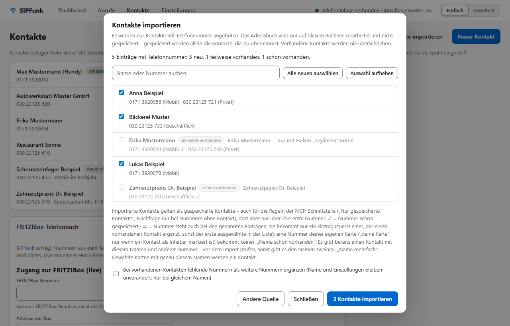

„Kontakte importieren“ auf der Seite „Kontakte“ übernimmt Kontakte mit Telefonnummer aus einem Adressbuch, damit du sie nicht abtippen musst. Quellen:

- **Google-Kontakte** (People API, nur lesend),
- **Microsoft** (Outlook.com, Microsoft 365; Microsoft Graph, nur lesend),
- **eine Datei**: vCard (`.vcf`) oder CSV (UTF-8, UTF-16 oder der Windows-Zeichensatz deutscher Outlook- und Excel-Exporte). Das ist der Weg für **Apple iCloud**, das keine offene Schnittstelle für andere Programme anbietet, und für jedes andere Adressbuch oder Handy.

Nach dem Laden zeigt SIPFunk eine Liste mit Suchfeld und eine Übersicht („… neu, … teilweise vorhanden, … schon vorhanden“); jede teilweise bekannte Zeile sagt, ob sie beim vorhandenen Kontakt ergänzt oder neu angelegt wird. Einzelne Einträge anhaken oder „Alle neuen auswählen“ (teilweise bekannte Einträge, „Name mehrfach“ und „Name schon vorhanden“ nur einzeln), dann „… Kontakte importieren“. Vor diesem Klick wird nichts geschrieben.

- Angeboten werden nur Einträge mit mindestens einer Telefonnummer; Fax- und Pagernummern fallen weg.
- Nummern werden in die SIPFunk-Schreibweise gebracht: deutsche mit führender 0 (`+49 (0)30 …` wird `030…`), ausländische mit `+`; eine Bezeichnung davor und Text dahinter (etwa „ext. 12“ oder eine Uhrzeit) fallen weg. Ungewöhnliche Schreibweisen im Telefonfeld (Öffnungszeiten vor der Nummer, mehrere Schrägstriche) werden nicht eigens gedeutet; die Vorschau zeigt, was übernommen würde. FRITZ!Box-Nebenstellen bleiben mit ihren Sternen erhalten („**610“, auch hinter einer Nummer als weitere Nummer); Dienstcodes mit * oder # und Nummern unter fünf Ziffern ohne führende 0 oder + („610“) werden nicht übernommen, damit nichts davon öffentlich gewählt wird.
- Mehrere Nummern je Eintrag: Die erste (eine wählbare vor einer Auslandsnummer, dann Mobil vor Privat vor Geschäftlich) wird die Nummer, die gewählt wird, die übrigen werden weitere Nummern.
- **Dubletten:** Ein Eintrag, dessen Nummer schon gespeichert ist (auch als weitere Nummer), ist als „schon vorhanden“ oder „teilweise vorhanden“ markiert. „Schon vorhanden“ wird nicht importiert; was mit „teilweise vorhanden“ geschieht, steht in der Zeile (siehe unten). Vorhandene Kontakte werden nie überschrieben. Nur wenn du „Bei vorhandenen Kontakten fehlende Nummern … ergänzen“ anhakst, kommen fehlende Nummern als weitere Nummern zum vorhandenen Kontakt, und zwar nur bei derselben Person: gleicher Vorname und gleicher oder abgekürzter Nachname („Erika B.“ und „Erika Beispiel“: abgekürzt auf den Anfangsbuchstaben), die bekannte Nummer ist nicht nur eine Geschäftsnummer und steht bei keinem anderen Eintrag; Name, Stil, Stimme, Auftrag und Notizen bleiben, wie sie sind. Ist ein teilweise bekannter Eintrag ein anderer Mensch (etwa die Partnerin am Festnetz des Inhabers), legt der Import einen neuen Kontakt nur mit den Nummern an, die noch niemand hat. Ein Eintrag, dessen Name schon mit einer anderen Nummer gespeichert ist, ist als „Name schon vorhanden“ markiert. Steht dieselbe Nummer bei mehreren Einträgen (gemeinsames Festnetz), markiert die Liste sie mit ⇄, und sie bekommt nur ein Eintrag: zuerst einer, der einen vorhandenen Kontakt ergänzt, sonst der erste ausgewählte. Ist ein Kontakt als „Inhaber“ markiert, bekommt eine Nummer, die auch auf deiner eigenen Karte steht, kein anderer Eintrag (in der Liste „deine Karte“; hat ein Eintrag nur solche Nummern, steht dort „nur Nummern deiner Karte“); trag sie bei Bedarf im Kontakt „Inhaber“ von Hand ein. Dein eigener Kontakt („Inhaber“) wird nie ergänzt. Gewählte Karten mit genau demselben Namen (in der Liste „Name mehrfach“) werden ein Kontakt mit allen ihren Nummern; das gilt auch für zwei verschiedene Menschen gleichen Namens – dann nur eine der Karten wählen.
- **Daten:** Das Adressbuch wird nur im Arbeitsspeicher dieses Rechners verarbeitet und beim Schließen des Dialogs oder nach dem Import verworfen, spätestens nach 30 Minuten; gespeichert werden nur die Kontakte, die du übernimmst. Die Anmeldung bei Google oder Microsoft erlaubt nur das Lesen der Kontakte und bleibt nur im Arbeitsspeicher (etwa eine Stunde, keine Datei). „Trennen“ verwirft sie sofort (bei Google wird sie zusätzlich widerrufen); nach einem Neustart meldest du dich neu an.
- **Danach** sind importierte Kontakte gewöhnliche Kontakte, auch für die MCP-Schnittstelle: Mit „Nur gespeicherte Kontakte“ darf ein Agent sie anrufen, und „Nur bei Nummern ohne Kontakt“ fragt bei ihnen nicht mehr nach – beides nur für die erste Nummer (die gewählt wird), nicht für weitere Nummern. Deine eigene Karte (genau derselbe Name wie beim Kontakt „Inhaber“; ohne einen solchen Kontakt gibt es diese Sonderregel nicht) wird nicht importiert, auch wenn keine Nummer übereinstimmt; weitere eigene Nummern trägst du im Kontakt von Hand ein.

**Anmelden mit einem Klick.** Bringt deine SIPFunk-Version eine mitgelieferte App-Registrierung mit, steht im Dialog „bereit – Verbinden öffnet die Anmeldung“. Dann genügt „Verbinden“: Im Browser meldest du dich bei Google oder Microsoft an und erlaubst das Lesen der Kontakte; danach lädt SIPFunk das Adressbuch von selbst. Anmeldung und Abruf laufen direkt zwischen diesem Rechner und dem Anbieter, über den Herausgeber von SIPFunk läuft nichts; auf der Zustimmungsseite steht nur dessen App-Name. Solange Google die mitgelieferte App noch nicht geprüft hat, warnt Google „App nicht überprüft“ (über „Erweitert“ geht es weiter) oder lässt nur eingetragene Testnutzer zu; in einem Firmen-Mandanten von Microsoft muss eventuell der Administrator zustimmen.

**Eigene App (optional).** Fehlt die mitgelieferte App (etwa in einer selbst gebauten Version) oder willst du deine eigene verwenden, registrierst du einmal eine eigene App (kostenlos) und trägst sie unter „Einrichtung“ bzw. „Eigene App verwenden (optional)“ ein; sie hat dann Vorrang. Die Schritte unten stehen kompakt mit direkten Links auch im Dialog unter „Einrichtung“; ein Klick auf einen Wert in Code-Schrift kopiert ihn. Wer keine Anmeldung möchte, nimmt den Dateiimport.

*Google:*

1. In der [Google Cloud Console](https://console.cloud.google.com/) ein Projekt anlegen oder wählen (das Projekt für den Mailversand lässt sich weiterverwenden).
2. „APIs und Dienste › Bibliothek“: **People API** aktivieren.
3. „Google Auth Platform“ (OAuth-Zustimmungsbildschirm): Nutzertyp „Extern“, ein App-Name und deine Adresse. Unter „Datenzugriff“ den Bereich `https://www.googleapis.com/auth/contacts.readonly` hinzufügen, unter „Zielgruppe“ dich selbst als Testnutzer eintragen. Die App darf im Status „Test“ bleiben; Google warnt dann, dass die App nicht überprüft ist – es ist deine eigene App, weiter.
4. „Clients“ (Anmeldedaten): einen OAuth-Client vom Typ **„Desktop-App“** anlegen. Client-ID und Client-Secret im Import-Dialog unter „Einrichtung“ eintragen. Google behandelt das Secret eines Desktop-Clients nicht als vertraulich; SIPFunk speichert es in `settings.json` und zeigt es maskiert. Eine Weiterleitungsadresse muss nicht eingetragen werden: Desktop-Clients nehmen `http://127.0.0.1:<Port>/oauth/callback` von selbst an.
5. „Verbinden“ öffnet die Google-Anmeldung; danach lädt SIPFunk das Adressbuch selbst („Adressbuch laden“ lädt es bei Bedarf neu).

*Microsoft:*

1. Im [Microsoft Entra Admin Center](https://entra.microsoft.com/) (oder im Azure-Portal) unter „App-Registrierungen“ eine **neue Registrierung** anlegen. Unterstützte Kontotypen: „Konten in einem beliebigen Organisationsverzeichnis und persönliche Microsoft-Konten“ (nötig für Outlook.com) oder nur die eigene Organisation.
2. Umleitungs-URI: Plattform **„Öffentlicher Client/nativ (mobil und Desktop)“**, Adresse `http://localhost/oauth/callback` – ohne Port. Microsoft ignoriert bei `localhost` den Port, eine Portänderung der Web-UI braucht hier also keine Änderung.
3. „API-Berechtigungen“: Microsoft Graph › Delegierte Berechtigungen › **Contacts.Read**. In einem Firmen-Mandanten muss eventuell der Administrator zustimmen.
4. Ein Client-Geheimnis ist nicht nötig. Die „Anwendungs-ID (Client)“ im Import-Dialog eintragen; Mandant `common` (Standard), `consumers` nur für private Konten oder die Mandanten-ID.
5. „Verbinden“, anmelden; SIPFunk lädt das Adressbuch dann selbst. SIPFunk liest den Standard-Kontaktordner, die weiteren Kontaktordner und deren Unterordner (eine Ebene).

*Apple iCloud und Datei-Exporte:*

- iCloud: auf [icloud.com/contacts](https://www.icloud.com/contacts) alle Kontakte auswählen, dann „vCard exportieren“. Auf dem iPhone kann die Kontakte-App eine Kontaktliste ebenfalls als vCard teilen.
- Google-Kontakte: „Exportieren“, Format vCard oder Google-CSV.
- Outlook.com: „Personen › Kontakte verwalten › Kontakte exportieren“ (CSV).

Im Dialog „Datei wählen“ (bis 22 MB; größere Exporte ohne Fotos speichern oder teilen). Die Exportdatei danach löschen, wenn du sie nicht mehr brauchst; sie enthält dein ganzes Adressbuch.

*Wenn es nicht klappt:* „People API has not been used in project“ – People API aktivieren (Schritt 2). `AADSTS50011` (Umleitung passt nicht) – Umleitungs-URI der App-Registrierung prüfen. `AADSTS65001` oder „Administratorgenehmigung erforderlich“ – der Administrator muss Contacts.Read zustimmen. „Anmeldung abgelaufen“ – Anmeldung neu starten.

*Exportieren:* „Exportieren“ auf der Seite „Kontakte“ speichert alle Kontakte mit Nummern und Notizen als vCard (`.vcf`, für Outlook, Google Kontakte und das Handy) oder als CSV (`.csv`, mit Semikolon für deutsches Excel). Die Hauptnummer, die SIPFunk wählt, steht zuerst. SIPFunk kann beide Dateien wieder importieren. Einstellungen wie Stil, Stimme oder Auftrag eines Kontakts stehen nicht darin; die nimmt die Sicherung mit (Abschnitt 11.4).

### 11.2 Protokolle

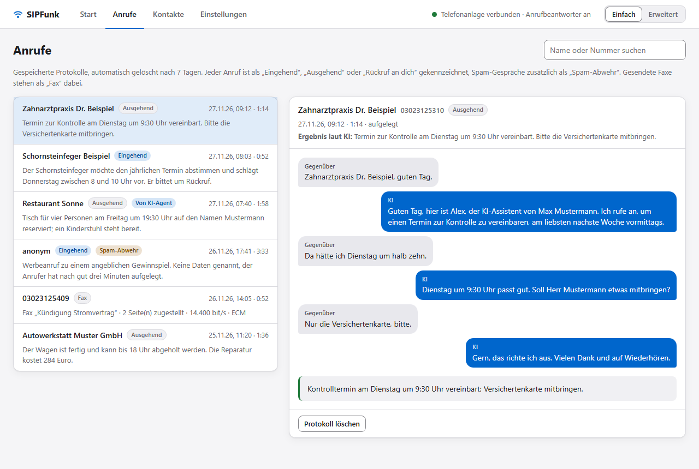

Gesendete Faxe stehen ebenfalls in der Liste, mit dem Kennzeichen „Fax“ (Abschnitt 14.7). Jedes zustande gekommene KI-Gespräch wird in `transcripts/` als JSON und Markdown gespeichert: Zeit, Nummer, gewählte eigene Nummer, Dauer, Codec, Endegrund, KI-Anbieter und Modell, Auftrag, Gesprächsplan, Ergebnis laut KI, Transkript (Text, keine Audiodaten), Verbrauch, Kostenschätzung, Zusammenfassung, Markierung Spam-Abwehr. Nicht zustande gekommene Anrufe (nicht abgenommen, besetzt) erzeugen kein Protokoll.

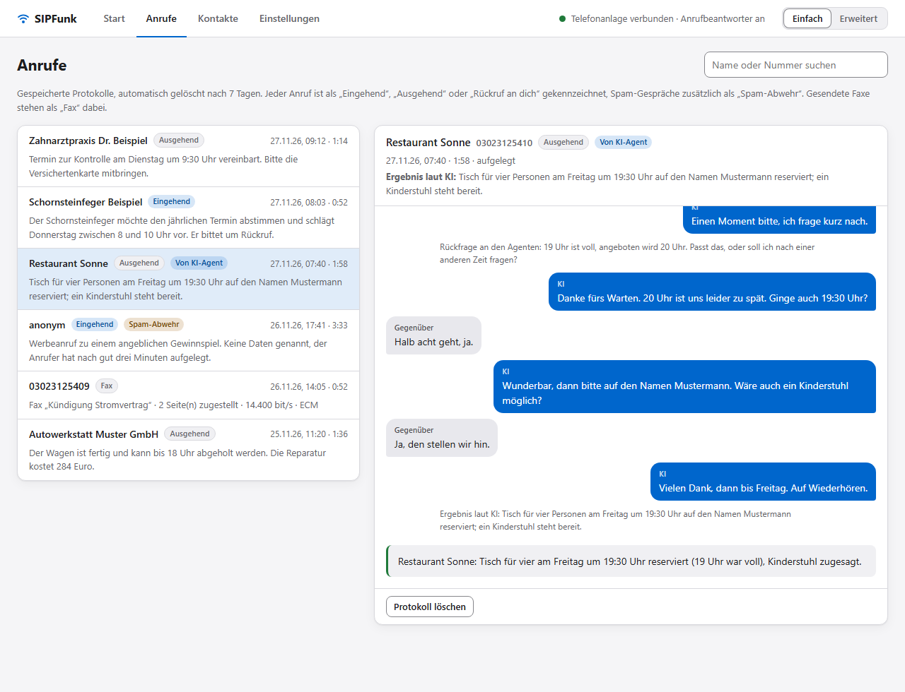

Neben den Zeilen der KI und des Gegenübers enthält das Transkript klein gesetzte Hinweise von SIPFunk. Sie zeigen, was im Gespräch außer den Worten geschah:

| Hinweis (Anfang) | Bedeutung |
| --- | --- |
| „Ergebnis laut KI: …“ | die KI will das Gespräch beenden und meldet Ergebnis und offene Punkte |
| „Prüfung vor dem Auflegen: noch offen – …“ | das Textmodell hat beim Auflegen etwas aus dem Auftrag vermisst; mit „– Gespräch geht weiter“ wurde das Auflegen zurückgenommen (Abschnitt 6.3) |
| „Hinweis der Regie an die KI: …“ | Hinweis der Regie (Textmodell) an die KI (Abschnitt 6.3) |
| „KI unterbrochen: etwa … s ihrer Antwort … wurden nicht mehr gesprochen“ | das Gegenüber ist dazwischengekommen; der genannte Teil der Antwort war nicht zu hören |
| „Stille: Seit … s sagt niemand etwas – die KI wurde angestoßen“ | der Stillstandswächter hat die KI angestoßen |
| „Das Gegenüber war zu hören, aber ohne Worte …“ | ein Lachen oder Laut ohne Worte; die KI geht darauf ein |
| „Die KI hat sich in der Begrüßung nicht als KI vorgestellt …“ | die Prüfung der KI-Kennung; die KI holt die Vorstellung nach |
| „Gegenüber hat noch etwas gesagt – Gespräch geht weiter“ | nach der Verabschiedung kam vom Gegenüber noch ein Anliegen |
| „Rückfrage an den Agenten: …“, „… blieb ohne Antwort“, „Vorgabe des Agenten während des Beendens …“, „Vorgabe des Agenten noch nicht gesprochen …“, „Eine Vorgabe des Agenten wurde nicht mehr gesprochen“ | nur bei Agenten-Anrufen (Kapitel 13) |
| „Spam-Abwehr: …“ | die KI ist in die Spam-Abwehr gewechselt (Kapitel 10) |

Automatische Löschung nach der eingestellten Frist (Standard 7 Tage, „Einstellungen › Technik“); von Hand auf der Seite „Anrufe“.

### 11.3 Dateien im Datenordner

Der Datenordner ist beim Start aus dem Repository der Projektordner, bei der installierten Tray-App `%APPDATA%\SIPFunk`.

| Datei | Inhalt | Vertraulich |
| --- | --- | --- |
| `.env` | Zugangsdaten (SIP, Schlüssel der KI-Verbindungen, optional der OpenAI-Admin-Schlüssel), Startwerte | ja, nie teilen |
| `settings.json` | alle Einstellungen der Web-UI inkl. der Liste der KI-Verbindungen (ohne Schlüssel), Mail-Kennwort, OAuth-Secret (Mail und Kontakt-Import) und Spam-Abwehr-Bestätigung | ja |
| `contacts.json` | Kontakte | ja (personenbezogen) |
| `transcripts/` | Gesprächsprotokolle | ja (personenbezogen) |
| `mail-token.json` | OAuth-Token für den Mailversand | ja |
| `sipfunk.log`, `sipfunk-JJJJ-MM-TT.log` | Betriebslog mit Rufnummern (nur Tray-App; sonst steht das Log im Terminal). Je Tag eine Datei; ältere als die Aufbewahrungsfrist der Protokolle werden gelöscht | ja |
| `usage.json` | Monatsverbrauch je KI-Anbieter: Zahl der Gespräche, Sekunden, geschätzte Kosten; die letzten 13 Monate (Abschnitt 6.2) | nein |
| `autostart.flag` | nur installierte Tray-App: merkt, dass der Autostart beim ersten Start eingerichtet wurde, damit ein Update ihn nicht wieder einschaltet (Abschnitt 4.3) | nein |
| `sipfunk.port` | Port der laufenden App; wird beim Beenden entfernt (Abschnitt 15.3) | nein |
| `window.json` | nur Tray-App: Größe, Lage und Zoom des SIPFunk-Fensters (Abschnitt 4.3) | nein |
| `voice-samples/` | zwischengespeicherte Hörproben (MP3; bei Gemini WAV im Unterordner `gemini/`) | nein |
| `sim-results/` | Berichte des Simulators (im Projektordner) | nein, sofern die Szenarien erfunden sind |

Beim Start aus dem Repository stehen die Dateien im Projektordner in der `.gitignore`; `autostart.flag` gibt es nur im Datenordner der installierten App. Beim Sichern des Rechners den Datenordner mitsichern, aber verschlüsselt. Für einen Umzug auf einen anderen Rechner gibt es die Sicherung in SIPFunk (Abschnitt 11.4).

### 11.4 Sicherung und Umzug

„Einstellungen › Sicherung“ schreibt eine Datei `SIPFunk-Sicherung-JJJJ-MM-TT.sipfunk` mit dem Inhalt von `.env` und `settings.json` (darin auch die Anrufbeantworter-Profile und die Spam-Liste) und allen Kontakten mit ihren Einstellungen. Nicht dabei sind die Gesprächsprotokolle, das Log, Hörproben und Verbrauch sowie die Werte, die zu diesem Rechner gehören: Port der Oberfläche und eigene IP-Adresse (`LOCAL_IP`).

- **Ohne Kennwörter** (Standard): Die Datei ist lesbarer Text ohne SIP-, Fax- und FRITZ!Box-Kennwort, ohne Schlüssel der KI-Verbindungen und ohne Mail-Zugang. Nach dem Wiederherstellen auf einem neuen Rechner gibst du diese im Einrichtungsassistenten und in den Einstellungen neu ein.
- **Mit Kennwörtern** („Kennwörter und Schlüssel einschließen“): Die Datei enthält auch die Zugangsdaten und die Anmeldung des Mail-Postfachs und ist mit einem Passwort verschlüsselt (scrypt und AES-256-GCM). Ohne das Passwort lässt sie sich nicht öffnen; SIPFunk kann es nicht wiederherstellen.

Speicherst du die Datei in deinem OneDrive-Ordner, liegt sie auch in der Cloud deines Microsoft-Kontos. Eine automatische Sicherung über das Microsoft-Konto gibt es für Store-Apps unter Windows 11 nicht mehr.

**Wiederherstellen:** „Sicherung wählen …“, bei einer verschlüsselten Datei das Passwort eingeben. Einstellungen und Profile werden durch die der Sicherung ersetzt; Kontakte werden wie beim Import zusammengeführt: Ein Kontakt mit bekannter Nummer bekommt nur fehlende Nummern, alle anderen werden mit ihren Einstellungen neu angelegt. Enthält die Sicherung keine Kennwörter, bleiben die gespeicherten; wechselt sie aber die Adresse der Telefonanlage oder des Mailservers, entfällt das bisherige Kennwort dafür, damit es nicht an einen anderen Server geht. Zugangsdaten zur Telefonanlage und KI gelten nach einem Neustart, den SIPFunk danach anbietet.

---

## 12. Simulator

Der Simulator spielt Gespräche im Textmodus durch, ohne jemanden anzurufen: Das Realtime-Modell bekommt dieselben Anweisungen und Werkzeuge wie am Telefon, ein Textmodell spielt das Gegenüber nach einer Rollenbeschreibung, ein weiteres bewertet am Ende (alle Punkte erledigt, Note, Probleme). Der Simulator läuft nur mit OpenAI: Er braucht `OPENAI_API_KEY` und verwendet OpenAI auch dann, wenn eine Google-Gemini-Verbindung aktiv ist, weil er den Textmodus der Realtime-API nutzt und die Gemini Live API nur Audio ausgibt. Er kostet je Durchlauf wenige Cent.

```bash
npm run sim
```

spielt alle eingebauten Szenarien, `npm run sim -- praxis strom` nur die genannten:

| Kennung | Szenario |
| --- | --- |
| `privat`, `praxis`, `falsch`, `mailbox` | ausgehend: private Nachricht, Terminverschiebung in einer Praxis, falsche Person am Apparat, Mailbox |
| `ausweichen`, `vergessen` | ausgehend: Das Gegenüber weicht einer Frage aus und will schnell auflegen; drei Punkte und ein Gegenüber, das viel redet und sich früh verabschiedet |
| `rueckruf` | Rückruf an den Inhaber nach einem wichtigen Anruf |
| `ab` | Anrufbeantworter mit echtem Anliegen bei eingeschalteter Spam-Abwehr (darf nicht auslösen) |
| `strom`, `bank` | Werbung und angebliche Bank-Sicherheitsabteilung: Erkennung im Gespräch mit Rollenwechsel |
| `inkasso`, `liste` | Listentreffer mit „hinhalten“ |
| `echt` | Listentreffer mit echtem Anliegen (Rückwechsel in den Assistenten-Modus) |

Eigenes ausgehendes Szenario:

```bash
npm run sim -- --task "Frag nach den Öffnungszeiten am Samstag" --partner "Verkäuferin in einer Bäckerei, kurz angebunden" --sie
```

Weitere Schalter: `--opening "…"` (erster Satz des Gegenübers), `--model <Realtime-Modell>`, `--no-judge` (ohne das Textmodell im Gespräch, Abschnitt 6.3). Mit eingeschaltetem Schalter prüft das Textmodell auch im Simulator beim Auflegen und führt Regie; die Zeilen „Prüfung vor dem Auflegen“ und „Hinweis der Regie“ stehen im Bericht, die Antwortzeiten in der Konsole. Die Entscheidung nach der Verabschiedung braucht ein Telefon und kommt im Simulator nicht vor. Die Spam-Szenarien nehmen Name und eigene Anweisungen der Rolle aus den gespeicherten Einstellungen; zum Ausprobieren ohne Speichern gehen die Umgebungsvariablen `SIM_SCAM_NAME`, `SIM_SCAM_EXTRA`, `SIM_SCAM_GENDER` und `SIM_SCAM_DISCLOSE` (`on` = mit KI-Kennung). Berichte landen in `sim-results/`.

Bei den Spam-Szenarien bewertet der Richter streng: Jede genannte Angabe, jedes „Ja“ und jede KI-Nennung im Spam-Modus ist ein schwerer Fehler. Textmodelle spielen Betrüger allerdings ungern glaubhaft; diese Szenarien sind deshalb weniger aussagekräftig als ein echter Anruf.

---

## 13. MCP-Schnittstelle

Über die MCP-Schnittstelle (Model Context Protocol) kann ein KI-Agent wie Codex, Claude Code oder Claude Desktop für dich telefonieren. Du sagst dem Agenten zum Beispiel „Reservier mir bei Restaurant Sonne einen Tisch für Freitag, 19 Uhr, vier Personen“, und er erledigt das über SIPFunk: Er startet den Anruf, liest mit, was gesagt wird, gibt der KI am Telefon bei Bedarf Vorgaben und berichtet dir das Ergebnis.

Die Schnittstelle ist **standardmäßig ausgeschaltet**. Du schaltest sie unter „Einstellungen › MCP-Schnittstelle“ ein und legst dort fest, was ein Agent darf.

Was bei einem Agenten-Anruf Schritt für Schritt passiert – Rollen, Ereignisse, Rückfragen, Beenden, Schutzgrenzen, mit Ablaufdiagramm und Beispiel –, beschreibt [Ablauf eines Agenten-Anrufs](mcp-flow.de.md).

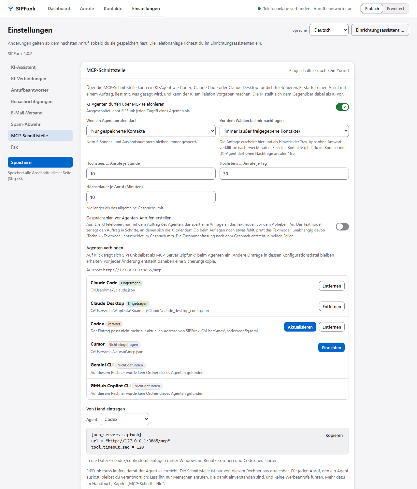

### 13.1 Wie ein Agenten-Anruf abläuft

Am Telefon spricht nicht der Agent, sondern die Sprach-KI von SIPFunk, über die aktive KI-Verbindung und mit der Stimme, die dort eingestellt ist. Sie führt das Gespräch selbstständig nach dem Auftrag, genau wie bei einem Anruf vom Dashboard. Der Agent sitzt daneben:

- Er **liest mit**: Jede fertige Äußerung des Gegenübers und der KI kommt als Ereignis bei ihm an, dazu der Zustand des Anrufs (wartet auf Bestätigung, wählt, klingelt, verbunden, beendet mit Grund) und Hinweise zum Ablauf: der Gesprächsplan der KI, Unterbrechungen, Stille, Laute ohne Worte, die Prüfung vor dem Auflegen und das Ergebnis laut KI. Solange das Gespräch verbunden ist, nennt jede Antwort außerdem Dauer, Restzeit und die Lage im Moment der Abfrage (wer gerade spricht, wie lange es still ist, ob die KI auf ihn wartet oder sich verabschiedet). So kennt er jederzeit das ganze Gespräch.
- Er **kann das Auflegen zurücknehmen**: Meldet ein Hinweis das Ergebnis laut KI, verabschiedet sie sich gerade. Fehlt aus Sicht des Agenten noch etwas, nimmt eine Vorgabe (`say`) das Auflegen zurück, solange nicht aufgelegt ist. Der Agent muss darauf nicht achten: Zur selben Zeit prüft das Textmodell, ob vom Auftrag etwas fehlt, und nimmt das Auflegen notfalls selbst zurück (Abschnitt 6.3); die KI wartet nicht auf den Agenten. Ein Beenden, das der Agent mit `end_call` verlangt hat, prüft das Textmodell nie und nimmt es nie zurück; nur ein neues `say` des Agenten zieht es zurück. Einzelheiten: [Ablauf eines Agenten-Anrufs](mcp-flow.de.md#38-das-gespräch-beenden).
- Er **gibt Vorgaben**: „Sag, dass auch 19:30 Uhr passt.“ Die KI formuliert selbst und setzt die Vorgabe im nächsten passenden Moment um, ohne jemandem ins Wort zu fallen.
- Die KI **fragt beim Agenten nach**, wenn ihr eine Entscheidung fehlt, von der das Ergebnis abhängt, oder wenn das Gegenüber etwas über den Agenten, den Anruf oder den Auftrag fragt, das sie nicht beantworten kann. Sie sagt dem Gegenüber „Einen Moment bitte, ich frage kurz nach“ und wartet bis zu 25 Sekunden auf die Antwort des Agenten; so lange ist es still in der Leitung. Kommt keine, sagt sie, dass du dich dazu meldest, und hält den Punkt als offen fest.

Warum so und nicht Wort für Wort vom Agenten? Ein Agent braucht für jeden Zug mehrere Sekunden (Modellaufruf, Werkzeugaufruf, Übertragung). Müsste jeder Satz am Telefon erst von ihm kommen, entstünden nach jedem Satz Pausen, in denen Menschen auflegen. Im geführten Betrieb antwortet die Sprach-KI sofort, und der Agent greift nur dort ein, wo es etwas zu entscheiden gibt. Je genauer der Auftrag den Spielraum nennt („19:30 Uhr geht auch, später nicht“), desto seltener muss sie nachfragen.

### 13.2 Einschalten und Erlaubnisse

Unter „Einstellungen › MCP-Schnittstelle“:

| Einstellung | Vorgabe | Bedeutung |
| --- | --- | --- |
| KI-Agenten dürfen über MCP telefonieren | aus | Hauptschalter. Ausgeschaltet lehnt SIPFunk jeden Tool-Aufruf mit einem Hinweis ab; der Agent sieht dann auch keinen Status, keine Kontakte und keine Protokolle. Schaltest du aus, während eine Anfrage auf deine Bestätigung wartet, verfällt sie. Ein Gespräch, das schon läuft, führt die KI allein zu Ende (die Höchstdauer gilt); auflegen kannst du es wie jedes andere in der Web-UI. |
| Wen ein Agent anrufen darf | Nur gespeicherte Kontakte | „Nur gespeicherte Kontakte“: Der Agent kann nur Nummern anrufen, die du als Kontakt angelegt hast. „Kontakte und jede erlaubte Nummer“: zusätzlich jede Nummer, die auch das Dashboard wählen darf. Notruf, Sonder-, Mehrwert- und Auslandsnummern und Call-by-Call bleiben in beiden Fällen gesperrt (Kapitel 6). |
| Vor dem Wählen bei mir nachfragen | Immer (außer freigegebene Kontakte) | „Immer“: Jeder Anruf wartet auf dein Ja, außer bei Kontakten, bei denen du „KI-Agent darf ohne Nachfrage anrufen“ angehakt hast (Abschnitt 11): Die wählt der Agent sofort, und zwar nur über die Nummer, die gewählt wird, nicht über weitere Nummern; änderst du diese Nummer, ist das Häkchen weg. Darf der Agent die Namen deiner Kontakte lesen, markiert `list_contacts` sie mit „ohne Bestätigung“. „Nur bei Nummern ohne Kontakt“: Kontakte werden ohne Rückfrage angerufen. „Nie“: Der Agent wählt sofort. Unabhängig davon fragt SIPFunk immer nach, wenn der Agent einen anderen Auftraggeber angibt als den, der in deinen Einstellungen steht. |
| Höchstens … Anrufe je Stunde / je Tag | 10 / 30 | Gezählt wird jede angenommene Anfrage, auch eine, die du abgelehnt hast oder bei der niemand abnahm. Der Zähler beginnt mit einem Neustart von SIPFunk neu. |
| Höchstdauer je Anruf (Minuten) | 10 | Danach legt SIPFunk auf. Nie länger als das allgemeine Gesprächslimit (Einstellungen › Technik, Standard 300 s, also 5 Minuten, solange du es nicht erhöhst) und die Grenze des KI-Anbieters. |
| Protokolle, die ein Agent lesen darf (Erweitert) | Nur Anrufe, die über MCP gestartet wurden | Mit „Alle Protokolle“ kann der Agent auch deine übrigen Gespräche und die des Anrufbeantworters lesen, samt den Rufnummern, die zu keinem Kontakt gehören. |
| Gesprächsplan vor Agenten-Anrufen erstellen | aus | Aus: Die KI telefoniert nur mit dem Auftrag, den der Agent mitgibt. Das spart eine Anfrage an das Textmodell, während es klingelt, und ein Limit oder Ausfall des Textmodells berührt den Anruf nicht. An: Das Textmodell zerlegt den Auftrag wie bei deinen eigenen Anrufen in Schritte, an denen sich die KI orientiert. Ob beim Auflegen noch etwas fehlt, prüft das Textmodell unabhängig davon (Abschnitt 6.3); nur wenn der Schalter „Textmodell entscheidet im Gespräch mit“ aus ist, prüft die Sprach-KI die Schritte selbst. Die Zusammenfassung nach dem Gespräch entsteht in beiden Fällen. |
| Agent darf die Namen meiner Kontakte lesen (Erweitert) | aus | Eingeschaltet liefert `list_contacts` die Namen. Rufnummern und Notizen von Kontakten bekommt ein Agent nie; nennt er einen Kontakt beim Namen, wählt SIPFunk die Nummer, ohne sie ihm zu zeigen. Ohne diese Freigabe erfährt er über die Tools auch umgekehrt keinen Namen: Ruft er eine Nummer an, die zu einem Kontakt gehört, bleibt es in den Antworten der Tools bei der Nummer, und in Protokollen steht statt Name oder Nummer nur „ein gespeicherter Kontakt“. Die KI am Telefon kennt den Namen des Kontakts allerdings und kann ihn im Gespräch nennen; was gesagt wird, liest der Agent mit. Bei Agenten-Anrufen bekommt deshalb auch die KI am Telefon die Notizen des Kontakts nicht als Hintergrundwissen, denn was sie sagt, liest der Agent mit; aus früheren Gesprächen kennt sie nur, was der Agent selbst lesen darf. Was die KI für das Gespräch wissen muss, gibt der Agent in `context` mit. |

Änderungen gelten, sobald du gespeichert hast. Rechts oben in der Karte steht der Zustand: ausgeschaltet, eingeschaltet, und wann zuletzt ein Agent zugegriffen hat.

**Bestätigen.** Fragt ein Agent einen Anruf an, zeigt die Web-UI einen Dialog mit Ziel, Auftrag, dem Hintergrundwissen, das der Agent mitgibt, und dem Namen, in dessen Auftrag angerufen wird; die Tray-App zeigt dieselbe Anfrage als Pop-up unten rechts, mit denselben Knöpfen, sodass die Web-UI dafür nicht offen sein muss. „Anrufen“ wählt; „Ablehnen“ oder die Escape-Taste lehnt ab. Steht dort „laut Agent im Auftrag von … – nicht dein eingestellter Name“, hat der Agent einen anderen Auftraggeber angegeben als den aus deinen Einstellungen. Ohne Antwort verfällt die Anfrage nach zwei Minuten. Im Pop-up lehnen das ✕ und die Escape-Taste nicht ab, sie schließen nur das Fenster; die Anfrage bleibt in der Web-UI offen, bis sie beantwortet ist oder verfällt. Das Pop-up gibt es nur mit der Tray-App; läuft SIPFunk über `npm start`, siehst du die Anfrage nur in der offenen Web-UI.

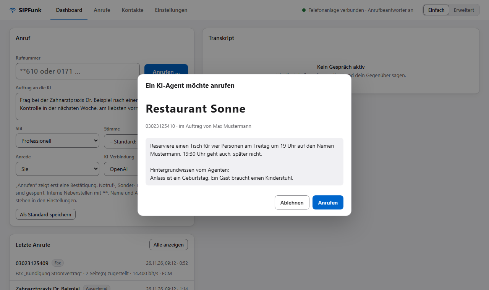

Jeder Agenten-Anruf, der zustande kam, steht wie jeder andere unter „Anrufe“, mit dem Kennzeichen „Von KI-Agent“. Wie sonst auch gibt es kein Protokoll, wenn niemand abnahm oder du abgelehnt hast.

### 13.3 Agenten verbinden

SIPFunk muss laufen (Tray-App oder `npm start`). Es gibt zwei Wege zum selben Server; beide sind nur von deinem Rechner aus erreichbar:

- **Direkt über HTTP** (Streamable HTTP): Der Agent spricht mit `http://127.0.0.1:3865/mcp`, also mit der laufenden App selbst. Kein zusätzlicher Prozess, keine Pfade. Das ist der einfachste Weg für die meisten Agenten. Die Adresse enthält den Port der Web-UI (Abschnitt 15.3).
- **Als Prozess (stdio)**: Der Agent startet einen kleinen Prozess, der jeden Aufruf an die laufende App weiterreicht. Diesen Weg braucht Claude Desktop, das lokale Server nur als Prozess startet. Der Prozess liest den Port der laufenden App aus dem Datenordner und folgt damit jeder Portänderung.

#### Mit einem Klick einrichten

Die Karte „MCP-Schnittstelle“ listet unter „Agenten verbinden“ die Agenten auf, bei denen sich SIPFunk selbst eintragen kann, jeweils mit dem Zustand und der Datei, um die es geht:

| Zustand | Bedeutung | Knöpfe |
| --- | --- | --- |
| Nicht gefunden | Auf dem Rechner gibt es keinen Ordner dieses Agenten. | – |
| Nicht eingetragen | Der Agent ist da, SIPFunk steht nicht in seiner Konfiguration. | „Einrichten“ |
| Eingetragen | Der Eintrag passt zur aktuellen Adresse. | „Entfernen“ |
| Veraltet | Es gibt einen Eintrag „sipfunk“, er passt aber nicht mehr, typischerweise nach einer Portänderung oder wenn SIPFunk an einen anderen Ort installiert wurde. | „Aktualisieren“, „Entfernen“ |
| Nicht auswertbar | Die Datei enthält Kommentare, ist beschädigt oder hat einen Aufbau, den SIPFunk nicht sicher ändern kann. SIPFunk fasst sie nicht an; trag den Eintrag von Hand ein. | – |

| Agent | Datei | Verbindung | Wann der Agent SIPFunk sieht |
| --- | --- | --- | --- |
| Claude Code | `~/.claude.json` (über den Befehl `claude mcp add`) | HTTP | in jeder neuen Sitzung; laufende Sitzungen sehen die Änderung nicht |
| Claude Desktop | `%APPDATA%\Claude\claude_desktop_config.json` (Store-Fassung: im Paketordner unter `%LOCALAPPDATA%\Packages`) | Prozess | nachdem Claude Desktop ganz beendet (auch im Infobereich der Taskleiste) und neu gestartet wurde |
| Codex (CLI, App, IDE-Erweiterung) | `~/.codex/config.toml` | HTTP | in jeder neuen Sitzung; App und IDE-Erweiterung einmal neu starten |
| Cursor | `~/.cursor/mcp.json` | HTTP | unter „Settings › MCP“ prüfen, ob „sipfunk“ aktiv ist; sonst Cursor neu starten |
| Gemini CLI | `~/.gemini/settings.json` | HTTP | in jeder neuen Sitzung |
| GitHub Copilot CLI | `~/.copilot/mcp-config.json` | HTTP | in jeder neuen Sitzung |

Was dabei gilt:

- **Geschrieben wird nur auf deinen Klick.** Beim Öffnen der Karte liest SIPFunk die Dateien nur, um den Zustand zu zeigen.
- **Andere Einträge bleiben.** SIPFunk ergänzt, ersetzt oder entfernt ausschließlich den Eintrag „sipfunk“. Einrückung, Zeilenenden und Reihenfolge der Datei bleiben erhalten; in JSON-Dateien kann sich nur die Schreibweise einzelner Werte ändern (z. B. wird eine einzeilige Liste mehrzeilig). In der `config.toml` von Codex bleibt alles außerhalb des Abschnitts `[mcp_servers.sipfunk]` stehen, auch Kommentare und Leerzeilen. Der Eintrag „sipfunk“ selbst wird immer als Ganzes ersetzt; eigene Zusätze darin stehen danach nur noch in der Sicherungskopie.
- **Sicherungskopie.** Vor jeder Änderung legt SIPFunk neben der Datei eine Kopie mit Zeitstempel ab (`….sipfunk-JJJJ-MM-TTThh-mm-ss.bak`); die Meldung nach dem Klick nennt den Pfad. Die Kopien räumt SIPFunk nicht auf.
- **Claude Code** verwaltet seine Datei selbst und schreibt sie laufend neu. SIPFunk ändert sie deshalb nicht direkt, sondern ruft den Befehl `claude mcp add` bzw. `claude mcp remove` auf (für alle Projekte, `--scope user`). Findet SIPFunk den Befehl nicht, nennt die Meldung den Befehl, den du dann selbst im Terminal ausführst. Hast du SIPFunk früher ohne `--scope user` in einem einzelnen Projekt eingetragen, hat dieser Eintrag dort Vorrang, und SIPFunk ändert ihn nicht: Die Karte weist auf solche Einträge hin, und du entfernst sie im Ordner des Projekts mit `claude mcp remove sipfunk`.
- **Nach einer Portänderung** zeigen die Agenten mit HTTP-Eintrag „Veraltet“; „Aktualisieren“ schreibt die neue Adresse. Maßgeblich ist der gespeicherte Port: Ist er gespeichert, SIPFunk aber noch nicht neu gestartet, steht das über der Liste, und die Einträge gelten erst nach dem Neustart. Der Eintrag von Claude Desktop bleibt gültig, weil sein Prozess den Port selbst findet.
- Mit echten Installationen geprüft ist bisher nur der Befehl von Claude Code. Die übrigen Formate und Pfade folgen der Dokumentation der Hersteller (Stand November 2026); ändert ein Hersteller sie, hilft „Von Hand eintragen“.

#### Von Hand eintragen

Für alle anderen Fälle zeigt die Karte unter „Von Hand eintragen“ die fertige Konfiguration für deinen Rechner, passend zum Port und dazu, ob SIPFunk installiert ist oder aus dem Projektordner läuft: Agent wählen (Codex, Claude Code, Claude Desktop, Cursor, VS Code, Gemini CLI oder „Anderer Agent“), „Kopieren“, einfügen. Die Beispiele unten zeigen den Aufbau.

**Codex** – in `~/.codex/config.toml` (unter Windows im Benutzerordner), dann Codex neu starten:

```toml
[mcp_servers.sipfunk]
url = "http://127.0.0.1:3865/mcp"
tool_timeout_sec = 120
```

`tool_timeout_sec` ist wichtig: `wait_for_events` wartet bis zu 50 Sekunden, die Vorgabe von Codex liegt bei 60.

**Claude Code** – im Terminal; die Verbindung gilt dann für alle Projekte:

```bash
claude mcp add --transport http --scope user sipfunk http://127.0.0.1:3865/mcp
```

**Claude Desktop** – in `claude_desktop_config.json` (Einstellungen › Entwickler › Konfiguration bearbeiten; unter Windows `%APPDATA%\Claude\claude_desktop_config.json`), dann Claude Desktop neu starten. Für die installierte App:

```json
{
  "mcpServers": {
    "sipfunk": {
      "command": "C:\\Users\\DEINNAME\\AppData\\Local\\Programs\\SIPFunk\\SIPFunk.exe",
      "args": ["C:\\Users\\DEINNAME\\AppData\\Local\\Programs\\SIPFunk\\resources\\app.asar\\dist\\mcp\\server.js"],
      "env": {
        "ELECTRON_RUN_AS_NODE": "1",
        "SIPFUNK_DATA_DIR": "C:\\Users\\DEINNAME\\AppData\\Roaming\\SIPFunk"
      }
    }
  }
}
```

`ELECTRON_RUN_AS_NODE=1` lässt die installierte `SIPFunk.exe` das mitgelieferte MCP-Skript ausführen, statt die Tray-App ein zweites Mal zu starten; Node.js muss dafür nicht installiert sein. `SIPFUNK_DATA_DIR` zeigt auf den Datenordner; dort liest der Prozess den Port der laufenden App. Die Pfade hängen vom Installationsort ab, deshalb am besten aus der Web-UI kopieren.

**Cursor** – in `~/.cursor/mcp.json`:

```json
{ "mcpServers": { "sipfunk": { "url": "http://127.0.0.1:3865/mcp" } } }
```

**VS Code (Copilot)** – den Befehl „MCP: Open User Configuration“ ausführen und unter `servers` eintragen: `"sipfunk": { "type": "http", "url": "http://127.0.0.1:3865/mcp" }`. **Gemini CLI** – `gemini mcp add -t http -s user sipfunk http://127.0.0.1:3865/mcp`. Andere Agenten: die Adresse als MCP-Server vom Typ „Streamable HTTP“ eintragen, ohne Anmeldung.

Aus dem Projektordner (Entwicklung) lautet der Befehl für den stdio-Prozess `npx tsx /pfad/zu/sipfunk/src/mcp/server.ts`, oder kurz `npm run mcp`. Ohne `SIPFUNK_DATA_DIR` sucht der Prozess die Datei `sipfunk.port` im aktuellen Ordner (im Projektordner ist das der Datenordner); wer ihn woanders startet, gibt die Adresse der Web-UI in `SIPFUNK_URL` an (z. B. `http://127.0.0.1:3865`); ein gesetztes `SIPFUNK_URL` hat immer Vorrang. Einträge aus früheren Fassungen mit `SIPFUNK_URL` funktionieren weiter, folgen einer Portänderung aber nicht.

Nach dem Verbinden zeigt der Agent die Tools von SIPFunk. Solange die Schnittstelle ausgeschaltet ist, beantwortet SIPFunk jeden Aufruf mit dem Hinweis, wo du sie einschaltest.

### 13.4 Die Tools

Alle Tools antworten mit Text, auf Deutsch (auch die Sprach-KI spricht Deutsch). Fehler (gesperrtes Ziel, Limit erreicht, nicht erlaubt) kommen als Fehlertext mit dem Grund zurück. `call_id` ist überall optional; ohne Angabe ist der letzte Anruf des Agenten gemeint.

| Tool | Parameter | Rückgabe |
| --- | --- | --- |
| `get_status` | – | Anmeldung an der Telefonanlage, freie Leitung, erlaubte Ziele, ob du bestätigen musst, verbleibende Anrufe je Stunde und Tag, Höchstdauer, laufender Anruf |
| `list_contacts` | – | Namen der Kontakte, ohne Nummern. Nur mit der Freigabe „Agent darf die Namen meiner Kontakte lesen“ |
| `start_call` | `target` (Kontaktname oder Rufnummer), `task` (Auftrag, höchstens 2000 Zeichen), optional `context` (Hintergrundwissen, höchstens 6000 Zeichen), `on_behalf_of`, `address` (`sie`/`du`), `persona` (`professionell`, `locker`, `formell`, `herzlich`), `max_minutes` (1–60; kann die Höchstdauer nur verkürzen) | `call_id` und der Zustand: „angefragt“ (wartet auf deine Bestätigung) oder „wählt“ |
| `wait_for_events` | `call_id`, `after` (Nummer des letzten bekannten Ereignisses), `timeout_sec` (1–50, Vorgabe 25) | Blockiert, bis es Neues gibt oder die Zeit abläuft. Liefert den Zustand mit Dauer und Restzeit, im Gespräch die Zeile „Lage jetzt“ (wer spricht, Stille, Rückfrage offen, Verabschiedung), die neuen Ereignisse mit Nummer (`Gegenüber`, `KI`, `Zustand`, `Hinweis`, `RÜCKFRAGE der KI an dich`), eine offene Rückfrage und die Nummer für den nächsten Aufruf. Ohne `after` kommt der ganze bisherige Verlauf |
| `say` | `call_id`, `text` (höchstens 600 Zeichen), `when` (`now` Vorgabe, `next`) | Übergibt eine Vorgabe an die Sprach-KI. Wartet sie auf die Antwort einer Rückfrage, die der Agent schon gelesen hat, ist `text` die Antwort; kam die Rückfrage erst nach seiner letzten Abfrage, nennt die Antwort von `say` sie, und der Agent beantwortet sie mit einem zweiten `say`. `now`: so bald wie möglich aussprechen; `next`: beim nächsten eigenen Redebeitrag berücksichtigen |
| `end_call` | `call_id`, `mode` (`polite` Vorgabe, `now`) | `polite`: Die KI verabschiedet sich, meldet ihr Ergebnis und legt auf. `now`: sofort auflegen. Beim Wählen oder Klingeln wird in beiden Modi sofort aufgelegt. Eine Anfrage, die noch auf Bestätigung wartet, wird zurückgezogen |
| `get_call_result` | `call_id` oder `record_id` (der Zeitstempel am Zeilenanfang aus `list_calls`) | Zustand und Grund des Endes, Ergebnis laut KI (erreicht, offen), Zusammenfassung, Transkript. Kam kein Gespräch zustande, steht das dort |
| `list_calls` | – | Gespeicherte Protokolle mit Kurzfassung, je nach Einstellung nur die über MCP gestarteten oder alle |

Hinweise zu einzelnen Parametern:

- **`target`**: Ein Kontaktname muss eindeutig sein: der genaue Name (Groß- und Kleinschreibung egal). Ein eindeutiger Teil des Namens genügt nur, wenn der Agent die Kontaktnamen lesen darf. Rufnummern nimmt `start_call` nur an, wenn „Kontakte und jede erlaubte Nummer“ eingestellt ist oder die Nummer zu einem Kontakt gehört.
- **`task`**: der Auftrag in normaler Sprache, so wie auf dem Dashboard. Er sollte sagen, wer vermutlich abnimmt, was erreicht werden soll, alle nötigen Angaben (Datum, Uhrzeit, Personenzahl, Name) und den Spielraum.
- **`on_behalf_of`**: Ohne Angabe ruft die KI im Namen an, der unter „Einstellungen › KI-Assistent › Im Auftrag von“ steht. Ein Agent kann hier einen anderen Namen angeben; ein solcher Anruf wird dir immer zur Bestätigung vorgelegt, auch wenn sonst keine Bestätigung eingestellt ist.
- **`say` und `end_call`** wirken auf das laufende Gespräch: `say` geht nur, solange der Anruf verbunden ist.
- **Anrede und Stil im Einzelfall**: Ruft der Agent deine eigene Inhabernummer an, duzt die KI dich immer. Ein unbekannter Stil wird zu „professionell“.
- **Stil und Anrede**: Ohne Angabe gelten die des Kontakts, sonst die Vorgaben des Dashboards. Die Stimme ist die des Kontakts, sonst die Standardstimme der KI-Verbindung. Den Namen der KI, ihre Stimme, das Modell und die „Zusätzlichen Hinweise zum Verhalten“ kann ein Agent nicht setzen; sie kommen aus deinen Einstellungen.
- **Zusammenfassung**: Sie entsteht einige Sekunden nach dem Auflegen. Steht in `get_call_result` „noch nicht fertig“, kurz darauf noch einmal abrufen. Das „Ergebnis laut KI“ ist sofort da.

### 13.5 Beispiel: einen Tisch reservieren

Voraussetzung: Die Schnittstelle ist eingeschaltet, „Restaurant Sonne“ ist ein Kontakt, der Agent ist verbunden. Du schreibst dem Agenten: „Reservier bei Restaurant Sonne einen Tisch für vier Personen am Freitag um 19 Uhr auf Mustermann. 19:30 Uhr geht auch, später nicht.“

1. **Lage prüfen.** Der Agent ruft `get_status` auf und erfährt: Leitung frei, nur Kontakte erlaubt, du musst bestätigen, 10 Anrufe in dieser Stunde möglich.
2. **Anruf starten.** `start_call` mit `target: "Restaurant Sonne"` und `task: "Reserviere einen Tisch für vier Personen am Freitag um 19 Uhr auf den Namen Mustermann. 19:30 Uhr geht auch, später nicht."` Antwort: `Anruf c1 an Restaurant Sonne angefragt. Der Betreiber muss ihn in SIPFunk bestätigen …`
3. **Du bestätigst** im Dialog der Web-UI. SIPFunk wählt.
4. **Warten.** Der Agent ruft `wait_for_events` in einer Schleife auf, jeweils mit der zuletzt gemeldeten Nummer als `after`. Er sieht nacheinander:
   ```text
   [2] Zustand: Wählt
   [3] Zustand: Klingelt
   [4] Zustand: Verbunden – das Gegenüber hat abgenommen
   [5] Gegenüber: Restaurant Sonne, guten Abend.
   [6] KI: Guten Abend, hier ist Alex, der KI-Assistent von Max Mustermann. Ich möchte einen Tisch für vier Personen am Freitag um 19 Uhr reservieren.
   [7] Gegenüber: Um 19 Uhr sind wir voll. Um 20 Uhr hätte ich noch etwas.
   [8] KI: Einen Moment bitte, ich frage kurz nach.
   ```
5. **Rückfrage.** 20 Uhr liegt außerhalb des Spielraums. Die KI sagt am Telefon „Einen Moment bitte, ich frage kurz nach“ und fragt den Agenten:
   ```text
   [9] RÜCKFRAGE der KI an dich: 19 Uhr ist voll, angeboten wird 20 Uhr. Passt das, oder soll ich nach einem anderen Tag fragen?
   OFFENE RÜCKFRAGE der KI an dich: … → jetzt mit say beantworten (die KI wartet etwa 25 s).
   ```
   Der Agent antwortet sofort mit `say`: `text: "20 Uhr ist zu spät. Frag nach 19:30 Uhr, sonst nach Samstag um 19 Uhr."`
6. **Weiter mitlesen.** Die KI gibt das weiter, das Restaurant bietet 19:30 Uhr an, die KI sagt zu (das deckt der Auftrag ab) und nennt den Namen.
7. **Vorgabe nachschieben** (wenn nötig): `say` mit `text: "Frag noch, ob ein Kinderstuhl möglich ist."` Die KI stellt die Frage, sobald sie wieder dran ist.
8. **Ende.** Ist alles erledigt, beendet die KI das Gespräch von selbst. Der Agent kann es auch mit `end_call` anstoßen; dann verabschiedet sie sich und legt auf. `wait_for_events` meldet `beendet (aufgelegt)`; warum SIPFunk aufgelegt hat, zeigen die Hinweise davor („Ergebnis laut KI: …“).
9. **Ergebnis.** `get_call_result` liefert das Ergebnis laut KI („Tisch für vier am Freitag um 19:30 Uhr auf Mustermann reserviert, Kinderstuhl steht bereit“), die Zusammenfassung und das Transkript. Der Agent berichtet dir.

Ein Beispiel-Skill, der einem Agenten genau diesen Ablauf beibringt, liegt im Repository unter [`examples/skills/sipfunk-anruf/SKILL.md`](../examples/skills/sipfunk-anruf/SKILL.md) (englisch: `examples/skills/sipfunk-call/`). Für Codex kopierst du den Ordner nach `~/.agents/skills/`, für Claude Code nach `~/.claude/skills/`.

### 13.6 Grenzen und Latenz

- **Ein Gespräch gleichzeitig.** Läuft schon ein Anruf (auch ein eingehender), lehnt `start_call` ab.
- **Der Agent hört nichts.** Er bekommt Text: die Transkription des Gegenübers und den Wortlaut der KI, jeweils erst, wenn eine Äußerung fertig ist. Tonfall und Hintergrundgeräusche erreichen ihn nicht; Stille, Laute ohne Worte und Unterbrechungen nur als Hinweis. Die Transkription kann Namen und Zahlen falsch wiedergeben.
- **Den Gesprächsplan sieht der Agent nur, wenn er das Ziel beim Namen kennt.** Der Plan kann den Namen des Kontakts nennen. Hat der Agent eine Rufnummer gewählt, die zu einem Kontakt gehört, und darf er die Kontaktnamen nicht lesen, bleibt der Plan deshalb weg. (Einen Plan gibt es nur, wenn „Gesprächsplan vor Agenten-Anrufen erstellen“ an ist.)
- **Vorgaben wirken mit Verzögerung.** Zwischen einer Äußerung am Telefon und der Reaktion des Agenten liegen mehrere Sekunden. Die KI wartet darauf nicht, außer sie hat selbst nachgefragt. Eine Vorgabe kann deshalb zu spät kommen; schreib den Spielraum lieber in den Auftrag.
- **Vorgaben sind Inhalte, kein Wortlaut.** Die KI formuliert selbst und bleibt bei ihren Grundregeln. Antworten des Agenten gibt sie mit ihren Einschränkungen weiter und macht daraus keine Zusage. Kennnummern (Steuer-, Ausweis-, Konto- oder Kartennummern), Passwörter und Codes sagt sie am Telefon nicht an, auch wenn der Agent sie schickt, denn am Telefon ist nicht geprüft, wer spricht.
- **Rückfragen kosten Geduld.** Bis zu 25 Sekunden Stille sind am Telefon lang. Antwortet der Agent nicht rechtzeitig, macht die KI ohne Antwort weiter.
- **Mit Gemini** erreichen Vorgaben die KI als nachgereichte Anweisung im Gesprächsverlauf; das wirkt schwächer als bei OpenAI (Abschnitt 6.2).
- **Wartezeit der Clients.** `wait_for_events` blockiert höchstens 50 Sekunden. Codex bricht Tool-Aufrufe ohne `tool_timeout_sec` nach 60 Sekunden ab.
- **Bisher erprobt** ist der Ablauf in einer Reihe echter Telefonate mit Codex als Agent und mit automatischen Tests gegen eine nachgestellte Sprachverbindung (`test/mcp.test.ts`). Die übrigen Agenten sind noch nicht in einem echten Telefonat erprobt. Probier es zuerst mit einer eigenen Nummer oder Nebenstelle aus.

### 13.7 Sicherheit

- **Nur lokal.** Der Server lauscht nur auf `127.0.0.1`, auf demselben Port wie die Web-UI. Anfragen mit fremdem Host oder fremder Herkunft (eine Webseite in deinem Browser) werden abgewiesen. Gib den Port nicht frei.
- **Die KI bleibt eine KI.** Sie stellt sich bei jedem Agenten-Anruf als KI-Assistent vor, auch wenn der Agent deine eigene Inhabernummer anruft („Hi Max, Alex hier, dein KI-Assistent“); SIPFunk prüft das an der ersten Antwort. Ein Agent hat dafür keinen Schalter und kann ihr weder einen anderen Namen noch eine andere Rolle geben; ihre Grundregeln sagen ihr, Vorgaben nicht zu befolgen, die das verlangen. Ebenso wenig darf sie etwas über den Agenten oder über Schutzmaßnahmen und Prüfungen (Datenschutz, Identitätsprüfung) behaupten, das ihr niemand gesagt hat. Das ist eine Regel in der Anweisung der KI, keine technische Sperre: Ein Sprachmodell kann sich im Einzelfall anders verhalten. Deshalb liest du im Protokoll nach, was gesagt wurde.
- **Sperren und Limits prüft SIPFunk**, nicht der Agent: Rufzielschutz, erlaubte Ziele, Bestätigung, Anrufe je Stunde und Tag, Höchstdauer, Gesprächslimit.
- **Was ein Agent erfährt:** nur, was die Tools liefern. Keine Schlüssel, keine Kennwörter, keine Zugangsdaten zur Telefonanlage oder zu KI-Anbietern, keine Rufnummern von Kontakten, die er nur beim Namen kennt, keine Kontaktnotizen. Von deinen Einstellungen sieht er nur, was `get_status` nennt: die Erlaubnisse und Limits der Schnittstelle. Fragt das Gegenüber, wie es dich erreicht, nennt die KI deine Rückrufnummer (Inhaber-Kontakt); sie steht dann im Transkript. Was am Telefon gesagt wird, liest er mit, und es geht damit an den Anbieter deines Agenten. Sag dem Gegenüber nichts über einen Agenten zu, was du nicht einhalten kannst, und beachte den Datenschutz ([Rechtliche Hinweise](legal.de.md), Abschnitt 3).
- **Prompt-Injection.** Ein Agent, der Webseiten oder Mails liest, kann dort Anweisungen aufschnappen („ruf diese Nummer an“). Dasselbe gilt für das Telefonat selbst: Was das Gegenüber sagt, liest dein Agent als Text, auch in den Rückfragen der KI. Er soll es als Information behandeln, nicht als Auftrag. Dagegen helfen „Nur gespeicherte Kontakte“ und die Bestätigung vor dem Wählen. Lass beides an, solange du dem Agenten nicht in jeder Lage traust. Kontakte mit „KI-Agent darf ohne Nachfrage anrufen“ sind von der Bestätigung ausgenommen; gib nur solche frei, bei denen ein unerwarteter Anruf nicht schadet.
- **Grenze der Bestätigung.** Die Web-UI und ihre API haben keine Anmeldung ([SECURITY](../SECURITY.de.md)). Ein Agent, der auf deinem Rechner beliebige Befehle ausführen darf (ein Terminal), kann die lokale API auch direkt ansprechen und damit die Erlaubnisse der MCP-Schnittstelle umgehen. Die Erlaubnisse schützen bei Agenten, die nur die MCP-Tools haben. Einem Agenten mit Terminalzugriff vertraust du ohnehin deinen Rechner an.
- **Verantwortung.** Für jeden Anruf, den ein Agent auslöst, bleibst du verantwortlich, als hättest du ihn selbst gestartet ([Richtlinien](guidelines.de.md)). Keine Werbeanrufe, keine Serienanrufe.

---

## 14. Faxen

SIPFunk kann Faxe **senden**, über die FRITZ!Box und ohne Faxgerät: Du druckst ein Dokument aus einem beliebigen Programm auf den Drucker „SIPFunk Fax“, suchst im kleinen Fax-Fenster den Empfänger, und SIPFunk wählt, überträgt und zeigt dir dabei live, wie weit es ist. Jedes gesendete Fax steht danach im Anrufe-Log. Empfangen kann SIPFunk keine Faxe; dafür bleibt die Faxfunktion der FRITZ!Box selbst.

**Kurz: so richtest du es ein**

1. In der FRITZ!Box ein zweites IP-Telefon für das Fax anlegen (14.1).
2. In SIPFunk unter „Einstellungen › Fax“ dessen Benutzername und Kennwort eintragen und „Speichern und anmelden“ (14.2).
3. Im selben Abschnitt „Drucker einrichten“ und die Windows-Abfrage bestätigen (14.3).
4. Optional: auf der Seite „Kontakte“ den Zugang zum FRITZ!Box-Telefonbuch eintragen, damit das Fax-Fenster Faxnummern vorschlägt (14.6).

Danach faxt du aus jedem Programm mit „Drucken“ › „SIPFunk Fax“ (14.4).

### Wie es technisch läuft

Für das Fax meldet sich SIPFunk mit einem **eigenen IP-Telefon** an der Box an, getrennt vom Zugang für die KI-Gespräche. Ein Fax kann so laufen, während die KI telefoniert. Das Dokument wird mit Ghostscript in Faxseiten umgewandelt (A4, 204 × 196 dpi, „fein“), dann überträgt ein Fax-Modem in Software (spandsp) die Seiten nach dem Faxprotokoll T.30 als Töne über die normale Sprachverbindung (G.711), wie ein Faxgerät am Telefonanschluss. Bis 14.400 bit/s, mit Fehlerkorrektur (ECM), mehrseitig. Bietet die Box T.38 an, lehnt SIPFunk ab und bleibt bei G.711; das funktioniert mit der FRITZ!Box zuverlässig.

Der Weg eines Dokuments:

1. **Drucken:** Windows schickt den Druckauftrag als PostScript an SIPFunk (`127.0.0.1`, Port 9101). Der Auftrag verlässt den Rechner dabei nicht.
2. **Umwandeln:** SIPFunk macht daraus ein PDF (für die Vorschau) und beim Senden die Faxseiten.
3. **Wählen:** Das Fax-Telefon ruft die Nummer über die FRITZ!Box an.
4. **Übertragen:** Die Faxgeräte stimmen Geschwindigkeit und Fehlerkorrektur ab, dann geht Seite für Seite hinüber; die Gegenseite bestätigt jede Seite.
5. **Protokoll:** Das Ergebnis steht im Fax-Fenster und im Anrufe-Log.

Fax-Modem und Ghostscript sind im Installationspaket enthalten, es muss nichts nachinstalliert werden. Herkunft und Lizenzen (spandsp LGPL, Ghostscript AGPL) stehen in `resources\fax\LIZENZEN.txt` im Programmordner.

### 14.1 IP-Telefon für das Fax in der FRITZ!Box

Wie in Kapitel 3, nur ein zweites Gerät:

1. FRITZ!Box-Oberfläche › „Telefonie“ › „Telefoniegeräte“ › „Neues Gerät einrichten“.
2. „Telefon (mit und ohne Anrufbeantworter)“ › „LAN/WLAN (IP-Telefon)“, Name z. B. „SIPFunk Fax“.
3. Benutzername und Kennwort vergeben. Diese beiden Werte trägst du in 14.2 ein.
4. Als ausgehende Rufnummer am besten deine Faxnummer wählen; diese Nummer sieht der Empfänger als Anrufer. Ankommende Anrufe braucht das Gerät nicht.

Ein eigenes Gerät hat zwei Vorteile: Fax und KI-Gespräche stören sich nicht, und in der Anrufliste der Box siehst du Faxe getrennt von Gesprächen.

### 14.2 Fax-Zugang einstellen

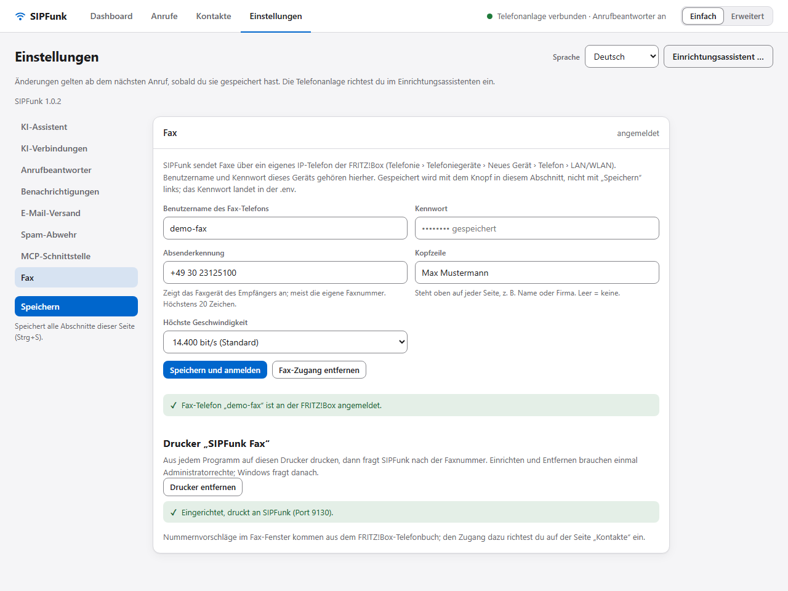

Unter **„Einstellungen › Fax“**:

| Feld | Bedeutung |
| --- | --- |
| Benutzername des Fax-Telefons, Kennwort | die Werte aus 14.1. Ein gespeichertes Kennwort wird nicht angezeigt; Feld leer lassen = es bleibt |
| Absenderkennung | erscheint auf dem Faxgerät des Empfängers und in seinem Faxprotokoll, meist deine Faxnummer im internationalen Format, z. B. `+49 30 1234567`. Höchstens 20 Zeichen, nur Ziffern, Leerzeichen und `+` |
| Kopfzeile | steht oben auf jeder gesendeten Seite, z. B. dein Name oder deine Firma. Leer = keine Kopfzeile |
| Höchste Geschwindigkeit | 14.400 bit/s ist der Standard. Brechen Faxe mitten in der Seite ab, hilft 9.600 bit/s; 4.800 bit/s nur für sehr schlechte Verbindungen |

**„Speichern und anmelden“** prüft die Eingaben, speichert sie und meldet das Fax-Telefon sofort an der Box an; die Zeile darunter zeigt „Fax-Telefon … ist an der FRITZ!Box angemeldet“ oder den Fehler. Ein Neustart ist nicht nötig. Der Abschnitt hat einen eigenen Knopf, „Speichern“ links gilt für ihn nicht. Oben rechts im Abschnitt steht der Zustand: „angemeldet“, „nicht angemeldet“ oder „nicht eingerichtet“. **„Fax-Zugang entfernen“** schaltet das Faxen ab. Während ein Fax läuft, lassen sich die Werte nicht ändern.

Die Werte stehen danach in der `.env` (das Kennwort im Klartext, wie die übrigen Zugangsdaten). Du kannst sie dort auch von Hand eintragen; die installierte App öffnet ihre `.env` über das Tray-Menü „Einstellungen (.env) bearbeiten“, danach SIPFunk beenden und neu starten. Ohne `FAX_USER` und `FAX_PASSWORD` ist das Faxen aus.

| Variable | Standard | Wirkung |
| --- | --- | --- |
| `FAX_USER`, `FAX_PASSWORD` | –, – | Benutzername und Kennwort des IP-Telefons aus 14.1 |
| `FAX_IDENT` | – | Absenderkennung (siehe oben); längere als 20 Zeichen werden nicht gesendet (Hinweis im Log) |
| `FAX_HEADER` | – | Kopfzeile oben auf jeder Seite |
| `FAX_MAX_BITRATE` | 14400 | höchste Geschwindigkeit: 14400, 9600 oder 4800 |
| `FAX_SIP_LOCAL_PORT`, `FAX_RTP_PORT` | 5064, 40100 | lokale UDP-Ports des Fax-Zugangs; nur ändern, wenn sie belegt sind (nur in der `.env`) |
| `FAX_PRINT_PORT` | 9101 | Port auf 127.0.0.1, an den der Drucker „SIPFunk Fax“ druckt; 0 schaltet den Drucker-Empfang ab (nur in der `.env`) |

Beim Start steht im Log, ob sich der Fax-Zugang anmelden konnte. Schlägt die Anmeldung fehl, versucht SIPFunk es beim nächsten Fax erneut.

### 14.3 Drucker „SIPFunk Fax“ einrichten

Der Drucker wird einmal eingerichtet und braucht dafür Administratorrechte. Am einfachsten unter **„Einstellungen › Fax“** mit **„Drucker einrichten“**: Windows fragt nach Administratorrechten, danach zeigt der Abschnitt „Eingerichtet, druckt an SIPFunk“. Dort lässt er sich auch wieder entfernen („Drucker entfernen“). Druckt der Drucker auf einen anderen Port, als SIPFunk lauscht (etwa nach einer Änderung von `FAX_PRINT_PORT`), meldet der Abschnitt das; „Drucker einrichten“ richtet ihn dann passend neu ein.

Ohne Web-UI geht es mit dem Skript. Es liegt bei der installierten App im Programmordner unter `resources\fax\fax-printer.ps1`, im Repository unter `scripts\fax-printer.ps1`. Bei der Standardinstallation:

```powershell
powershell -ExecutionPolicy Bypass -File "$env:LOCALAPPDATA\Programs\SIPFunk\resources\fax\fax-printer.ps1"
```

Hast du bei der Installation einen anderen Ordner gewählt, ersetze `$env:LOCALAPPDATA\Programs\SIPFunk` durch diesen. Windows fragt einmal nach Administratorrechten. Das Skript legt einen Drucker „SIPFunk Fax“ an, der den in Windows enthaltenen Treiber „Microsoft PS Class Driver“ nutzt und auf `127.0.0.1:9101` druckt, also an SIPFunk auf demselben Rechner. Nichts verlässt dabei den Rechner.

- Anderen Port verwenden (passend zu `FAX_PRINT_PORT`): `… fax-printer.ps1 -Port 9102`
- Drucker wieder entfernen: `… fax-printer.ps1 -Remove`

Der Drucker funktioniert nur, solange SIPFunk läuft. Ist SIPFunk aus, bleibt der Auftrag mit einem Fehler in der Druckerwarteschlange von Windows; sobald SIPFunk wieder läuft, kannst du ihn dort neu starten.

### 14.4 Ein Fax senden

1. Im Programm (Word, PDF-Betrachter, Browser …) „Drucken“ wählen, Drucker **„SIPFunk Fax“**. Papierformat A4; Farbe wird zu Schwarzweiß.
2. Unten rechts öffnet sich das Fax-Fenster mit einem Vorschaubild der ersten Seite, dem Namen des Dokuments und der Seitenzahl. Ein Klick auf das Bild oder auf **„Vorschau“** zeigt das ganze Dokument als PDF so, wie es gefaxt wird.
3. Im Feld **„An (Faxnummer oder Kontakt)“** den Empfänger suchen (14.5) oder die Nummer direkt eingeben. Schreibweise wie beim Wählen: `030 1234567` oder `+49 30 1234567`.
4. **„Faxen“** oder Enter.

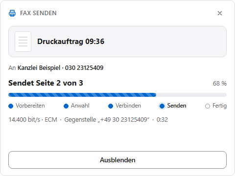

Nach „Faxen“ zeigt das Fenster den Fortschritt live:

| Schritt | Was passiert | Anzeige |
| --- | --- | --- |
| Vorbereiten | Das Dokument wird in Faxseiten umgewandelt; wartet ein anderes Fax, steht der Auftrag in der Warteschlange | „Dokument wird vorbereitet …“, „Wartet auf die Leitung …“ |
| Anwahl | Das Fax-Telefon ruft die Nummer an, es klingelt | „Wählt …“ |
| Verbinden | Die Gegenseite hat abgenommen; die Faxgeräte stimmen Geschwindigkeit und Fehlerkorrektur ab | „Verbunden – Faxgeräte stimmen sich ab …“ |
| Senden | Seite für Seite geht hinüber | „Sendet Seite 2 von 3“ |
| Fertig | Die Gegenseite hat jede Seite bestätigt bzw. es ist ein Fehler aufgetreten | grün „Zugestellt“ mit Seitenzahl und Dauer, oder rot „Fehlgeschlagen“ mit dem Grund |

Der **Balken** steigt mit den Schritten; innerhalb einer Seite schätzt SIPFunk den Fortschritt nach der Dauer der bisherigen Seiten (die erste Seite mit rund 18 Sekunden). Darunter stehen, sobald bekannt, die ausgehandelte **Übertragungsrate** und ob **ECM** (Fehlerkorrektur) aktiv ist, die **Gegenstelle** (die Kennung, die das empfangende Gerät meldet) und die **Laufzeit**.

**„Ausblenden“** (oder ✕, Esc) schließt nur das Fenster, das Fax läuft im Hintergrund weiter; das Ergebnis findest du im Anrufe-Log (14.7). Nach dem Ergebnis zeigt das Fenster den nächsten wartenden Druckauftrag oder schließt sich.

Weitere Hinweise:

- **„Verwerfen“** löscht den Druckauftrag. ✕ oder Esc vor dem Senden schließt nur das Fenster; der Auftrag bleibt liegen und erscheint beim nächsten Druck wieder.
- Druckst du mehrere Dokumente, zeigt das Fenster sie nacheinander. Es warten höchstens 10 Druckaufträge, ältere werden verworfen (Hinweis im Log). Druckaufträge liegen nur im Arbeitsspeicher; nach einem Neustart von SIPFunk sind sie weg.
- Gesendet wird ein Fax nach dem anderen. Ein Faxanruf dauert höchstens 15 Minuten.
- **Gesperrte Ziele:** Es gelten dieselben Regeln wie für Anrufe (Kapitel 6): Notruf, Behörden-, Sonder-, Service- und Mehrwertnummern (z. B. 110, 115, 118…, 0180, 0900), Call-by-Call (010…) und **Auslandsnummern** (`00…` und `+` außer `+49`) lehnt SIPFunk ab. Interne Nebenstellen der Box (`**…`) gehen auch nicht, dort kann kein Fax ankommen. Das Fenster sagt dir das, bevor gewählt wird.
- Ob ein Fax angekommen ist, entscheidet das Faxprotokoll: „Zugestellt“ heißt, das Gerät der Gegenseite hat jede Seite bestätigt.

Zum Ausprobieren eignet sich ein Testfax-Empfang im Internet, etwa [simple-fax.de](https://simple-fax.de/test-fax-empfangen): Dort steht eine Testnummer, und das empfangene Fax erscheint nach ein bis zwei Minuten als Bild auf der Seite. So siehst du auch, wie Kopfzeile und Absenderkennung beim Empfänger ankommen.

### 14.5 Empfänger suchen

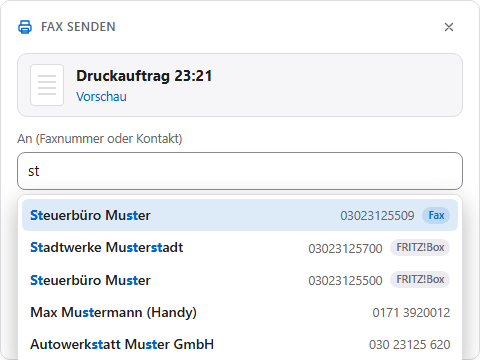

Sobald du im Feld „An“ tippst, öffnet sich eine Trefferliste aus deinen **SIPFunk-Kontakten** und dem **FRITZ!Box-Telefonbuch** (14.6). Jede Zeile zeigt Name, Nummer und die Herkunft: „Fax“ für Faxnummern aus dem Telefonbuch, „FRITZ!Box“ für die übrigen Nummern von dort, ohne Kennzeichen für SIPFunk-Kontakte. Treffer im Namen sind hervorgehoben.

So funktioniert die Suche:

- Gesucht wird in **Name und Nummer**, ohne Rücksicht auf Groß- und Kleinschreibung, an jeder Stelle (nicht nur am Anfang).
- **Mehrere Wörter** müssen alle passen, in beliebiger Reihenfolge.
- **`*`** steht für beliebig viele Zeichen, **`?`** für genau eines.
- Ziffern findest du auch ohne Leerzeichen, Striche oder Schrägstriche: `0301234` findet `030 1234567`.
- **Faxnummern stehen oben**, dann Namen, die mit dem ersten Suchwort beginnen.

| Eingabe | findet zum Beispiel |
| --- | --- |
| `kanz` | „Kanzlei Beispiel“ |
| `st*er` | „Steuerbüro Muster“, „Stadtwerke Musterstadt“ |
| `müller praxis` | „Praxis Dr. Müller“, „Müller Physiopraxis“ |
| `0301234` | alle Nummern, die mit 030 1234… beginnen oder es enthalten |
| `*09` | Nummern, in denen `09` vorkommt |
| `M?ier` | „Maier“, „Meier“ |

Bedienung: **Pfeil runter/hoch** wählt einen Treffer, **Enter** oder **Tab** übernimmt ihn, ein Klick auch; **Esc** schließt die Liste (ein zweites Esc das Fenster). Nach dem Übernehmen steht „Name – Nummer“ im Feld; gefaxt wird an die Nummer. Tippst du nur einen Namen ohne Ziffern und gibt es genau einen Treffer, nimmt SIPFunk diesen. Findet die Suche nichts und hast du eine Nummer eingegeben, steht „Kein Kontakt – die Nummer wird so gewählt.“ da.

### 14.6 FRITZ!Box-Telefonbuch

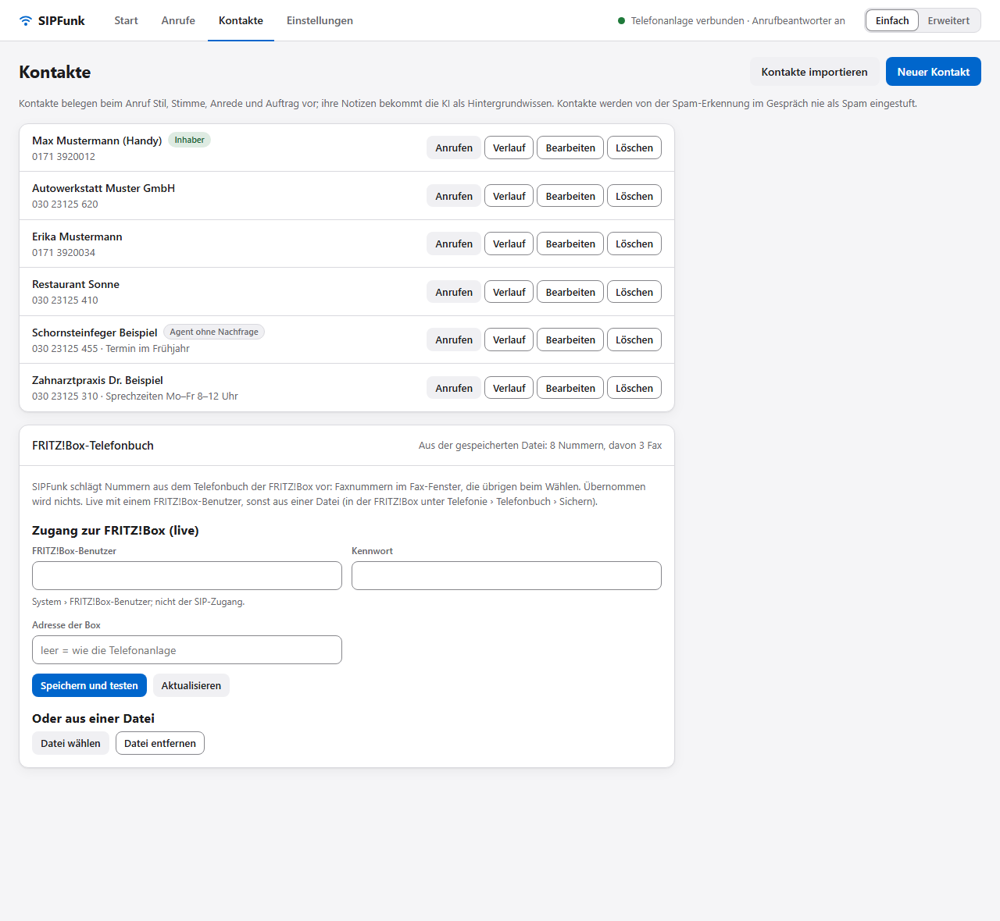

Das Fax-Fenster und das Wählfeld auf dem Dashboard schlagen Nummern aus dem Telefonbuch der FRITZ!Box vor: das Fax-Fenster vor allem die **Faxnummern**, das Wählfeld die übrigen Nummern (dort **keine** Faxnummern). Übernommen wird nichts: Das FRITZ!Box-Telefonbuch bleibt die einzige Quelle, deine SIPFunk-Kontakte ändern sich nicht.

Damit eine Nummer als Faxnummer gilt, trägst du sie im Telefonbuch der FRITZ!Box beim Kontakt mit dem Typ **„Fax“** ein (FRITZ!Box-Oberfläche › „Telefonie“ › „Telefonbuch“ › Kontakt bearbeiten › Nummer, Typ „Fax“).

SIPFunk kommt auf zwei Wegen an das Telefonbuch:

- **Live über TR-064 (empfohlen).** SIPFunk liest alle Telefonbücher der Box und hält sie 5 Minuten vor; „Aktualisieren“ holt sie sofort neu. Dafür braucht es einen **FRITZ!Box-Benutzer**: FRITZ!Box-Oberfläche › „System“ › „FRITZ!Box-Benutzer“ › „Benutzer hinzufügen“, z. B. „sipfunk“. Welches Recht die Box für das Telefonbuch verlangt, hängt von FRITZ!OS ab: Versuch es zuerst mit dem engsten Recht für Telefonie („Sprachnachrichten, Faxnachrichten, FRITZ!App Fon und Anrufliste“); meldet SIPFunk dann „FRITZ!Box lehnt die Anmeldung ab“, gib zusätzlich „FRITZ!Box Einstellungen“ frei. Das ist Vollzugriff auf die Box, und das Kennwort steht im Klartext in der `.env`; nimm ein eigenes, sonst nirgends verwendetes Kennwort. Der SIP-Zugang des IP-Telefons reicht nicht.

  Benutzer und Kennwort trägst du auf der Seite **„Kontakte“** im Bereich **„FRITZ!Box-Telefonbuch“** unter „Zugang zur FRITZ!Box (live)“ ein und klickst **„Speichern und testen“**; SIPFunk ruft das Telefonbuch dann gleich ab und zeigt „Verbunden: 50 Nummern aus der FRITZ!Box.“ oder den Fehler. „Adresse der Box“ bleibt meist leer (dann gilt die der Telefonanlage). „Zugang entfernen“ löscht ihn wieder. Gespeichert wird in der `.env`, wo du die Werte auch von Hand setzen kannst:

  | Variable | Standard | Wirkung |
  | --- | --- | --- |
  | `FRITZ_USER`, `FRITZ_PASSWORD` | –, – | FRITZ!Box-Benutzer für das Telefonbuch |
  | `FRITZ_HOST` | wie `SIP_SERVER` | Adresse der Box, falls sie anders lautet |

  Unter „Heimnetz › Netzwerk › Netzwerkeinstellungen“ muss „Zugriff für Anwendungen zulassen“ (TR-064) eingeschaltet sein. Zu viele falsche Anmeldungen sperren die Anmeldung der Box eine Weile.
- **Aus einer Datei.** Ohne FRITZ!Box-Benutzer sicherst du das Telefonbuch in der FRITZ!Box („Telefonie“ › „Telefonbuch“ › „Sichern“) und lädst die XML-Datei im selben Bereich unter „Oder aus einer Datei“ mit **„Datei wählen“** hoch. Sie liegt dann als `fritz-telefonbuch.xml` im Datenordner. Änderungen in der Box siehst du erst, wenn du die Datei neu sicherst und hochlädst. „Datei entfernen“ löscht sie. Ist ein FRITZ!Box-Benutzer eingerichtet und die Box nicht erreichbar, nimmt SIPFunk die Datei als Ersatz.

Oben rechts im Bereich steht die Quelle und die Zahl der Nummern, etwa „Live aus der FRITZ!Box: 50 Nummern, davon 3 Fax“ oder „Aus der gespeicherten Datei: …“, bei Problemen der Fehler.

### 14.7 Gesendete Faxe im Anrufe-Log

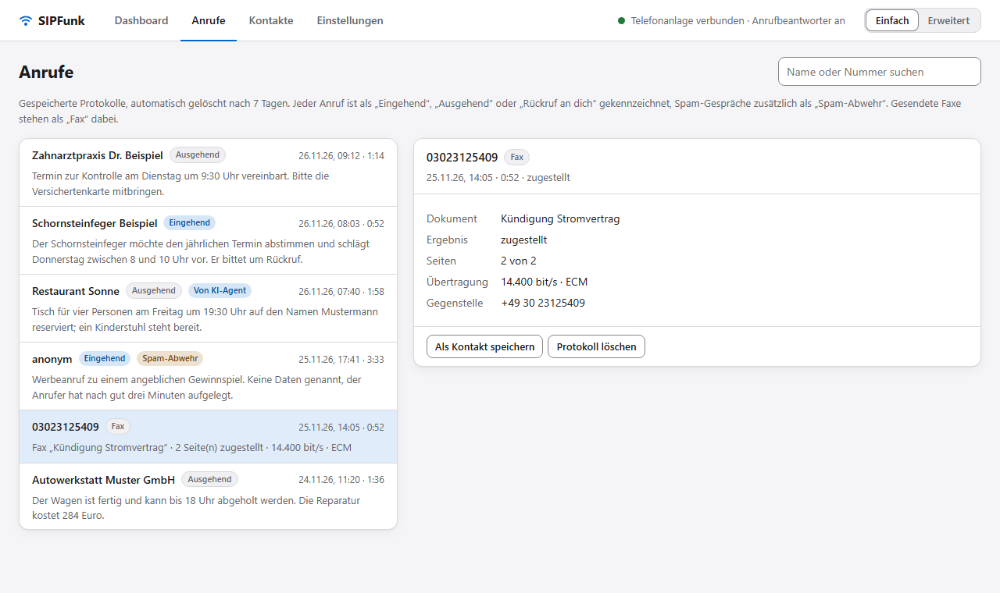

Jedes Fax, das zugestellt wurde oder fehlgeschlagen ist, steht danach auf der Seite **„Anrufe“** (und unter „Letzte Anrufe“ auf dem Dashboard), zwischen den Gesprächen, nach Zeit sortiert:

- In der Liste ist es mit **„Fax“** gekennzeichnet, ein fehlgeschlagenes zusätzlich rot mit **„Fehlgeschlagen“**. Die Zeile darunter nennt Dokument, Seitenzahl und Übertragungsrate bzw. den Grund des Fehlschlags.
- Ein Klick zeigt statt eines Transkripts die Eckdaten: **Dokument**, **Ergebnis**, **Seiten** (gesendet von insgesamt), **Übertragung** (Rate, ECM) und **Gegenstelle**.
- Steht die Nummer nicht bei deinen Kontakten, aber im FRITZ!Box-Telefonbuch (14.6), zeigt SIPFunk den Namen von dort mit dem kleinen Zeichen **„FRITZ!Box“**. Das gilt für Faxe und Gespräche, in der Liste, im Detail und in der Anrufleiste.
- Die Suche über der Liste findet Faxe wie Gespräche nach Name oder Nummer; über den Kontakt („Verlauf“) siehst du Faxe und Gespräche mit diesem Kontakt zusammen.
- „Als Kontakt speichern“ legt die Faxnummer als Kontakt an, „Protokoll löschen“ entfernt den Eintrag.

Fax-Einträge folgen derselben Aufbewahrungsfrist wie Gesprächsprotokolle (Einstellungen › Technik, Standard 7 Tage) und liegen wie diese als `.json` und `.md` im Ordner `transcripts`. Das Dokument selbst speichert SIPFunk nicht, nur seinen Namen.

### 14.8 Faxen ohne Drucker: `/api/fax`

Programme und Skripte auf demselben Rechner können ein PDF direkt faxen:

```powershell
$pdf = [Convert]::ToBase64String([IO.File]::ReadAllBytes("C:\Briefe\Rechnung.pdf"))
Invoke-RestMethod -Method Post -Uri http://127.0.0.1:3865/api/fax -ContentType 'application/json' `
  -Body (@{ number = '030 1234567'; name = 'Rechnung'; pdf = $pdf } | ConvertTo-Json)
```

Die Antwort enthält den Auftrag mit seiner `id`; `GET /api/fax` liefert den Zustand aller Aufträge (`queued`, `converting`, `dialing`, `sending`, `done`, `failed`, dazu `pages`, `totalPages`, `bitRate`, `ecm`, `remoteIdent`, `error`) und ob der Fax-Zugang angemeldet ist. Angenommen werden nur PDFs bis etwa 22 MB. Auch so gesendete Faxe stehen im Anrufe-Log. Wie die ganze Web-UI ist die Schnittstelle nur auf 127.0.0.1 erreichbar und hat keine Anmeldung ([SECURITY](../SECURITY.de.md)).

### 14.9 Tipps und häufige Fragen

- **Im Fax-Fenster steht „Druckauftrag 14:05“ statt des Dokumentnamens.** SIPFunk liest den Namen aus der Windows-Druckwarteschlange, so wie ihn das Programm vergibt (bei Word ohne die Vorsilbe „Microsoft Word -“). Klappt das nicht und schickt auch der Druckauftrag keinen Namen mit, nimmt SIPFunk die Uhrzeit. Am Fax ändert das nichts.
- **Wie sieht mein Fax beim Empfänger aus?** Schick ein Testfax an einen Testfax-Empfang (14.4). Die Kopfzeile steht oben auf jeder Seite, die Absenderkennung im Faxprotokoll des Empfängers.
- **Kann ich faxen, während die KI telefoniert?** Ja. Das Fax läuft über ein eigenes IP-Telefon (14.1).
- **Mehrere Seiten, Farbe, Querformat?** Mehrseitige Dokumente gehen in einem Fax. Farbe wird zu Schwarzweiß, Querformat wird auf A4 hochkant eingepasst; für gut lesbare Faxe besser hochkant drucken.
- **Das Fax bricht immer an derselben Stelle ab.** Höchste Geschwindigkeit auf 9.600 bit/s stellen (14.2) und den Rechner möglichst per LAN-Kabel anschließen.
- **Die Gegenseite nimmt ab, aber es kommt kein Fax zustande.** Meist ist die Nummer kein Faxanschluss (ein Mensch oder ein Anrufbeantworter hebt ab). Das Ergebnis lautet dann „Fehlgeschlagen“ mit einer Meldung des Faxprotokolls (auf Englisch, etwa eine Zeitüberschreitung beim Verbindungsaufbau).
- **Die Oberfläche ist auf Englisch, die Fehlermeldung nicht?** Fax-Fenster und Einstellungen folgen der Sprache unter „Einstellungen › Sprache“. Meldungen der FRITZ!Box oder der Gegenstelle (etwa „486 Busy Here“) gibt SIPFunk unverändert weiter.

### 14.10 Grenzen

- Nur Senden, kein Empfang. Nur Ziele im Inland.
- Fax über eine Sprachverbindung ist empfindlich: Netzwerkaussetzer oder ein stark ausgelasteter Rechner können eine Übertragung abbrechen. Ein Rechner am LAN-Kabel ist zuverlässiger als WLAN. Mit ECM werden gestörte Stellen meist neu gesendet; bricht es trotzdem ab, 9.600 bit/s versuchen.
- Seiten werden auf A4 eingepasst. Sehr feine Schrift und Graustufen leiden wie bei jedem Fax.
- Der Drucker „SIPFunk Fax“ braucht den Treiber „Microsoft PS Class Driver“ (PostScript). Mit einem anderen Treiber meldet das Log „kein PostScript“.
- Der Fortschritt innerhalb einer Seite ist geschätzt; genau bekannt ist nur, wann eine Seite bestätigt ist.

---

## 15. Einstellungen im Überblick

Zwei Orte: die `.env` (wird beim Start gelesen; Änderungen von Hand brauchen einen Neustart, der Einrichtungsassistent übernimmt seine Werte sofort) und die Seite „Einstellungen“ der Web-UI (gespeichert in `settings.json`, gilt ab dem nächsten Anruf; Änderungen an KI-Verbindungen werden sofort gespeichert, Abschnitt 6.2). Für alles, was es an beiden Orten gibt, liefert die `.env` nur den Startwert; ein in der Web-UI gespeicherter Wert hat Vorrang. Die vollständige, kommentierte Liste der Variablen ist die [.env.example.de](../.env.example.de).

### 15.1 Nur in der `.env`

Die erste und die vierte Zeile lassen sich auch mit dem Einrichtungsassistenten setzen (Kapitel 4.2); er schreibt sie in die `.env`. Die Schlüssel der vierten, fünften und sechsten Zeile trägst du unter „Einstellungen › KI-Verbindungen“ ein (Abschnitt 6.2).

| Variable | Standard | Wirkung |
| --- | --- | --- |
| `SIP_SERVER`, `SIP_USER`, `SIP_PASSWORD` | `fritz.box`, –, – | Anmeldung an der Box |
| `SIP_LOCAL_PORT`, `RTP_PORT` | 5062, 40000 | lokale UDP-Ports |
| `LOCAL_IP` | automatisch | lokale Adresse, falls der Rechner mehrere Netze hat |
| `OPENAI_API_KEY`, `GEMINI_API_KEY` | –, – | Schlüssel der beiden mitgelieferten KI-Verbindungen „OpenAI“ und „Google Gemini“ für alle KI-Funktionen; verwendet wird nur der der aktiven Verbindung |
| `AI_KEY_<ID>` | – | Schlüssel jeder weiteren KI-Verbindung (ID = Kennung der Verbindung in Großbuchstaben); wird von der Web-UI geschrieben, normalerweise nicht von Hand bearbeitet |
| `OPENAI_ADMIN_KEY` | – | optional: Admin-Schlüssel der OpenAI-Organisation für die tatsächlichen Monatskosten |
| `OWNER_NUMBERS` | – | eigene Nummern (Alternative zum Kontakt „Inhaber“) |
| `AUDIO_HD` | true | HD-G.711 (16 kHz) mit der Box aushandeln; `false` erzwingt 8 kHz |
| `LIVE_LISTEN_ENABLED` | true | Mithören im Browser |
| `WEB_PORT` | 3865 | Startwert für den Port der Web-UI (nur 127.0.0.1); danach gilt die Einstellung unter „Technik“ (Abschnitt 15.3). Weicht `WEB_PORT` später von der Einstellung ab, steht das beim Start im Log |
| `SIP_DEBUG` | 0 | alle SIP-Nachrichten ins Log |
| `FAX_…` | – | Fax-Zugang, Absenderkennung, Kopfzeile, Geschwindigkeit (auch unter „Einstellungen › Fax“), Ports (Abschnitt 14.2) |
| `FRITZ_USER`, `FRITZ_PASSWORD`, `FRITZ_HOST` | – | FRITZ!Box-Benutzer für das Telefonbuch (auch auf der Seite „Kontakte“, Abschnitt 14.6) |

### 15.2 Web-UI, Abschnitt „Technik“

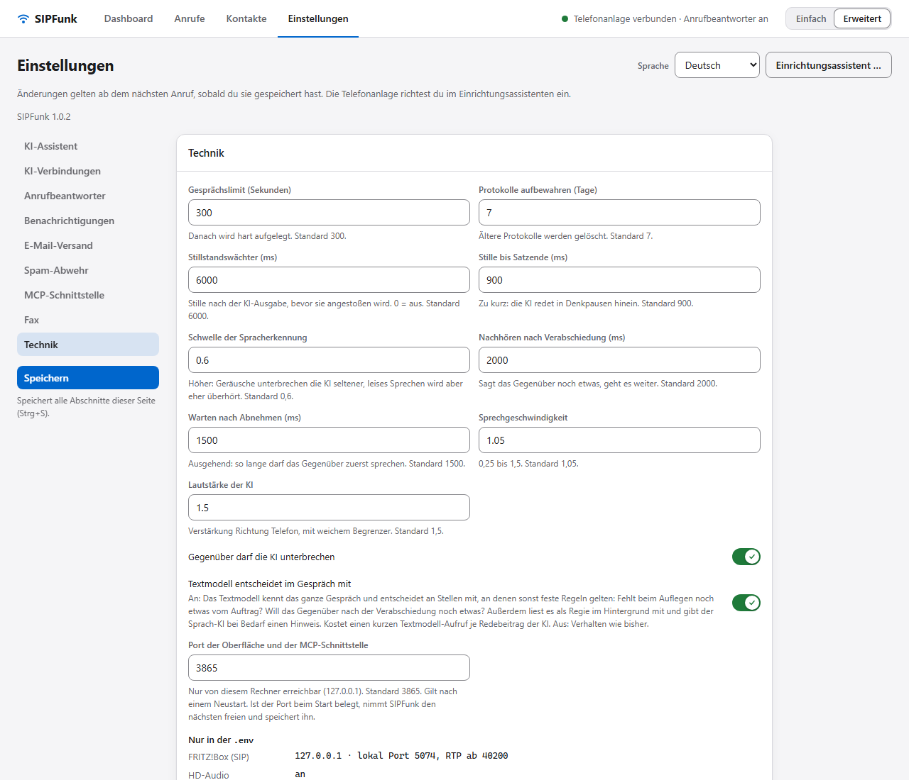

Das Textmodell stellst du in der Oberfläche je Verbindung unter „KI-Verbindungen“ ein (Abschnitt 6.2); sein Startwert kommt aus `OPENAI_SUMMARY_MODEL` bzw. `GEMINI_SUMMARY_MODEL`. Die übrigen Werte stehen unter „Technik“.

| Einstellung | Standard | Startwert aus | Wirkung |
| --- | --- | --- | --- |
| Gesprächslimit (Sekunden) | 300 | `MAX_CALL_SECONDS` | hartes Limit, gilt für alle Gespräche; mit Google Gemini nie mehr als 540 s |
| Protokolle aufbewahren (Tage) | 7 | `TRANSCRIPT_RETENTION_DAYS` | ältere Protokolle werden gelöscht |
| Stillstandswächter (ms) | 6000 | `AI_STALL_MS` | bleibt es nach der KI-Ausgabe so lange still, wird die KI angestoßen weiterzusprechen; 0 = aus |
| Stille bis Satzende (ms) | 900 | `AI_VAD_SILENCE_MS` | zu kurz: die KI redet in Denkpausen hinein |
| Schwelle der Spracherkennung | 0,6 | `AI_VAD_THRESHOLD` | 0,3–0,9; höher: Geräusche unterbrechen die KI seltener, leises Sprechen wird eher überhört. Mit Google Gemini wählt der Wert nur eine von zwei Stufen: ab 0,5 niedrige, darunter hohe Empfindlichkeit |
| Nachhören nach Verabschiedung (ms) | 2000 | `AI_HANGUP_GRACE_MS` | sagt das Gegenüber noch etwas, geht es weiter |
| Warten nach Abnehmen (ms) | 1500 | `AI_GREETING_WAIT_MS` | ausgehend: so lange darf das Gegenüber zuerst sprechen |
| Sprechgeschwindigkeit | 1,05 | `AI_SPEECH_SPEED` | 0,25–1,5; mit Google Gemini nur ein Hinweis an die KI |
| Lautstärke der KI | 1,5 | `AI_OUTPUT_GAIN` | Verstärkung Richtung Telefon, mit weichem Begrenzer |
| Gegenüber darf die KI unterbrechen | an | `AI_ALLOW_INTERRUPT` | aus: die KI spricht immer zu Ende |
| Textmodell entscheidet im Gespräch mit | an | `AI_LIVE_JUDGE` | Prüfung beim Auflegen, Entscheidung nach der Verabschiedung und Regie im Hintergrund durch das Textmodell (Abschnitt 6.3); aus: Verhalten wie bisher |
| Port der Oberfläche und der MCP-Schnittstelle | 3865 | `WEB_PORT` | Port auf 127.0.0.1 für Web-UI und `/mcp`; gilt nach einem Neustart (Abschnitt 15.3) |

Die übrigen Abschnitte sind in den Kapiteln 6 bis 10 beschrieben. Ihre Startwerte kommen aus `AI_*` (Dashboard, KI-Assistent), `AI_PROVIDER`, `OPENAI_MODEL`, `GEMINI_MODEL` und `AI_VOICE` (KI-Verbindungen; `AI_VOICE` ist nur noch der Startwert für Verbindungen ohne eigene Standardstimme), `INCOMING_*` (Anrufbeantworter), `NOTIFY_*` und `RING_POPUP` (Benachrichtigungen), `MAIL_*` und `SMTP_*` (E-Mail) sowie `SCAM_NUMBERS` und `SPAM_LOOKUP` (Spam-Abwehr).

---

### 15.3 Port der Web-UI

Die Web-UI und die MCP-Schnittstelle lauschen auf demselben Port, immer nur auf `127.0.0.1`. Standard ist 3865. Wer SIPFunk schon vor Version 1.0.1 eingerichtet hat, behält seinen bisherigen Port (meist 8080), sofern in der `.env` eine Zeile `WEB_PORT=…` steht; bei der installierten App ist das immer so. Ohne diese Zeile gilt seit 1.0.1 der Port 3865, und eingetragene Agenten zeigen „Veraltet“.

**Von 8080 auf den Standardport 3865 umstellen.** Maßgeblich ist die Einstellung unter „Technik“ (gespeichert in `settings.json`); `WEB_PORT` in der `.env` ist nur der Startwert, solange dort nichts gespeichert ist. Ein Ändern der `.env` allein bewirkt also nichts. So geht es:

1. „Einstellungen › Technik › Port der Oberfläche und der MCP-Schnittstelle“ (Stufe „Erweitert“) auf **3865** setzen und speichern.
2. **„Jetzt neu starten“** wählen (oder SIPFunk beenden und neu starten). Die Oberfläche wechselt danach auf `http://127.0.0.1:3865`.
3. Unter „Einstellungen › MCP-Schnittstelle“ die eingetragenen KI-Agenten aktualisieren (Abschnitt 13.3); sie zeigen bis dahin „Veraltet“. Laufende Agenten (Claude Code, Codex …) danach neu starten oder die MCP-Verbindung neu aufbauen, damit sie die neue Adresse lesen.

Wer möchte, setzt `WEB_PORT=3865` zusätzlich in der `.env`, damit beides übereinstimmt. Bei Microsoft 365 als Mail-Zugang auch die Redirect-Adresse anpassen (siehe unten).

- **Ändern**: „Einstellungen › Technik › Port der Oberfläche und der MCP-Schnittstelle“ (Stufe „Erweitert“), speichern. Erlaubt sind 1024 bis 65535; einen Port, den gerade ein anderes Programm belegt, nimmt die Oberfläche nicht an. Der neue Port gilt nach einem Neustart; mit der Tray-App bietet die Oberfläche „Jetzt neu starten“ an und wechselt danach von selbst auf die neue Adresse. Ohne Tray-App (`npm start`) SIPFunk von Hand beenden und wieder starten.
- **Port belegt**: Ist der eingestellte Port beim Start von einem anderen Programm belegt, nimmt SIPFunk den nächsten freien darüber und speichert ihn als neue Einstellung. Das steht im Log, die Tray-App zeigt einen Hinweis, und die Oberfläche meldet es beim nächsten Öffnen. Die Adresse ändert sich danach nicht wieder von selbst, solange der neue Port frei bleibt.
- **Wiederfinden**: Das Tray-Menü „Im Browser öffnen (Port …)“ und der Doppelklick auf das Tray-Symbol öffnen immer die richtige Adresse. Der Port der laufenden App steht außerdem in der Datei `sipfunk.port` im Datenordner.
- **Was sich mit dem Port ändert**: Lesezeichen im Browser; die Adresse `http://127.0.0.1:PORT/mcp` bei eingetragenen KI-Agenten (Abschnitt 13.3 zeigt, wie sie mit einem Klick aktualisiert werden); bei Microsoft 365 die Redirect-Adresse der App-Registrierung (Abschnitt 9). Der Browser merkt sich Kleinigkeiten wie die zuletzt gewählte Nummer je Adresse; sie beginnen unter dem neuen Port neu.

## 16. Kosten

Beide KI-Anbieter rechnen nach Token ab. Die Web-UI zeigt pro Gespräch den Verbrauch und eine Schätzung in US-Dollar. Die Preise dafür stehen fest in `src/ai/pricing.ts` und müssen bei Preisänderungen von Hand angepasst werden; maßgeblich ist die Abrechnung des Anbieters. Die Schätzung lässt die Transkription und Rabatte für zwischengespeicherte Eingaben weg.

Der größte Posten ist die Sprachausgabe des Sprachmodells; die Mini-Variante des Realtime-Modells von OpenAI kostet nach der hinterlegten Preistabelle etwa ein Drittel. Zusammenfassung, Einschätzung und Gesprächsplan fallen kaum ins Gewicht. Hinhalten in der Spam-Abwehr kostet entsprechend der Dauer. Setze bei deinem Anbieter ein monatliches Budget-Limit.

Für Google Gemini stehen in der Tabelle die Preise der bezahlten Stufe für `gemini-3.8-live` (US-Dollar je 1 Million Token: Audio-Eingabe 3, Audio-Ausgabe 12, Text-Eingabe 0,75, Text-Ausgabe 4,5). Die Schätzung rechnet auch dann damit, wenn ein Gespräch über das kostenlose Kontingent lief; zum kostenlosen Kontingent siehe Abschnitt 6.2.

„Einstellungen › KI-Verbindungen“ summiert die Schätzungen je Monat und Anbieter („Verbrauch in diesem Monat“) und kann optional die tatsächlichen Kosten deiner OpenAI-Organisation zeigen (Abschnitt 6.2).

Telefonkosten fallen nach deinem Tarif an (der Rückruf an dich ist ein normaler ausgehender Anruf).

---

## 17. Fehlersuche

Das Log (im Terminal, auf dem Dashboard in der Karte „Systemprotokoll“ (Stufe „Erweitert“), bei der Tray-App zusätzlich `sipfunk.log` im Datenordner) ist die erste Anlaufstelle.

| Symptom | Prüfen |
| --- | --- |
| „Telefonanlage noch nicht eingerichtet“ im Kopf | Einrichtungsassistent öffnen („Einstellungen“ › „Einrichtungsassistent …“) oder `SIP_USER` und `SIP_PASSWORD` in der `.env` eintragen und neu starten |
| Keine Registrierung an der Box | `SIP_USER`/`SIP_PASSWORD`, `SIP_SERVER`; Firewall für die UDP-Ports; Box-Oberfläche: ist das IP-Telefon angemeldet? |
| Nebenstelle klingelt nicht | Rufnummer in der Box der Nebenstelle zugeordnet? |
| KI nimmt nicht ab | Anrufbeantworter an? Profil der Nummer auf „aus“? Läuft gerade ein anderes Gespräch? |
| KI spricht nicht / Stille nach Annahme | Log „Realtime: verbunden“, „erstes Audio … ms nach …“; Schlüssel der aktiven KI-Verbindung, Modellzugriff, Internet; „Verbindung testen“ unter „Einstellungen › KI-Verbindungen“ prüft Schlüssel, Sprachmodell und Live-Verbindung |
| Falsche Stimme nach dem Umschalten der KI-Verbindung | Nach dem Umschalten gilt die Standardstimme der neuen Verbindung: die Verbindung unter „Einstellungen › KI-Verbindungen“ aufklappen und dort die „Standardstimme“ wählen. Stimmen des anderen Anbieters (Kontakt, Profil einer eigenen Rufnummer, Spam-Rolle) werden ignoriert. Modelle und Standardstimme gehören zur Verbindung (Abschnitt 6.2) |
| Gespräch endet nach neun Minuten | mit Google Gemini dauert ein Gespräch höchstens 540 s, gleich was das Gesprächslimit sagt (Abschnitt 6.2) |
| Stimme abgehackt | Log „RTP: Gegenstelle sendet …“, „Unterläufe“; `AUDIO_HD=false` testen; WLAN vermeiden |
| KI redet in Pausen hinein | „Stille bis Satzende“ erhöhen (z. B. 1200) |
| Geräusche (Rascheln, Husten) unterbrechen die KI | „Schwelle der Spracherkennung“ erhöhen (z. B. 0,7). Die KI pausiert bei einer Unterbrechung nur und wartet die Transkription ab: War es ein Geräusch oder ein Zuhör-Laut („mhm“), spricht sie ihren Satz zu Ende; bei Inhalt („Nein“, „Moment“, eine Frage) verwirft sie den Rest und antwortet. Mit Google Gemini bricht Google die Antwort selbst ab, wenn das Gegenüber dazwischenspricht; das Zu-Ende-Sprechen klappt deshalb seltener |
| Lange Stille mitten im Gespräch | Log „Stillstand“; der Stillstandswächter stößt die KI nach der eingestellten Zeit an |
| Antwort abgeschnitten | Log „Realtime-Antwort abgeschnitten“ → Token-Limit; Auftrag kürzer fassen |
| E-Mail bleibt aus | Statuszeile der Karte „E-Mail-Versand“; „Verbindung prüfen“; bei OAuth neu verbinden |
| Rückruf kommt nicht | Inhaber-Kontakt bzw. `OWNER_NUMBERS` vorhanden? Einschätzung „unwichtig“? Schalter bzw. Profil? |
| Durchstellen klappt nicht | Log „REFER“; die Box muss die Nummer anrufen dürfen |
| Nach dem Drucken auf „SIPFunk Fax“ kommt kein Fax-Fenster | Läuft SIPFunk? Fax-Zugang unter „Einstellungen › Fax“ angemeldet? `FAX_PRINT_PORT` und der Port des Druckers gleich (Abschnitt 14.3)? Log „Fax-Drucker: …“ |
| Log „Fax-Drucker: … kein PostScript“ | Der Drucker nutzt einen anderen Treiber; mit `fax-printer.ps1 -Remove` entfernen und neu einrichten (Abschnitt 14.3) |
| Fax „Fehlgeschlagen“ | Grund im Fax-Fenster und im Log („Fax: Auftrag … fehlgeschlagen“). Nimmt die Gegenseite nicht ab oder ist kein Fax, kommt kein Faxsignal; bricht es mitten in der Seite ab, `FAX_MAX_BITRATE=9600` und LAN statt WLAN versuchen (Abschnitt 14.10) |
| Log „Fax: Anmeldung an der FRITZ!Box fehlgeschlagen“ | `FAX_USER`/`FAX_PASSWORD`; ist das IP-Telefon für das Fax in der Box angelegt (Abschnitt 14.1)? |
| FRITZ!Box-Telefonbuch: „FRITZ!Box lehnt die Anmeldung ab“ | `FRITZ_USER`/`FRITZ_PASSWORD` prüfen (FRITZ!Box-Benutzer, nicht der SIP-Zugang); zu viele Fehlversuche sperren die Anmeldung der Box eine Weile |

Pro KI-Antwort steht im Log eine Diagnosezeile (Generierungsgeschwindigkeit, Puffer-Unterläufe, Unterbrechungen). `SIP_DEBUG=1` zeigt alle SIP-Nachrichten; solche Logs enthalten Rufnummern und gehören vor dem Weitergeben bereinigt.

---

## 18. Begriffe

- **Nebenstelle / IP-Telefon**: das Gerät, als das sich SIPFunk an der Box anmeldet.
- **KI-Anbieter**: das Unternehmen, dessen Modelle das Gespräch führen und die Texte schreiben: OpenAI oder Google (Abschnitt 6.2).
- **KI-Verbindung**: ein benannter Zugang zu einem KI-Anbieter: Anbieter, eigener Schlüssel, die Modelle, die damit benutzt werden, und eine Standardstimme. Die aktive Verbindung führt die Gespräche (Abschnitt 6.2).
- **Standardstimme**: die Stimme einer KI-Verbindung; sie gilt, wenn Anruf, Kontakt oder eigene Rufnummer keine Stimme ihres Anbieters vorgeben (Abschnitt 6.2).
- **Realtime-API**: OpenAI-Schnittstelle für Sprache in Echtzeit (Audio rein, Audio raus).
- **Live API**: Googles Schnittstelle für Sprache in Echtzeit mit Gemini.
- **Server-VAD**: Spracherkennung auf der Seite des KI-Anbieters, die Satzenden erkennt. Die Schwelle ist ein Parameter von OpenAI; bei Gemini wählt sie nur eine niedrige oder hohe Start-Empfindlichkeit.
- **end_call / transfer_call / flag_spam**: Werkzeuge, die die KI aufruft, um aufzulegen, durchzustellen oder Spam zu melden.
- **REFER**: SIP-Nachricht, mit der die Box angewiesen wird, ein Gespräch zu einer anderen Nummer durchzustellen.
- **Inhaber**: du, erkennbar am Kontakt-Kennzeichen oder an `OWNER_NUMBERS`.
- **Stil (Persona)**: Stilvorgabe aus `personas/*.md`.
- **`.env`**: Textdatei im Datenordner, in der deine Zugangsdaten stehen, etwa das SIP-Kennwort und die API-Schlüssel. Der Einrichtungsassistent füllt sie für dich; „Einstellungen (.env) bearbeiten“ im Tray-Menü öffnet sie. Nie weitergeben.
- **Datenordner**: der Ordner, in dem SIPFunk Einstellungen, Kontakte, Protokolle und die `.env` ablegt. Bei der installierten Tray-App ist es `%APPDATA%\SIPFunk` (Abschnitt 11.3).
- **Port**: eine Zahl, die dem Rechner sagt, für welches Programm eine Verbindung bestimmt ist. Die Web-UI lauscht standardmäßig auf Port 3865 (Abschnitt 15.3).
- **SMTP**: der übliche Weg, E-Mails zu verschicken. SIPFunk nutzt ihn für die Benachrichtigungs-Mail (Abschnitt 9.3).
- **OAuth**: eine Anmeldung, bei der du dich im Browser bei Google oder Microsoft anmeldest und SIPFunk den Zugriff erlaubst, ohne ihm dein Passwort zu geben.
- **Token**: ein kleines Stück Text oder Audio; die KI-Anbieter messen den Verbrauch in Token und rechnen danach ab (Kapitel 16). Das Wort bezeichnet auch die Berechtigung, die OAuth ausstellt (`mail-token.json`).
- **MCP**: Model Context Protocol, eine Schnittstelle, über die KI-Agenten Werkzeuge aufrufen. Bei SIPFunk: Anrufe starten, mitlesen, Vorgaben machen (Kapitel 13, [Ablauf eines Agenten-Anrufs](mcp-flow.de.md)).
- **Sprach-KI / Live-KI**: das Sprachmodell, das am Telefon spricht (Realtime bzw. Live API).
- **Textmodell**: das Modell der KI-Verbindung, das Plan, Zusammenfassung und Einschätzung schreibt und im Gespräch mitentscheidet (Abschnitt 6.3).
- **Regie**: das Textmodell, das im Hintergrund mitliest und der Sprach-KI Hinweise gibt; bei Agenten-Anrufen übernimmt der Agent diese Rolle.
- **ask_principal**: Werkzeug, mit dem die Sprach-KI bei einem Agenten-Anruf beim Agenten nachfragt (Kapitel 13).
