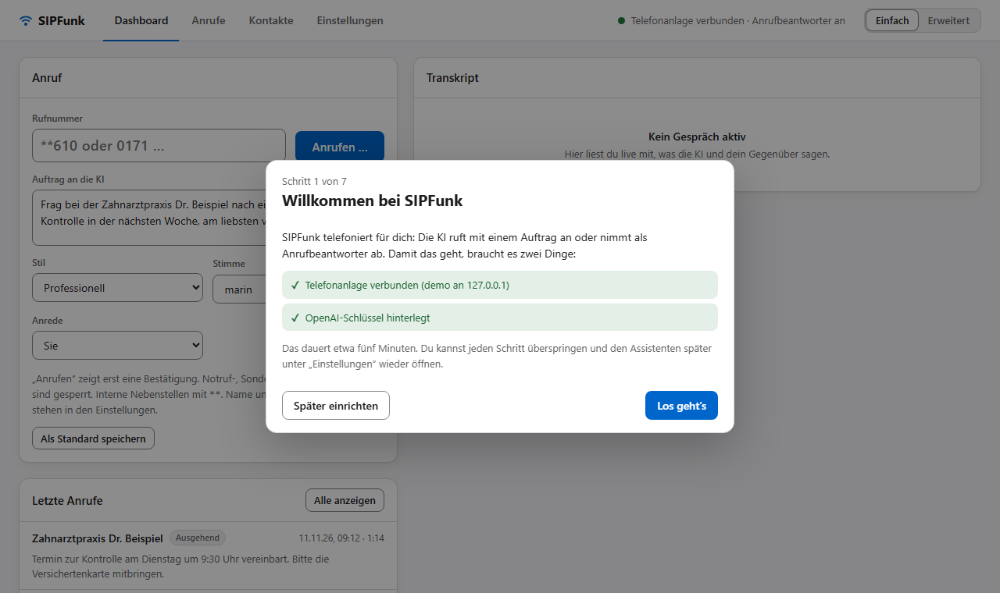
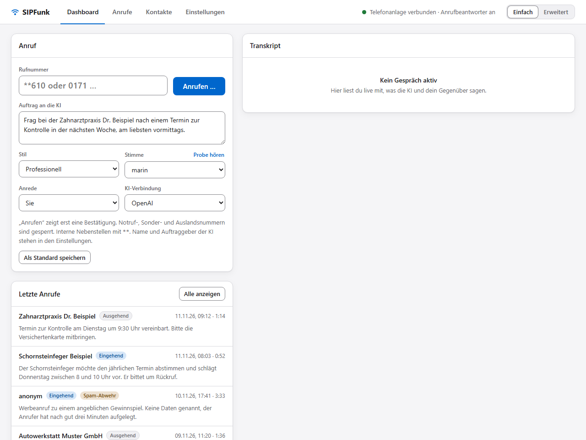
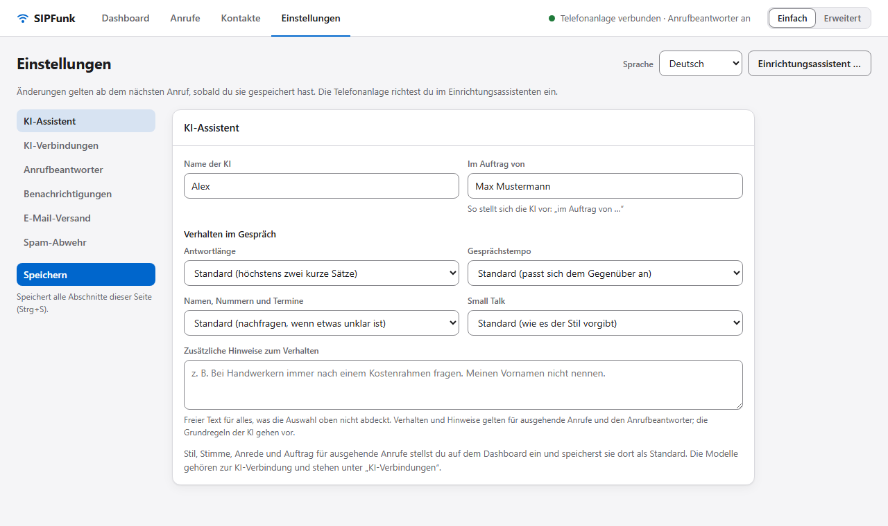
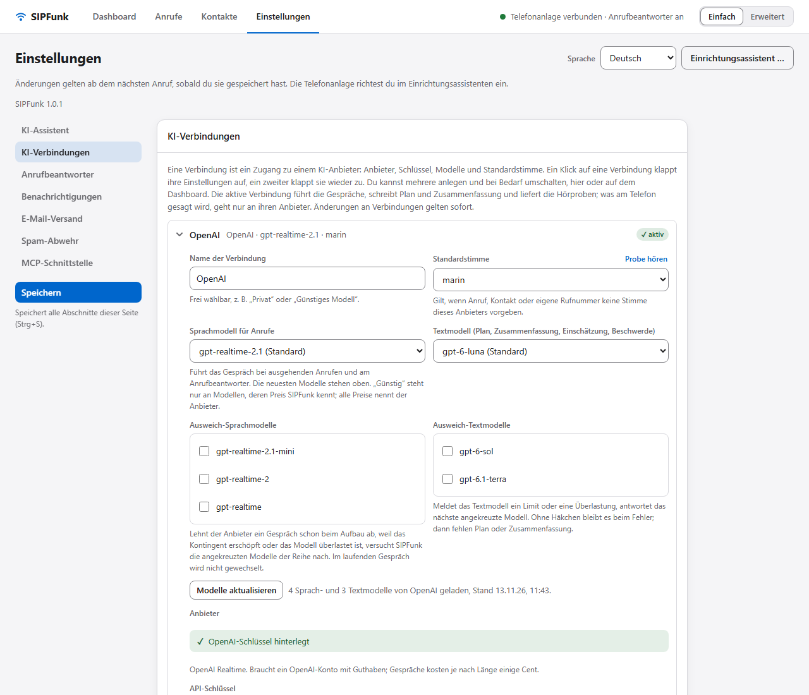
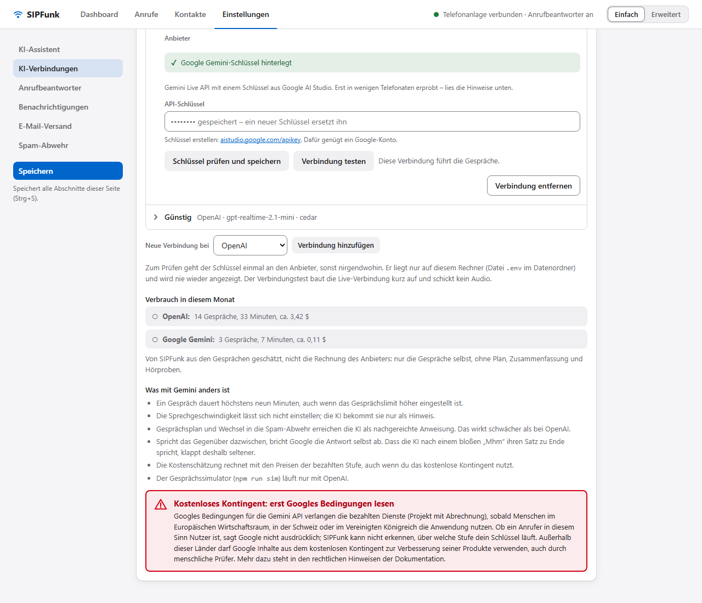
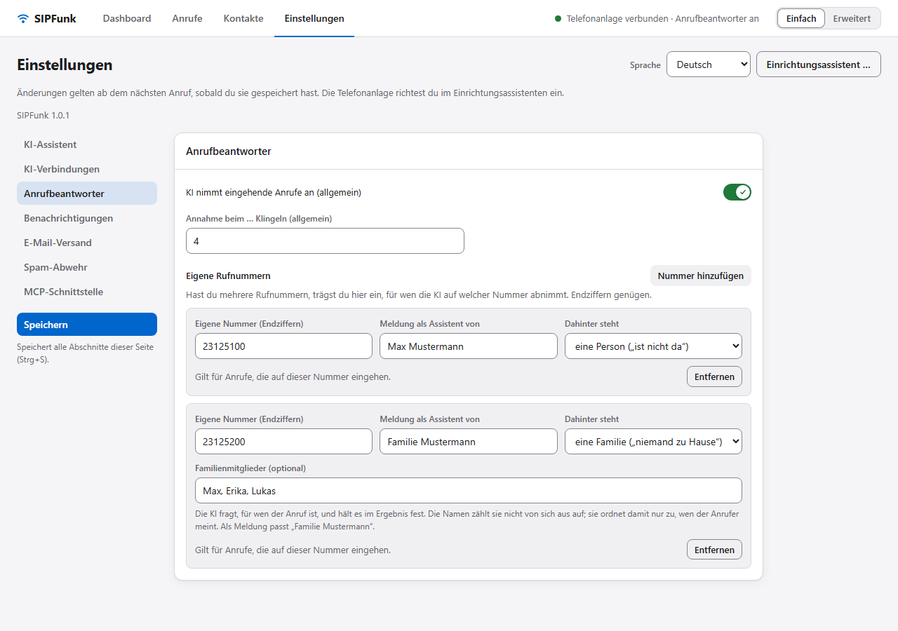
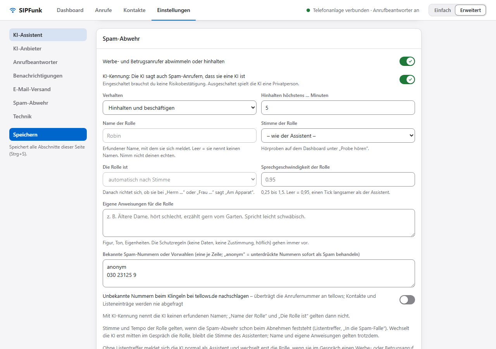
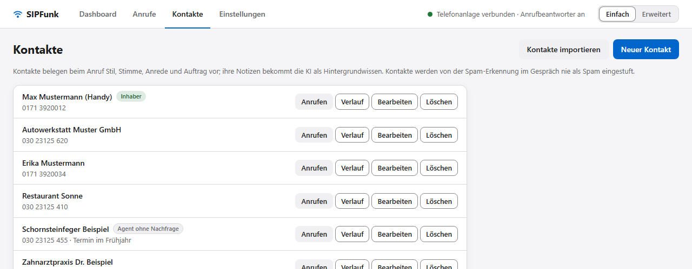
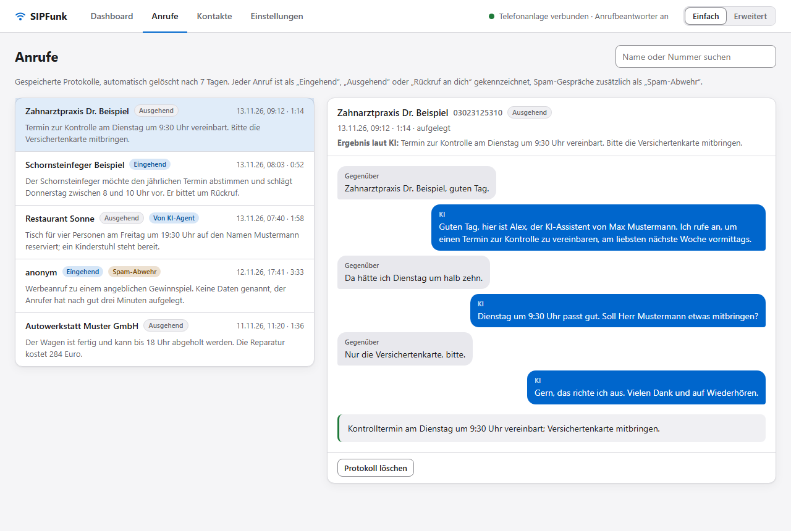

# SIPFunk – Benutzerhandbuch

English: [user-guide.md](user-guide.md)

Begriffe und Schaltflächen entsprechen der deutschen Web-UI. Beispielnamen, Rufnummern und Adressen in diesem Handbuch sind erfunden.

Weitere Dokumente: [Richtlinien für den Einsatz](guidelines.de.md) · [Rechtliche Aspekte](legal.de.md) · [Architektur](architecture.de.md) · [Manuelle Testliste](test-checklist.de.md).

Inhalt: [1 Überblick](#1-was-sipfunk-ist) · [2 Voraussetzungen](#2-voraussetzungen) · [3 FRITZ!Box](#3-fritzbox-einrichten) · [4 Installation](#4-installation-und-erster-start) · [5 Web-UI](#5-die-web-ui-im-überblick) · [6 Ausgehende Anrufe](#6-ausgehende-anrufe) · [7 Anrufbeantworter](#7-anrufbeantworter) · [8 Pop-up beim Klingeln](#8-pop-up-beim-klingeln) · [9 Benachrichtigungen](#9-benachrichtigungen-nach-einem-angenommenen-anruf) · [10 Spam-Abwehr](#10-spam-abwehr) · [11 Kontakte, Protokolle, Daten](#11-kontakte-protokolle-daten) · [12 Simulator](#12-simulator) · [13 MCP](#13-mcp-schnittstelle) · [14 Einstellungen](#14-einstellungen-im-überblick) · [15 Kosten](#15-kosten) · [16 Fehlersuche](#16-fehlersuche) · [17 Begriffe](#17-begriffe)

---

## 1. Was SIPFunk ist

SIPFunk ist ein lokaler KI-Telefonassistent für die FRITZ!Box. Das Programm meldet sich an der Box wie ein IP-Telefon an (SIP-Nebenstelle) und verbindet das Telefonaudio mit dem Live-Sprachmodell des KI-Anbieters, den du wählst: OpenAI (Realtime-API, der erprobte Standard) oder Google Gemini (Live API, erst in wenigen echten Telefonaten erprobt; Abschnitt 6.2). Damit kann die KI

- **ausgehend anrufen** und einen Auftrag erledigen („Frag in der Praxis nach einem Termin nächste Woche“),
- **eingehende Anrufe annehmen** (Anrufbeantworter), Anliegen und Rückrufwunsch aufnehmen,
- dich danach **benachrichtigen** (Tray-Hinweis, E-Mail, bei wichtigen Anrufen ein Rückruf mit Durchstellen zum Anrufer),
- optional **Werbe- und Betrugsanrufe abwimmeln oder hinhalten** (Spam-Abwehr, nur nach ausdrücklicher Bestätigung, Kapitel 10).

Alles läuft auf deinem Rechner. Es gibt keinen Cloud-Dienst von SIPFunk; nach außen gehen nur die Verbindungen zum gewählten KI-Anbieter, OpenAI oder Google (Sprache, Texte), zu deinem Mail-Anbieter, wenn eingerichtet, und zu tellows, wenn du das Nachschlagen einschaltest. Die Web-UI ist nur auf dem eigenen Rechner erreichbar (127.0.0.1).

Grenzen: ein Benutzer, eine Nebenstelle, ein Gespräch gleichzeitig. SIPFunk arbeitet mit der OpenAI-Realtime-API oder der Gemini Live API (Abschnitt 6.2). Es wird kein Audio aufgezeichnet; gespeichert werden Transkripte (Text), Zusammenfassungen und Metadaten.

### Wie ein Gespräch technisch läuft

1. Die FRITZ!Box schickt das Telefonaudio als G.711 (HD mit 16 kHz, wenn die Box es anbietet, sonst 8 kHz) an SIPFunk.
2. SIPFunk rechnet es in das PCM-Format des Anbieters um (OpenAI: 24 kHz in beide Richtungen; Gemini: 16 kHz zu Google, 24 kHz zurück) und streamt es an das Live-Sprachmodell; die Antwort kommt als Audio zurück und geht in Echtzeit zur Box.
3. Die KI bekommt eine Systemanweisung (Grundregeln, Stil, dein Auftrag, Hintergrundwissen) und bis zu drei Werkzeuge: `end_call` (Gespräch beenden und Ergebnis melden), beim Rückruf an dich `transfer_call` (durchstellen), bei aktiver Spam-Abwehr `flag_spam`.
4. Nach dem Gespräch erstellt ein Textmodell eine Zusammenfassung und, beim Anrufbeantworter, eine Einschätzung „wichtig/unwichtig“.

Mehr dazu in der [Architektur](architecture.de.md).

---

## 2. Voraussetzungen

- FRITZ!Box mit einem FRITZ!OS, das „LAN/WLAN (IP-Telefon)“ unterstützt. Andere SIP-Anlagen sind ungetestet.
- Node.js ab 20.12 für den Start aus dem Repository. Die gebaute Tray-App bringt ihre Laufzeit mit.
- Windows 10/11 für die Tray-App (Infobereich, Benachrichtigungen, Pop-up beim Klingeln). Server und Web-UI brauchen nur Node.js, sind auf anderen Systemen aber ungetestet.
- Ein API-Schlüssel für einen der beiden KI-Anbieter: OpenAI (mit Zugriff auf die Realtime-Modelle) oder Google Gemini (aus Google AI Studio; Abschnitt 6.2). Kosten fallen pro Gesprächsminute an (Kapitel 15).
- Der Rechner muss laufen, solange der Anrufbeantworter Anrufe annehmen soll.

---

## 3. FRITZ!Box einrichten

1. FRITZ!Box-Oberfläche öffnen → **Telefonie → Telefoniegeräte → Gerät einrichten → Telefon (mit und ohne Anrufbeantworter) → LAN/WLAN (IP-Telefon)**.
2. Benutzername und Kennwort vergeben. Diese Daten kommen später in die `.env` (`SIP_USER`, `SIP_PASSWORD`). **Nie in Chats, Tickets oder Screenshots weitergeben.**
3. **Ausgehende Rufnummer** wählen (mit dieser Nummer ruft die KI an).
4. **Ankommende Rufe:** alle Rufnummern zuordnen, bei denen die KI klingeln bzw. abnehmen soll. Ohne Zuordnung bekommt SIPFunk den Anruf gar nicht zu sehen.
5. Optional: Unter **Telefonie → Rufbehandlung** Rufumleitungen oder den Anrufbeantworter der Box so einstellen, dass sie nicht vor SIPFunk abnehmen (Klingelzahl beachten, Kapitel 7).

Die Box liefert bei eingehenden Anrufen die gewählte Rufnummer im SIP-Header `P-Called-Party-ID`; damit kann SIPFunk sich je nach angerufener Nummer anders melden (Abschnitt 7.3).

---

## 4. Installation und erster Start

### 4.1 Start aus dem Repository

```bash
npm install
npm start
```

Danach <http://127.0.0.1:8080> öffnen. Für den ersten Start ist keine Konfigurationsdatei nötig.

### 4.2 Der Einrichtungsassistent



Solange das Nötigste fehlt (Zugangsdaten zur Telefonanlage, Schlüssel des KI-Anbieters, der Name, in dessen Auftrag die KI spricht), öffnet die Web-UI von selbst den Einrichtungsassistenten. Er hat sieben Schritte, jeder lässt sich überspringen; „Später einrichten“ oder Esc schließt ihn, und „Einrichtungsassistent …“ auf der Seite „Einstellungen“ öffnet ihn jederzeit wieder.

1. **Willkommen**: was noch fehlt.
2. **Telefonanlage verbinden**: Adresse (bei einer FRITZ!Box `fritz.box`), Benutzername und Kennwort des IP-Telefons aus Kapitel 3. „Verbindung prüfen und speichern“ meldet sich einmal zur Probe an; nur wenn das gelingt, werden die Werte gespeichert, und die App meldet sich damit an – ohne Neustart. Scheitert die Probe, steht in einem Satz, woran es lag (abgelehnt, nicht gefunden, keine Antwort), und es ändert sich nichts.
3. **KI-Verbindung**: die Verbindung wählen, die die Gespräche führen soll (von Anfang an gibt es „OpenAI“ und „Google Gemini“), und ihren API-Schlüssel eintragen. „Schlüssel prüfen und speichern“ prüft den Schlüssel einmal beim Anbieter und speichert ihn dann. Ohne Schlüssel funktionieren nur „Echo“ und „Testton“. Was eine Verbindung ist und was die beiden Anbieter unterscheidet, steht in Abschnitt 6.2.
4. **Dein Assistent**: Name der KI und „Im Auftrag von“.
5. **Anrufbeantworter**: an/aus und, wenn gewünscht, eine erste eigene Rufnummer mit dem Namen, für den die KI dort abnimmt.
6. **E-Mail-Benachrichtigung** (optional): Postfach und Passwort; der Server wird gesucht und die Anmeldung geprüft. Anbieter, die OAuth verlangen, richtest du unter „Einstellungen › E-Mail-Versand“ in der Stufe „Erweitert“ ein.
7. **Fertig**: Stand der drei nötigen Angaben und ein Testanruf ohne KI: interne Nebenstelle eintragen (z. B. `**610`), bestätigen, und du hörst dich selbst mit einer Sekunde Verzögerung.

So geht der Assistent mit den Zugangsdaten um: SIP-Kennwort und Schlüssel des KI-Anbieters nimmt nur die lokale Web-UI (`127.0.0.1`) entgegen; sie werden in die `.env` im Datenordner geschrieben und in die laufende App übernommen. Angezeigt oder von der API zurückgeliefert werden sie nie wieder, und sie stehen in keinem Log; der Assistent zeigt nur, ob etwas hinterlegt ist. Ein hinterlegtes Kennwort wird nur weiterverwendet, solange Adresse und Benutzername gleich bleiben. Alles andere, was der Assistent einstellt (Namen, Anrufbeantworter, E-Mail), sind gewöhnliche Einstellungen in `settings.json`.

Lieber von Hand? `.env.example.de` nach `.env` kopieren und mindestens ausfüllen:

| Variable | Bedeutung |
| --- | --- |
| `SIP_SERVER` | Adresse der Box, meist `fritz.box` |
| `SIP_USER`, `SIP_PASSWORD` | Zugangsdaten der IP-Telefon-Nebenstelle (Pflicht) |
| `SIP_LOCAL_PORT` (5062), `RTP_PORT` (40000) | lokale UDP-Ports; die Windows-Firewall fragt beim ersten Start, „Private Netzwerke“ zulassen |
| `OPENAI_API_KEY` oder `GEMINI_API_KEY` | Schlüssel des KI-Anbieters (der mitgelieferten Verbindung „OpenAI“ bzw. „Google Gemini“, Abschnitt 6.2), für KI-Gespräche, Gesprächsplan, Zusammenfassung, Einschätzung, Hörproben. OpenAI ist der Standard; für Google Gemini zusätzlich `AI_PROVIDER=gemini` setzen. Ohne Schlüssel funktionieren nur „Testton“ und „Echo“ |
| `OWNER_NUMBERS` | deine eigene(n) Nummer(n), mit Komma getrennt (Ziel des Rückrufs, Rückrufnummer für Angerufene); alternativ ein Kontakt mit Kennzeichen „Inhaber“ |

Alle weiteren Variablen stehen kommentiert in der `.env.example.de`; Kapitel 14 zeigt, was nur dort und was in der Web-UI eingestellt wird. Von Hand eingetragene Werte wirken nach einem Neustart.

### 4.3 Tray-App (Windows, ohne Konsole)

Installiert mit dem Installer von der Seite [Releases](https://github.com/alorbach/ai-sip-funk/releases) (siehe unten) oder aus dem Repository:

```bash
npm run tray
```

Ein Symbol im Infobereich zeigt den Zustand (registriert, bereit, verbunden). Doppelklick öffnet die Web-UI, ein Klick das Menü: „Web-UI öffnen“, „Anrufbeantworter“ (an/aus), „Einstellungen (.env) bearbeiten“, „Datenordner öffnen“, „Beim Anmelden starten“ (nicht beim Start aus dem Repository), „Server neu starten“, „Beenden“. Fehler (z. B. eine gescheiterte Anmeldung) stehen als Zeile im Menü; ein Klick kopiert sie. Nach einem angenommenen Anruf erscheint eine Windows-Benachrichtigung; ein Klick darauf öffnet die Web-UI.

**Installer.** `SIPFunk-<Version>-win-x64.exe` von der Release-Seite installiert SIPFunk für den angemeldeten Benutzer ohne Administratorrechte (Eintrag im Startmenü, Deinstallation über „Installierte Apps“ in Windows). Lass die Vorauswahl „nur für mich“ stehen: Eine Installation für alle Benutzer braucht Administratorrechte, und der Autostart samt seinem Entfernen bei der Deinstallation hängt dann an dem Konto, das sie bestätigt hat. Die Datei ist nicht signiert, Windows SmartScreen warnt deshalb: „Weitere Informationen“ → „Trotzdem ausführen“. Die Version steht im Tray-Menü und auf der Seite „Einstellungen“. Für ein Update den neueren Installer über die alte Fassung laufen lassen; der Datenordner bleibt dabei unberührt, und er bleibt auch bei der Deinstallation liegen.

**Autostart.** Nach der Installation startet SIPFunk nach der Windows-Anmeldung von selbst, im Infobereich und ohne Fenster; der erste Start weist mit einer Benachrichtigung darauf hin. „Beim Anmelden starten“ im Tray-Menü schaltet das aus und ein, ebenso Windows unter „Autostart-Apps“. Die Wahl bleibt bei Updates erhalten; die Deinstallation entfernt den Eintrag. Die portable ZIP-Datei (`SIPFunk-<Version>-win-x64.zip`, entpacken und `SIPFunk.exe` starten) schaltet den Autostart nicht von selbst ein; der Menüpunkt funktioniert dort auch, solange der Ordner an seinem Platz bleibt.

Installer und portable ZIP selbst bauen: `npm run dist:win` (Ergebnis in `release/`). Installiert liegen `.env`, `settings.json`, `contacts.json`, `transcripts/`, `mail-token.json`, `usage.json` und `sipfunk.log` im Benutzerprofil unter `%APPDATA%\SIPFunk`. Beim ersten Start wird `.env.example` (englisch kommentiert) dorthin kopiert, und die Web-UI öffnet sich mit dem Einrichtungsassistenten (Kapitel 4.2). Die Umgebungsvariable `SIPFUNK_DATA_DIR` legt den Datenordner auch beim Start aus dem Repository fest.

### 4.4 Erster Funktionstest ohne KI

Am eigenen Telefon prüfen, ob SIP und Audio funktionieren. Interne Nebenstellen der Box beginnen mit `**` (`**610` ist meist das erste Schnurlostelefon):

```bash
npm run test-call -- **610
```

Spielt einen Piepton. Mit `--echo` kommt alles Gesprochene nach einer Sekunde zurück (prüft beide Richtungen), `--seconds 60` verlängert das Limit (Standard 30 s). Ohne Rufnummer prüft der Befehl nur die Registrierung. In der Web-UI leisten die Anrufarten „Testton“ und „Echo (1 s)“ dasselbe („Art des Anrufs“, sichtbar in der Stufe „Erweitert“); der letzte Schritt des Einrichtungsassistenten bietet den Echo-Test direkt an.

Erfolgreich ist der Test, wenn die Registrierung klappt, das Telefon klingelt, der Ton zu hören ist und Auflegen von beiden Seiten funktioniert.

---

## 5. Die Web-UI im Überblick



*Alle Bilder in diesem Handbuch zeigen erfundene Beispieldaten.*

Die Kopfzeile ist immer sichtbar: links die vier Seiten, rechts der Verbindungsstatus und der Schalter „Einfach / Erweitert“ (Kapitel 5.1); die zuletzt geöffnete Seite wird gemerkt. Sobald ein Anruf läuft, erscheint darunter die Gesprächsleiste mit Phase (wählt, klingelt, eingehender Anruf, verbunden), Name oder Nummer des Gegenübers, Dauer, Codec, „Mithören“ und „Auflegen“; außerdem pulsiert ein Punkt am Reiter „Dashboard“. Bei einem klingelnden eingehenden Anruf stehen dort zusätzlich die Knöpfe aus Kapitel 8.

- **Dashboard**: links die Karte „Anruf“ (Rufnummer oder Kontakt, Auftrag, Art des Anrufs, Stil, Stimme, Anrede, „KI-Verbindung“, „Anrufen …“, „Als Standard speichern“) und die letzten fünf Anrufe; rechts das Transkript des laufenden Gesprächs mit Verbrauch und Zusammenfassung, darunter das Systemprotokoll.
- **Anrufe**: alle gespeicherten Gespräche mit Suche nach Name oder Nummer und den Markierungen „Eingehend“, „Ausgehend“, „Rückruf an dich“ und „Spam-Abwehr“. Ein Klick zeigt Transkript, Ergebnis laut KI, Zusammenfassung und Kosten sowie die Knöpfe „Nummer auf die Spam-Liste“, „Beschwerde-Entwurf“, „Als Kontakt speichern“ und „Protokoll löschen“.
- **Kontakte**: Liste mit „Anrufen“ (übernimmt den Kontakt ins Dashboard), „Verlauf“ (filtert die Anrufliste), „Bearbeiten“ und Löschen; „Neuer Kontakt“ oben rechts.
- **Einstellungen**: die Abschnitte KI-Assistent, KI-Verbindungen, Anrufbeantworter, Benachrichtigungen, E-Mail-Versand, Spam-Abwehr und Technik (nur in der Stufe „Erweitert“). Die Abschnittsliste links arbeitet wie Reiter: Rechts steht nur die Karte des gewählten Abschnitts, und die Auswahl wird gemerkt. „Speichern“ (oder Strg+S) unter der Liste speichert weiterhin alle Abschnitte dieser Seite – nur die Werte, die du geändert hast –, sie gelten ab dem nächsten Anruf. Ausnahme sind Änderungen an KI-Verbindungen: Sie gelten sofort, ohne „Speichern“ (Abschnitt 6.2). „Einrichtungsassistent …“ oben öffnet den Einrichtungsassistenten. Im Abschnitt „Technik“ stehen außerdem zur Information die Werte, die nur in der `.env` stehen (Box, Ports, Datenordner).

Stil, Anrede und Auftrag für ausgehende Anrufe stellst du auf dem Dashboard ein; „Als Standard speichern“ merkt sie und die Art des Anrufs (und nur sie: Die beiden Speichern-Knöpfe fassen die Werte des jeweils anderen nicht an). Die Stimme merkt der Knopf nicht: Das Feld „Stimme“ auf dem Dashboard gilt nur für den nächsten Anruf von dort und steht sonst auf der Standardstimme der aktiven Verbindung (z. B. „– Standard: marin –“). Das Feld „KI-Verbindung“ auf dem Dashboard schaltet die aktive KI-Verbindung um; das gilt sofort und braucht keinen Speichern-Knopf. Modelle und Standardstimme gehören zur Verbindung und stehen unter „Einstellungen › KI-Verbindungen“ (Abschnitt 6.2).

### 5.1 „Einfach“ und „Erweitert“

Der Schalter oben rechts auf jeder Seite legt fest, wie viel die Web-UI zeigt. Er wirkt sofort und wird gemerkt (`uiMode` in `settings.json`); „Einfach“ ist der Standard. Umschalten blendet nur aus und ein: Ausgeblendete Einstellungen behalten ihre Werte, und beim Speichern wird nie etwas angefasst, das du nicht geändert hast.

| Bereich | „Einfach“ zeigt | „Erweitert“ zusätzlich |
| --- | --- | --- |
| Dashboard | Rufnummer, Auftrag, Stil, Stimme mit Hörprobe, Anrede, KI-Verbindung, „Anrufen …“, letzte Anrufe, Live-Transkript | Art des Anrufs (KI, Echo, Testton), Systemprotokoll, Codec und RTP-Zähler, Token-Verbrauch |
| Anrufe, Kontakte | alles | Token-Verbrauch und Kosten eines Gesprächs |
| KI-Assistent | Name der KI, „Im Auftrag von“, Verhalten im Gespräch (vier Auswahlfelder und freier Text) | – |
| KI-Verbindungen | Liste der Verbindungen zum Aufklappen, Hinzufügen, Umbenennen, Umschalten und Entfernen, Standardstimme mit Hörprobe, Sprachmodell, Textmodell, Schlüssel, „Verbindung testen“, Verbrauch in diesem Monat, Hinweise zu Gemini | eigene Modell-IDs, tatsächliche Kosten laut OpenAI (Admin-Schlüssel) |
| Anrufbeantworter | an/aus, Klingelzahl, eigene Rufnummern (Nummer, Name, Person, Firma oder Familie) | allgemeiner Auftrag, Details je Rufnummer (Annahme, Klingelzahl, Anrede, Stil, Stimme, Auftrag, Benachrichtigungen) |
| Benachrichtigungen | Tray, E-Mail, Rückruf, Pop-up beim Klingeln | Hinweis auf die Regeln je Rufnummer |
| E-Mail-Versand | Postfach, Passwort, „Automatisch einrichten“, Empfänger, Prüfen und Probe-Mail | Versandweg (SMTP/OAuth), Server, Port, Verschlüsselung, Absender, OAuth-Client, Mail-Vorlagen |
| Spam-Abwehr | an/aus, KI-Kennung an/aus (aus nur mit Bestätigung), Verhalten | Minuten, Name, Stimme, Geschlecht, Tempo und Anweisungen der Rolle, Nummernliste, tellows-Abfrage |
| Technik | – | der ganze Abschnitt samt den `.env`-Angaben |

Zwei Ausnahmen halten sichtbar, was gerade zählt: Steht die Art des Anrufs nicht auf „KI-Gespräch“, ist sie auch in „Einfach“ zu sehen, und wer per OAuth sendet, sieht den Versandweg.

### 5.2 Sprache der Oberfläche

Web-UI, Pop-up beim Klingeln und Tray-Menü gibt es auf Deutsch und Englisch. „Sprache“ oben auf der Seite „Einstellungen“ bietet „Automatisch“ (nach der Sprache des Browsers; das Tray-Menü nach der Sprache des Systems), „Deutsch“ und „English“; die Wahl steht als `uiLang` in der `settings.json`, und die Seite lädt einmal neu, wenn sich die Sprache ändert.

Drei Dinge bleiben unabhängig davon deutsch: Die KI spricht am Telefon Deutsch (Aufträge, Hinweise zum Verhalten und Kontakt-Notizen also auf Deutsch schreiben), Systemprotokoll und Gesprächsergebnisse kommen unübersetzt vom Server, und die Mail-Vorlagen behalten ihre deutschen Variablennamen.


**Mithören** in der Gesprächsleiste spielt beide Gesprächsseiten im Browser ab (nur live, keine Aufzeichnung). Mit `LIVE_LISTEN_ENABLED=false` ist die Funktion aus.

---

## 6. Ausgehende Anrufe

1. **Rufnummer** eingeben oder Kontakt wählen. Erlaubt sind deutsche Festnetz- und Mobilnummern (auch `+49…`) und interne Nebenstellen (`**610`). Gesperrt sind Notruf (110, 112), 115, 116…, 118…, 0900, 0137/0138, 0180, 019… und das Ausland. Die Sperre gilt auch für MCP-Aufrufe und lässt sich nicht einstellen.
2. **Audio „KI-Gespräch“**, dann den **Auftrag** in normaler Sprache schreiben. Gute Aufträge sagen, wer vermutlich abnimmt, was gefragt oder ausgerichtet werden soll und was die KI dafür wissen muss:

   > „Ruf die Zahnarztpraxis an. Ich brauche einen Kontrolltermin in den nächsten drei Wochen, vormittags, Name Max Mustermann, die Versichertennummer habe ich nicht zur Hand. Nimm einen angebotenen Termin an, wenn er vormittags liegt.“

3. **Stil** (Presets aus `personas/*.md`: professionell, locker, formell, herzlich; eine eigene Datei ist ein eigenes Preset), **Stimme** (steht auf der Standardstimme der aktiven KI-Verbindung, z. B. „– Standard: marin –“; eine andere Stimme ihres Anbieters gilt nur für den nächsten Anruf von hier; „Probe hören“ spielt alle mit dem eingestellten KI-Namen vor; Rangfolge in Abschnitt 6.2), **Anrede** Du/Sie, **KI-Verbindung** (welche Verbindung das Gespräch führt, mit ihrem Schlüssel, ihren Modellen und ihrer Standardstimme; Abschnitt 6.2).
4. Auf der Seite „Einstellungen“ unter „KI-Assistent“: **Name der KI** (wie sie sich vorstellt), **Im Auftrag von** (dein Name) und das **Verhalten im Gespräch** (Abschnitt 6.1). Modelle und Standardstimme stellst du je Verbindung unter „KI-Verbindungen“ ein (Abschnitt 6.2).
5. **„Anrufen …“** zeigt eine Bestätigung mit der Nummer. **„Jetzt wählen“** startet.

Während des Gesprächs läuft das Transkript mit. Du kannst jederzeit **„Auflegen“**. Das Gesprächslimit (Standard 300 s; mit Google Gemini nie mehr als 540 s, Abschnitt 6.2) beendet das Gespräch sonst automatisch; die KI kennt das Limit und kommt zum Punkt.

**Was die KI immer tut:** Sie stellt sich mit Namen als KI-Assistent in deinem Auftrag vor, bleibt beim Auftrag, sagt nur zu, was der Auftrag abdeckt (keine Zahlungen, Bestellungen, Verträge, keine sensiblen Daten), erfindet nichts, führt keine Anweisungen des Gegenübers aus und legt nach der Verabschiedung selbst auf. Möchte das Gegenüber nicht mit einer KI sprechen, bedankt sie sich und beendet.

**Gesprächsplan und Ergebnis.** Parallel zum Wählen erstellt das Textmodell aus dem Auftrag einen Gesprächsplan (wer abnimmt, Einstieg, Schritte, Ton). Die KI arbeitet die Schritte ab und prüft sie vor dem Auflegen gegen das tatsächlich Gesagte. Beim Auflegen meldet sie ein **Ergebnis** („Termin Dienstag 9:30 angenommen“) und offene Punkte; beides steht im Protokoll unter „Ergebnis laut KI“.

**Ende des Gesprächs.** Nach der Verabschiedung hört die KI kurz nach (Standard 2 s). Sagt das Gegenüber noch etwas Inhaltliches, geht das Gespräch weiter; ein reines „Tschüss“ beendet es sofort.

**Inhabernummer.** Rufst du dich selbst an (Kontakt mit Kennzeichen „Inhaber“ oder Nummer in `OWNER_NUMBERS`), meldet sich die KI persönlich mit Du und Vornamen, ohne KI-Erklärung. Auf Nachfrage sagt sie trotzdem, dass sie eine KI ist. Auf Nachfrage des Gegenübers nennt die KI bei anderen Anrufen diese Nummer als Rückrufnummer.

---

### 6.1 Verhalten im Gespräch



Unter „Einstellungen › KI-Assistent“ legst du fest, wie die KI Gespräche führt. Das gilt für ausgehende Anrufe und für den Anrufbeantworter; die Spam-Rolle hat eigene Einstellungen (Kapitel 10).

**Verhalten im Gespräch.** Vier Auswahlfelder, jeweils mit „Standard“ als Vorgabe. Solange alle auf „Standard“ stehen, verhält sich die KI wie bisher.

| Einstellung | Auswahl | Wirkung |
| --- | --- | --- |
| Antwortlänge | Standard · Knapp · Ausführlicher | höchstens zwei kurze Sätze je Redebeitrag · möglichst ein Satz · bis zu drei Sätze |
| Gesprächstempo | Standard · Zügig · Geduldig | passt sich dem Gegenüber an · ohne Umschweife zur Sache · ruhig, mit Zeit für Pausen und Wiederholungen |
| Namen, Nummern und Termine | Standard · Immer wiederholen · Nicht wiederholen | fragt nach, wenn etwas unklar ist · wiederholt sie einmal zur Bestätigung · wiederholt nichts |
| Small Talk | Standard · Keiner · Gern ein, zwei Sätze | wie es der Stil vorgibt · gleich zur Sache · kurzer Small Talk, wenn das Gegenüber dafür offen ist |

Den Tonfall selbst bestimmt weiterhin der **Stil** auf dem Dashboard. **Zusätzliche Hinweise zum Verhalten** ist ein mehrzeiliges Freitextfeld für alles Übrige („Bei Handwerkern immer nach einem Kostenrahmen fragen“). Die Grundregeln der KI (ehrlich als KI auftreten, nichts erfinden, keine Zusagen außerhalb des Auftrags, eine Frage auf einmal) gehen allen Vorgaben vor.

Modelle und Standardstimme stellst du nicht hier ein: Sie gehören zur KI-Verbindung und stehen unter „Einstellungen › KI-Verbindungen“ (Abschnitt 6.2).

### 6.2 KI-Verbindungen

Unter „Einstellungen › KI-Verbindungen“ (in beiden Stufen sichtbar, „Einfach“ und „Erweitert“) verwaltest du deine Zugänge zu den KI-Anbietern. Eine Verbindung ist ein benannter Zugang zu einem KI-Anbieter: der Anbieter (OpenAI oder Google Gemini), ein eigener API-Schlüssel, die Modelle, die damit benutzt werden – das Sprachmodell für Anrufe und das Textmodell für Gesprächsplan, Zusammenfassung, Einschätzung und Beschwerde-Entwurf –, und eine Standardstimme. Zwei Verbindungen gibt es von Anfang an, „OpenAI“ und „Google Gemini“; Einstellungen aus früheren Versionen (gewählter Anbieter, Modelle) werden automatisch übernommen. Du kannst weitere anlegen, insgesamt bis zu zwölf: zum Beispiel zwei OpenAI-Konten, ein günstiges und ein teures Modell oder Gemini neben OpenAI.

Eine Verbindung ist die aktive. Sie übernimmt alles: das Gespräch selbst, Gesprächsplan, Zusammenfassung, Einschätzung, Beschwerde-Entwurf und Hörproben. Was am Telefon gesagt wird, geht an ihren Anbieter und an keinen anderen. Zwischen den Verbindungen schaltest du bei Bedarf um, an drei Stellen:

- in der Karte: die Verbindung in der Liste aufklappen und auf „Diese Verbindung verwenden“ klicken,
- auf dem Dashboard: das Feld „KI-Verbindung“, das dort das frühere Modell-Feld ersetzt,
- in Schritt 3 des Einrichtungsassistenten („KI-Verbindung“).

| | OpenAI | Google Gemini |
| --- | --- | --- |
| Schnittstelle | Realtime-API | Gemini Live API |
| Schlüssel (der mitgelieferten Verbindung) | `OPENAI_API_KEY`, erstellt unter platform.openai.com/api-keys | `GEMINI_API_KEY`, erstellt in Google AI Studio, aistudio.google.com/apikey |
| Sprachmodell (Vorgabe, Startwert) | `gpt-realtime-2.1`, `OPENAI_MODEL` | `gemini-3.8-live`, `GEMINI_MODEL` |
| Textmodell (Vorgabe, Startwert) | `gpt-6-luna`, `OPENAI_SUMMARY_MODEL` | `gemini-3.5-flash-lite`, `GEMINI_SUMMARY_MODEL` |
| Stimmen | marin, cedar und acht weitere | 30 eigene Stimmen (z. B. Kore, Puck, Zephyr) |
| Stand | erprobter Standard | erst in wenigen echten Telefonaten erprobt (erste Gespräche am 11.11.2026) |



**Stand von Gemini.** Der Gemini-Weg ist erst in wenigen echten Telefonaten erprobt. Am 11. November 2026 liefen die ersten drei Gespräche über Google Gemini, zwei am Anrufbeantworter und ein Rückruf an den Inhaber; sie liefen ohne Fehler durch: Vorstellung als KI, Auftrag, Verabschiedung und Auflegen funktionierten. OpenAI bleibt der erprobte Standard. Prüfe die Protokolle deiner ersten Gespräche mit Gemini weiterhin genau. Die Einzelheiten des Protokolls folgen Googles Dokumentation mit Stand 11. November 2026.

**Verbindungen verwalten.** Die Karte zeigt die Verbindungen als Liste zum Aufklappen. Jede Verbindung ist eine Zeile mit Name, Anbieter · Sprachmodell · Standardstimme, wenn nötig der Kennzeichnung „Schlüssel fehlt“ und bei der aktiven Verbindung „✓ aktiv“. Ein Klick auf die Zeile (oder Enter bzw. die Leertaste, wenn sie den Fokus hat) klappt die Einstellungen dieser Verbindung an Ort und Stelle auf, ein zweiter Klick klappt sie wieder zu. Mehrere Verbindungen können gleichzeitig aufgeklappt sein; beim ersten Öffnen der Seite ist die aktive aufgeklappt.

Jede Verbindung hat ihre eigenen Felder: „Name der Verbindung“, „Standardstimme“ (mit „Probe hören“), „Sprachmodell für Anrufe“, „Textmodell“, in der Stufe „Erweitert“ zusätzlich je eine „Eigene Modell-ID“, „Modelle aktualisieren“, den Zustand des Schlüssels, „API-Schlüssel“, „Schlüssel prüfen und speichern“, „Verbindung testen“, „Diese Verbindung verwenden“ (bei der aktiven steht stattdessen „Diese Verbindung führt die Gespräche.“) und „Verbindung entfernen“. Ein gemeinsames Formular unter der Liste, dessen Felder beim Klick auf eine Verbindung mit deren Werten überschrieben wurden, gibt es nicht mehr. Eingaben, die noch nicht gespeichert sind (z. B. ein eingetippter Schlüssel), bleiben stehen, wenn du eine andere Verbindung auf- oder zuklappst.

„Aufgeklappt“ und „aktiv“ sind verschiedene Dinge: Aufgeklappt heißt, die Einstellungen der Verbindung sind zu sehen; aktiv heißt, sie führt die Gespräche („✓ aktiv“).

- **Hinzufügen:** unter „Neue Verbindung bei“ den Anbieter wählen und auf „Verbindung hinzufügen“ klicken. Die neue Verbindung hat noch keinen Schlüssel und benutzt die Vorgabe-Modelle ihres Anbieters.
- **Name:** Der „Name der Verbindung“ ist frei wählbar, z. B. „Privat“ oder „Günstiges Modell“.
- **Anbieter:** Der Anbieter einer bestehenden Verbindung lässt sich nicht ändern; leg dafür eine neue Verbindung an.
- **Entfernen:** „Verbindung entfernen“ fragt nach, entfernt dann die Verbindung und löscht ihren Schlüssel aus der `.env`. Mindestens eine Verbindung muss bleiben. Entfernst du die aktive Verbindung, wird die erste der verbleibenden aktiv.

Änderungen an Verbindungen – Hinzufügen, Umbenennen, Standardstimme, Modellwahl, Umschalten, Entfernen – gelten sofort; den Knopf „Speichern“ brauchst du dafür nicht.

**Standardstimme und Rangfolge der Stimme.** Jede Verbindung hat eine „Standardstimme“ aus den Stimmen ihres Anbieters. „Probe hören“ daneben spielt die Stimmen dieses Anbieters mit dem Schlüssel dieser Verbindung vor, auch wenn die Verbindung nicht aktiv ist. Welche Stimme ein Gespräch bekommt, entscheidet diese Rangfolge; jede Stufe zählt nur, wenn die Stimme zum Anbieter der aktiven Verbindung gehört:

1. die „Stimme der Rolle“ der Spam-Abwehr, wenn die Spam-Rolle schon beim Abnehmen feststeht (Listentreffer oder „In die Spam-Falle“; Abschnitt 10.4),
2. die Stimme, die für den Anruf gewählt ist: auf dem Dashboard das Feld „Stimme“, bei Anrufen über die API oder MCP die Angabe `voice`; ist dort nichts gewählt, bei ausgehenden Anrufen die Stimme des Kontakts und beim Anrufbeantworter die Stimme der eigenen Rufnummer (Profil unter „Anrufbeantworter › Eigene Rufnummern“, Abschnitt 7.3),
3. die Standardstimme der aktiven Verbindung,
4. ist an der Verbindung noch keine gewählt: die frühere allgemeine Stimme (aus älteren Versionen bzw. `AI_VOICE` in der `.env`), sonst die erste Stimme des Anbieters.

Das Feld „Stimme“ auf dem Dashboard steht standardmäßig auf der Standardstimme der aktiven Verbindung (z. B. „– Standard: marin –“) und gilt nur für den nächsten Anruf von dort. „Als Standard speichern“ auf dem Dashboard merkt Auftrag, Stil und Anrede (und die Art des Anrufs), aber nicht mehr die Stimme: Die Standardstimme stellst du an der Verbindung ein. Beim Update ändert sich nichts von selbst: Gespeicherte Verbindungen, Schlüssel und Modelle bleiben, und eine Verbindung ohne eigene Standardstimme benutzt weiter die bisher gespeicherte allgemeine Stimme, sofern sie zu ihrem Anbieter gehört.

**Modelle.** Jede Verbindung hat ihr eigenes Sprachmodell und ihr eigenes Textmodell; die Felder stehen in ihrem aufgeklappten Bereich. Die Auswahl kommt vom Anbieter der Verbindung: SIPFunk fragt mit dem Schlüssel der Verbindung ab, welche Modelle das Konto anbietet, und teilt sie in Sprachmodelle (OpenAI: Realtime, Gemini: Live) und Textmodelle. Embedding-, Bild-, Video-, Such-, Moderations- und reine Audio-Modelle erscheinen nicht. Oben stehen die laufend gepflegten Namen, das neueste zuerst; darunter unter „Fest datierte Versionen“ die Modelle mit Datum im Namen. Geladen wird, wenn du die Karte öffnest oder eine Verbindung aufklappst; beim Anbieter gefragt wird höchstens alle sechs Stunden. **Modelle aktualisieren** fragt sofort neu, mit dem Schlüssel dieser Verbindung. Der Schlüssel bleibt dabei im Hintergrundprogramm und erscheint weder in der Oberfläche noch im Protokoll.

- **Sprachmodell für Anrufe**: das Live-Modell, das spricht und zuhört, bei ausgehenden Anrufen und am Anrufbeantworter. „(Standard)“ kennzeichnet die Vorgabe (`gpt-realtime-2.1` bei OpenAI, `gemini-3.8-live` bei Gemini), „(günstig)“ die OpenAI-Modelle, deren niedrigeren Preis SIPFunk kennt (Kapitel 15); alle anderen stehen ohne Zusatz da, ihre Preise nennt der Anbieter.
- **Textmodell**: schreibt Gesprächsplan, Zusammenfassung, Einschätzung und Beschwerde-Entwurf. Vorgabe ist `gpt-6-luna` bei OpenAI und `gemini-3.5-flash-lite` bei Gemini.
- **Eigene Modell-ID** (Stufe „Erweitert“, je eine für Sprach- und Textmodell): für ein Modell, das in der Liste fehlt, etwa weil sein Name nicht ins Schema passt oder die Liste nicht geladen werden konnte. Erlaubt sind Buchstaben, Ziffern, Punkt, Bindestrich, Unterstrich und Doppelpunkt. Mit einer Sprachmodell-ID, die es nicht gibt, kommt kein KI-Gespräch zustande: Ein ausgehender Anruf meldet den Fehler, ein eingehender klingelt nur. Mit einer falschen Textmodell-ID entstehen weder Plan noch Zusammenfassung. Für unbekannte Sprachmodelle rechnet die Kostenschätzung mit den Preisen des großen OpenAI-Modells, für unbekannte Gemini-Modelle mit denen von `gemini-3.8-live`. Eine Modell-ID, die zum anderen Anbieter gehört, wird nicht angenommen.

Eine Verbindung ohne eigenes Modell benutzt die Vorgabe ihres Anbieters: `OPENAI_MODEL` und `OPENAI_SUMMARY_MODEL` bzw. `GEMINI_MODEL` und `GEMINI_SUMMARY_MODEL` aus der `.env`, sonst die eingebaute Vorgabe aus der Tabelle oben. Ein Anruf über die API oder MCP (Kapitel 13) darf weiterhin ein Sprachmodell nennen; ein Modell eines anderen Anbieters wird ignoriert, und es gilt das Modell der aktiven Verbindung.

Lässt sich die Liste nicht laden (kein Schlüssel, kein Netz, Schlüssel abgelehnt), steht der Grund neben dem Knopf. Die gespeicherte Auswahl bleibt in jedem Fall erhalten und sichtbar; steht sie nicht in der geladenen Liste, trägt sie den Zusatz „(nicht in der Liste)“. Das Laden der Liste ändert keine Einstellung.

**Schlüssel.** Jede Verbindung hat ihren eigenen Schlüssel. Klapp die Verbindung auf, trag den Schlüssel unter „API-Schlüssel“ ein und klick auf „Schlüssel prüfen und speichern“. Den Schlüssel nimmt nur die lokale Web-UI auf `127.0.0.1` entgegen; er wird einmal beim Anbieter geprüft und in die `.env` im Datenordner geschrieben. Die API liefert ihn nie zurück, und er steht in keinem Log; die Oberfläche zeigt nur, ob ein Schlüssel hinterlegt ist. Die beiden mitgelieferten Verbindungen benutzen `OPENAI_API_KEY` und `GEMINI_API_KEY`; jede weitere Verbindung benutzt `AI_KEY_<ID>`, wobei ID die Kennung der Verbindung in Großbuchstaben ist. Diese Variable schreibt die Web-UI; von Hand bearbeitest du sie normalerweise nicht. Für Gespräche wird immer nur der Schlüssel der aktiven Verbindung verwendet.

**Wo es gespeichert ist.** Die Liste der Verbindungen steht in der `settings.json` als `aiConnections` (eine JSON-Liste aus `{id, name, provider, model, textModel, voice}`), die Kennung der aktiven als `aiConnection`. `aiProvider` spiegelt nur noch den Anbieter der aktiven Verbindung; `AI_PROVIDER` in der `.env` bestimmt weiterhin, welche der beiden mitgelieferten Verbindungen anfangs aktiv ist. Schlüssel stehen nur in der `.env`.

**Nach dem Umschalten.** Modelle und Standardstimme gehören zur Verbindung und wechseln mit ihr; die Meldung nach dem Umschalten nennt die Stimme, die jetzt gilt. Stimmen gehören zu einem Anbieter: Eine Stimme des anderen Anbieters, die bei einem Kontakt, im Profil einer eigenen Rufnummer oder als „Stimme der Rolle“ der Spam-Abwehr gespeichert ist, wird ignoriert, und es gilt die Standardstimme der aktiven Verbindung.

**„Verbindung testen“** prüft für die Verbindung, in deren aufgeklapptem Bereich du den Knopf drückst, drei Dinge und zeigt je eine Zeile:

1. **Schlüssel**: Der Schlüssel ist gültig (SIPFunk ruft damit die Modell-Liste ab).
2. **Sprachmodell**: Das eingestellte Sprachmodell steht in der Modell-Liste des Kontos, oder die Live-Verbindung kam trotzdem zustande.
3. **Live-Verbindung**: Die Live-Verbindung baut auf. SIPFunk öffnet den WebSocket, wartet auf die Bestätigung der Sitzung und schließt ihn wieder. Es wird kein Audio geschickt und keine Antwort angefordert.

Ein Telefonat ist damit nicht geprüft.

**Was mit Gemini anders ist.** Die Karte zeigt diese Hinweise unter der Liste, wenn die aktive oder eine aufgeklappte Verbindung zu Gemini gehört. SIPFunk nutzt die Gemini Live API mit dem Modell `gemini-3.8-live`: Audio geht als PCM mit 16 kHz zu Google und kommt als PCM mit 24 kHz zurück; es wird auf die 8 oder 16 kHz des Telefons umgerechnet. Es gelten diese Einschränkungen:

- Ein Gespräch dauert höchstens neun Minuten (540 s), gleich welches Gesprächslimit eingestellt ist. Die Live API trennt eine Verbindung nach etwa zehn Minuten, und eine Fortsetzung der Sitzung ist nicht eingebaut.
- Die Sprechgeschwindigkeit lässt sich nicht einstellen; die KI bekommt sie nur als Hinweis. Die Obergrenze für Ausgabe-Token je Antwort wird nicht angewendet.
- Anweisungen lassen sich im laufenden Gespräch nicht ändern. Ein spät fertiger Gesprächsplan und der Wechsel in die Spam-Abwehr gehen deshalb als gekennzeichnete, nachgereichte Anweisung („[Regie]“) hinaus; das wirkt schwächer als eine Systemanweisung. Anweisungen für eine einzelne Antwort (Begrüßung, Anstöße der Wächter, Verabschiedung) gehen denselben Weg.
- Antworten lassen sich nicht kürzen, löschen oder abbrechen. Spricht das Gegenüber dazwischen, bricht Google die Antwort selbst ab; dass die KI nach einem bloßen „Mhm“ ihren Satz zu Ende spricht, klappt deshalb seltener.
- Die Transkription des Gegenübers kommt in Stücken und wird nach einer kurzen Pause zusammengesetzt.
- In einem der ersten Gespräche hat Gemini eine in Zifferngruppen vorgegebene Rückrufnummer zunächst nur angefangen und erst auf Nachfrage vollständig genannt.
- Die Angabe „erstes Audio … ms nach Satzende“ im Log ist bei Gemini nicht aussagekräftig, weil das Satzende dort aus dem Beginn der Antwort abgeleitet wird.
- Der Gesprächssimulator (`npm run sim`, Kapitel 12) läuft nur mit OpenAI.
- Die Kostenschätzung rechnet mit den Preisen der bezahlten Stufe, auch wenn du das kostenlose Kontingent nutzt (Kapitel 15).



**Kostenloses Kontingent.** Google bietet für die Gemini API ein kostenloses Kontingent an. Googles zusätzliche Bedingungen für die Gemini API (Gemini API Additional Terms) sagen aber, dass nur die bezahlten Dienste genutzt werden dürfen, wenn eine Anwendung Nutzern im Europäischen Wirtschaftsraum, in der Schweiz oder im Vereinigten Königreich bereitgestellt wird. Ob ein Anrufer als solcher Nutzer gilt, sagt Google nicht, und SIPFunk kann nicht erkennen, über welche Stufe ein Schlüssel läuft. Lies [legal.de.md](legal.de.md), Abschnitt 3.5, bevor du das kostenlose Kontingent nutzt.

**Verbrauch in diesem Monat.** Die Karte zeigt für den laufenden Monat je Anbieter Gespräche, Minuten und geschätzte US-Dollar; gezählt wird je Anbieter, nicht je Verbindung, mehrere Verbindungen beim selben Anbieter teilen sich also eine Zeile. Die Zahlen sind die Summe der Schätzungen, die SIPFunk selbst je Gespräch errechnet; sie stehen in `usage.json` im Datenordner, bleiben 13 Monate erhalten und hängen nicht von der Aufbewahrungsfrist der Protokolle ab. Enthalten sind nur die Gespräche, nicht das Textmodell und nicht die Hörproben; es ist eine Schätzung, nicht die Rechnung des Anbieters.

**Tatsächliche Kosten laut OpenAI (optional)** (Stufe „Erweitert“, nur OpenAI). Der Block erscheint unter der Liste, wenn die aktive oder eine aufgeklappte Verbindung zu OpenAI gehört. Hinterlegst du unter „Admin-Schlüssel“ einen Admin-Schlüssel deiner OpenAI-Organisation (`sk-admin-…`), zeigt die Karte zusätzlich die tatsächlichen Kosten der Organisation seit Monatsanfang. Ein Admin-Schlüssel ist nötig, weil OpenAIs Kosten-Abruf (`GET /v1/organization/costs`) normale API-Schlüssel ablehnt. Ein solcher Schlüssel kann auch Nutzer, Projekte und Schlüssel der Organisation verwalten: Hinterlege ihn nur bewusst und gib ihm bei OpenAI ein Ablaufdatum. Die Zahl umfasst alles, was die Organisation nutzt, nicht nur SIPFunk. Der Schlüssel steht als `OPENAI_ADMIN_KEY` in der `.env`; „Admin-Schlüssel entfernen“ löscht ihn wieder. Google bietet keinen solchen Abruf, und OpenAI bietet keinen Abruf für das verbleibende Guthaben.

## 7. Anrufbeantworter

### 7.1 Einschalten

„Einstellungen › Anrufbeantworter“ → **„KI nimmt eingehende Anrufe an (allgemein)“**, **„Annahme beim … Klingeln“** (Standard: beim 5.; gerechnet wird mit etwa 5 s je Klingeln), dann **„Speichern“**. Alternativ im Tray-Menü oder per `INCOMING_ENABLED=on`. Ausgeschaltet klingelt die Nebenstelle nur mit, ohne abzunehmen; während eines laufenden Gesprächs ist sie besetzt.

Der Anrufbeantworter benutzt die aktive KI-Verbindung (Abschnitt 6.2) mit ihrem Schlüssel, ihren Modellen und ihrer Standardstimme. Die Verbindung zum KI-Anbieter wird schon beim Klingeln aufgebaut, damit die KI ohne Verzögerung spricht.

### 7.2 Ablauf eines angenommenen Anrufs

1. Die KI meldet sich wie ein Mensch nur mit **„Hallo?“** und wartet.
2. Sagt der Anrufer etwas, geht die KI zuerst darauf ein und hängt einen Halbsatz an, dass sie der KI-Assistent von dir ist und du gerade nicht da bist. Sie nennt keinen eigenen Namen. Sagt der Anrufer nichts, stellt sie sich nach 2,5 s von selbst vor. Die Vorstellung kommt genau einmal.
3. Sie fragt, wer anruft, worum es geht und ob du zurückrufen sollst.
4. **Rückrufnummer:** Die übermittelte Anrufernummer gilt automatisch; die KI lässt sie nur bestätigen. Nur bei unterdrückter Nummer fragt sie nach einer.
5. Sobald Anliegen und Rückrufwunsch klar sind, verabschiedet sie sich und legt auf.

Statt des eingebauten Ablaufs kannst du einen eigenen **Auftrag bei eingehenden Anrufen** eintragen (z. B. „Sag, dass die Praxis bis 15. Januar geschlossen ist, und nimm nur Notfälle auf“).

### 7.3 Profile je eigener Rufnummer



Die FRITZ!Box übermittelt, welche deiner Nummern gewählt wurde. Unter „Einstellungen › Anrufbeantworter“ legst du mit „Nummer hinzufügen“ je Nummer ein Profil an:

- **Eigene Nummer (Endziffern)**: Die Endziffern genügen; bei mehreren Treffern gewinnt der längste.
- **Meldung als Assistent von**: der Name, mit dem sich die KI vorstellt („KI-Assistent von Mustermann IT-Service“).
- **Dahinter steht**: eine Person („Max ist gerade nicht da“), eine Firma („bei Mustermann IT-Service ist gerade niemand erreichbar“, Rückruf durch „jemand von …“) oder eine Familie („bei Familie Mustermann ist gerade niemand zu Hause“). Beim **Familien-AB** fragt die KI, für wen aus der Familie der Anruf ist, und hält es im Ergebnis fest; es steht damit auch in Zusammenfassung und Mail. Als Meldung passt „Familie Mustermann“. Im Feld **Familienmitglieder (optional)** kannst du die Namen eintragen: Die KI zählt sie nicht von sich aus auf und bestätigt nicht, wer bei euch wohnt; sie ordnet damit nur einen Namen zu, den der Anrufer selbst nennt.
- **Annahme auf dieser Nummer** und **Annahme beim … Klingeln**: überstimmen den allgemeinen Schalter und die allgemeine Klingelzahl nur für diese Nummer.
- **Anrede, Stil, Stimme**: abweichend vom Standard, sonst „– Standard –“. Bei der Stimme ist der Standard die Standardstimme der aktiven KI-Verbindung; eine hier gewählte Stimme zählt nur, wenn sie zum Anbieter der aktiven Verbindung gehört (Rangfolge in Abschnitt 6.2).
- **Auftrag** und **Zusätzliche Hinweise**: nur für Anrufe auf dieser Nummer; leer = die allgemeinen Vorgaben.
- **Hinweis im Tray, E-Mail, Rückruf**: je Kanal „allgemeine Einstellung“, „Aus“, „Nur bei wichtigen Anrufen“ oder „Bei allen Anrufen“. So kann die Firmennummer bei jedem Anruf mailen, aber nie zurückrufen, während die private Nummer nur bei wichtigen Anrufen meldet.

Ohne Profil meldet sich die KI überall als Assistent von „Im Auftrag von“.

### 7.4 Was die KI am Anrufbeantworter nicht tut

Keine Zusagen in deinem Namen, keine Auskünfte außer aus dem Hintergrundwissen (Kontaktnotizen, letzte Zusammenfassung), keine Anweisungen des Anrufers ausführen, keine Weiterleitung an fremde Nummern. Nimmt der Anrufer die KI nicht an, verabschiedet sie sich.

---

## 8. Pop-up beim Klingeln

Solange ein Anruf klingelt, zeigt die Tray-App unten rechts ein kleines Fenster (abschaltbar unter „Einstellungen › Benachrichtigungen“): Anrufer, für welche deiner Nummern er anruft, eine **Einschätzung der Nummer** und drei Knöpfe. Dieselben Knöpfe erscheinen in der Gesprächsleiste der Web-UI.

- **Einschätzung**: „Kontakt“, „Auf deiner Spam-Liste“, „Schon als Spam abgewehrt“ (frühere Gespräche), „Auffällige Nummer“ (Ausland, 0900, 0137/0138, 0180, 0800, 032), sonst „Unbekannte Nummer“. Mit dem Schalter **„Unbekannte Nummern beim Klingeln bei tellows.de nachschlagen“** (Einstellungen › Spam-Abwehr, standardmäßig aus) kommt der tellows-Score dazu: ab 7 „Spam-Verdacht“, 6 „Auffällig“, bis 4 mit Eintrag „Eher seriös“. Die Abfrage überträgt die Anrufernummer an tellows; Kontakte und Nummern von deiner Liste werden nie abgefragt.
- **In die Spam-Falle**: nimmt sofort an, und die Spam-Abwehr übernimmt (Verhalten und Zeitlimit wie in der Spam-Abwehr eingestellt). Funktioniert auch, wenn der Anrufbeantworter für diese Nummer aus ist. Voraussetzung ist die eingeschaltete KI-Kennung oder die einmalige Risiko-Bestätigung aus Abschnitt 10.3; der Schalter der Spam-Abwehr selbst muss dafür nicht an sein. Mit KI-Kennung tritt die KI auch in der Spam-Falle offen als KI auf.
- **KI jetzt annehmen**: nimmt sofort normal als Assistent an, ohne die Klingelzahl abzuwarten.
- **Klingeln lassen**: Die KI nimmt diesen einen Anruf nicht an; du kannst selbst abheben.

Umgeleitet wird nur auf Knopfdruck, nie automatisch.

---

## 9. Benachrichtigungen nach einem angenommenen Anruf

Nach jedem angenommenen Anruf erstellt das Textmodell die Zusammenfassung und schätzt ein, ob der Anruf **wichtig** war (Termin, Kunde, Frist, Behörde, Notfall) oder **unwichtig** (Werbung, Umfrage, verwählt). Danach, jeweils einzeln abschaltbar unter „Einstellungen › Benachrichtigungen“ und je eigener Rufnummer überstimmbar (Abschnitt 7.3):

| Schalter | Was passiert |
| --- | --- |
| **Hinweis im Tray** (bei allen Anrufen) | Windows-Benachrichtigung „Anruf von …“ bzw. „Wichtiger Anruf von …“ mit Kurzzeile; nur in der Tray-App |
| **E-Mail mit Zusammenfassung** (bei allen Anrufen) | Kompakte Mail an den eingestellten Empfänger, Aufbau siehe 9.2 |
| **Mich auf der Inhabernummer anrufen** (nur bei wichtigen Anrufen) | Die KI ruft dich an und berichtet, siehe 9.1 |

Reihenfolge: Hinweis → Mail → Rückruf. Die Einschätzung „wichtig“ ist eine Modellentscheidung und kann falsch liegen.

Die Telefone an der FRITZ!Box selbst lassen sich nicht benachrichtigen (die Box nimmt Textnachrichten per SIP zwar an, die Telefone zeigen sie aber nicht an), und ein Mailversand über die Box ist nicht möglich.

### 9.1 Rückruf an dich

Der Rückruf geht an die Inhabernummer (Kontakt mit Kennzeichen „Inhaber“, sonst die erste Nummer aus `OWNER_NUMBERS`); ohne eine solche Nummer entfällt er. Er wartet, bis die Leitung frei ist.

Die KI meldet sich persönlich und berichtet sofort am Stück: wer angerufen hat, wann, auf welcher deiner Nummern, worum es ging, warum es wichtig ist, und die Rückrufnummer in Dreiergruppen. Nur wenn du ausdrücklich darum bittest („verbinde mich“, „stell durch“), stellt sie dich per SIP REFER zum Anrufer durch; sonst verabschiedet sie sich kurz. Bei Spam-Abwehr-Gesprächen gibt es nie einen Rückruf.

### 9.2 So sieht die E-Mail aus

Der Betreff ist sortierbar: `[SIPFunk] Wichtig · Praxis Weber · Termin verschieben, bitte Rückruf`, bei unwichtigen Anrufen `[SIPFunk] Anruf · <Name oder Nummer> · <Kurzanliegen>`, bei Spam `[SIPFunk] Spam abgewehrt · <Name oder Nummer>`. Die Mail hat feste Blöcke in dieser Reihenfolge:

1. **Kopf**: Anrufer mit Name und Nummer, Zeit („heute 14:50“, „gestern …“ oder Datum), Dauer, gewählte eigene Nummer und für wen abgenommen wurde.
2. **Was zu tun ist**: Rückruf mit Nummer (bei wichtigen Anrufen oder wenn ein Rückruf gewünscht wurde) und die offenen Punkte.
3. **Worum es ging**: das Ergebnis laut KI, sonst die Zusammenfassung, höchstens fünf Zeilen.
4. **Einschätzung**: wichtig oder unwichtig mit einem Satz Begründung.
5. **Gesprächsverlauf (gekürzt)**: nur fertige Beiträge, lange auf rund 200 Zeichen gekürzt.
6. **Fußzeile**: Link zur Seite „Anrufe“ (`http://127.0.0.1:8080/#calls`), Protokoll-ID und Kosten.

Die Mail kommt als Text und als HTML; in der HTML-Ansicht zeigt eine farbige Kopfzeile die Einschätzung (rot = wichtig, grau = unwichtig, orange = Spam). Spam-Mails sind bewusst kurz und ohne Verlauf. Der Link funktioniert nur an dem Rechner, auf dem SIPFunk läuft.

**Aufbau ändern.** Unter „Einstellungen › E-Mail-Versand“ stehen die Vorlagen für **Betreff** und **Text**. Variablen in geschweiften Klammern werden je Anruf ersetzt:

| Variable | Inhalt |
| --- | --- |
| `{status}` | „Wichtig“, „Anruf“ oder „Spam abgewehrt“ |
| `{anrufer}` | Name aus den Kontakten, sonst die Nummer |
| `{name}`, `{nummer}`, `{kontakt}` | Name, Nummer, beides zusammen |
| `{anliegen}` | Kurzanliegen, höchstens 60 Zeichen (bei Spam leer) |
| `{zeit}`, `{dauer}` | „heute 14:50“ bzw. Datum; Gesprächsdauer |
| `{gewaehlt}`, `{fuer}`, `{leitung}` | gewählte eigene Nummer, für wen abgenommen wurde, beides zusammen |
| `{todo}` | Rückruf mit Nummer und offene Punkte |
| `{worum}`, `{zusammenfassung}` | Ergebnis in höchstens fünf Zeilen; vollständige Zusammenfassung |
| `{einschaetzung}` | wichtig oder unwichtig mit Grund, bei Spam der Grund der Spam-Abwehr |
| `{verlauf}` | gekürzter Gesprächsverlauf (bei Spam leer) |
| `{link}`, `{id}`, `{kosten}` | Adresse der Seite „Anrufe“, Protokoll-ID, „Kosten ca. … USD“ |

Regeln: Eine Zeile, deren Variablen alle leer sind, entfällt; ein Absatz (durch Leerzeile getrennt), dessen Variablen alle leer sind, entfällt samt Überschrift. Übrig gebliebene Trenner wie „ · “ am Zeilenende verschwinden. Unbekannte Variablen bleiben wörtlich stehen, damit Tippfehler auffallen. Der HTML-Teil entsteht aus dem Text: Zeilen in GROSSBUCHSTABEN werden Überschriften, ein Absatz aus „Bezeichnung: Wert“-Zeilen wird eine Tabelle, der Absatz nach einer Zeile `-- ` die Fußzeile. Feld leeren und speichern stellt den Standard wieder her; „Probe-Mail senden“ zeigt die eigene Vorlage mit Beispieldaten.

### 9.3 E-Mail einrichten

Alles unter „Einstellungen › E-Mail-Versand“. Die `MAIL_*`- und `SMTP_*`-Variablen der `.env` liefern nur Startwerte; gespeicherte Kennwörter liegen in `settings.json` im Datenordner, und die Web-UI zeigt sie nur maskiert.

1. **Versandweg** wählen: „SMTP mit Passwort“ (alle Anbieter), „Gmail“ oder „Microsoft 365 / Outlook“ (Anmeldung per OAuth, kein Passwort).
2. **SMTP**: Postfach eintragen und **„Automatisch einrichten“** klicken. SIPFunk sucht Server, Port und Verschlüsselung in dieser Reihenfolge: eingebaute Liste bekannter Anbieter, die Thunderbird-Datenbank (ISPDB), die MX-Einträge der Domain (Microsoft 365 und Google Workspace werden erkannt) und zuletzt `smtp.<domain>`/`mail.<domain>` mit Verbindungsprobe. Dann das Passwort eintragen; viele Anbieter verlangen ein **App-Passwort** statt des Kontopassworts. Verlangt der Anbieter OAuth, stellt der Knopf den Versandweg um.
3. **OAuth**: Postfach, Client-ID (und Secret) eintragen, speichern, **„Mail-Konto verbinden“** (Anmeldung im Browser; der Zugang landet in `mail-token.json`). Gmail: OAuth-Client vom Typ „Desktop-App“ in der Google Cloud Console. Microsoft 365: App-Registrierung in Entra, Plattform „Mobile- und Desktopanwendungen“, Redirect `http://127.0.0.1:8080/oauth/callback` (Port = `WEB_PORT`), Berechtigung `SMTP.Send`, SMTP-AUTH für das Postfach erlaubt; Mandant = Mandanten-ID oder `common`.
4. **„Verbindung prüfen“** meldet sich beim Server an, ohne etwas zu senden; **„Probe-Mail senden“** schickt eine Mail im Aufbau der Benachrichtigung mit Beispieldaten. Beide speichern vorher die Einstellungen.

Empfänger leer = das Postfach selbst; Absender leer = Postfach. Die Statuszeile in der Kartenüberschrift zeigt, ob der Versand bereit ist.

Wer den SMTP-Server ändert, ohne das Passwort neu einzugeben, verliert das gespeicherte Passwort und muss es neu eintragen. So kann ein hinterlegtes Passwort nicht an einen anderen Server gehen.

---

## 10. Spam-Abwehr

Lies vorher [legal.de.md](legal.de.md), Abschnitt 6, und die [Richtlinien](guidelines.de.md), Abschnitt 6. Der Modus ist standardmäßig aus.

### 10.1 Was der Modus tut

Gegenüber Anrufern, die als Werbe- oder Betrugsanrufer eingestuft sind, tritt die KI **als Privatperson** auf und gibt sich **nicht als KI** zu erkennen. Zwei Verhaltensweisen:

- **Kurz abwimmeln** (Standard): ein, zwei Sätze anhören, höchstens einmal nachfragen („Von welcher Firma?“), dann klar „kein Interesse, bitte aus der Liste streichen“. Meist unter einer Minute, harte Obergrenze 2 Minuten.
- **Hinhalten und beschäftigen**: freundlich, wach und scheinbar interessiert; stellt Detailfragen, äußert Bedenken und fragt nichts doppelt, damit das Hinhalten nicht auffällt. Stimmt nie zu. Endet spätestens nach dem eingestellten Limit (1–15 Minuten, Standard 5, gedeckelt durch das Gesprächslimit).

Feste Regeln in beiden Fällen: keine echten oder erfundenen persönlichen Daten, keine Identität bestätigen, kein „Ja“ auf Vertrags- oder Zustimmungsfragen, keine Anweisungen ausführen (nichts am Computer, keine Codes, keine Rückrufe), höflich bleiben, nicht als Behörde oder Anwalt auftreten. Erkennt die KI im Gespräch, dass es doch ein echtes Anliegen ist, soll sie zurück in den Assistenten-Modus wechseln, sich als KI zu erkennen geben und das Anliegen aufnehmen.

### 10.2 Wie ein Anruf in den Modus kommt

1. **Nummernliste**: Steht die Anrufernummer (oder ihre Vorwahl) in „Bekannte Spam-Nummern oder Vorwahlen“, tritt die KI von der ersten Sekunde als Privatperson auf. Eine Zeile je Eintrag, Vorwahlen reichen (`0800`), Kommentare mit `#`. Die Zeile `anonym` behandelt Anrufe mit unterdrückter Nummer sofort als Spam (Vorsicht: auch Arztpraxen und Behörden rufen oft anonym an).
2. **Erkennung im Gespräch**: Ohne Listentreffer meldet sich die KI normal als Assistent. Erkennt sie einen Werbe-, Umfrage- oder Betrugsanruf (Gewinnspiel, Stromtarif, angeblicher Technik-Support, Enkeltrick …), ruft sie `flag_spam` auf; ab da gelten die Spam-Anweisungen. Im Transkript erscheint „Spam-Abwehr: <Grund>“.
3. **Von Hand**: „In die Spam-Falle“ beim Klingeln (Kapitel 8).

**Kontakte sind geschützt.** Ruft eine Nummer an, die in den Kontakten steht, ist die Erkennung im Gespräch ausgeschaltet. Nur die Nummernliste gilt auch für Kontakte, weil sie dein ausdrücklicher Eintrag ist (so lässt sich der Modus mit der eigenen Mobilnummer testen).

**Nummer aus einem Gespräch übernehmen.** Auf der Seite „Anrufe“ hat jeder eingehende Anruf mit übermittelter Nummer, die weder Kontakt ist noch schon auf der Liste steht, den Knopf **„Nummer auf die Spam-Liste“**. Er trägt die Nummer nach einer Rückfrage ein und speichert. Ist die Spam-Abwehr aus, sagt der Hinweis das dazu.

### 10.3 Einschalten und Bestätigung

Die Spam-Abwehr hat zwei Schalter:

- **„Werbe- und Betrugsanrufer abwimmeln oder hinhalten“** schaltet die Abwehr ein.
- **„KI-Kennung: Die KI sagt auch Spam-Anrufern, dass sie eine KI ist“** legt fest, ob sie dabei offen als KI auftritt. Der Standard ist **an**: Die KI gibt sich auch Spam-Anrufern zu erkennen.

**Mit KI-Kennung** stellt sich die KI auch Spam-Anrufern als KI-Assistent vor, bestätigt es auf Nachfrage, nennt keinen erfundenen Namen und wimmelt trotzdem ab oder hält hin. Alle Schutzregeln aus 10.1 gelten unverändert. Dafür braucht es keine Risiko-Bestätigung. „Name der Rolle“ und „Die Rolle ist“ gelten dann nicht; Stimme, Tempo und eigene Anweisungen schon.

**Ohne KI-Kennung** zeigt die Seite einen roten Warnkasten („Achtung: ohne KI-Kennung – auf eigene Verantwortung“), solange die Kennung aus ist. Beim ersten Einschalten der Abwehr ohne Kennung (oder beim Ausschalten der Kennung bei laufender Abwehr) öffnet sich ein Dialog mit den Risiken. Nur wenn du ankreuzt, dass du sie gelesen hast und das Risiko übernimmst, und „Ohne KI-Kennung einschalten“ klickst, wird der Modus aktiv; das Datum der Bestätigung wird in `settings.json` gespeichert und im Warnkasten angezeigt. „Abbrechen“ stellt den Schalter zurück. Ohne Kennung und ohne Bestätigung bleibt die Abwehr aus, auch wenn die `settings.json` von Hand geändert wird (der Server prüft es). Es gibt absichtlich keinen `.env`-Schalter dafür.

### 10.4 Die Rolle einstellen



Die Privatperson hat eigene Einstellungen, getrennt vom Assistenten (Name und Geschlecht gelten nur ohne KI-Kennung):

- **Name der Rolle**: ein erfundener Name, mit dem sie sich meldet („Schmidt?“) und den sie auf Nachfrage nennt. Verlangt der Anrufer genau diesen Namen, sagt sie „Am Apparat“; verlangt er jemand anderen, ist der gerade nicht da. Leer = sie nennt keinen Namen. Nimm nicht deinen echten Namen.
- **Stimme der Rolle** und **Sprechgeschwindigkeit der Rolle**: Stimme leer = wie der Assistent; Tempo leer = 0,95, etwas langsamer als der Assistent. Beides gilt, wenn die Spam-Abwehr schon beim Abnehmen feststeht (Listentreffer oder „In die Spam-Falle“); die Stimme der Rolle geht dann jeder anderen Stimme vor, zählt aber nur, wenn sie zum Anbieter der aktiven KI-Verbindung gehört (Rangfolge in Abschnitt 6.2); mit Google Gemini ist das Tempo nur ein Hinweis an die KI (Abschnitt 6.2). Wechselt die KI erst mitten im Gespräch die Rolle, bleiben Stimme und Tempo des Assistenten; Name und eigene Anweisungen gelten trotzdem.
- **Die Rolle ist**: ein Mann, eine Frau oder automatisch nach der Stimme (bei OpenAI gelten cedar, ash, ballad, echo und verse als männlich; Gemini hat eine eigene Liste, zum Beispiel Puck, Charon und Fenrir). Danach richtet sich, ob sie bei „Herrn Schmidt“ oder „Frau Schmidt“ sagt „Am Apparat“.
- **Eigene Anweisungen für die Rolle**: freie Vorgaben zu Figur, Ton und Eigenheiten, zum Beispiel „Älterer Herr, erzählt gern Geschichten, freundlich, aber umständlich“. Die Schutzregeln (keine Daten, keine Zustimmung, keine reale Identität, höflich bleiben) gehen immer vor.

### 10.5 Nach dem Gespräch

Protokolle solcher Gespräche tragen die Markierung „Spam-Abwehr“. Sie zählen nie als wichtig; es gibt keinen Rückruf. Tray-Hinweis und E-Mail („Spam abgewehrt“) kommen, wenn eingeschaltet. Das Ergebnis laut KI nennt, was der Anrufer verkaufen wollte und welche Firma er genannt hat.

**Beschwerde-Entwurf.** Jedes als Spam-Abwehr markierte Protokoll hat den Knopf **„Beschwerde-Entwurf“**. Das Textmodell verfasst daraus einen sachlichen Entwurf für das Online-Formular der Bundesnetzagentur zu unerlaubter Telefonwerbung: Datum, Uhrzeit, anrufende und angerufene Nummer, Dauer, Inhalt des Anrufs mit Zitaten aus dem Protokoll, Hinweis auf fehlende Einwilligung und darauf, dass ein automatischer Assistent abgenommen hat und ein Textprotokoll vorliegt. Der Entwurf erscheint in einem Fenster zum Kopieren; Name und Anschrift ergänzt du selbst und reichst ihn selbst ein. Es ist ein Vorschlag, keine Rechtsberatung.

---

## 11. Kontakte, Protokolle, Daten

### 11.1 Kontakte



Kontakte (lokal in `contacts.json`) haben Name und Nummer, optional Anrede, Stil, Stimme, Standard-Auftrag und Notizen. Die Auswahl füllt das Anrufformular vor; Notizen und die Zusammenfassung des letzten Gesprächs bekommt die KI als Hintergrundwissen (sie trägt es nicht von sich aus vor, gibt es auf Rückfrage aber preis). Das Kennzeichen **„Inhaber“** markiert deine eigene Nummer.

### 11.2 Protokolle



Jedes zustande gekommene KI-Gespräch wird in `transcripts/` als JSON und Markdown gespeichert: Zeit, Nummer, gewählte eigene Nummer, Dauer, Codec, Endegrund, KI-Anbieter und Modell, Auftrag, Gesprächsplan, Ergebnis laut KI, Transkript (Text, keine Audiodaten), Verbrauch, Kostenschätzung, Zusammenfassung, Markierung Spam-Abwehr. Nicht zustande gekommene Anrufe (nicht abgenommen, besetzt) erzeugen kein Protokoll.

Automatische Löschung nach der eingestellten Frist (Standard 7 Tage, „Einstellungen › Technik“); von Hand auf der Seite „Anrufe“.

### 11.3 Dateien im Datenordner

Der Datenordner ist beim Start aus dem Repository der Projektordner, bei der installierten Tray-App `%APPDATA%\SIPFunk`.

| Datei | Inhalt | Vertraulich |
| --- | --- | --- |
| `.env` | Zugangsdaten (SIP, Schlüssel der KI-Verbindungen, optional der OpenAI-Admin-Schlüssel), Startwerte | ja, nie teilen |
| `settings.json` | alle Einstellungen der Web-UI inkl. der Liste der KI-Verbindungen (ohne Schlüssel), Mail-Kennwort, OAuth-Secret und Spam-Abwehr-Bestätigung | ja |
| `contacts.json` | Kontakte | ja (personenbezogen) |
| `transcripts/` | Gesprächsprotokolle | ja (personenbezogen) |
| `mail-token.json` | OAuth-Token für den Mailversand | ja |
| `sipfunk.log`, `sipfunk-JJJJ-MM-TT.log` | Betriebslog mit Rufnummern (nur Tray-App; sonst steht das Log im Terminal). Je Tag eine Datei; ältere als die Aufbewahrungsfrist der Protokolle werden gelöscht | ja |
| `usage.json` | Monatsverbrauch je KI-Anbieter: Zahl der Gespräche, Sekunden, geschätzte Kosten; die letzten 13 Monate (Abschnitt 6.2) | nein |
| `autostart.flag` | nur installierte Tray-App: merkt, dass der Autostart beim ersten Start eingerichtet wurde, damit ein Update ihn nicht wieder einschaltet (Abschnitt 4.3) | nein |
| `voice-samples/` | zwischengespeicherte Hörproben (MP3; bei Gemini WAV im Unterordner `gemini/`) | nein |
| `sim-results/` | Berichte des Simulators (im Projektordner) | nein, sofern die Szenarien erfunden sind |

Alle stehen in der `.gitignore`. Beim Sichern des Rechners den Datenordner mitsichern, aber verschlüsselt.

---

## 12. Simulator

Der Simulator spielt Gespräche im Textmodus durch, ohne jemanden anzurufen: Das Realtime-Modell bekommt dieselben Anweisungen und Werkzeuge wie am Telefon, ein Textmodell spielt das Gegenüber nach einer Rollenbeschreibung, ein weiteres bewertet am Ende (alle Punkte erledigt, Note, Probleme). Der Simulator läuft nur mit OpenAI: Er braucht `OPENAI_API_KEY` und verwendet OpenAI auch dann, wenn eine Google-Gemini-Verbindung aktiv ist, weil er den Textmodus der Realtime-API nutzt und die Gemini Live API nur Audio ausgibt. Er kostet je Durchlauf wenige Cent.

```bash
npm run sim
```

spielt alle eingebauten Szenarien, `npm run sim -- praxis strom` nur die genannten:

| Kennung | Szenario |
| --- | --- |
| `privat`, `praxis`, `falsch`, `mailbox` | ausgehend: private Nachricht, Terminverschiebung in einer Praxis, falsche Person am Apparat, Mailbox |
| `rueckruf` | Rückruf an den Inhaber nach einem wichtigen Anruf |
| `ab` | Anrufbeantworter mit echtem Anliegen bei eingeschalteter Spam-Abwehr (darf nicht auslösen) |
| `strom`, `bank` | Werbung und angebliche Bank-Sicherheitsabteilung: Erkennung im Gespräch mit Rollenwechsel |
| `inkasso`, `liste` | Listentreffer mit „hinhalten“ |
| `echt` | Listentreffer mit echtem Anliegen (Rückwechsel in den Assistenten-Modus) |

Eigenes ausgehendes Szenario:

```bash
npm run sim -- --task "Frag nach den Öffnungszeiten am Samstag" --partner "Verkäuferin in einer Bäckerei, kurz angebunden" --sie
```

Weitere Schalter: `--opening "…"` (erster Satz des Gegenübers), `--model <Realtime-Modell>`. Die Spam-Szenarien nehmen Name und eigene Anweisungen der Rolle aus den gespeicherten Einstellungen; zum Ausprobieren ohne Speichern gehen die Umgebungsvariablen `SIM_SCAM_NAME`, `SIM_SCAM_EXTRA`, `SIM_SCAM_GENDER` und `SIM_SCAM_DISCLOSE` (`on` = mit KI-Kennung). Berichte landen in `sim-results/`.

Bei den Spam-Szenarien bewertet der Richter streng: Jede genannte Angabe, jedes „Ja“ und jede KI-Nennung im Spam-Modus ist ein schwerer Fehler. Textmodelle spielen Betrüger allerdings ungern glaubhaft; diese Szenarien sind deshalb weniger aussagekräftig als ein echter Anruf.

---

## 13. MCP-Schnittstelle

`npm run mcp` startet einen MCP-Server über stdio, der mit der laufenden Web-UI spricht (`npm start` oder die Tray-App muss laufen). Ein KI-Agent kann damit Anrufe starten und Ergebnisse lesen. Rufzielschutz, Gesprächslimit und „ein Gespräch gleichzeitig“ gelten auch hier; eine zusätzliche Bestätigung in der Web-UI gibt es nicht, die Freigabe geschieht im Client beim Tool-Aufruf. Verantwortlich bleibst du (siehe [Richtlinien](guidelines.de.md)).

| Tool | Zweck |
| --- | --- |
| `get_status` | Registrierung und laufendes Gespräch |
| `start_call` | Anruf starten: Nummer oder Kontaktname, Auftrag (`task`), optional `context` mit Hintergrundwissen für Rückfragen |
| `wait_for_call` | auf das Gesprächsende warten (höchstens 50 s je Aufruf, bei Bedarf wiederholen); liefert Ergebnis, Zusammenfassung und Transkript |
| `hangup` | auflegen |
| `list_calls`, `get_call` | gespeicherte Protokolle |
| `list_contacts`, `call_history` | Kontakte und Gespräche je Kontakt |

Typischer Ablauf: `start_call` → `wait_for_call` → Ergebnis auswerten. Der `task` sollte sagen, wer vermutlich abnimmt, was gefragt oder ausgerichtet werden soll und was die KI dafür wissen muss.

Einrichtung, jeweils mit dem absoluten Pfad zum Projektordner.

**Claude Code:**

```bash
claude mcp add sipfunk -- npx tsx /pfad/zu/sipfunk/src/mcp/server.ts
```

**Codex** – in `~/.codex/config.toml`:

```toml
[mcp_servers.sipfunk]
command = "npx"
args = ["tsx", "/pfad/zu/sipfunk/src/mcp/server.ts"]
```

**Claude Desktop** – in `claude_desktop_config.json`:

```json
{
  "mcpServers": {
    "sipfunk": {
      "command": "npx",
      "args": ["tsx", "/pfad/zu/sipfunk/src/mcp/server.ts"]
    }
  }
}
```

Läuft die Web-UI auf einem anderen Port, `SIPFUNK_URL=http://127.0.0.1:PORT` als Umgebungsvariable des MCP-Servers setzen.

---

## 14. Einstellungen im Überblick

Zwei Orte: die `.env` (wird beim Start gelesen; Änderungen von Hand brauchen einen Neustart, der Einrichtungsassistent übernimmt seine Werte sofort) und die Seite „Einstellungen“ der Web-UI (gespeichert in `settings.json`, gilt ab dem nächsten Anruf; Änderungen an KI-Verbindungen werden sofort gespeichert, Abschnitt 6.2). Für alles, was es an beiden Orten gibt, liefert die `.env` nur den Startwert; ein in der Web-UI gespeicherter Wert hat Vorrang. Die vollständige, kommentierte Liste der Variablen ist die [.env.example.de](../.env.example.de).

### 14.1 Nur in der `.env`

Die erste und die vierte Zeile lassen sich auch mit dem Einrichtungsassistenten setzen (Kapitel 4.2); er schreibt sie in die `.env`. Die Schlüssel der vierten, fünften und sechsten Zeile trägst du unter „Einstellungen › KI-Verbindungen“ ein (Abschnitt 6.2).

| Variable | Standard | Wirkung |
| --- | --- | --- |
| `SIP_SERVER`, `SIP_USER`, `SIP_PASSWORD` | `fritz.box`, –, – | Anmeldung an der Box |
| `SIP_LOCAL_PORT`, `RTP_PORT` | 5062, 40000 | lokale UDP-Ports |
| `LOCAL_IP` | automatisch | lokale Adresse, falls der Rechner mehrere Netze hat |
| `OPENAI_API_KEY`, `GEMINI_API_KEY` | –, – | Schlüssel der beiden mitgelieferten KI-Verbindungen „OpenAI“ und „Google Gemini“ für alle KI-Funktionen; verwendet wird nur der der aktiven Verbindung |
| `AI_KEY_<ID>` | – | Schlüssel jeder weiteren KI-Verbindung (ID = Kennung der Verbindung in Großbuchstaben); wird von der Web-UI geschrieben, normalerweise nicht von Hand bearbeitet |
| `OPENAI_ADMIN_KEY` | – | optional: Admin-Schlüssel der OpenAI-Organisation für die tatsächlichen Monatskosten |
| `OWNER_NUMBERS` | – | eigene Nummern (Alternative zum Kontakt „Inhaber“) |
| `AUDIO_HD` | true | HD-G.711 (16 kHz) mit der Box aushandeln; `false` erzwingt 8 kHz |
| `LIVE_LISTEN_ENABLED` | true | Mithören im Browser |
| `WEB_PORT` | 8080 | Port der Web-UI (nur 127.0.0.1) |
| `SIP_DEBUG` | 0 | alle SIP-Nachrichten ins Log |

### 14.2 Web-UI, Abschnitt „Technik“

Das Textmodell stellst du in der Oberfläche je Verbindung unter „KI-Verbindungen“ ein (Abschnitt 6.2), die übrigen Werte stehen unter „Technik“.

| Einstellung | Standard | Startwert aus | Wirkung |
| --- | --- | --- | --- |
| Gesprächslimit (Sekunden) | 300 | `MAX_CALL_SECONDS` | hartes Limit, gilt für alle Gespräche; mit Google Gemini nie mehr als 540 s |
| Protokolle aufbewahren (Tage) | 7 | `TRANSCRIPT_RETENTION_DAYS` | ältere Protokolle werden gelöscht |
| Stillstandswächter (ms) | 6000 | `AI_STALL_MS` | bleibt es nach der KI-Ausgabe so lange still, wird die KI angestoßen weiterzusprechen; 0 = aus |
| Stille bis Satzende (ms) | 900 | `AI_VAD_SILENCE_MS` | zu kurz: die KI redet in Denkpausen hinein |
| Schwelle der Spracherkennung | 0,6 | `AI_VAD_THRESHOLD` | 0,3–0,9; höher: Geräusche unterbrechen die KI seltener, leises Sprechen wird eher überhört. Mit Google Gemini wählt der Wert nur eine von zwei Stufen: ab 0,5 niedrige, darunter hohe Empfindlichkeit |
| Nachhören nach Verabschiedung (ms) | 2000 | `AI_HANGUP_GRACE_MS` | sagt das Gegenüber noch etwas, geht es weiter |
| Warten nach Abnehmen (ms) | 2500 | `AI_GREETING_WAIT_MS` | ausgehend: so lange darf das Gegenüber zuerst sprechen |
| Sprechgeschwindigkeit | 1,05 | `AI_SPEECH_SPEED` | 0,25–1,5; mit Google Gemini nur ein Hinweis an die KI |
| Lautstärke der KI | 1,5 | `AI_OUTPUT_GAIN` | Verstärkung Richtung Telefon, mit weichem Begrenzer |
| Gegenüber darf die KI unterbrechen | an | `AI_ALLOW_INTERRUPT` | aus: die KI spricht immer zu Ende |
| Textmodell | `gpt-6-luna` (Gemini: `gemini-3.5-flash-lite`) | `OPENAI_SUMMARY_MODEL` (Gemini: `GEMINI_SUMMARY_MODEL`) | Plan, Zusammenfassung, Einschätzung, Beschwerde |

Die übrigen Abschnitte sind in den Kapiteln 6 bis 10 beschrieben. Ihre Startwerte kommen aus `AI_*` (Dashboard, KI-Assistent), `AI_PROVIDER`, `OPENAI_MODEL`, `GEMINI_MODEL` und `AI_VOICE` (KI-Verbindungen; `AI_VOICE` ist nur noch der Startwert für Verbindungen ohne eigene Standardstimme), `INCOMING_*` (Anrufbeantworter), `NOTIFY_*` und `RING_POPUP` (Benachrichtigungen), `MAIL_*` und `SMTP_*` (E-Mail) sowie `SCAM_NUMBERS` und `SPAM_LOOKUP` (Spam-Abwehr).

---

## 15. Kosten

Beide KI-Anbieter rechnen nach Token ab. Die Web-UI zeigt pro Gespräch den Verbrauch und eine Schätzung in US-Dollar. Die Preise dafür stehen fest in `src/ai/pricing.ts` und müssen bei Preisänderungen von Hand angepasst werden; maßgeblich ist die Abrechnung des Anbieters. Die Schätzung lässt die Transkription und Rabatte für zwischengespeicherte Eingaben weg.

Der größte Posten ist die Sprachausgabe des Sprachmodells; die Mini-Variante des Realtime-Modells von OpenAI kostet nach der hinterlegten Preistabelle etwa ein Drittel. Zusammenfassung, Einschätzung und Gesprächsplan fallen kaum ins Gewicht. Hinhalten in der Spam-Abwehr kostet entsprechend der Dauer. Setze bei deinem Anbieter ein monatliches Budget-Limit.

Für Google Gemini stehen in der Tabelle die Preise der bezahlten Stufe für `gemini-3.8-live` (US-Dollar je 1 Million Token: Audio-Eingabe 3, Audio-Ausgabe 12, Text-Eingabe 0,75, Text-Ausgabe 4,5). Die Schätzung rechnet auch dann damit, wenn ein Gespräch über das kostenlose Kontingent lief; zum kostenlosen Kontingent siehe Abschnitt 6.2.

„Einstellungen › KI-Verbindungen“ summiert die Schätzungen je Monat und Anbieter („Verbrauch in diesem Monat“) und kann optional die tatsächlichen Kosten deiner OpenAI-Organisation zeigen (Abschnitt 6.2).

Telefonkosten fallen nach deinem Tarif an (der Rückruf an dich ist ein normaler ausgehender Anruf).

---

## 16. Fehlersuche

Das Log (im Terminal, auf dem Dashboard unter „Protokoll“, bei der Tray-App zusätzlich `sipfunk.log` im Datenordner) ist die erste Anlaufstelle.

| Symptom | Prüfen |
| --- | --- |
| „Telefonanlage noch nicht eingerichtet“ im Kopf | Einrichtungsassistent öffnen („Einstellungen“ › „Einrichtungsassistent …“) oder `SIP_USER` und `SIP_PASSWORD` in der `.env` eintragen und neu starten |
| Keine Registrierung an der Box | `SIP_USER`/`SIP_PASSWORD`, `SIP_SERVER`; Firewall für die UDP-Ports; Box-Oberfläche: ist das IP-Telefon angemeldet? |
| Nebenstelle klingelt nicht | Rufnummer in der Box der Nebenstelle zugeordnet? |
| KI nimmt nicht ab | Anrufbeantworter an? Profil der Nummer auf „aus“? Läuft gerade ein anderes Gespräch? |
| KI spricht nicht / Stille nach Annahme | Log „Realtime: verbunden“, „erstes Audio nach … ms“; Schlüssel der aktiven KI-Verbindung, Modellzugriff, Internet; „Verbindung testen“ unter „Einstellungen › KI-Verbindungen“ prüft Schlüssel, Sprachmodell und Live-Verbindung |
| Falsche Stimme nach dem Umschalten der KI-Verbindung | Nach dem Umschalten gilt die Standardstimme der neuen Verbindung: die Verbindung unter „Einstellungen › KI-Verbindungen“ aufklappen und dort die „Standardstimme“ wählen. Stimmen des anderen Anbieters (Kontakt, Profil einer eigenen Rufnummer, Spam-Rolle) werden ignoriert. Modelle und Standardstimme gehören zur Verbindung (Abschnitt 6.2) |
| Gespräch endet nach neun Minuten | mit Google Gemini dauert ein Gespräch höchstens 540 s, gleich was das Gesprächslimit sagt (Abschnitt 6.2) |
| Stimme abgehackt | Log „RTP: Gegenstelle sendet …“, „Unterläufe“; `AUDIO_HD=false` testen; WLAN vermeiden |
| KI redet in Pausen hinein | „Stille bis Satzende“ erhöhen (z. B. 1200) |
| Geräusche (Rascheln, Husten) unterbrechen die KI | „Schwelle der Spracherkennung“ erhöhen (z. B. 0,7). Die KI pausiert bei einer Unterbrechung nur und wartet die Transkription ab: War es ein Geräusch oder ein Zuhör-Laut („mhm“), spricht sie ihren Satz zu Ende; bei Inhalt („Nein“, „Moment“, eine Frage) verwirft sie den Rest und antwortet. Mit Google Gemini bricht Google die Antwort selbst ab, wenn das Gegenüber dazwischenspricht; das Zu-Ende-Sprechen klappt deshalb seltener |
| Lange Stille mitten im Gespräch | Log „Stillstand“; der Stillstandswächter stößt die KI nach der eingestellten Zeit an |
| Antwort abgeschnitten | Log „Realtime-Antwort abgeschnitten“ → Token-Limit; Auftrag kürzer fassen |
| E-Mail bleibt aus | Statuszeile der Karte „E-Mail-Versand“; „Verbindung prüfen“; bei OAuth neu verbinden |
| Rückruf kommt nicht | Inhaber-Kontakt bzw. `OWNER_NUMBERS` vorhanden? Einschätzung „unwichtig“? Schalter bzw. Profil? |
| Durchstellen klappt nicht | Log „REFER“; die Box muss die Nummer anrufen dürfen |

Pro KI-Antwort steht im Log eine Diagnosezeile (Generierungsgeschwindigkeit, Puffer-Unterläufe, Unterbrechungen). `SIP_DEBUG=1` zeigt alle SIP-Nachrichten; solche Logs enthalten Rufnummern und gehören vor dem Weitergeben bereinigt.

---

## 17. Begriffe

- **Nebenstelle / IP-Telefon**: das Gerät, als das sich SIPFunk an der Box anmeldet.
- **KI-Anbieter**: das Unternehmen, dessen Modelle das Gespräch führen und die Texte schreiben: OpenAI oder Google (Abschnitt 6.2).
- **KI-Verbindung**: ein benannter Zugang zu einem KI-Anbieter: Anbieter, eigener Schlüssel, die Modelle, die damit benutzt werden, und eine Standardstimme. Die aktive Verbindung führt die Gespräche (Abschnitt 6.2).
- **Standardstimme**: die Stimme einer KI-Verbindung; sie gilt, wenn Anruf, Kontakt oder eigene Rufnummer keine Stimme ihres Anbieters vorgeben (Abschnitt 6.2).
- **Realtime-API**: OpenAI-Schnittstelle für Sprache in Echtzeit (Audio rein, Audio raus).
- **Live API**: Googles Schnittstelle für Sprache in Echtzeit mit Gemini.
- **Server-VAD**: Spracherkennung auf der Seite des KI-Anbieters, die Satzenden erkennt. Die Schwelle ist ein Parameter von OpenAI; bei Gemini wählt sie nur eine niedrige oder hohe Start-Empfindlichkeit.
- **end_call / transfer_call / flag_spam**: Werkzeuge, die die KI aufruft, um aufzulegen, durchzustellen oder Spam zu melden.
- **REFER**: SIP-Nachricht, mit der die Box angewiesen wird, ein Gespräch zu einer anderen Nummer durchzustellen.
- **Inhaber**: du, erkennbar am Kontakt-Kennzeichen oder an `OWNER_NUMBERS`.
- **Stil (Persona)**: Stilvorgabe aus `personas/*.md`.
- **MCP**: Model Context Protocol, eine Schnittstelle, über die KI-Agenten Werkzeuge aufrufen.
