# SIPFunk – User Guide

Deutsch: [user-guide.de.md](user-guide.de.md)

The web UI comes in German and English (section 5.2). This guide quotes the German label of a button or field and, in parentheses, the label of the English interface. Example names, phone numbers and addresses in this guide are made up.

Further documents: [Usage guidelines](guidelines.md) · [Legal aspects](legal.md) · [Architecture](architecture.md) · [Manual test checklist](test-checklist.md) · [How an agent call works](mcp-flow.md).

Contents: [1 Overview](#1-what-sipfunk-is) · [2 Requirements](#2-requirements) · [3 FRITZ!Box](#3-setting-up-the-fritzbox) · [4 Installation](#4-installation-and-first-start) · [5 Web UI](#5-the-web-ui-at-a-glance) · [6 Outgoing calls](#6-outgoing-calls) · [7 Answering machine](#7-answering-machine) · [8 Pop-up while ringing](#8-pop-up-while-ringing) · [9 Notifications](#9-notifications-after-an-answered-call) · [10 Spam defence](#10-spam-defence) · [11 Contacts, logs, data](#11-contacts-call-logs-data) · [12 Simulator](#12-simulator) · [13 MCP](#13-mcp-interface) · [14 Settings](#14-settings-overview) · [15 Cost](#15-cost) · [16 Troubleshooting](#16-troubleshooting) · [17 Glossary](#17-glossary)

---

## 1. What SIPFunk is

SIPFunk is a local AI phone assistant for the FRITZ!Box. It registers with the box like an IP phone (SIP extension) and connects the call audio to the live speech model of the AI provider you select: OpenAI (Realtime API, the tested default) or Google Gemini (Live API, so far tried on only a few real phone calls; section 6.2). This lets the AI

- **place outgoing calls** and carry out a task ("Ask the practice for an appointment next week"),
- **answer incoming calls** (answering machine) and take down the request and whether a call back is wanted,
- **notify** you afterwards (tray notification, e-mail, for important calls a call back with the option to be put through to the caller),
- optionally **brush off or stall advertising and scam callers** (spam defence, only after explicit confirmation, chapter 10).

Everything runs on your computer. There is no SIPFunk cloud service; the only outbound connections go to the selected AI provider, OpenAI or Google (speech, text), to your mail provider if configured, to tellows if you switch on the lookup, to Google or Microsoft while you import contacts from there, and, only when you click "Automatisch einrichten" (set up automatically) in the mail setup, to Mozilla's Thunderbird database and to a DNS server, with the domain of your mail address (section 9.3). The web UI is reachable only from the same computer (127.0.0.1).

Limits: one user, one extension, one call at a time. SIPFunk works with the OpenAI Realtime API or the Gemini Live API (section 6.2). The AI speaks German with callers. No audio is recorded; what is stored are transcripts (text), summaries and metadata.

### How a call works technically

1. The FRITZ!Box sends the call audio as G.711 (HD at 16 kHz if the box offers it, otherwise 8 kHz) to SIPFunk.
2. SIPFunk converts it to the PCM format of the provider (OpenAI: 24 kHz in both directions; Gemini: 16 kHz to Google, 24 kHz back) and streams it to the live speech model; the answer comes back as audio and goes to the box in real time.
3. The AI receives a system instruction (ground rules, style, your task, background knowledge) and up to three tools: `end_call` (end the call and report a result), `transfer_call` during the call back to you (put through), and `flag_spam` when the spam defence is active. In calls started by an AI agent it has `ask_principal` (ask the agent) instead of the last two (chapter 13).
4. During the call the text model of the same AI connection helps decide at a few points: whether anything from the task is missing before hanging up, whether a word after the goodbye is only a farewell, and as a director in the background (section 6.3).
5. After the call a text model writes a summary and, for answering machine calls, an assessment "important/unimportant".

More in the [architecture](architecture.md).

---

## 2. Requirements

- FRITZ!Box with a FRITZ!OS that supports "LAN/WLAN (IP-Telefon)". Other SIP systems are untested.
- Node.js 20.12 or later when starting from the repository. The built tray app ships its own runtime.
- Windows 10/11 for the tray app (notification area, notifications, pop-up while ringing). Server and web UI only need Node.js but are untested on other systems.
- An API key for one of the two AI providers: OpenAI (with access to the Realtime models) or Google Gemini (from Google AI Studio; section 6.2). Cost accrues per minute of conversation (chapter 15).
- The computer has to be running for as long as the answering machine should take calls.

---

## 3. Setting up the FRITZ!Box

The box UI is quoted in German as it is the language most installations use.

1. Open the FRITZ!Box UI → **Telefonie → Telefoniegeräte → Neues Gerät einrichten → Telefon (mit und ohne Anrufbeantworter) → LAN/WLAN (IP-Telefon)**.
2. Assign a user name and password. These go into `.env` later (`SIP_USER`, `SIP_PASSWORD`). **Never share them in chats, tickets or screenshots.**
3. Choose the **outgoing number** (the AI calls with this number).
4. **Incoming calls:** assign all numbers on which the AI should ring or pick up. Without the assignment SIPFunk never sees the call.
5. Optional: under **Telefonie → Rufbehandlung**, set call diversions or the box's own answering machine so that they do not pick up before SIPFunk (mind the number of rings, chapter 7).

For incoming calls the box delivers the dialled number in the SIP header `P-Called-Party-ID`; this lets SIPFunk answer differently depending on the number called (section 7.3).

---

## 4. Installation and first start

### 4.1 Starting from the repository

```bash
npm install
npm start
```

Then open <http://127.0.0.1:3865>. No configuration file is needed for the first start. If port 3865 is in use, SIPFunk takes the next free one and names it in the log and in the tray menu ("Web-UI öffnen (Port …)"); you can change it under "Einstellungen › Technik" (section 14.3).

### 4.2 The setup assistant

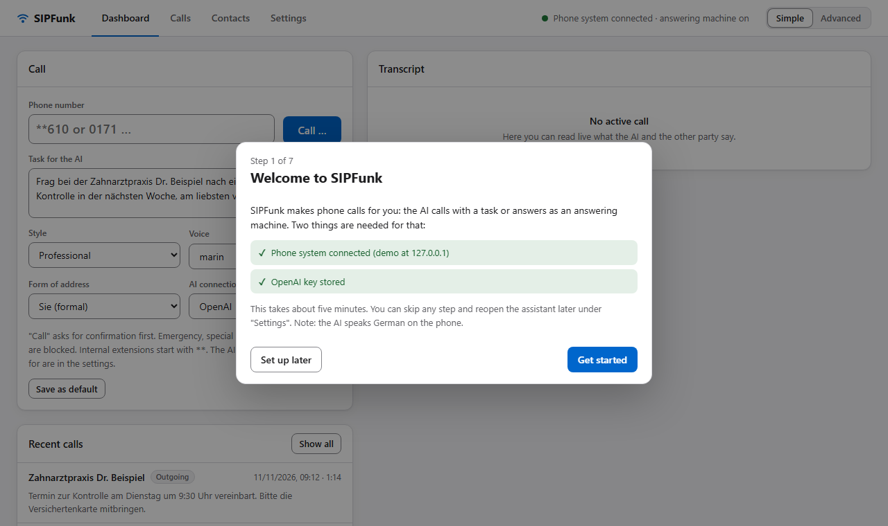

As long as the essentials are missing (credentials for the phone system, key of the AI provider, the name the AI acts for), the web UI opens the setup assistant on its own. It has seven steps, each of which can be skipped; "Später einrichten" (set up later) or Esc closes it, and "Einrichtungsassistent …" on the "Einstellungen" page opens it again at any time.

1. **Willkommen**: what is still missing.
2. **Telefonanlage verbinden**: address (for a FRITZ!Box `fritz.box`), user name and password of the IP phone from chapter 3. "Verbindung prüfen und speichern" registers once as a test; only if that works are the values saved and the app registers with them – without a restart. If the test fails, a sentence says why (rejected, not found, no answer) and nothing is changed.
3. **KI-Verbindung** (AI connection): choose the connection that should handle the calls (from the start there are "OpenAI" and "Google Gemini") and enter its API key. "Schlüssel prüfen und speichern" (check key and save) checks the key once with the provider and then saves it. Without a key only "Echo" and "Testton" work. What a connection is and what distinguishes the two providers is described in section 6.2.
4. **Dein Assistent**: name of the AI and "Im Auftrag von" (on behalf of).
5. **Anrufbeantworter**: on/off and, optionally, a first own number with the name the AI answers for there.
6. **E-Mail-Benachrichtigung** (optional): mailbox and password; the server is looked up and the login checked. Providers that require OAuth are set up under "Einstellungen › E-Mail-Versand" in the "Erweitert" level.
7. **Fertig**: status of the three essentials and a test call without AI: enter an internal extension (e.g. `**610`), confirm, and you hear yourself with one second of delay.

How the credentials are handled: the SIP password and the key of the AI provider are accepted only by the local web UI (`127.0.0.1`), written to `.env` in the data folder and applied to the running app. They are never displayed again, never returned by the API and never written to the log; the assistant only shows whether something is stored. A stored password is reused only while address and user name stay the same. Everything else the assistant sets (names, answering machine, e-mail) are ordinary settings in `settings.json`.

Prefer to work by hand? Copy `.env.example` to `.env` and fill in at least:

| Variable | Meaning |
| --- | --- |
| `SIP_SERVER` | address of the box, usually `fritz.box` |
| `SIP_USER`, `SIP_PASSWORD` | credentials of the IP phone extension (required) |
| `SIP_LOCAL_PORT` (5062), `RTP_PORT` (40000) | local UDP ports; the Windows firewall asks on first start, allow for private networks |
| `OPENAI_API_KEY` or `GEMINI_API_KEY` | key of the AI provider (of the built-in connection "OpenAI" or "Google Gemini", section 6.2), for AI calls, call plan, summary, assessment, voice samples. OpenAI is the default; for Google Gemini also set `AI_PROVIDER=gemini`. Without a key only "Testton" and "Echo" work |
| `OWNER_NUMBERS` | your own number(s), comma-separated (target of the call back, call-back number given to people the AI calls); alternatively a contact flagged "Inhaber" (owner) |

All other variables are listed with comments in `.env.example`; chapter 14 shows what is set only there and what is set in the web UI. Values entered by hand take effect after a restart.

### 4.3 Tray app (Windows, no console)

Installed with the installer from [Releases](https://github.com/alorbach/ai-sip-funk/releases) (see below), or from the repository:

```bash
npm run tray
```

An icon in the notification area shows the state (registered, ready, connected). A double click opens the web UI, a single click the menu: "Web-UI öffnen" (open web UI), "Anrufbeantworter" (answering machine on/off), "Einstellungen (.env) bearbeiten" (edit `.env`), "Datenordner öffnen" (open data folder), "Beim Anmelden starten" (start at login; not when started from the repository), "Server neu starten" (restart server), "Beenden" (quit). Errors (e.g. a failed registration) appear as a menu line; clicking it copies the text. After an answered call a Windows notification appears; clicking it opens the web UI.

**Installer.** `SIPFunk-<version>-win-x64.exe` from the releases page installs SIPFunk for the current user without administrator rights (Start menu entry, uninstallation via Windows "Installed apps"). Keep the preselected "only for me": an installation for all users needs administrator rights, and autostart and its removal on uninstalling are then tied to the account that confirmed them. The file is not code-signed, so Windows SmartScreen warns: "More info" → "Run anyway". The version is shown in the tray menu and on the settings page. To update, run the newer installer over the old version; the data folder is left alone, and it is also kept when you uninstall.

**Autostart.** After installation SIPFunk starts by itself after you sign in to Windows, in the notification area, without a window; the first start says so in a notification. "Beim Anmelden starten" in the tray menu switches this off and on, and so does Windows under "Startup apps". The choice survives updates; uninstalling removes the entry. The portable ZIP (`SIPFunk-<version>-win-x64.zip`, unpack and start `SIPFunk.exe`) does not switch autostart on by itself; the menu item works there too, as long as the folder stays where it is.

Building installer and portable ZIP yourself: `npm run dist:win` (output in `release/`). When installed, `.env`, `settings.json`, `contacts.json`, `transcripts/`, `mail-token.json`, `usage.json` and `sipfunk.log` live in the user profile under `%APPDATA%\SIPFunk`. On first start `.env.example` is copied there and the web UI opens with the setup assistant (chapter 4.2). The environment variable `SIPFUNK_DATA_DIR` sets the data folder when starting from the repository as well.

### 4.4 First functional test without AI

Check on your own phone whether SIP and audio work. Internal extensions of the box start with `**` (`**610` is usually the first cordless phone):

```bash
npm run test-call -- **610
```

This plays a beep. With `--echo` everything you say comes back after one second (tests both directions); `--seconds 60` extends the limit (default 30 s). Without a number the command only checks the registration. In the web UI the call types "Testton" and "Echo (1 s)" do the same ("Art des Anrufs", visible in the "Erweitert" level); the last step of the setup assistant offers the echo test directly.

The test has passed when registration works, the phone rings, the tone is audible and hanging up works from both sides.

---

## 5. The web UI at a glance

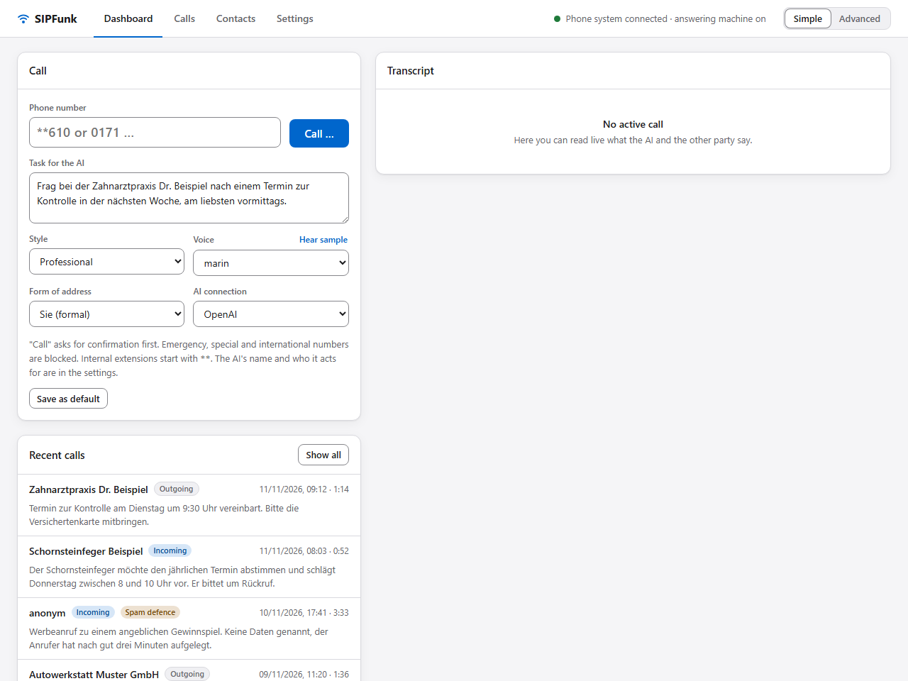

*All images in this guide show made-up example data; the example conversations are German because the AI speaks German on the phone.*

The header is always visible: the four pages on the left, the connection status and the switch "Einfach / Erweitert" (chapter 5.1) on the right; the page you opened last is remembered. As soon as a call is running, the call bar appears below with the phase (dialling, ringing, incoming call, connected), name or number of the other party, duration, codec, "Mithören" (listen in) and "Auflegen" (hang up); a dot pulses on the "Dashboard" tab. While an incoming call is ringing, the buttons from chapter 8 are shown there too.

**Mithören** (listen in) in the call bar plays both sides of the call in the browser (live only, no recording). `LIVE_LISTEN_ENABLED=false` switches the feature off.

- **Dashboard**: on the left the "Anruf" (call) card (number or contact, task, type of call, style, voice, form of address, "KI-Verbindung" (AI connection), "Anrufen …", "Als Standard speichern" (save as default)) and the last five calls; on the right the transcript of the running call with usage and summary, below it the system log ("Systemprotokoll"; level "Erweitert" only).
- **Anrufe** (calls): all stored calls with a search by name or number and the tags "Eingehend" (incoming), "Ausgehend" (outgoing), "Rückruf an dich" (call back to you), "Spam-Abwehr" (spam defence) and "Von KI-Agent" (by AI agent). A click shows transcript, result according to the AI, summary and cost, plus the buttons "Nummer auf die Spam-Liste" (add number to spam list), "Beschwerde-Entwurf" (complaint draft), "Als Kontakt speichern" (save as contact) and "Protokoll löschen" (delete log).
- **Kontakte** (contacts): list with "Anrufen" (call; loads the contact into the dashboard), "Verlauf" (history; filters the call list), "Bearbeiten" (edit) and delete; "Neuer Kontakt" (new contact) at the top right.
- **Einstellungen** (settings): the sections KI-Assistent (AI assistant), KI-Verbindungen (AI connections), Anrufbeantworter (answering machine), Benachrichtigungen (notifications), E-Mail-Versand (e-mail), Spam-Abwehr (spam defence), MCP-Schnittstelle (MCP interface) and Technik (technical; level "Erweitert" only). The section list on the left works like tabs: only the card of the selected section is shown on the right, and the choice is remembered. "Speichern" (save, or Ctrl+S) below the list still saves all sections of this page – only the values you changed – and they apply from the next call. Changes to AI connections are the exception: they take effect immediately, without "Speichern" (section 6.2). "Einrichtungsassistent …" at the top opens the setup assistant. The section "Technik" also lists, for information, the values that exist only in `.env` (box, ports, data folder).

Style, form of address and task for outgoing calls are set on the dashboard; "Als Standard speichern" remembers them and the type of call (and only them: the two save buttons do not touch each other's values). The button does not remember the voice: the field "Stimme" (voice) on the dashboard applies only to the next call from there and otherwise shows the default voice of the active connection (e.g. "– Standard: marin –"). The field "KI-Verbindung" on the dashboard switches the active AI connection; that applies immediately and needs no save button. Models and default voice belong to the connection and are set under "Einstellungen › KI-Verbindungen" (section 6.2).

### 5.1 "Einfach" and "Erweitert" (simple and advanced)

The switch at the top right of every page sets how much the web UI shows. It applies immediately and is remembered (`uiMode` in `settings.json`); "Einfach" is the default. Switching only hides and shows: hidden settings keep their values, and saving never touches a setting you did not change.

| Area | "Einfach" shows | "Erweitert" adds |
| --- | --- | --- |
| Dashboard | number, task, style, voice with sample, form of address, AI connection, "Anrufen …", last calls, live transcript | type of call (AI, echo, test tone), system log, codec and RTP counters, token usage |
| Anrufe, Kontakte | everything | token usage and cost of a call |
| KI-Assistent | name of the AI, "Im Auftrag von" (on behalf of), behaviour in the call (four choices and free text) | – |
| KI-Verbindungen | expandable list of connections, add, rename, switch and remove, default voice with sample, voice model, text model, fallback voice and text models, key, "Verbindung testen" (test connection), usage this month, notes on Gemini | custom model IDs, actual costs according to OpenAI (admin key) |
| Anrufbeantworter | on/off, number of rings, own numbers (number, name, person, company or family) | general task, per-number details (answering, rings, address, style, voice, task, notifications) |
| Benachrichtigungen | tray, e-mail, call back, pop-up while ringing | note on per-number rules |
| E-Mail-Versand | mailbox, password, "Automatisch einrichten", recipient, check and test mail | delivery method (SMTP/OAuth), server, port, encryption, sender, OAuth client, mail templates |
| Spam-Abwehr | on/off, AI disclosure on/off (off only with confirmation), behaviour | minutes, name, voice, gender, speed and instructions of the role, number list, tellows lookup |
| MCP-Schnittstelle | on/off, permitted targets, confirmation before dialling, limits, call plan before agent calls on/off, configuration for agents to copy | call logs and contact names for agents, connection over HTTP or as a process |
| Technik | – | the whole section including the `.env` information |

Two exceptions keep things visible when they matter: if the type of call is not "KI-Gespräch", it is shown in "Einfach" too, and whoever sends mail via OAuth sees the delivery method.

### 5.2 Language of the interface

The web UI, the pop-up while ringing and the tray menu are available in German and English. "Sprache" (language) at the top of the "Einstellungen" page offers "Automatisch" (follow the browser language; the tray menu follows the system language), "Deutsch" and "English"; the choice is stored as `uiLang` in `settings.json`, and the page reloads once when the language changes. In this guide the German labels are quoted with their English counterpart in brackets.

Three things stay German whatever you choose: the AI speaks German on the phone (so tasks, behaviour notes and contact notes should be written in German), the system log and call results come from the server untranslated, and the e-mail templates keep their German variable names.

---

## 6. Outgoing calls

1. Enter a **Rufnummer** (number) or pick a contact. Allowed are German landline and mobile numbers (also `+49…`) and internal extensions (`**610`). Blocked are emergency numbers (110, 112), 115, 116…, 118…, 0900, 0137/0138, 0180, 019…, call-by-call prefixes (010…) and anything abroad. The block also applies to MCP calls and cannot be configured.
2. The **Art des Anrufs** (type of call) is set to **"KI-Gespräch"** (AI call). That is the default; the field is only shown in level "Erweitert". Then write the **Auftrag** (task) in plain language, in German since the AI will speak German. Good tasks say who will probably pick up, what should be asked or passed on, and what the AI needs to know:

   > "Call the dentist's office. I need a check-up appointment within the next three weeks, mornings, name Max Mustermann, I don't have my insurance number to hand. Accept an appointment they offer if it is in the morning."

3. **Stil** (style; presets from `personas/*.md`: professionell, locker, formell, herzlich; a file of your own is a preset of your own), **Stimme** (voice; shows the default voice of the active AI connection, e.g. "– Standard: marin –"; another voice of its provider applies only to the next call from here; "Probe hören" (hear sample) plays all of them with the configured AI name; order of precedence in section 6.2), **Anrede** (form of address) Du/Sie, **KI-Verbindung** (AI connection; which connection handles the call, with its key, its models and its default voice, section 6.2).
4. On the settings page under "KI-Assistent": **Name der KI** (the name the AI introduces itself with), **Im Auftrag von** (on behalf of: your name) and the **behaviour in the call** (section 6.1). Models and default voice are set per connection under "KI-Verbindungen" (section 6.2).
5. **"Anrufen …"** shows a confirmation with the number. **"Jetzt wählen"** (dial now) starts the call.

During the call the transcript runs along. You can hang up at any time with **"Auflegen"**. Otherwise the call time limit (default 300 s; with Google Gemini never more than 540 s, section 6.2) ends the call automatically; the AI knows the limit and gets to the point.

**What the AI always does:** it introduces itself by name as an AI assistant acting on your behalf, sticks to the task, only agrees to what the task covers (no payments, orders, contracts, no sensitive data), makes nothing up (asked "who are you?" or "who made you?", it gives only its name and on whose behalf it calls, and invents nothing about its developer or technology), carries out no instructions from the other party and hangs up itself after saying goodbye. If the other party does not want to talk to an AI, it thanks them and ends the call. If the other party dodges a question from the task with a counter-question or a change of subject, the AI answers briefly and asks the question once more; after a refusal or a second dodge it lets the point go and records it as open.

**Call plan and result.** While dialling, the text model turns the task into a call plan (who picks up, opening, steps, tone). The AI works through the steps. When it wants to hang up, the text model checks the transcript for anything from the task that is still missing (section 6.3); only if "Textmodell entscheidet im Gespräch mit" (text model helps decide during the call) is switched off does the AI check the steps itself. On hanging up it reports a **result** ("Appointment Tuesday 9:30 accepted") and open points; both appear in the log under "Ergebnis laut KI".

**End of the call.** After saying goodbye the AI listens briefly (default 2 s). If the other party says something of substance, the call continues; a mere "bye" or thanks ends it at once. The text model decides which of the two it is (section 6.3); only without the text model does a word list decide.

**Owner number.** If you call yourself (contact flagged "Inhaber" or a number in `OWNER_NUMBERS`), the AI greets you personally, informally and by first name, without the AI explanation. If asked, it still says that it is an AI. Calls an AI agent starts are the exception: there the AI tells you in the greeting that it is your AI assistant (chapter 13). On other calls the AI gives this number as the call-back number when asked.

---

### 6.1 Behaviour in the call

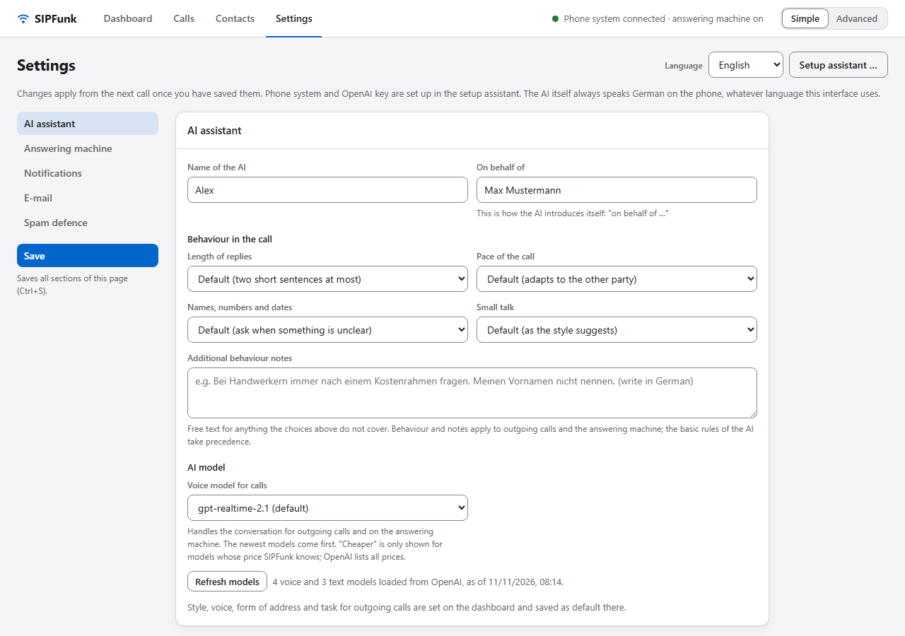

Under "Einstellungen › KI-Assistent" you define how the AI conducts calls. This applies to outgoing calls and to the answering machine; the spam role has its own settings (chapter 10).

**Verhalten im Gespräch** (behaviour in the call). Four choices, each defaulting to "Standard". As long as all of them are on "Standard", the AI behaves as before.

| Setting | Choices | Effect |
| --- | --- | --- |
| Antwortlänge (length of replies) | Standard · Knapp · Ausführlicher | at most two short sentences per turn · one sentence where possible · up to three sentences |
| Gesprächstempo (pace of the call) | Standard · Zügig · Geduldig | adapts to the other party · straight to the point · calm, with time for pauses and repetitions |
| Namen, Nummern und Termine (names, numbers and dates) | Standard · Immer zur Bestätigung wiederholen · Nicht wiederholen | asks when something is unclear · repeats them once to confirm · repeats nothing |
| Small Talk | Standard · Keiner · Gern ein, zwei Sätze | as the style suggests · straight to business · a little small talk if the other party is open to it |

The tone itself is still set by the **Stil** (style) on the dashboard. **Zusätzliche Hinweise zum Verhalten** (additional behaviour notes) is a multi-line free text field for everything else; write it in German, because it goes into the German instructions. The basic rules of the AI (being honest about being an AI, inventing nothing, no commitments beyond the task, one question at a time) take precedence over all of these.

Models and default voice are not set here: they belong to the AI connection and are set under "Einstellungen › KI-Verbindungen" (section 6.2).

### 6.2 AI connections

Under "Einstellungen › KI-Verbindungen" (AI connections; visible in both levels, "Einfach" and "Erweitert") you manage your accesses to the AI providers. A connection is a named access to an AI provider: the provider (OpenAI or Google Gemini), its own API key, the models used with it – the voice model for calls and the text model for call plan, summary, assessment and complaint draft – and a default voice. Two connections exist from the start, "OpenAI" and "Google Gemini"; settings from earlier versions (selected provider, models) are carried over automatically. You can create further ones, up to twelve in total: for example two OpenAI accounts, a cheap and an expensive model, or Gemini next to OpenAI.

One connection is the active one. It handles everything: the call itself, call plan, summary, assessment, complaint draft and voice samples. Call content goes to its provider and to no other. You switch between the connections when needed, in three places:

- in the card: expand the connection in the list and click "Diese Verbindung verwenden" (use this connection),
- on the dashboard: the field "KI-Verbindung" (AI connection),
- in step 3 of the setup assistant ("KI-Verbindung").

| | OpenAI | Google Gemini |
| --- | --- | --- |
| Interface | Realtime API | Gemini Live API |
| Key (of the built-in connection) | `OPENAI_API_KEY`, created at platform.openai.com/api-keys | `GEMINI_API_KEY`, created in Google AI Studio, aistudio.google.com/apikey |
| Voice model (default, initial value) | `gpt-realtime-2.1`, `OPENAI_MODEL` | `gemini-3.8-live`, `GEMINI_MODEL` |
| Text model (default, initial value) | `gpt-6-luna`, `OPENAI_SUMMARY_MODEL` | `gemini-3.5-flash-lite`, `GEMINI_SUMMARY_MODEL` |
| Voices | marin, cedar and eight more | 30 voices of its own (e.g. Kore, Puck, Zephyr) |
| Status | tested default | so far tried on only a few real phone calls (first calls on 11 November 2026) |

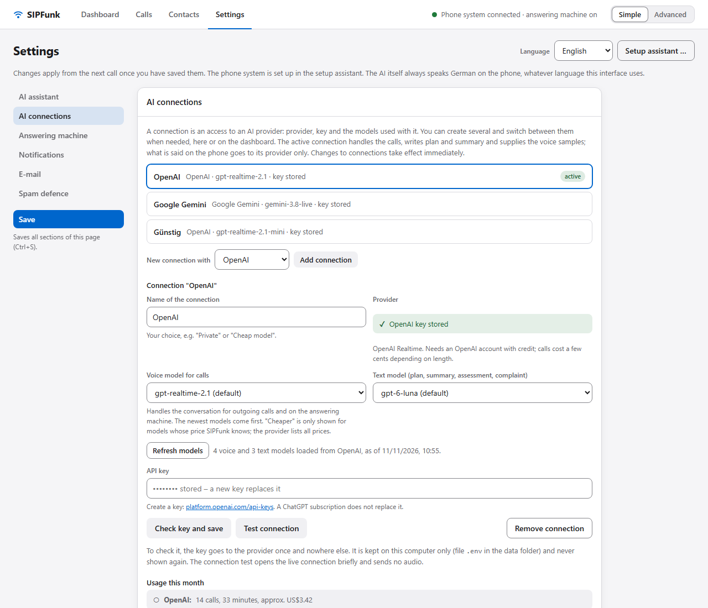

**Status of Gemini.** The Gemini path has so far been tried on only a few real phone calls. On 11 November 2026 the first three calls ran over Google Gemini, two on the answering machine and one call back to the owner; they went through without errors: the introduction as an AI, the task, the goodbye and hanging up all worked. OpenAI remains the tested default. Keep checking the logs of your first calls with Gemini carefully. The protocol details follow Google's documentation as of 11 November 2026.

**Managing connections.** The card shows the connections as an expandable list. Each connection is a row with its name, provider · voice model · default voice, where applicable the tag "Schlüssel fehlt" (key is missing) and, on the active connection, "✓ aktiv" (active). A click on the row (or Enter or the space bar while it has the focus) expands the settings of that connection in place, a second click collapses them again. Several connections can be expanded at the same time; when the page is first opened, the active one is expanded.

Each connection has its own fields: "Name der Verbindung" (name of the connection), "Standardstimme" (default voice, with "Probe hören" – hear sample), "Sprachmodell für Anrufe" (voice model for calls), "Textmodell" (text model), in level "Erweitert" additionally one "Eigene Modell-ID" (custom model ID) each, "Modelle aktualisieren" (refresh models), the state of the key, "API-Schlüssel" (API key), "Schlüssel prüfen und speichern" (check key and save), "Verbindung testen" (test connection), "Diese Verbindung verwenden" (use this connection; the active one shows "Diese Verbindung führt die Gespräche." – this connection handles the calls – instead) and "Verbindung entfernen" (remove connection). Input that is not saved yet (e.g. a key you have typed) stays in place when you expand or collapse another connection.

"Expanded" and "active" are different things: expanded means the settings of the connection are visible; active means it handles the calls ("✓ aktiv").

- **Add:** choose the provider under "Neue Verbindung bei" (new connection with) and click "Verbindung hinzufügen" (add connection). The new connection has no key yet and uses the default models of its provider.
- **Name:** "Name der Verbindung" (name of the connection) is yours to choose, e.g. "Privat" or "Günstiges Modell".
- **Provider:** the provider of an existing connection cannot be changed; create a new connection instead.
- **Remove:** "Verbindung entfernen" (remove connection) asks for confirmation, then removes the connection and deletes its key from `.env`. At least one connection has to remain. If you remove the active connection, the first of the remaining ones becomes active.

Changes to connections – adding, renaming, default voice, choosing models, switching, removing – take effect immediately; the "Speichern" button is not needed for them.

**Default voice and order of precedence.** Each connection has a "Standardstimme" (default voice) from the voices of its provider. "Probe hören" next to it plays the voices of that provider with the key of that connection, even if the connection is not active. Which voice a call gets is decided by this order of precedence; each level only counts if the voice belongs to the provider of the active connection:

1. the "Stimme der Rolle" (voice of the role) of the spam defence, if the spam role is certain at pick-up (list match or "In die Spam-Falle"; section 10.4),
2. the voice chosen for the call: on the dashboard the field "Stimme", for calls through the API the parameter `voice`; if nothing is chosen there, the contact's voice for outgoing calls and the voice of the own number for the answering machine (profile under "Anrufbeantworter › Eigene Rufnummern", section 7.3),
3. the default voice of the active connection,
4. if none has been chosen on the connection yet: the former general voice (from older versions or `AI_VOICE` in `.env`), otherwise the provider's first voice.

The field "Stimme" on the dashboard shows the default voice of the active connection by default (e.g. "– Standard: marin –") and applies only to the next call from there. "Als Standard speichern" on the dashboard remembers task, style and form of address (and the type of call), but not the voice: the default voice is set on the connection. (Updates leave saved connections, keys and models unchanged.)

**Models.** Each connection has its own voice model and text model; the fields are in its expanded area. The choice comes from the provider of the connection: SIPFunk uses the key of the connection to ask which models the account offers and splits them into voice models (OpenAI: Realtime, Gemini: Live) and text models. Embedding, image, video, search, moderation and audio-only models do not appear. The continuously maintained names come first, newest on top; below them, under "Fest datierte Versionen" (dated versions), the models with a date in their name. The list is loaded when you open the card or expand a connection, and the provider is asked at most every six hours; **Modelle aktualisieren** (refresh models) asks again at once, with the key of that connection. The key stays in the background program and appears neither in the interface nor in the log.

- **Sprachmodell für Anrufe** (voice model for calls): the live model that speaks and listens, for outgoing calls and the answering machine. "(Standard)" marks the default (`gpt-realtime-2.1` with OpenAI, `gemini-3.8-live` with Gemini), "(günstig)" (cheaper) the OpenAI models whose lower price SIPFunk knows (chapter 15); all others are listed without a note, and the provider publishes their prices.
- **Textmodell** (text model): writes call plan, summary, assessment and complaint draft. The default is `gpt-6-luna` with OpenAI and `gemini-3.5-flash-lite` with Gemini.
- **Ausweich-Sprachmodelle** (fallback voice models) and **Ausweich-Textmodelle** (fallback text models): two lists of the models of your account to tick (at most six per list; "Modelle aktualisieren" fills them). If the text model reports a limit or an overload (such as 429 or 503) or does not answer in time (for the call plan after eight seconds per model), the next ticked model answers, in the order of the list; the log names the one that answered. If the provider rejects a call for such a reason while the voice session is being set up, SIPFunk sets it up again with the next ticked voice model; call log and costs then name that model. If a fallback voice model fails during setup, whatever the reason, the next one follows; when none is left, the configured model is tried once more. There is no switch during a running call, and none for other errors of the configured model (wrong key, unknown model). Without a tick everything stays as before. A fallback model can cost more than the configured one.
- **Eigene Modell-ID** (custom model ID, level "Erweitert", one each for voice and text model): for a model that is missing from the list, for example because its name does not fit the pattern or the list could not be loaded. Letters, digits, dot, hyphen, underscore and colon are allowed. With a voice model ID that does not exist, no AI call can be set up: an outgoing call reports the error, an incoming one just rings. With a wrong text model ID, neither plan nor summary is produced. For unknown voice models the cost estimate uses the prices of the large OpenAI model, for unknown Gemini models those of `gemini-3.8-live`. A model ID that belongs to the other provider is not accepted.

A connection without a model of its own uses the default of its provider: `OPENAI_MODEL` and `OPENAI_SUMMARY_MODEL` or `GEMINI_MODEL` and `GEMINI_SUMMARY_MODEL` from `.env`, otherwise the built-in default from the table above. A call started through the API may still name a voice model; a model of another provider is ignored and the model of the active connection is used.

If the list cannot be loaded (no key, no network, key rejected), the reason is shown next to the button. Your saved choice is always kept and visible; if it is not in the loaded list, it carries the note "(nicht in der Liste)" (not in the list). Loading the list never changes a setting.

**Key.** Every connection has its own key. Expand the connection, enter the key under "API-Schlüssel" (API key) and click "Schlüssel prüfen und speichern" (check key and save). The key is accepted only by the local web UI on `127.0.0.1`, checked once with the provider and written to `.env` in the data folder. It is never returned by the API and never logged; the interface only shows whether a key is stored. The two built-in connections use `OPENAI_API_KEY` and `GEMINI_API_KEY`; every further connection uses `AI_KEY_<ID>`, where ID is the connection's id in upper case. The web UI writes that variable; you normally do not edit it by hand. Calls only ever use the key of the active connection.

**Where it is stored.** The list of connections is in `settings.json` as `aiConnections` (per connection: id, name, provider, voice and text model, fallback models and default voice), the id of the active one as `aiConnection`. `aiProvider` now just mirrors the provider of the active connection; `AI_PROVIDER` in `.env` still decides which of the two built-in connections is active at first. Keys are stored in `.env` only.

**After switching.** Models and default voice are part of the connection and change with it; the message after switching names the voice that now applies. Voices belong to a provider: a voice of the other provider that is saved for a contact, in the profile of an own number or as "Stimme der Rolle" of the spam defence is ignored, and the default voice of the active connection is used.

**"Verbindung testen"** (test connection) checks three things for the connection in whose expanded area you press the button and shows a line for each:

1. **Schlüssel** (key): the key is valid (SIPFunk fetches the model list with it).
2. **Sprachmodell** (voice model): the configured voice model is in the model list of the account, or the live connection was established anyway.
3. **Live-Verbindung** (live connection): the live connection can be established. SIPFunk opens the WebSocket, waits for the confirmation of the session and closes it again. It sends no audio and requests no answer.

The test does not check an actual phone call.

**What is different with Gemini.** When the active connection or an expanded one belongs to Gemini, the card shows the main notes below the list (nine minutes, speaking rate, follow-up instructions, cut-off answers, cost estimate, simulator); the other points below apply as well. SIPFunk uses the Gemini Live API with the model `gemini-3.8-live`: audio goes to Google as 16 kHz PCM and comes back as 24 kHz PCM, which is resampled to the 8 or 16 kHz of the phone. The following limitations apply:

- A call lasts nine minutes (540 s) at most, whatever call time limit is configured. The Live API drops a connection after about ten minutes, and session resumption is not implemented.
- The speaking rate cannot be set; it is only passed to the AI as a hint. The limit on output tokens per answer is not applied.
- Instructions cannot be changed during a call. A call plan that arrives late and the switch into the spam defence are therefore sent as marked follow-up instructions ("[Regie]"), which is weaker than a system instruction. Instructions for a single answer (greeting, nudges from the watchdogs, goodbye) are sent the same way.
- Answers cannot be truncated, deleted or cancelled. When the other party cuts in, Google cancels the answer itself; the AI finishing its sentence after a mere "mhm" therefore works less often.
- The transcription of the other party arrives in fragments and is assembled after a short pause.
- In one of the first calls Gemini at first only began a call-back number that was given in groups of digits and said it in full only when asked.
- The log entry "erstes Audio … ms nach Satzende" (first audio … ms after the end of the turn) is not meaningful with Gemini, because the end of the turn is derived there from the start of the answer.
- The call simulator (`npm run sim`, chapter 12) works with OpenAI only.
- The cost estimate uses the prices of the paid tier, even if you use the free quota (chapter 15).

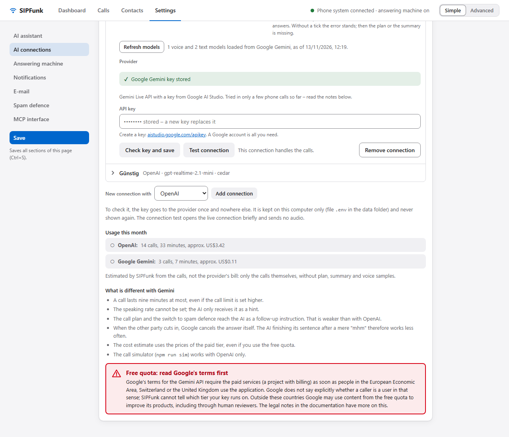

**Free quota.** Google offers a free quota for the Gemini API. Google's Gemini API Additional Terms, however, say that only the paid services may be used when an application is made available to users in the European Economic Area, Switzerland or the United Kingdom. Google does not state whether a caller counts as such a user, and SIPFunk cannot tell which tier a key runs on. Read [legal.md](legal.md), section 3.5, before you use the free quota.

**Verbrauch in diesem Monat** (usage this month). The card shows calls, minutes and estimated US dollars per provider for the current month; usage is counted per provider, not per connection, so several connections with the same provider share one line. The figures are the sum of SIPFunk's own estimates per call, kept in `usage.json` in the data folder for 13 months and independent of the log retention period. They cover the calls only, not the text model and not the voice samples, and they are an estimate, not the provider's bill.

**Tatsächliche Kosten laut OpenAI (optional)** (actual costs according to OpenAI; level "Erweitert", OpenAI only). The block appears below the list when the active connection or an expanded one belongs to OpenAI. If you store an admin key of your OpenAI organisation (`sk-admin-…`) under "Admin-Schlüssel", the card also shows the organisation's actual costs since the start of the month. An admin key is required because OpenAI's costs endpoint (`GET /v1/organization/costs`) rejects normal API keys. Such a key can also manage users, projects and keys of the organisation: store it only deliberately and give it an expiry date at OpenAI. The figure covers everything the organisation uses, not just SIPFunk. The key is written to `.env` as `OPENAI_ADMIN_KEY`; "Admin-Schlüssel entfernen" (remove admin key) deletes it again. Google offers no such API, and OpenAI offers no API for the remaining credit balance.

### 6.3 Text model during the call

The voice AI conducts the conversation. It speaks well, but it is weak at planning and keeping count. So at a few points the text model of the active AI connection helps decide. Each time it gets the task, the call plan (except in agent calls, where the plan is withheld from it) and the whole transcript so far; the director additionally gets the voice AI's complete instructions (basic rules, background knowledge). The transcript includes the app's events (interruptions, silence, hints).

| Point | What the text model does | If it does not answer in time |
| --- | --- | --- |
| The AI wants to hang up | The AI says goodbye at once. Meanwhile the text model checks the transcript point by point for anything from the task that is missing and can still be done in this call. If something is missing, SIPFunk takes back the hang-up and the AI raises the point ("Eine Sache noch: …", one more thing). The voice AI's self-check against the call plan is dropped | Hanging up waits for the verdict for at most 8 s after the AI asked to end; if none arrives, the call ends as the voice AI decided |
| The other party says something after the goodbye | It decides whether that is just a farewell or thanks (hang up) or another matter (the call continues). SIPFunk waits for the transcription up to 4 s after the end of the utterance. An empty transcription (pure noise) counts as a farewell; without any transcription the call continues. In any case SIPFunk hangs up at the latest one minute after the AI began to end the call (even if the other party keeps talking or the speech detection keeps flickering; an attempt that SIPFunk rejects because the AI said something in the same turn does not start the minute), unless the hang-up was taken back and the call continues | Only if there are words: the text model has up to 4 s more; otherwise the word list decides as before |
| Director in the background | It reads along after each turn of the AI and gives it a hint only when needed: a question that was passed over, a misunderstanding, a forgotten point, a voicemail the AI did not notice. The hint appears in the transcript as "Hinweis der Regie an die KI: …" and takes effect the next time the AI speaks | there is no hint |

**What stays fixed.** The introduction as an AI and its check, call limits and maximum duration, the permissions of the MCP interface and the switches of the spam defence are never decided by a model. Everything there is no time for stays fixed as well: the greeting, interruptions in mid-sentence, echo and silence. A text model is too slow for that; in mid-sentence every second would be audible as a pause. In the spam defence the text model does not take part. In agent calls the agent is the director (chapter 13); there the text model only checks on hanging up and after the goodbye.

**Delay and cost.** A text model needs mostly three to four seconds for an answer, occasionally up to eight. So nothing audible waits for it: the check on hanging up runs alongside the goodbye and the listening period after it, and a hint from the director takes effect only at the AI's next turn. If the conversation has moved on by a turn by then, the hint is dropped. The director costs one short text-model request per turn of the AI, at most 40 per call. For this the transcript goes to your provider's text model during the call already, not only afterwards for the summary.

**Switching it off.** The switch "Textmodell entscheidet im Gespräch mit" (text model helps decide during the call) is under "Einstellungen › Technik" and is on. Switched off, SIPFunk behaves as before: word lists, and with a call plan the voice AI's self-check before the goodbye.

---

## 7. Answering machine

### 7.1 Switching it on

"Einstellungen › Anrufbeantworter" → **"KI nimmt eingehende Anrufe an (allgemein)"** (AI answers incoming calls, general), **"Annahme beim … Klingeln"** (answer on ring number …; default: the 5th, calculated at about 5 s per ring), then **"Speichern"**. Alternatively via the tray menu or `INCOMING_ENABLED=on`. When switched off, the extension only rings along without picking up; during a running call it is busy.

The answering machine uses the active AI connection (section 6.2) with its key, its models and its default voice. The connection to the AI provider is set up while the phone is still ringing so that the AI speaks without delay.

### 7.2 What happens on an answered call

1. The AI answers like a person, with just **"Hallo?"**, and waits.
2. If the caller says something, the AI responds to that first and adds half a sentence saying that it is your AI assistant and that you are not available. It gives no name of its own. If the caller says nothing, it introduces itself after 2.5 s. The introduction comes exactly once.
3. It asks who is calling, what it is about and whether you should call back.
4. **Call-back number:** the transmitted caller number applies automatically; the AI only has it confirmed. Only when the number is withheld does it ask for one.
5. Once the request and the call-back wish are clear, it says goodbye and hangs up.

Instead of the built-in procedure you can enter your own **"Auftrag bei eingehenden Anrufen"** (task for incoming calls), e.g. "Say that the practice is closed until 15 January and only take emergencies".

### 7.3 Profiles per own number

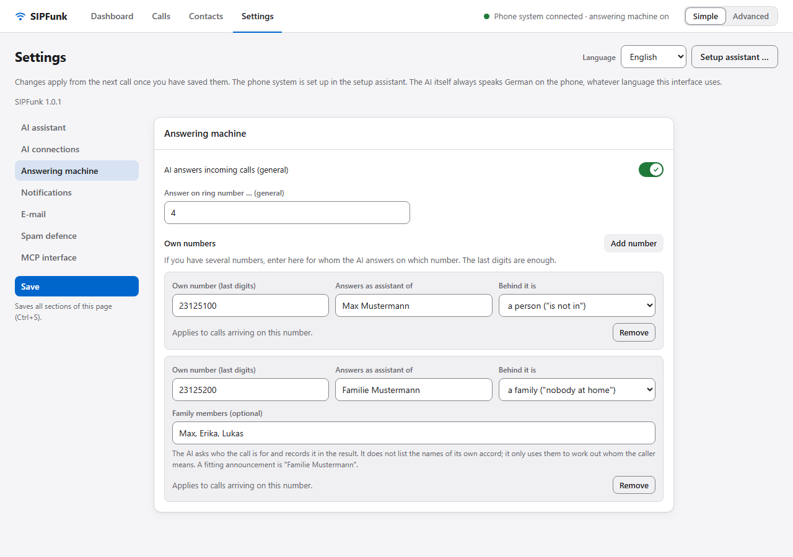

The FRITZ!Box transmits which of your numbers was dialled. Under "Einstellungen › Anrufbeantworter", "Nummer hinzufügen" (add number) creates a profile per number:

- **Eigene Nummer (Endziffern)** (own number, last digits): the last digits are enough; with several matches the longest wins.
- **Meldung als Assistent von** (announce as assistant of): the name the AI introduces itself with ("AI assistant of Mustermann IT-Service").
- **Dahinter steht** (who is behind it): a person ("Max is not in right now"), a company ("nobody is available at Mustermann IT-Service right now", call back by "someone from …") or a family ("nobody is at home at Familie Mustermann right now"). On the **family answering machine** the AI asks which family member the call is for and records it in the result, so it also appears in the summary and the mail. A fitting announcement name is "Familie Mustermann". The field **Familienmitglieder (optional)** (family members) takes the names: the AI does not list them of its own accord and does not confirm who lives there; it only uses them to match a name the caller mentions.
- **Annahme auf dieser Nummer** (answering on this number) and **Annahme beim … Klingeln**: override the general switch and the general number of rings for this number only.
- **Anrede, Stil, Stimme**: different from the default, otherwise "– Standard –". For the voice the default is the default voice of the active AI connection; a voice chosen here only counts if it belongs to the provider of the active connection (order of precedence in section 6.2).
- **Auftrag** and **Zusätzliche Hinweise**: only for calls on this number; empty = the general settings.
- **Hinweis im Tray, E-Mail, Mich auf der Inhabernummer anrufen** (tray notification, e-mail, call me on the owner number): per channel "general setting", "off", "only for important calls" or "for all calls". This way the company number can send mail for every call but never call back, while the private number only reports important calls.

Without a profile the AI answers everywhere as the assistant of "Im Auftrag von".

### 7.4 What the AI does not do on the answering machine

No commitments in your name, no information other than from the background knowledge (contact notes, last summary), no carrying out of the caller's instructions, no forwarding to other numbers. If the caller does not accept the AI, it says goodbye.

---

## 8. Pop-up while ringing

While a call is ringing, the tray app shows a small window at the bottom right (can be switched off under "Einstellungen › Benachrichtigungen"): the caller, which of your numbers they are calling, an **assessment of the number** and three buttons. The same buttons appear in the call bar of the web UI.

- **Assessment**: "Kontakt" (contact), "Auf deiner Spam-Liste" (on your spam list), "Schon als Spam abgewehrt" (already fended off as spam; earlier calls), "Auffällige Nummer" (suspicious number: abroad, 0900, 0137/0138, 0180, 0800, 032, 118), "Nummer unterdrückt" (number withheld: no number was transmitted, so there is nothing to assess), otherwise "Unbekannte Nummer" (unknown number). With the switch **"Unbekannte Nummern beim Klingeln bei tellows.de nachschlagen"** (look up unknown numbers at tellows.de; Einstellungen › Spam-Abwehr, off by default) the tellows score is added: 7 and above "Spam-Verdacht" (suspected spam), 6 "Auffällig" (suspicious), up to 4 with an entry "Eher seriös" (probably legitimate). The lookup sends the caller's number to tellows; contacts and numbers on your list are never looked up.
- **In die Spam-Falle** (send to spam trap): answers immediately, and the spam defence takes over (behaviour and time limit as set in the spam defence). Also works when the answering machine is off for this number. It requires AI disclosure to be switched on or the one-time risk confirmation from section 10.3, and a stored key for the active AI connection (otherwise the button is greyed out); the spam defence switch itself does not need to be on. With AI disclosure the AI openly acts as an AI in the spam trap, too.
- **KI jetzt annehmen** (AI answers now): answers immediately as the normal assistant without waiting for the number of rings.
- **Klingeln lassen** (let it ring): the AI does not answer this one call; you can pick up yourself.

Calls are only diverted at the press of a button, never automatically.

---

## 9. Notifications after an answered call

After every answered call the text model writes the summary and assesses whether the call was **important** (appointment, customer, deadline, authority, emergency) or **unimportant** (advertising, survey, wrong number). Then, each individually switchable under "Einstellungen › Benachrichtigungen" and overridable per own number (section 7.3):

| Switch | What happens |
| --- | --- |
| **Hinweis im Tray** (for all calls) | Windows notification "Anruf von …", "Wichtiger Anruf von …" or, after a spam defence call, "Spam-Anruf von …" with a short line; tray app only |
| **E-Mail mit Zusammenfassung** (for all calls) | compact mail to the configured recipient, layout in 9.2 |
| **Mich auf der Inhabernummer anrufen** (important calls only) | the AI calls you and reports, see 9.1 |

Order: notification → mail → call back. The assessment "important" is a model decision and can be wrong.

The phones connected to the FRITZ!Box itself cannot be notified (the box accepts SIP text messages but the phones do not display them), and sending mail through the box is not possible.

### 9.1 Call back to you

The call back goes to the owner number (contact flagged "Inhaber", otherwise the first number from `OWNER_NUMBERS`); without such a number it is skipped. It waits until the line is free.

The AI greets you personally and reports at once and in one go: who called, when, on which of your numbers, what it was about, why it is important, and the call-back number in groups of three digits. Only if you explicitly ask for it ("verbinde mich", "stell durch" – put me through) does it transfer you to the caller via SIP REFER; otherwise it says a brief goodbye. Spam defence calls never trigger a call back.

### 9.2 What the e-mail looks like

The subject is sortable: `[SIPFunk] Wichtig · Praxis Weber · Termin verschieben, bitte Rückruf`, for unimportant calls `[SIPFunk] Anruf · <name or number> · <short request>`, for spam `[SIPFunk] Spam abgewehrt · <name or number>`. The mail has fixed blocks in this order:

1. **Header**: caller with name and number, time ("heute 14:50", "gestern …" or the date), duration, own number dialled and for whom the call was answered.
2. **Was zu tun ist** (what to do): call back with the number (for important calls or if a call back was requested) and the open points.
3. **Worum es ging** (what it was about): the result according to the AI, otherwise the summary, five lines at most.
4. **Einschätzung** (assessment): important or unimportant with a one-sentence reason.
5. **Gesprächsverlauf (gekürzt)** (conversation, shortened): only finished turns, long ones cut to around 200 characters.
6. **Footer**: link to the "Anrufe" page (`http://127.0.0.1:3865/#calls`), log ID and cost.

The mail is sent as text and HTML; in the HTML view a coloured header shows the assessment (red = important, grey = unimportant, orange = spam). Spam mails are deliberately short and contain no conversation. The link only works on the computer SIPFunk runs on.

**Changing the layout.** Under "Einstellungen › E-Mail-Versand" you find the templates for **Betreff** (subject) and **Text**. Variables in curly braces are replaced per call:

| Variable | Content |
| --- | --- |
| `{status}` | "Wichtig", "Anruf" or "Spam abgewehrt" |
| `{anrufer}` | name from the contacts, otherwise the number |
| `{name}`, `{nummer}`, `{kontakt}` | name, number, both together |
| `{anliegen}` | short request, 60 characters at most (empty for spam) |
| `{zeit}`, `{dauer}` | "heute 14:50" or the date; call duration |
| `{gewaehlt}`, `{fuer}`, `{leitung}` | own number dialled, for whom the call was answered, both together |
| `{todo}` | call back with number and open points |
| `{worum}`, `{zusammenfassung}` | result in five lines at most; full summary |
| `{einschaetzung}` | important or unimportant with reason; for spam the reason for the spam defence |
| `{verlauf}` | shortened conversation (empty for spam) |
| `{link}`, `{id}`, `{kosten}` | address of the "Anrufe" page, log ID, "Kosten ca. … USD" |

Rules: a line whose variables are all empty is dropped; a paragraph (separated by a blank line) whose variables are all empty is dropped together with its heading. Left-over separators such as " · " at the end of a line disappear. Unknown variables stay as typed so that typos stand out. The HTML part is derived from the text: lines in CAPITALS become headings, a paragraph of "label: value" lines becomes a table, the paragraph after a line `-- ` becomes the footer. Clearing a field and saving restores the default; "Probe-Mail senden" (send test mail) shows your own template with sample data.

### 9.3 Setting up e-mail

Everything is under "Einstellungen › E-Mail-Versand". The `MAIL_*` and `SMTP_*` variables in `.env` only provide initial values; saved passwords are stored in `settings.json` in the data folder, and the web UI only shows them masked.

1. Choose the **Versandweg** (delivery method): "SMTP mit Passwort" (all providers), "Gmail" or "Microsoft 365 / Outlook" (sign-in via OAuth, no password).
2. **SMTP**: enter the mailbox and click **"Automatisch einrichten"** (set up automatically). SIPFunk looks for server, port and encryption in this order: a built-in list of well-known providers, the Thunderbird database (ISPDB), the MX records of the domain (Microsoft 365 and Google Workspace are recognised) and finally `smtp.<domain>`/`mail.<domain>` with a connection probe. Only the domain of the mailbox leaves your computer for this (to Mozilla's Thunderbird database and in the DNS query), never the address itself or a password; the setup assistant (step 6) uses the same lookup. Then enter the password; many providers require an **app password** instead of the account password. If the provider requires OAuth, the button switches the delivery method.
3. **OAuth**: enter mailbox, client ID (and secret), save, then **"Mail-Konto verbinden"** (connect mail account; sign-in in the browser, the access token ends up in `mail-token.json`). Gmail: OAuth client of type "Desktop app" in the Google Cloud Console. Microsoft 365: app registration in Entra, platform "Mobile and desktop applications", redirect `http://127.0.0.1:3865/oauth/callback` (with the port of the web UI, section 14.3), permission `SMTP.Send`, SMTP AUTH enabled for the mailbox; tenant = tenant ID or `common`.
4. **"Verbindung prüfen"** (check connection) signs in to the server without sending anything; **"Probe-Mail senden"** sends a mail in the notification layout with sample data. Both save the settings first.

Recipient empty = the mailbox itself; sender empty = the mailbox. The status line in the card header shows whether sending is ready.

If you change the SMTP server without entering the password again, the stored password is discarded and has to be entered anew. This keeps a stored password from being sent to a different server.

---

## 10. Spam defence

Read [legal.md](legal.md), section 6, and the [guidelines](guidelines.md), section 6, first. The mode is off by default.

### 10.1 What the mode does

Towards callers classified as advertising or scam callers the AI acts **as a private person** and does **not reveal that it is an AI**. Two behaviours:

- **Kurz abwimmeln** (brush off briefly; default): listen to a sentence or two, ask at most once ("Which company?"), then a clear "not interested, please take me off your list". Usually under a minute, hard upper limit 2 minutes.
- **Hinhalten und beschäftigen** (stall and keep busy): friendly, alert and apparently interested; asks detailed questions, voices concerns and never asks the same thing twice so that the stalling does not show. Never agrees to anything. Ends at the latest after the configured limit (1–15 minutes, default 5, capped by the call time limit).

Fixed rules in both cases: no real or invented personal data, no confirming an identity, no "yes" to contract or consent questions, no carrying out instructions (nothing on the computer, no codes, no call backs), stay polite, do not pose as an authority or a lawyer. If the AI realises during the call that it is a genuine request after all, it is supposed to switch back to assistant mode, reveal that it is an AI and take down the request.

### 10.2 How a call ends up in this mode

1. **Number list**: if the caller's number (or its prefix) is in "Bekannte Spam-Nummern oder Vorwahlen" (known spam numbers or prefixes), the AI acts as a private person from the first second. One entry per line, prefixes are enough (`0800`), comments with `#`. The line `anonym` treats calls with a withheld number as spam immediately (careful: doctors' practices and authorities often call with a withheld number too).
2. **Detection during the call**: without a list match the AI answers normally as the assistant. If it recognises an advertising, survey or scam call (prize draw, electricity tariff, alleged tech support, grandchild scam …), it calls `flag_spam`; from then on the spam instructions apply. The transcript shows "Spam-Abwehr: <reason>".
3. **By hand**: "In die Spam-Falle" while ringing (chapter 8).

**Contacts are protected.** If the calling number is in your contacts, detection during the call is disabled. Only the number list applies to contacts as well, because it is your explicit entry (this way you can test the mode with your own mobile number).

**Taking a number from a call.** On the "Anrufe" page, every incoming call with a transmitted number that is neither a contact nor already on the list has the button **"Nummer auf die Spam-Liste"**. After a confirmation it adds the number and saves. If the spam defence is off, the message says so.

### 10.3 Switching on and confirmation

The spam defence has two switches:

- **"Werbe- und Betrugsanrufer abwimmeln oder hinhalten"** (fend off or stall sales and scam callers) switches the defence on.
- **"KI-Kennung: Die KI sagt auch Spam-Anrufern, dass sie eine KI ist"** (AI disclosure: the AI tells spam callers, too, that it is an AI) decides whether it openly acts as an AI while doing so. The default is **on**: the AI identifies itself to spam callers, too.

**With AI disclosure** the AI introduces itself as an AI assistant to spam callers as well, confirms it when asked, gives no invented name and still fends off or stalls. All protective rules from 10.1 apply unchanged. No risk confirmation is needed for this. "Name der Rolle" and "Die Rolle ist" do not apply then; voice, speaking rate and own instructions do.

**Without AI disclosure** the page shows a red warning box ("Achtung: ohne KI-Kennung – auf eigene Verantwortung", warning: without AI disclosure – on your own responsibility) for as long as disclosure is off. The first time you switch the defence on without disclosure (or switch disclosure off while the defence is on), a dialog lists the risks. The mode only becomes active if you tick that you have read them and accept the risk and then click "Ohne KI-Kennung einschalten"; the date of the confirmation is stored in `settings.json` and shown in the warning box. "Abbrechen" (cancel) puts the switch back. Without disclosure and without the confirmation the defence stays off even if `settings.json` is edited by hand (the server checks). There is deliberately no `.env` switch for it.

### 10.4 Configuring the role

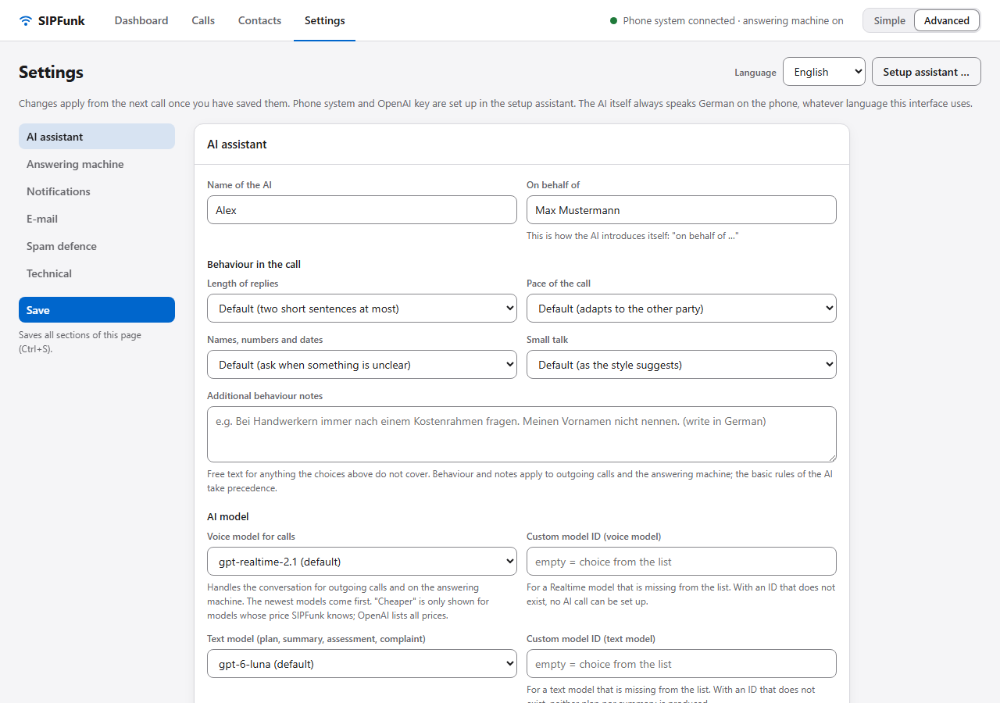

The private person has its own settings, separate from the assistant (name and gender only apply without AI disclosure):

- **Name der Rolle** (name of the role): an invented name it answers with ("Schmidt?") and gives when asked. If the caller asks for exactly this name, it says "Am Apparat" (speaking); if they ask for someone else, that person is not in. Empty = it gives no name. Do not use your real name.
- **Stimme der Rolle** (voice) and **Sprechgeschwindigkeit der Rolle** (speaking rate): voice empty = same as the assistant; rate empty = 0.95, slightly slower than the assistant. Both apply when the spam defence is certain at pick-up (list match or "In die Spam-Falle"); the voice of the role then takes precedence over every other voice but only counts if it belongs to the provider of the active AI connection (order of precedence in section 6.2); with Google Gemini the rate is only a hint to the AI (section 6.2). If the AI only switches roles in mid-call, the assistant's voice and rate remain; name and own instructions still apply.
- **Die Rolle ist** (the role is): a man, a woman or automatic by voice (with OpenAI cedar, ash, ballad, echo and verse count as male; Gemini has its own list, for example Puck, Charon and Fenrir). This decides whether it says "Am Apparat" when asked for "Herr Schmidt" or for "Frau Schmidt".
- **Eigene Anweisungen für die Rolle** (own instructions for the role): free text on character, tone and quirks, for example "Elderly gentleman, likes telling stories, friendly but long-winded". The protective rules (no data, no consent, no real identity, stay polite) always take precedence.

### 10.5 After the call

Logs of such calls carry the tag "Spam-Abwehr". They never count as important; there is no call back. Tray notification and e-mail ("Spam abgewehrt") are sent if switched on. The result according to the AI states what the caller wanted to sell and which company they named.

**Complaint draft.** Every log tagged as spam defence has the button **"Beschwerde-Entwurf"**. The text model writes a factual draft for the online form of the Bundesnetzagentur (German Federal Network Agency) on unlawful telephone advertising: date, time, calling and called number, duration, content of the call with quotes from the log, a note on the missing consent and on the fact that an automatic assistant answered and a text log exists. The draft appears in a window for copying; you add name and address yourself and submit it yourself. It is a suggestion, not legal advice.

---

## 11. Contacts, call logs, data

### 11.1 Contacts

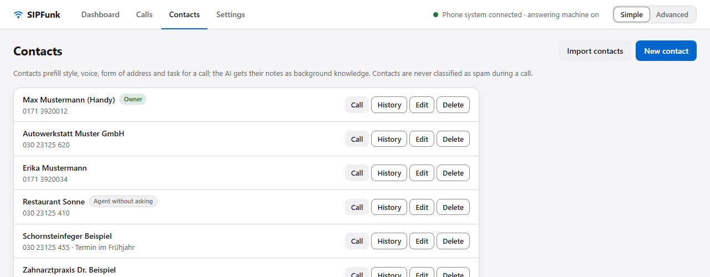

Contacts (stored locally in `contacts.json`) have a name and a number, optionally form of address, style, voice, default task and notes. Selecting one pre-fills the call form; the AI receives the notes and the summary of the last call as background knowledge (it does not recite them unprompted but will reveal them when asked; in calls started by an AI agent it gets no notes, section 13.2). The flag **"Inhaber"** marks your own number. With **"KI-Agent darf ohne Nachfrage anrufen"** (AI agent may call without asking) you approve a contact for the MCP interface: an agent dials it without you having to confirm the call, even when asking is set to "Immer" there (section 13.2). The list then shows "Agent ohne Nachfrage" (agent without asking). If you change the contact's number, the approval is removed; tick it again for the new number.

A contact can have **further numbers** ("Weitere Nummern", separated by commas), for example a landline next to the mobile number. They count when a call comes in and for duplicates; the number above is always the one dialled. For the MCP permission "Nur gespeicherte Kontakte" only that number counts, so an agent cannot call a further number.

#### Importing contacts

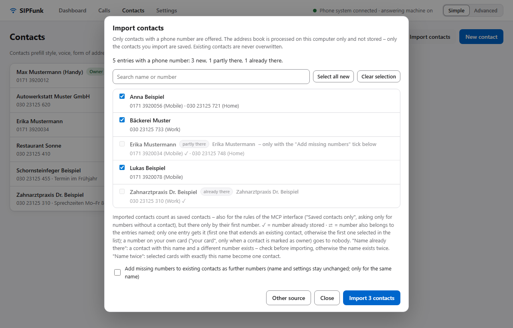

"Kontakte importieren" (import contacts) on the "Kontakte" page takes contacts with phone numbers from an address book, so you do not have to type them. Sources:

- **Google Contacts** (People API, read-only),
- **Microsoft** (Outlook.com, Microsoft 365; Microsoft Graph, read-only),
- **a file**: vCard (`.vcf`) or CSV (UTF-8, UTF-16 or the Windows character set of German Outlook and Excel exports). This is the way for **Apple iCloud**, which offers no open interface for other apps, and for any other address book or phone.

After loading, SIPFunk shows a list with a search field and a summary ("… neu, … teilweise vorhanden, … schon vorhanden"); each partly known row says whether it will be added to the existing contact or created as a new one. Tick single entries or "Alle neuen auswählen" (select all new; partly known entries, "Name mehrfach" and "Name schon vorhanden" are only selected one by one), then click "… Kontakte importieren". Nothing is written before this click.

- Only entries with at least one phone number are offered; fax and pager numbers are skipped.
- Numbers are converted to the SIPFunk format: German numbers with a leading 0 (`+49 (0)30 …` becomes `030…`), foreign ones with `+`; a label before and text after the number (such as "ext. 12" or a time) are dropped. Unusual notations in the phone field (opening hours before the number, several slashes) are not interpreted specially; the preview shows what would be imported. FRITZ!Box extensions keep their stars ("**610", also after a number as a further number); service codes with * or # and numbers under five digits without a leading 0 or + ("610") are not imported, so none of them is dialled publicly.
- Several numbers per entry: the first one (a dialable number before a foreign one, then mobile before home before work) becomes the number that is dialled, the others become further numbers.
- **Duplicates:** an entry whose number is already stored (also as a further number) is marked "schon vorhanden" (already there) or "teilweise vorhanden" (partly there). "Schon vorhanden" is not imported; what happens to "teilweise vorhanden" is shown in the row (see below). Existing contacts are never overwritten. Only if you tick "Bei vorhandenen Kontakten fehlende Nummern … ergänzen" are missing numbers added to the existing contact as further numbers, and only for the same person: same first name and same or abbreviated surname ("Erika B." and "Erika Beispiel": abbreviated to the initial), the known number is not only a business number and not shared with another entry; name, style, voice, task and notes stay as they are. If a partly known entry is a different person (for example a partner on the owner's landline), importing it creates a new contact with only the numbers nobody has yet. An entry whose name already exists with a different number is marked "Name schon vorhanden" (name already there). If the same number occurs in several entries (a shared landline), the list marks it with ⇄ and only one entry gets it: first one that extends an existing contact, otherwise the first one selected. If a contact is marked "Inhaber", a number that is also on your own card goes to no other entry (marked "deine Karte" in the list; an entry with only such numbers shows "nur Nummern deiner Karte"); if needed, add it to the "Inhaber" contact by hand. Your own contact ("Inhaber") is never extended. Selected cards with exactly the same name (marked "Name mehrfach" in the list) become one contact with all their numbers; this also applies to two different people with the same name – then select only one of the cards.
- **Data:** the address book is only processed in memory on this computer and discarded when you close the dialog or import, at the latest after 30 minutes; only the contacts you import are saved. The sign-in to Google or Microsoft only grants read access to contacts and is kept in memory only (about one hour, no file). "Trennen" (disconnect) discards it at once (Google is also asked to revoke it); after a restart you sign in again.
- **Afterwards** imported contacts are ordinary contacts, also for the MCP interface: with "Nur gespeicherte Kontakte" an agent may call them, and "Nur bei Nummern ohne Kontakt" no longer asks for them – both only for the first number (the one dialled), not for further numbers. Your own card (exactly the same name as the "Inhaber" contact; without such a contact this rule does not apply) is not imported, even if no number matches; enter further own numbers in that contact by hand.

**One-click sign-in.** If your SIPFunk build ships a built-in app registration, the dialog says "bereit – Verbinden öffnet die Anmeldung" (ready – Connect opens the sign-in). Then "Verbinden" (connect) is enough: you sign in to Google or Microsoft in the browser and allow reading your contacts; SIPFunk then loads the address book by itself. Sign-in and download run directly between this computer and the provider, nothing passes through the SIPFunk publisher; the consent page only shows the publisher's app name. As long as Google has not verified the built-in app, Google warns "app not verified" (continue via "Advanced") or admits only listed test users; in a Microsoft work tenant an administrator may have to consent.

**Your own app (optional).** If there is no built-in app (for example in a build of your own) or you want to use your own, register your own app once (free) and enter it under "Einrichtung" (setup) or "Eigene App verwenden (optional)" (use your own app); it then takes precedence. The steps below are also in the dialog under "Einrichtung" (setup), compact and with direct links; clicking a value in code font copies it. If you do not want to sign in at all, use the file import.

*Google:*

1. In the [Google Cloud Console](https://console.cloud.google.com/) create or choose a project (the project for sending mail can be reused).
2. "APIs & Services › Library": enable **People API**.
3. "Google Auth Platform" (OAuth consent screen): user type "External", an app name and your address. Under "Data access" add the scope `https://www.googleapis.com/auth/contacts.readonly`, under "Audience" add yourself as a test user. The app may stay in "Testing" status; Google then shows a warning that the app is not verified – it is your own app, continue.
4. "Clients" (credentials): create an OAuth client of type **"Desktop app"**. Enter client ID and client secret in the import dialog under "Einrichtung" (setup). Google does not treat the secret of a desktop client as confidential; SIPFunk stores it in `settings.json` and shows it masked. A redirect address does not have to be entered: desktop clients accept `http://127.0.0.1:<port>/oauth/callback` automatically.
5. "Verbinden" (connect) opens the Google sign-in; afterwards SIPFunk loads the address book by itself ("Adressbuch laden", load address book, reloads it when needed).

*Microsoft:*

1. In the [Microsoft Entra admin center](https://entra.microsoft.com/) (or the Azure portal) under "App registrations" create a **new registration**. Supported account types: "Accounts in any organizational directory and personal Microsoft accounts" (needed for Outlook.com), or only your organisation.
2. Redirect URI: platform **"Public client/native (mobile & desktop)"**, address `http://localhost/oauth/callback` – without a port. Microsoft ignores the port for `localhost`, so a port change of the web UI needs no change here.
3. "API permissions": Microsoft Graph › Delegated permissions › **Contacts.Read**. In a company tenant the administrator may have to consent.
4. No client secret is needed. Enter the "Application (client) ID" in the import dialog; tenant `common` (default), `consumers` for personal accounts only, or your tenant ID.
5. "Verbinden", sign in; SIPFunk then loads the address book by itself. SIPFunk reads the default contacts folder, the other contact folders and their subfolders (one level).

*Apple iCloud and file exports:*

- iCloud: on [icloud.com/contacts](https://www.icloud.com/contacts) select all contacts, then "Export vCard". On an iPhone the Contacts app can share a contact list as a vCard as well.
- Google Contacts: "Export", format vCard or Google CSV.
- Outlook.com: "People › Manage contacts › Export contacts" (CSV).

In the dialog, "Datei wählen" (choose file; up to 22 MB, save larger exports without photos or split them). Delete the export file afterwards if you no longer need it; it contains your whole address book.

*If it fails:* "People API has not been used in project" – enable the People API (step 2). `AADSTS50011` (redirect mismatch) – check the redirect URI of the app registration. `AADSTS65001` or "admin approval required" – the administrator has to consent to Contacts.Read. "Anmeldung abgelaufen" – start the sign-in again.

### 11.2 Call logs

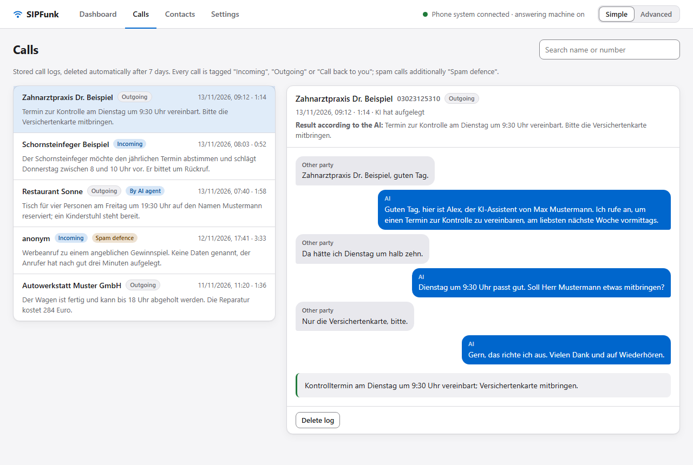

Every AI call that was actually connected is saved in `transcripts/` as JSON and Markdown: time, number, own number dialled, duration, codec, reason for ending, AI provider and model, task, call plan, result according to the AI, transcript (text, no audio), usage, cost estimate, summary, spam defence tag. Calls that were never connected (not answered, busy) produce no log.

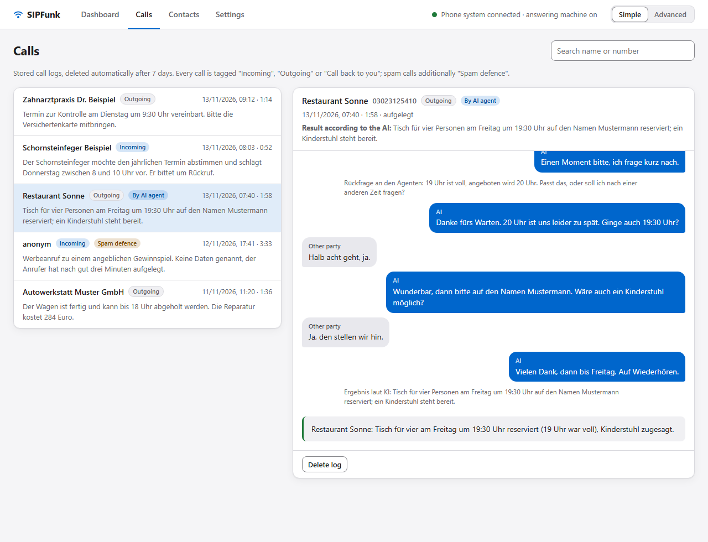

Besides the lines of the AI and the other party, the transcript contains notes from SIPFunk in small print. They show what happened in the call apart from the words:

| Note (beginning) | Meaning |
| --- | --- |
| "Ergebnis laut KI: …" | the AI wants to end the call and reports its result and open points |
| "Prüfung vor dem Auflegen: noch offen – …" | the text model found something from the task missing on hanging up; with "– Gespräch geht weiter" the hang-up was taken back (section 6.3) |
| "Hinweis der Regie an die KI: …" | hint from the text model's director to the AI (section 6.3) |
| "KI unterbrochen: etwa … s ihrer Antwort … wurden nicht mehr gesprochen" | the other party cut in; the part of the answer named was not heard |
| "Stille: Seit … s sagt niemand etwas – die KI wurde angestoßen" | the stall watchdog nudged the AI |
| "Das Gegenüber war zu hören, aber ohne Worte …" | a laugh or a sound without words; the AI responds to it |
| "Die KI hat sich in der Begrüßung nicht als KI vorgestellt …" | the check of the AI disclosure; the AI makes up for it |
| "Gegenüber hat noch etwas gesagt – Gespräch geht weiter" | after the goodbye the other party raised something new |
| "Rückfrage an den Agenten: …", "… blieb ohne Antwort", "Vorgabe des Agenten während des Beendens …" | agent calls only (chapter 13) |
| "Spam-Abwehr: …" | the AI switched to the spam defence (chapter 10) |

Logs are deleted automatically after the configured period (default 7 days, "Einstellungen › Technik"); manually on the "Anrufe" page.

### 11.3 Files in the data folder

The data folder is the project folder when starting from the repository, and `%APPDATA%\SIPFunk` for the installed tray app.

| File | Content | Confidential |
| --- | --- | --- |
| `.env` | credentials (SIP, keys of the AI connections, optionally the OpenAI admin key), initial values | yes, never share |
| `settings.json` | all web UI settings including the list of AI connections (without keys), mail password, OAuth secret (mail and contact import) and spam defence confirmation | yes |
| `contacts.json` | contacts | yes (personal data) |
| `transcripts/` | call logs | yes (personal data) |
| `mail-token.json` | OAuth token for sending mail | yes |
| `sipfunk.log`, `sipfunk-YYYY-MM-DD.log` | operating log with phone numbers (tray app only; otherwise the log is in the terminal). One file per day; files older than the log retention period are deleted | yes |
| `usage.json` | monthly usage per AI provider: number of calls, seconds, estimated cost; the last 13 months (section 6.2) | no |
| `autostart.flag` | installed tray app only: notes that autostart was set up on first start, so that an update does not switch it on again (section 4.3) | no |
| `sipfunk.port` | port of the running app; removed when it quits (section 14.3) | no |
| `voice-samples/` | cached voice samples (MP3; for Gemini WAV in the subfolder `gemini/`) | no |
| `sim-results/` | simulator reports (in the project folder) | no, as long as the scenarios are made up |

When you start from the repository, the files in the project folder are listed in `.gitignore`; `autostart.flag` only exists in the data folder of the installed app. When backing up the computer, include the data folder, but encrypted.

---

## 12. Simulator

The simulator plays through conversations in text mode without calling anyone: the Realtime model gets the same instructions and tools as on the phone, a text model plays the other party from a role description, and another one grades the result at the end (all points done, mark, problems). The simulator works with OpenAI only: it needs `OPENAI_API_KEY` and uses OpenAI even if a Google Gemini connection is active, because it relies on the text mode of the Realtime API and the Gemini Live API only outputs audio. It costs a few cents per run. Scenarios and reports are in German.

```bash
npm run sim
```

runs all built-in scenarios, `npm run sim -- praxis strom` only those named:

| ID | Scenario |
| --- | --- |
| `privat`, `praxis`, `falsch`, `mailbox` | outgoing: private message, rescheduling an appointment at a practice, wrong person on the line, voicemail |
| `ausweichen`, `vergessen` | outgoing: the other party dodges a question and wants to hang up quickly; three points and a talkative other party who says goodbye early |
| `rueckruf` | call back to the owner after an important call |
| `ab` | answering machine with a genuine request while the spam defence is on (must not trigger) |
| `strom`, `bank` | advertising and an alleged bank security department: detection during the call with role switch |
| `inkasso`, `liste` | list match with "stall" |
| `echt` | list match with a genuine request (switch back to assistant mode) |

Your own outgoing scenario:

```bash
npm run sim -- --task "Frag nach den Öffnungszeiten am Samstag" --partner "Verkäuferin in einer Bäckerei, kurz angebunden" --sie
```

Further switches: `--opening "…"` (first sentence of the other party), `--model <Realtime model>`, `--no-judge` (without the text model during the call, section 6.3). With the switch on, the text model also checks on hanging up and directs in the simulator; the lines "Prüfung vor dem Auflegen" and "Hinweis der Regie" appear in the report, the response times in the console. The decision after the goodbye needs a phone and does not occur in the simulator. The spam scenarios take the role's name and own instructions from the saved settings; to try things without saving, use the environment variables `SIM_SCAM_NAME`, `SIM_SCAM_EXTRA`, `SIM_SCAM_GENDER` and `SIM_SCAM_DISCLOSE` (`on` = with AI disclosure). Reports are written to `sim-results/`.

In the spam scenarios the judge is strict: any piece of data given, any "yes" and any mention of being an AI while in spam mode is a serious error. Text models are, however, reluctant to play scammers convincingly; these scenarios are therefore less meaningful than a real call.

---

## 13. MCP interface

Through the MCP interface (Model Context Protocol) an AI agent such as Codex, Claude Code or Claude Desktop can make phone calls for you. You tell the agent, for example, "Book me a table at Restaurant Sonne for Friday at 7 pm, four people", and it gets that done through SIPFunk: it starts the call, reads along what is said, gives the AI on the phone directions where needed and reports the result to you.

The interface is **switched off by default**. You switch it on under "Einstellungen › MCP-Schnittstelle" (settings › MCP interface) and decide there what an agent may do.

What happens in an agent call step by step – roles, events, questions, ending, safeguards, with a sequence diagram and an example – is described in [How an agent call works](mcp-flow.md).

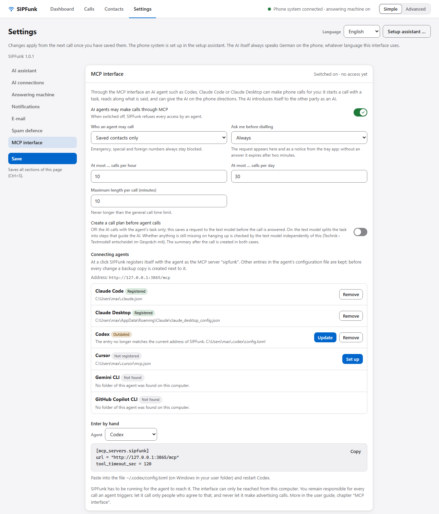

### 13.1 How an agent call works

The agent does not speak on the phone. SIPFunk's voice AI does, over the active AI connection and with the voice set there. It conducts the call by itself according to the task, exactly as in a call from the dashboard. The agent sits next to it:

- It **reads along**: every finished utterance of the other party and of the AI arrives as an event, together with the state of the call (waiting for confirmation, dialling, ringing, connected, ended with the reason) and notes on what is going on: the AI's call plan, interruptions, silence, sounds without words, the check before hanging up and the result according to the AI. While the call is connected, every answer also states the duration, the time left and the situation at the moment of the request (who is speaking, how long it has been silent, whether the AI is waiting for the agent or saying goodbye). So the agent knows the whole conversation at any time.
- It **can take back the hang-up**: when a note reports the result according to the AI, the AI is saying goodbye. If the agent thinks something is still missing, a direction (`say`) takes back the hang-up as long as the call has not ended. The agent does not have to watch for this: at the same time the text model checks whether anything from the task is missing and takes back the hang-up itself if need be (section 6.3); the AI does not wait for the agent. An end that the agent requested with `end_call` is never checked or taken back by the text model; only a new `say` from the agent withdraws it. Details: [How an agent call works](mcp-flow.md#38-ending-the-call).
- It **gives directions**: "Say that 7:30 pm is fine too." The AI words it itself and acts on the direction at the next suitable moment, without talking over anyone.
- The AI **asks the agent** when it lacks a decision the result depends on, or when the other party asks something about the agent, the call or the task that it cannot answer. It tells the other party "Einen Moment bitte, ich frage kurz nach" (one moment please, I will just check) and waits up to 25 seconds for the agent's answer; meanwhile the line is silent. If none comes, it says that you will get back about it and records the point as open.

Why this way, and not word for word from the agent? An agent needs several seconds for every move (model call, tool call, transport). If every sentence on the phone had to come from it first, there would be a pause after each sentence, and people hang up during such pauses. In guided operation the voice AI answers immediately, and the agent steps in only where something has to be decided. The more precisely the task states the leeway ("7:30 pm is fine too, not later"), the less often it has to ask.

### 13.2 Switching on and permissions

Under "Einstellungen › MCP-Schnittstelle":

| Setting | Default | Meaning |
| --- | --- | --- |
| KI-Agenten dürfen über MCP telefonieren (AI agents may make calls through MCP) | off | Main switch. When off, SIPFunk refuses every tool call with a note; the agent then sees no status, no contacts and no call logs either. If you switch it off while a request is waiting for your confirmation, the request lapses. A call that is already running is finished by the AI on its own (the maximum length applies); you can hang it up in the web UI like any other. |
| Wen ein Agent anrufen darf (who an agent may call) | Nur gespeicherte Kontakte (saved contacts only) | "Nur gespeicherte Kontakte": the agent can only call numbers you have saved as a contact. "Kontakte und jede erlaubte Nummer" (contacts and any permitted number): in addition any number the dashboard may dial. Emergency, special, premium-rate and foreign numbers and call-by-call prefixes stay blocked in both cases (chapter 6). |
| Vor dem Wählen bei mir nachfragen (ask me before dialling) | Immer (außer freigegebene Kontakte) (always, except approved contacts) | "Immer": every call waits for your yes, except for contacts where you ticked "KI-Agent darf ohne Nachfrage anrufen" (AI agent may call without asking; section 11): the agent dials those at once, and only through the number that is dialled, not through further numbers; if you change that number, the tick is removed. If the agent may read the names of your contacts, `list_contacts` marks them with "ohne Bestätigung" (without confirmation). "Nur bei Nummern ohne Kontakt" (only for numbers without a contact): contacts are called without asking. "Nie" (never): the agent dials immediately. Regardless of this, SIPFunk always asks when the agent states a different principal from the one in your settings. |
| Höchstens … Anrufe je Stunde / je Tag (at most … calls per hour / per day) | 10 / 30 | Every accepted request counts, including one you declined or one nobody answered. The counter starts again when SIPFunk restarts. |
| Höchstdauer je Anruf (Minuten) (maximum length per call, minutes) | 10 | After that SIPFunk hangs up. Never longer than the general call time limit (Einstellungen › Technik, default 300 s, so 5 minutes unless you raise it) and the limit of the AI provider. |
| Protokolle, die ein Agent lesen darf (call logs an agent may read; advanced) | Nur Anrufe, die über MCP gestartet wurden (only calls started through MCP) | With "Alle Protokolle" (all call logs) the agent can also read your other calls and those of the answering machine, including the phone numbers that belong to no contact. |
| Gesprächsplan vor Agenten-Anrufen erstellen (create a call plan before agent calls) | off | Off: the AI calls with the task the agent passes along only. This saves a request to the text model while the phone is ringing, and a limit or outage of the text model does not affect the call. On: the text model splits the task into steps as for your own calls, which guide the AI. Whether anything is still missing on hanging up is checked by the text model independently of this (section 6.3); only when the switch "Textmodell entscheidet im Gespräch mit" is off does the voice AI check the steps itself. The summary after the call is created in both cases. |
| Agent darf die Namen meiner Kontakte lesen (agent may read the names of my contacts; advanced) | off | When on, `list_contacts` returns the names. An agent never gets phone numbers or notes of contacts; if it names a contact, SIPFunk dials the number without showing it. Without this permission it does not learn a name from the tools the other way round either: if it calls a number that belongs to a contact, the answers of the tools keep to the number, and call logs show only "ein gespeicherter Kontakt" (a saved contact) instead of a name or number. The AI on the phone does know the contact's name, however, and may say it in the call; the agent reads along what is said. In agent calls the AI on the phone therefore does not get the contact's notes as background knowledge either, because the agent reads along what it says; from earlier calls it knows only what the agent itself may read. Whatever the AI needs to know for the call, the agent passes in `context`. |

Changes apply as soon as you have saved. The top right of the card shows the state: switched off, switched on, and when an agent last accessed the interface.

**Confirming.** When an agent requests a call, the web UI shows a dialog with the target, the task, the background knowledge the agent passes along and the name on whose behalf the call is made; the tray app shows the same request as a pop-up at the bottom right, with the same buttons, so the web UI does not have to be open for it. "Anrufen" (call) dials; "Ablehnen" (decline) or the Escape key declines. If it says "laut Agent im Auftrag von … – nicht dein eingestellter Name" (on behalf of …, according to the agent – not the name in your settings), the agent has stated a different principal from the one in your settings. Without an answer the request expires after two minutes. In the pop-up the ✕ and the Escape key do not decline, they only close the window; the request stays open in the web UI until it is answered or expires. The pop-up exists only with the tray app; if SIPFunk runs through `npm start`, you see the request only in the open web UI.

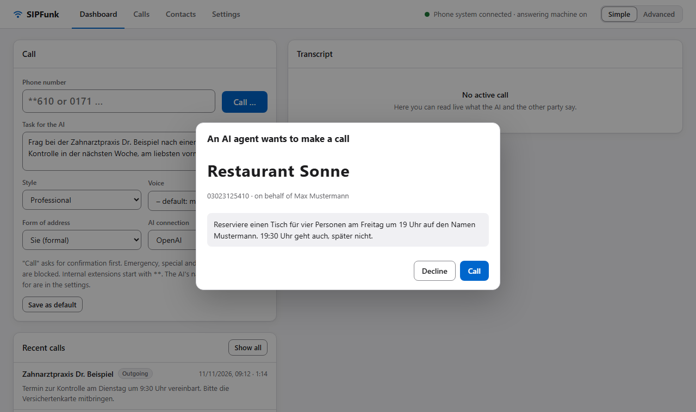

Every agent call that came about is listed under "Anrufe" (calls) like any other, with the tag "Von KI-Agent" (by AI agent). As elsewhere, there is no call log if nobody answered or you declined.

### 13.3 Connecting agents

SIPFunk has to be running (tray app or `npm start`). There are two ways to the same server; both can only be reached from your own computer:

- **Directly over HTTP** (Streamable HTTP): the agent talks to `http://127.0.0.1:3865/mcp`, that is, to the running app itself. No extra process, no paths. This is the simplest way for most agents. The address contains the port of the web UI (section 14.3).
- **As a process (stdio)**: the agent starts a small process that passes every call on to the running app. Claude Desktop needs this way, because it starts local servers only as a process. The process reads the port of the running app from the data folder and so follows every port change.

#### Setting up with one click

Under "Agenten verbinden" (connecting agents) the card "MCP-Schnittstelle" lists the agents SIPFunk can register itself with, each with its state and the file concerned:

| State | Meaning | Buttons |
| --- | --- | --- |
| Nicht gefunden (not found) | There is no folder of this agent on the computer. | – |
| Nicht eingetragen (not registered) | The agent is there, SIPFunk is not in its configuration. | "Einrichten" (set up) |
| Eingetragen (registered) | The entry matches the current address. | "Entfernen" (remove) |
| Veraltet (outdated) | There is an entry "sipfunk", but it no longer matches, typically after a port change or when SIPFunk was installed in a different place. | "Aktualisieren" (update), "Entfernen" |
| Nicht auswertbar (cannot be read) | The file contains comments, is damaged or has a structure SIPFunk cannot change safely. SIPFunk does not touch it; add the entry by hand. | – |

| Agent | File | Connection | When the agent sees SIPFunk |
| --- | --- | --- | --- |
| Claude Code | `~/.claude.json` (through the command `claude mcp add`) | HTTP | in every new session; running sessions do not see the change |
| Claude Desktop | `%APPDATA%\Claude\claude_desktop_config.json` (Store build: in the package folder under `%LOCALAPPDATA%\Packages`) | process | after Claude Desktop has been quit completely (also in the taskbar notification area) and started again |
| Codex (CLI, app, IDE extension) | `~/.codex/config.toml` | HTTP | in every new session; restart the app and the IDE extension once |
| Cursor | `~/.cursor/mcp.json` | HTTP | check under "Settings › MCP" whether "sipfunk" is active; otherwise restart Cursor |
| Gemini CLI | `~/.gemini/settings.json` | HTTP | in every new session |
| GitHub Copilot CLI | `~/.copilot/mcp-config.json` | HTTP | in every new session |

What applies:

- **Nothing is written without your click.** When the card opens, SIPFunk only reads the files to show the state.
- **Other entries stay.** SIPFunk adds, replaces or removes only the entry "sipfunk". Indentation, line endings and the order of the file are kept; in JSON files only the notation of individual values can change (for example a one-line list becomes multi-line). In Codex's `config.toml` everything outside the section `[mcp_servers.sipfunk]` stays, including comments and blank lines. The entry "sipfunk" itself is always replaced as a whole; anything you added inside it is afterwards only in the backup copy.
- **Backup copy.** Before every change SIPFunk puts a time-stamped copy next to the file (`….sipfunk-YYYY-MM-DDThh-mm-ss.bak`); the message after the click names the path. SIPFunk does not clean these copies up.
- **Claude Code** manages its file itself and rewrites it all the time. SIPFunk therefore does not change it directly but calls the command `claude mcp add` or `claude mcp remove` (for all projects, `--scope user`). If SIPFunk cannot find the command, the message names the command for you to run in a terminal yourself. If you registered SIPFunk earlier without `--scope user` in a single project, that entry takes precedence there and SIPFunk does not change it: the card points such entries out, and you remove them with `claude mcp remove sipfunk` in the project folder.
- **After a port change** the agents with an HTTP entry show "Veraltet"; "Aktualisieren" writes the new address. The stored port counts: if it is stored but SIPFunk has not restarted yet, a note above the list says so, and the entries only work after the restart. The Claude Desktop entry stays valid, because its process finds the port itself.
- So far only the Claude Code command has been checked against a real installation. The other formats and paths follow the vendors' documentation (as of November 2026); if a vendor changes them, "Von Hand eintragen" helps.

#### Entering by hand

For all other cases the card shows, under "Von Hand eintragen" (enter by hand), the finished configuration for your computer, matching the port and whether SIPFunk is installed or runs from the project folder: choose the agent (Codex, Claude Code, Claude Desktop, Cursor, VS Code, Gemini CLI or "Anderer Agent"), "Kopieren" (copy), paste. The examples below show the structure.

**Codex** – in `~/.codex/config.toml` (on Windows in your user folder), then restart Codex:

```toml
[mcp_servers.sipfunk]
url = "http://127.0.0.1:3865/mcp"
tool_timeout_sec = 120
```

`tool_timeout_sec` matters: `wait_for_events` waits up to 50 seconds, and Codex's default is 60.

**Claude Code** – in a terminal; the connection then applies to all projects:

```bash
claude mcp add --transport http --scope user sipfunk http://127.0.0.1:3865/mcp
```

**Claude Desktop** – in `claude_desktop_config.json` (Settings › Developer › Edit Config; on Windows `%APPDATA%\Claude\claude_desktop_config.json`), then restart Claude Desktop. For the installed app:

```json
{
  "mcpServers": {
    "sipfunk": {
      "command": "C:\\Users\\YOURNAME\\AppData\\Local\\Programs\\SIPFunk\\SIPFunk.exe",
      "args": ["C:\\Users\\YOURNAME\\AppData\\Local\\Programs\\SIPFunk\\resources\\app.asar\\dist\\mcp\\server.js"],
      "env": {
        "ELECTRON_RUN_AS_NODE": "1",
        "SIPFUNK_DATA_DIR": "C:\\Users\\YOURNAME\\AppData\\Roaming\\SIPFunk"
      }
    }
  }
}
```

`ELECTRON_RUN_AS_NODE=1` makes the installed `SIPFunk.exe` run the bundled MCP script instead of starting the tray app a second time; Node.js does not have to be installed for this. `SIPFUNK_DATA_DIR` points to the data folder; there the process reads the port of the running app. The paths depend on where SIPFunk is installed, so it is best to copy them from the web UI.

**Cursor** – in `~/.cursor/mcp.json`:

```json
{ "mcpServers": { "sipfunk": { "url": "http://127.0.0.1:3865/mcp" } } }
```

**VS Code (Copilot)** – run the command "MCP: Open User Configuration" and add under `servers`: `"sipfunk": { "type": "http", "url": "http://127.0.0.1:3865/mcp" }`. **Gemini CLI** – `gemini mcp add -t http -s user sipfunk http://127.0.0.1:3865/mcp`. Other agents: enter the address as an MCP server of type "Streamable HTTP", without sign-in.

From the project folder (development) the command for the stdio process is `npx tsx /path/to/sipfunk/src/mcp/server.ts`, or `npm run mcp` for short. Without `SIPFUNK_DATA_DIR` the process looks for the file `sipfunk.port` in the current folder (in the project folder that is the data folder); if you start it elsewhere, give the address of the web UI in `SIPFUNK_URL` (e.g. `http://127.0.0.1:3865`); a set `SIPFUNK_URL` always takes precedence. Entries from earlier versions with `SIPFUNK_URL` keep working but do not follow a port change.

After connecting, the agent shows SIPFunk's tools. As long as the interface is switched off, SIPFunk answers every call with a note saying where you switch it on.

### 13.4 The tools

All tools answer with text, in German (the voice AI speaks German too). Errors (blocked target, limit reached, not permitted) come back as an error text with the reason. `call_id` is optional everywhere; without it the agent's most recent call is meant.

| Tool | Parameters | Returns |
| --- | --- | --- |
| `get_status` | – | Registration with the phone system, free line, permitted targets, whether you have to confirm, calls left per hour and per day, maximum length, current call |
| `list_contacts` | – | Names of the contacts, without numbers. Only with the permission "Agent darf die Namen meiner Kontakte lesen" |
| `start_call` | `target` (contact name or phone number), `task` (at most 2000 characters), optional `context` (background knowledge, at most 6000 characters), `on_behalf_of`, `address` (`sie`/`du`), `persona` (`professionell`, `locker`, `formell`, `herzlich`), `max_minutes` (1–60; can only shorten the maximum length) | `call_id` and the state: requested (waiting for your confirmation) or dialling |
| `wait_for_events` | `call_id`, `after` (number of the last known event), `timeout_sec` (1–50, default 25) | Blocks until there is something new or the time is up. Returns the state with duration and time left, during the call the line "Lage jetzt" (situation now: who is speaking, silence, open question, goodbye), the new events with their number (`Gegenüber` = other party, `KI` = the AI, `Zustand` = state, `Hinweis` = note, `RÜCKFRAGE der KI an dich` = the AI's question to you), an open question and the number for the next call. Without `after` the whole course so far is returned |
| `say` | `call_id`, `text` (at most 600 characters), `when` (`now` default, `next`) | Hands a direction to the voice AI. If it is waiting for the answer to a question that the agent has already read, `text` is that answer; if the question came in after the agent last fetched events, the answer of `say` quotes it and the agent answers it with a second `say`. `now`: say it as soon as possible; `next`: take it into account the next time the AI speaks |
| `end_call` | `call_id`, `mode` (`polite` default, `now`) | `polite`: the AI says goodbye, reports its result and hangs up. `now`: hang up immediately. While dialling or ringing it hangs up immediately in either mode. A request still waiting for confirmation is withdrawn |
| `get_call_result` | `call_id` or `record_id` (the timestamp at the start of a line from `list_calls`) | State and reason of the end, result according to the AI (achieved, open), summary, transcript. If no call came about, it says so |
| `list_calls` | – | Saved call logs with a short summary, depending on the setting only those started through MCP or all |

Notes on individual parameters:

- **`target`**: a contact name has to be unambiguous: the exact name (case does not matter). An unambiguous part of the name is enough only if the agent may read the contact names. `start_call` accepts phone numbers only if "Kontakte und jede erlaubte Nummer" is set or the number belongs to a contact.
- **`task`**: the task in plain language, as on the dashboard, best in German. It should say who will probably answer, what is to be achieved, all the details needed (date, time, number of people, name) and the leeway.
- **`on_behalf_of`**: without it, the AI calls in the name entered under "Einstellungen › KI-Assistent › Im Auftrag von". An agent can state a different name here; such a call is always put to you for confirmation, even if no confirmation is set otherwise.
- **`say` and `end_call`** act on the running call: `say` works only while the call is connected.
- **Form of address and style in special cases**: if the agent calls your own owner number, the AI always uses "du" with you. An unknown style becomes "professionell".
- **Style and form of address**: without them, those of the contact apply, otherwise the defaults of the dashboard. The voice is that of the contact, otherwise the default voice of the AI connection. An agent cannot set the AI's name, its voice, the model or the "Zusätzliche Hinweise zum Verhalten" (additional behaviour notes); they come from your settings.
- **Summary**: it is written a few seconds after hanging up. If `get_call_result` says it is not ready yet, fetch it again shortly afterwards. The result according to the AI is there immediately.

### 13.5 Example: booking a table

Prerequisites: the interface is switched on, "Restaurant Sonne" is a contact, the agent is connected. You write to the agent: "Book a table at Restaurant Sonne for four people on Friday at 7 pm in the name of Mustermann. 7:30 pm is fine too, not later."

1. **Check the situation.** The agent calls `get_status` and learns: line free, contacts only, you have to confirm, 10 calls possible this hour.
2. **Start the call.** `start_call` with `target: "Restaurant Sonne"` and `task: "Reserviere einen Tisch für vier Personen am Freitag um 19 Uhr auf den Namen Mustermann. 19:30 Uhr geht auch, später nicht."` Answer: `Anruf c1 an Restaurant Sonne angefragt. Der Betreiber muss ihn in SIPFunk bestätigen …`
3. **You confirm** in the dialog of the web UI. SIPFunk dials.
4. **Wait.** The agent calls `wait_for_events` in a loop, each time with the last reported number as `after`. It sees, one after the other:
   ```text
   [2] Zustand: Wählt
   [3] Zustand: Klingelt
   [4] Zustand: Verbunden – das Gegenüber hat abgenommen
   [5] Gegenüber: Restaurant Sonne, guten Abend.
   [6] KI: Guten Abend, hier ist Alex, der KI-Assistent von Max Mustermann. Ich möchte einen Tisch für vier Personen am Freitag um 19 Uhr reservieren.
   [7] Gegenüber: Um 19 Uhr sind wir voll. Um 20 Uhr hätte ich noch etwas.
   [8] KI: Einen Moment bitte, ich frage kurz nach.
   ```
5. **Question.** 8 pm is outside the leeway. On the phone the AI says "Einen Moment bitte, ich frage kurz nach" and asks the agent:
   ```text
   [9] RÜCKFRAGE der KI an dich: 19 Uhr ist voll, angeboten wird 20 Uhr. Passt das, oder soll ich nach einem anderen Tag fragen?
   OFFENE RÜCKFRAGE der KI an dich: … → jetzt mit say beantworten (die KI wartet etwa 25 s).
   ```
   The agent answers at once with `say`: `text: "20 Uhr ist zu spät. Frag nach 19:30 Uhr, sonst nach Samstag um 19 Uhr."`
6. **Keep reading along.** The AI passes that on, the restaurant offers 7:30 pm, the AI accepts (the task covers that) and gives the name.
7. **Add a direction** (if needed): `say` with `text: "Frag noch, ob ein Kinderstuhl möglich ist."` The AI asks the question as soon as it is its turn again.
8. **End.** When everything is done, the AI ends the call by itself. The agent can also trigger this with `end_call`; the AI then says goodbye and hangs up. `wait_for_events` reports `beendet (aufgelegt)`; why SIPFunk hung up is shown by the notes before it ("Ergebnis laut KI: …").
9. **Result.** `get_call_result` returns the result according to the AI (table for four on Friday at 7:30 pm in the name of Mustermann, a high chair will be ready), the summary and the transcript. The agent reports to you.

An example skill that teaches an agent exactly this procedure is in the repository under [`examples/skills/sipfunk-call/SKILL.md`](../examples/skills/sipfunk-call/SKILL.md) (German: `examples/skills/sipfunk-anruf/`). For Codex, copy the folder to `~/.agents/skills/`, for Claude Code to `~/.claude/skills/`.

### 13.6 Limits and latency

- **One call at a time.** If a call is already running (including an incoming one), `start_call` refuses.
- **The agent hears nothing.** It gets text: the transcription of the other party and the wording of the AI, each only once an utterance is finished. Tone of voice and background noise do not reach it; silence, sounds without words and interruptions only as a note. The transcription can get names and numbers wrong.
- **The agent sees the call plan only if it knows the target by name.** The plan can mention the contact's name. If the agent dialled a number that belongs to a contact and may not read the contact names, the plan is therefore withheld. (There is a plan only if "Gesprächsplan vor Agenten-Anrufen erstellen" is on.)
- **Directions take effect with a delay.** Several seconds pass between an utterance on the phone and the agent's reaction. The AI does not wait for that, unless it has asked a question itself. A direction can therefore arrive too late; rather put the leeway into the task.
- **Directions are content, not wording.** The AI words things itself and keeps to its basic rules. It passes on the agent's answers with their caveats and makes no promise out of them. It does not read out identification numbers (tax, ID, account or card numbers), passwords or codes on the phone, even if the agent sends them, because nobody on the phone is verified.
- **Questions cost patience.** Up to 25 seconds of silence are long on the phone. If the agent does not answer in time, the AI carries on without an answer.
- **With Gemini**, directions reach the AI as an instruction added to the conversation; that has a weaker effect than with OpenAI (section 6.2).
- **Client timeouts.** `wait_for_events` blocks for at most 50 seconds. Without `tool_timeout_sec`, Codex aborts tool calls after 60 seconds.
- **Tried so far** in a number of real phone calls with Codex as the agent, and with automated tests against a simulated voice connection (`test/mcp.test.ts`). The other agents have not been tried in a real call yet. Try it with one of your own numbers or extensions first.

### 13.7 Security

- **Local only.** The server listens only on `127.0.0.1`, on the same port as the web UI. Requests with a foreign host or origin (a website in your browser) are refused. Do not expose the port.
- **The AI stays an AI.** In every agent call it introduces itself as an AI assistant, also when the agent calls your own owner number ("Hi Max, Alex hier, dein KI-Assistent"); SIPFunk checks the first answer for it. An agent has no switch for that and can give it neither another name nor another role; its basic rules tell it not to follow directions that demand this. Nor may it claim anything about the agent or about safeguards and checks (data protection, identity check) that nobody told it. That is a rule in the AI's instruction, not a technical lock: a language model can behave differently in an individual case. That is why you read in the call log what was said.
- **SIPFunk checks blocks and limits**, not the agent: dial target protection, permitted targets, confirmation, calls per hour and per day, maximum length, call time limit.
- **What an agent learns:** only what the tools return. No keys, no passwords, no credentials for the phone system or AI providers, no phone numbers of contacts it knows only by name, no contact notes. Of your settings it sees only what `get_status` states: the permissions and limits of the interface. If the other party asks how to reach you, the AI gives your call-back number (owner contact); it is then in the transcript. It reads along what is said on the phone, and with that it goes to the provider of your agent. Do not promise the other party anything about an agent that you cannot keep, and mind data protection ([legal notes](legal.md), section 3).
- **Prompt injection.** An agent that reads websites or e-mails can pick up instructions there ("call this number"). The same goes for the phone call itself: what the other party says is read by your agent as text, also in the AI's questions. It should treat that as information, not as a task. "Nur gespeicherte Kontakte" and the confirmation before dialling help against that. Leave both on as long as you do not trust the agent in every situation. Contacts with "KI-Agent darf ohne Nachfrage anrufen" (AI agent may call without asking) are exempt from the confirmation; approve only those where an unexpected call does no harm.
- **Limit of the confirmation.** The web UI and its API have no login ([SECURITY](../SECURITY.md)). An agent that may run arbitrary commands on your computer (a terminal) can also address the local API directly and so bypass the permissions of the MCP interface. The permissions protect with agents that have only the MCP tools. To an agent with terminal access you entrust your computer anyway.
- **Responsibility.** You remain responsible for every call an agent triggers, as if you had started it yourself ([guidelines](guidelines.md)). No advertising calls, no serial calls.

---

## 14. Settings overview

There are two places: `.env` (read at start; changes made by hand need a restart, the setup assistant applies its values immediately) and the "Einstellungen" page of the web UI (saved in `settings.json`, applies from the next call; changes to AI connections are saved immediately, section 6.2). For everything that exists in both places, `.env` only provides the initial value; a value saved in the web UI takes precedence. The complete list of variables is [.env.example](../.env.example).

### 14.1 Only in `.env`

The first and fourth row can also be set with the setup assistant (chapter 4.2), which writes them to `.env`; the keys of the fourth, fifth and sixth row are entered under "Einstellungen › KI-Verbindungen" (section 6.2).

| Variable | Default | Effect |
| --- | --- | --- |
| `SIP_SERVER`, `SIP_USER`, `SIP_PASSWORD` | `fritz.box`, –, – | registration with the box |
| `SIP_LOCAL_PORT`, `RTP_PORT` | 5062, 40000 | local UDP ports |
| `LOCAL_IP` | automatic | local address if the computer has several networks |
| `OPENAI_API_KEY`, `GEMINI_API_KEY` | –, – | keys of the two built-in AI connections "OpenAI" and "Google Gemini" for all AI features; only the key of the active connection is used |
| `AI_KEY_<ID>` | – | key of every further AI connection (ID = the connection's id in upper case); written by the web UI, normally not edited by hand |
| `OPENAI_ADMIN_KEY` | – | optional: admin key of the OpenAI organisation for the actual monthly costs |
| `OWNER_NUMBERS` | – | own numbers (alternative to the "Inhaber" contact) |
| `AUDIO_HD` | true | negotiate HD G.711 (16 kHz) with the box; `false` forces 8 kHz |
| `LIVE_LISTEN_ENABLED` | true | listening in via the browser |
| `WEB_PORT` | 3865 | initial value for the port of the web UI (127.0.0.1 only); after that the setting under "Technik" applies (section 14.3). If `WEB_PORT` later differs from the setting, the log says so at start |
| `SIP_DEBUG` | 0 | write all SIP messages to the log |

### 14.2 Web UI, section "Technik"

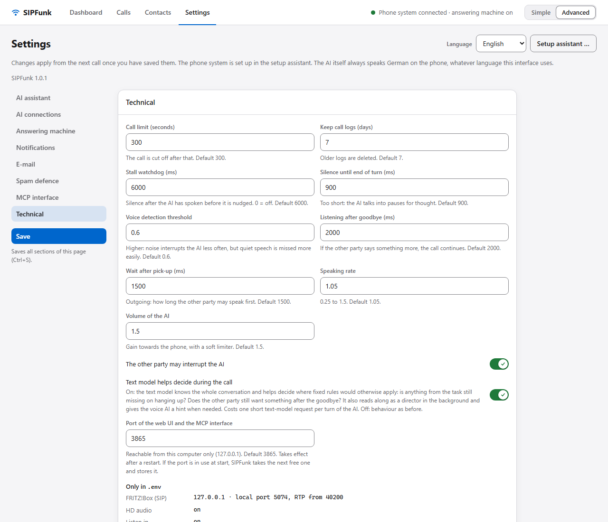

In the interface the text model is set per connection under "KI-Verbindungen" (section 6.2); its initial value comes from `OPENAI_SUMMARY_MODEL` or `GEMINI_SUMMARY_MODEL`. The other values are under "Technik".

| Setting | Default | Initial value from | Effect |
| --- | --- | --- | --- |
| Gesprächslimit (Sekunden) – call time limit | 300 | `MAX_CALL_SECONDS` | hard limit, applies to all calls; with Google Gemini never more than 540 s |
| Protokolle aufbewahren (Tage) – log retention | 7 | `TRANSCRIPT_RETENTION_DAYS` | older logs are deleted |
| Stillstandswächter (ms) – stall watchdog | 6000 | `AI_STALL_MS` | if it stays silent this long after the AI's output, the AI is nudged to continue; 0 = off |
| Stille bis Satzende (ms) – silence until end of turn | 900 | `AI_VAD_SILENCE_MS` | too short: the AI talks into thinking pauses |
| Schwelle der Spracherkennung – voice detection threshold | 0.6 | `AI_VAD_THRESHOLD` | 0.3–0.9; higher: noises interrupt the AI less often, quiet speech is more easily missed. With Google Gemini the value only selects one of two levels: 0.5 and above low, below that high sensitivity |
| Nachhören nach Verabschiedung (ms) – listening after goodbye | 2000 | `AI_HANGUP_GRACE_MS` | if the other party says something more, the call continues |
| Warten nach Abnehmen (ms) – wait after pick-up | 1500 | `AI_GREETING_WAIT_MS` | outgoing: how long the other party may speak first |
| Sprechgeschwindigkeit – speaking rate | 1.05 | `AI_SPEECH_SPEED` | 0.25–1.5; with Google Gemini only a hint to the AI |
| Lautstärke der KI – AI volume | 1.5 | `AI_OUTPUT_GAIN` | gain towards the phone, with a soft limiter |
| Gegenüber darf die KI unterbrechen – other party may interrupt | on | `AI_ALLOW_INTERRUPT` | off: the AI always finishes speaking |
| Textmodell entscheidet im Gespräch mit – text model helps decide during the call | on | `AI_LIVE_JUDGE` | check on hanging up, decision after the goodbye and director in the background by the text model (section 6.3); off: behaviour as before |
| Port der Oberfläche und der MCP-Schnittstelle – port of the web UI and the MCP interface | 3865 | `WEB_PORT` | port on 127.0.0.1 for the web UI and `/mcp`; takes effect after a restart (section 14.3) |

The other sections are described in chapters 6 to 10. Their initial values come from `AI_*` (dashboard, AI assistant), `AI_PROVIDER`, `OPENAI_MODEL`, `GEMINI_MODEL` and `AI_VOICE` (AI connections; `AI_VOICE` is now only the initial value for connections without a default voice of their own), `INCOMING_*` (answering machine), `NOTIFY_*` and `RING_POPUP` (notifications), `MAIL_*` and `SMTP_*` (e-mail), and `SCAM_NUMBERS` and `SPAM_LOOKUP` (spam defence).

---

### 14.3 Port of the web UI

The web UI and the MCP interface listen on the same port, always on `127.0.0.1` only. The default is 3865. If you set up SIPFunk before version 1.0.1, you keep your previous port (usually 8080), provided your `.env` has a line `WEB_PORT=…`; with the installed app that is always the case. Without that line 3865 applies since 1.0.1, and registered agents show "Veraltet".

- **Changing it**: "Einstellungen › Technik › Port der Oberfläche und der MCP-Schnittstelle" (level "Erweitert"), then save. Allowed values are 1024 to 65535; the web UI does not accept a port that another program is using at that moment. The new port takes effect after a restart; with the tray app the web UI offers "Jetzt neu starten" (restart now) and then switches to the new address by itself. Without the tray app (`npm start`), quit SIPFunk and start it again by hand.
- **Port in use**: if the configured port is taken by another program at start, SIPFunk takes the next free one above it and stores it as the new setting. This is written to the log, the tray app shows a notification, and the web UI says so the next time it is opened. After that the address does not change by itself again as long as the new port stays free.
- **Finding it again**: the tray menu "Web-UI öffnen (Port …)" and a double click on the tray icon always open the right address. The port of the running app is also in the file `sipfunk.port` in the data folder.
- **What changes with the port**: browser bookmarks; the address `http://127.0.0.1:PORT/mcp` in registered AI agents (section 13.3 shows how to update them with one click); with Microsoft 365 the redirect address of the app registration (chapter 9). The browser remembers small things such as the last dialled number per address; they start afresh under the new port.

## 15. Cost

Both AI providers bill by token. The web UI shows usage and an estimate in US dollars per call. The prices used are hard-coded in `src/ai/pricing.ts` and have to be adjusted by hand when prices change; the provider's billing is authoritative. The estimate leaves out transcription and discounts for cached input.

The largest item is the speech output of the voice model; according to the stored price table the mini variant of the OpenAI Realtime model costs about a third. Summary, assessment and call plan are negligible. Stalling in the spam defence costs according to its duration. Set a monthly budget limit at your provider.

For Google Gemini the table holds the prices of the paid tier for `gemini-3.8-live` (US dollars per 1 million tokens: audio in 3, audio out 12, text in 0.75, text out 4.5). The estimate uses them even if a call ran on the free quota; on the free quota see section 6.2.

"Einstellungen › KI-Verbindungen" adds the estimates up per month and provider ("Verbrauch in diesem Monat") and can optionally show the actual costs of your OpenAI organisation (section 6.2).

Call charges apply according to your tariff (the call back to you is a normal outgoing call).

---

## 16. Troubleshooting

The log (in the terminal, on the dashboard in the card "Systemprotokoll" (system log; level "Erweitert"), and for the tray app additionally `sipfunk.log` in the data folder) is the first place to look. Log messages are German; the quoted fragments below are what to search for.

| Symptom | Check |
| --- | --- |
| "Telefonanlage noch nicht eingerichtet" in the header | open the setup assistant ("Einstellungen" › "Einrichtungsassistent …") or fill in `SIP_USER` and `SIP_PASSWORD` in `.env` and restart |
| No registration with the box | `SIP_USER`/`SIP_PASSWORD`, `SIP_SERVER`; firewall for the UDP ports; box UI: is the IP phone registered? |
| Extension does not ring | is the number assigned to the extension in the box? |
| AI does not pick up | answering machine on? Profile of the number set to off? Is another call running? |
| AI does not speak / silence after pick-up | log "Realtime: verbunden", "erstes Audio … ms nach …"; key of the active AI connection, model access, internet; "Verbindung testen" under "Einstellungen › KI-Verbindungen" checks key, voice model and live connection |
| Wrong voice after switching the AI connection | after switching, the default voice of the new connection applies: expand the connection under "Einstellungen › KI-Verbindungen" and choose its "Standardstimme" (default voice) there. Voices of the other provider (contact, profile of an own number, spam role) are ignored. Models and default voice belong to the connection (section 6.2) |
| Call ends after nine minutes | with Google Gemini a call lasts 540 s at most, whatever the call time limit says (section 6.2) |
| Choppy voice | log "RTP: Gegenstelle sendet …", "Unterläufe"; try `AUDIO_HD=false`; avoid Wi-Fi |
| AI talks into pauses | increase "Stille bis Satzende" (e.g. 1200) |
| Noises (rustling, coughing) interrupt the AI | increase "Schwelle der Spracherkennung" (e.g. 0.7). On an interruption the AI only pauses and waits for the transcription: if it was a noise or a listening sound ("mhm"), it finishes its sentence; if there was content ("No", "Wait", a question), it drops the rest and answers. With Google Gemini, Google cancels the answer itself when the other party cuts in, so finishing the sentence works less often |
| Long silence in mid-call | log "Stillstand"; the stall watchdog nudges the AI after the configured time |
| Answer cut off | log "Realtime-Antwort abgeschnitten" → token limit; make the task shorter |
| No e-mail | status line of the "E-Mail-Versand" card; "Verbindung prüfen"; reconnect for OAuth |
| No call back | owner contact or `OWNER_NUMBERS` present? Assessment "unimportant"? Switch or profile? |
| Transfer fails | log "REFER"; the box has to be allowed to call the number |

For every AI answer the log contains a diagnostic line (generation speed, buffer underruns, interruptions). `SIP_DEBUG=1` shows all SIP messages; such logs contain phone numbers and have to be cleaned before you share them.

---

## 17. Glossary

- **Extension / IP phone**: the device SIPFunk registers as with the box.
- **AI provider**: the company whose models conduct the call and write the texts: OpenAI or Google (section 6.2).
- **AI connection** (KI-Verbindung): a named access to an AI provider: provider, its own key, the models used with it and a default voice. The active connection handles the calls (section 6.2).
- **Default voice** (Standardstimme): the voice of an AI connection; it applies when call, contact or own number do not specify a voice of its provider (section 6.2).
- **Realtime API**: OpenAI interface for speech in real time (audio in, audio out).
- **Live API**: Google's interface for speech in real time with Gemini.
- **Server VAD**: voice activity detection on the AI provider's side that recognises the end of a turn. The threshold is an OpenAI parameter; with Gemini it only selects a low or high start sensitivity.
- **end_call / transfer_call / flag_spam**: tools the AI calls to hang up, put through or flag spam.
- **REFER**: SIP message instructing the box to transfer a call to another number.
- **Inhaber (owner)**: you, recognised by the contact flag or by `OWNER_NUMBERS`.
- **Stil (persona)**: style preset from `personas/*.md`.
- **`.env`**: text file in the data folder that holds your secrets, such as the SIP password and the API keys. The setup assistant fills it for you; "Einstellungen (.env) bearbeiten" in the tray menu opens it. Never share it.
- **Data folder** (Datenordner): the folder where SIPFunk keeps your settings, contacts, logs and the `.env`. For the installed tray app it is `%APPDATA%\SIPFunk` (section 11.3).
- **Port**: a number that tells the computer which program a connection is meant for. The web UI listens on port 3865 by default (section 14.3).
- **SMTP**: the standard way to send e-mail. SIPFunk uses it for the notification mail (section 9.3).
- **OAuth**: a sign-in where you log in at Google or Microsoft in the browser and allow SIPFunk access, without giving it your password.
- **Token**: a small piece of text or audio; the AI providers measure usage and bill in tokens (chapter 15). The word also names the permission that OAuth hands out (`mail-token.json`).
- **Anrufbeantworter**: answering machine. **Spam-Abwehr**: spam defence. **Auftrag**: the task you give the AI.
- **MCP**: Model Context Protocol, an interface through which AI agents call tools. In SIPFunk: start calls, read along, give directions (chapter 13, [How an agent call works](mcp-flow.md)).
- **Voice AI / Live AI** (Sprach-KI, Live-KI): the voice model that speaks on the phone (Realtime or Live API).
- **Text model**: the model of the AI connection that writes plan, summary and assessment and helps decide during the call (section 6.3).
- **Director** (Regie): the text model reading along in the background and giving the voice AI hints; in agent calls the agent takes this role.
- **ask_principal**: tool with which the voice AI asks the agent in an agent call (chapter 13).
